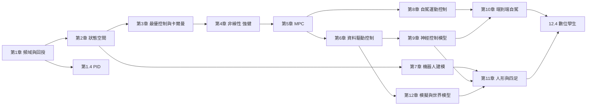

# 控制模型：從經典理論到神經網路控制、自動駕駛、先進機器人與遊戲模擬世界

本書全面探討「控制模型（Control Models）」從經典理論一路推進至現代神經網路控制、端到端自動駕駛、人形與四足機器人全身控制，以及基於遊戲引擎與世界模型的虛擬模擬生態系。前八章建立嚴密的經典與現代控制理論基底，自第九章起大幅擴充與深化，聚焦神經網路動態模型與學習控制的前沿。

全書的核心線索是**理論的前因後果與互相驅動關係**：每一次理論躍進，都是上一代理論的失效模式、新的工程需求（太空競賽、工業自動化、算力革命）與新工具（計算機、GPU、深度學習）共同催生的結果。

---

## 目錄

* 第1章-經典控制理論的黃金時代：回授與頻域分析（19世紀末至20世紀中葉）
    * [1.1-19世紀末-回授機制（Feedback）的數學根源與穩定性判據](01.1-回授機制的數學根源與穩定性判據.md)
    * [1.2-1940年代-傳遞函數（Transfer Functions）與拉普拉斯變換](01.2-傳遞函數與拉普拉斯變換.md)
    * [1.3-1950年代-頻域分析：根軌跡法與伯德圖（Bode Plots）](01.3-頻域分析-根軌跡法與伯德圖.md)
    * [1.4-1950年代-PID 控制器的閉環設計與調參哲學](01.4-PID控制器的閉環設計與調參哲學.md)
* 第2章-現代控制理論：狀態空間法與能控能觀性（1960至1970年代）
    * [2.1-1960年代-從外部輸入輸出到內部狀態空間（State-Space）的典範轉移](02.1-狀態空間的典範轉移.md)
    * [2.2-1960年代-線性系統的能控性（Controllability）與能觀性（Observability）矩陣](02.2-能控性與能觀性矩陣.md)
    * [2.3-1960年代-極點配置（Pole Placement）與全狀態回授調節器](02.3-極點配置與全狀態回授調節器.md)
* 第3章-最佳控制與卡爾曼濾波：面對不確定性的估計（1960至1980年代）
    * [3.1-1960年代-最優控制（Optimal Control）與黎卡提方程（Riccati Equation）](03.1-最優控制與黎卡提方程.md)
    * [3.2-1960年代-線性二次調整器（LQR）的數學推導與實務應用](03.2-LQR的數學推導與應用.md)
    * [3.3-1960年代-貝氏估計的巔峰：卡爾曼濾波（Kalman Filter）與雜訊抑制](03.3-卡爾曼濾波與雜訊抑制.md)
* 第4章-非線性控制、適應性與強健控制（1980至2000年代）
    * [4.1-1980年代-Lyapunov 穩定性理論：能量觀點下的非線性系統穩定分析](04.1-Lyapunov穩定性理論.md)
    * [4.2-1980年代-適應性控制（Adaptive Control）：應對未知參數與系統辨識](04.2-適應性控制.md)
    * [4.3-1990年代-強健控制（Robust Control）與 $`H_\infty`$ 迴圈塑造](04.3-強健控制與H∞迴圈塑造.md)
* 第5章-約束最佳化與模型預測控制（MPC）（1990至2010年代）
    * [5.1-1990年代-模型預測控制（Model Predictive Control, MPC）的核心思想與滾動優化](05.1-模型預測控制的核心思想與滾動優化.md)
    * [5.2-2000年代-有限視界最佳化問題與約束條件處理（State & Input Constraints）](05.2-有限視界最佳化與約束條件處理.md)
    * [5.3-2010年代-顯式 MPC（Explicit MPC）與即時優化求解器（QP Solvers）](05.3-顯式MPC與即時優化求解器.md)
* 第6章-資料驅動控制與強化學習的交匯（2010至2020年代）
    * [6.1-2010年代-系統識別（System Identification）與 Koopman 算子理論](06.1-系統識別與Koopman算子理論.md)
    * [6.2-2010年代-無模型強化學習（Model-Free RL）：Q-learning 與策略梯度在控制中的限制](06.2-無模型強化學習在控制中的限制.md)
    * [6.3-2020年代-模型基底強化學習（Model-Based RL）與神經網路控制函數](06.3-模型基底強化學習與神經網路控制函數.md)
* 第7章-機器人學的基礎運動學與動力學建模
    * [7.1-機械臂的正逆運動學（Forward & Inverse Kinematics）與雅可比矩陣](07.1-機械臂正逆運動學與雅可比矩陣.md)
    * [7.2-Lagrange 與 Euler-Newton 動力學建模：迴轉矩、科氏力與重力補償](07.2-Lagrange與Euler-Newton動力學建模.md)
    * [7.3-操作臂的任務空間與聯合空間阻抗控制（Impedance Control）](07.3-任務空間與聯合空間阻抗控制.md)
* 第8章-傳統自動駕駛與行動載具的運動學控制
    * [8.1-車輛動力學模型：單軌模型（Bicycle Model）與非完整約束](08.1-車輛動力學模型單軌模型與非完整約束.md)
    * [8.2-幾何追蹤控制：純追蹤演算法（Pure Pursuit）與 Stanley 控制器](08.2-幾何追蹤控制純追蹤與Stanley控制器.md)
    * [8.3-低速與高速行車下的路徑規劃與回授迴圈設計](08.3-低速與高速行車下的路徑規劃與回授迴圈設計.md)
* 第9章-現代神經網路的控制模型與深度強化學習架構（2020至2026年）
    * [9.1-神經網路作為動態系統：神經常微分方程（Neural ODEs）與連續時間控制](09.1-神經常微分方程與連續時間控制.md)
    * [9.2-深度模型基底強化學習（MBRL）：DreamerV1-V3 與潛在空間控制迴圈](09.2-深度模型基底強化學習Dreamer與潛在空間控制.md)
    * [9.3-物理感知神經網路（PINN）在控制系統辨識與微分物理中的應用](09.3-物理感知神經網路PINN.md)
    * [9.4-Transformer 架構在時序控制與多模態決策序列中的突破](09.4-Transformer架構在時序控制與多模態決策.md)
* 第10章-自動駕駛的現代神經控制與端到端架構（2023至2026年）
    * [10.1-模組化自動駕駛控制與端到端（End-to-End）神經控制策略的典範轉移](10.1-模組化自動駕駛與端到端神經控制.md)
    * [10.2-視覺-語言-動作模型（VLA）在複雜路況決策與導航中的控制應用](10.2-視覺語言動作模型VLA.md)
    * [10.3-基於神經網路的預測性模型預測控制（Neural MPC）與即時軌跡優化](10.3-Neural MPC與即時軌跡優化.md)
    * [10.4-高動態駕駛安全防護：結合神經控制與控制屏障函數（CBF）的防撞保障](10.4-神經控制與控制屏障函數CBF防撞保障.md)
* 第11章-先進機器人學：人形、四足與多自由度動態平衡控制（2023至2026年）
    * [11.1-步行機器的簡化物理模型：倒單擺模型（LIPM）與質心動力學擴展](11.1-步行機器的簡化物理模型LIPM.md)
    * [11.2-四足與人形機器人的深度強化學習 locomotion（如 Unitree / Boston Dynamics 策略）](11.2-四足與人形機器人的深度強化學習locomotion.md)
    * [11.3-全身控制（Whole-Body Control, WBC）與二次規劃（QP）的實時神經加速](11.3-全身控制WBC與二次規劃的實時神經加速.md)
    * [11.4-具身操作（Embodied Manipulation）：靈巧手與動態抓取的閉環力控](11.4-具身操作靈巧手與動態抓取的閉環力控.md)
* 第12章-遊戲模擬世界、數位孿生與合成資料生成（2024至2026年）
    * [12.1-遊戲模擬器作為控制試驗場：從 Atari、Minecraft 到 Unreal Engine 物理引擎](12.1-遊戲模擬器作為控制試驗場.md)
    * [12.2-基於世界模型（World Models）的虛擬環境生成與想象力規劃（Imagination-based Planning）](12.2-世界模型的虛擬環境生成與想象力規劃.md)
    * [12.3-Sim-to-Real 轉移技術：網域隨機化（Domain Randomization）與系統識別對齊](12.3-Sim-to-Real轉移技術.md)
    * [12.4-大規模數位孿生（Digital Twins）與實時智慧體控制網路的未來願景](12.4-大規模數位孿生與實時智慧體控制網路.md)

---

## 閱讀路線圖

## 全書主軸：回授思想的百年迴圈

| 時代 | 驅動力量 | 核心理論 | 關鍵失效模式（催生下一代） |
|---|---|---|---|
| 1868–1940 | 蒸汽動力、電信與火控 | Routh-Hurwitz、傳遞函數 | 只能處理線性單入單出系統 |
| 1940–1960 | 二戰與太空競賽 | 根軌跡、Bode、PID | 多變數系統、時變軌跡難處理 |
| 1960–1980 | 阿波羅計畫 | 狀態空間、LQR、Kalman 濾波 | 對模型誤差敏感（LQG 裕度缺陷） |
| 1980–2000 | 工業與航空 | Lyapunov、適應性、 $`H_\infty`$ | 無法處理顯式約束 |
| 1990–2010 | 計算機算力爆發 | MPC、QP 求解器 | 模型仍需人工建模 |
| 2010–2020 | 深度學習 | 系統識別、RL、Model-Based RL | 樣本效率、安全性無保證 |
| 2020–2026 | GPU 大規模模擬與基礎模型 | Neural ODE、Dreamer、VLA、CBF | Sim-to-Real 差距、可驗證性 |

全書最後一章（12.4）以數位孿生收束：回授從瓦特的離心調速器出發，歷經百年，最終成為連接物理世界與虛擬世界、貫穿感知-決策-行動的普適架構。
