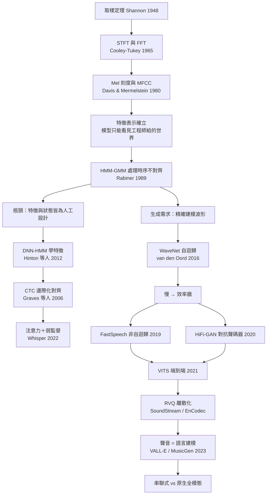
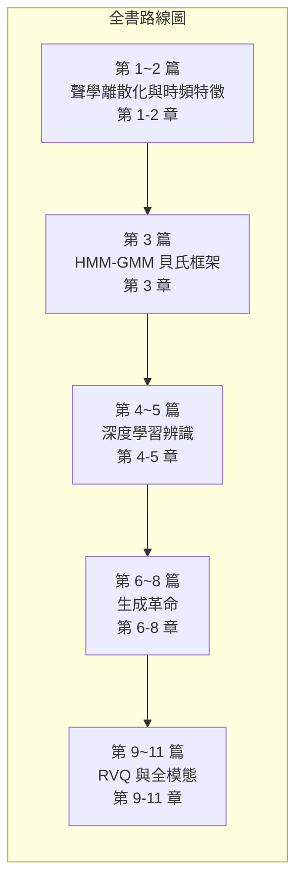
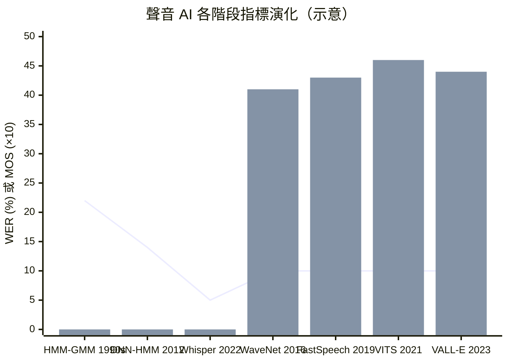

# 0.1 導言：機器如何「聽見」並「開口說話」——聲音 AI 的技術演進脈絡

## 為什麼聲音是最難被馴服的模態

文字是離散的、影像是二維靜止的，而聲音什麼都不是。它是時間軸上的一維連續波形 $`x(t)`$ ，沒有天然的「字」或「物件」邊界，所有語義都攤平在一條上下振盪的曲線上。要把這條曲線交給電腦，第一步是取樣：Shannon 在 1948 年的取樣定理證明，若信號最高頻率為 $`f_{max}`$ ，只要以 $`f_s \geq 2 f_{max}`$ 的速率取樣，波形便可無損重建。語音約在 8 kHz 以上能量可忽略，於是 16 kHz 成為業界通行的取樣率。

這個數字看似平凡，實則埋下了整本書的第一個難題——時間解析的本質取捨連帶著序列長度的爆炸。 以每幀 25 ms 視窗、10 ms 位移計算，每秒產生 100 幀；若以更長的 50 ms 為一幀則 $`T \approx 20`$ 幀/秒，常見的 20 ms 幀移則累積到 $`T \approx 320`$ 幀/秒的粒度。無論如何切，一分鐘語音就是數千到數萬幀，一個小時就是上百萬個時間步——序列長度遠超 RNN 或早期 Transformer 單層所能負荷的排列量級。更根本的是，帶有限頻寬的信號在時間軸與頻率軸上的解析度受制於 Gabor 極限：視窗取長則頻譜精細但時間模糊，視窗取短則反之。這條取捨沒有免費的出路，只會把長序列問題原封不動地推給下游模型。

序列長只是第一重負擔，更麻煩的是這條序列上沒有可靠的地標。 影像裡一隻貓有其輪廓，一段語音裡的子音與母音卻互相滲透、彼此調變：前一個音節的共振峰會拖進下一個音節，音段之間不存在乾淨的切割點。這個現象稱為共同調變（coarticulation），它使得「把波形切成有意義的單位」這件事本身就是一個待解的推論問題，而非前處理步驟。文字處理可以直接從字元開始，聲音處理卻必須先回答「單位在哪裡」，才談得上建模。

三重負擔疊加之後，量化的工程語言就格外殘酷。 以 16 kHz 取樣、25 ms 視窗、10 ms 位移計，一秒語音就是 100 幀、一分鐘是 6000 幀、一小時是 36 萬幀；若改用 20 ms 的較短幀移，幀率立刻升到每秒 50 幀以上，而一個兩百萬字的語料庫若全部轉成逐幀特徵，其規模等同於數十億級的序列。相較之下，一頁英文約六百個字元，一百萬字的三億詞語料在字元級模型裡只是數億個 token，而一小時語音的幀數就足以匹敵數十萬字的文字量。這意味著在深度學習時代，語音從來不是資料不足的模態，而是「資料形狀不對」的模態：它有足夠多的樣本，卻缺少讓樣本能被人類標註與被機器對齊的顆粒度。

更棘手的是感知的非線性。 人耳對頻率的分辨能力隨頻率升高而鈍化：對 100 Hz 與 150 Hz 的差異極為敏感，卻幾乎分不清 4000 Hz 與 4050 Hz。Bark、ERB 與 Mel 刻度正是把這種對數式感知寫成數學，Davis 與 Mermelstein 在 1980 年提出的 MFCC 讓「依人耳加權的頻譜」得以壓縮成十幾個係數，之後統治語音前端整整四十年。換言之，早在任何神經網路出現之前，特徵表示的工程已經替模型劃定了它能「看見」的世界。

| 模態 | 資料形態 | 典型序列長度 | 邊界結構 | 核心難題 |
| --- | --- | --- | --- | --- |
| 文字 | 離散 token | 百~千級 | 字/詞天然分段 | 語義組合性 |
| 影像 | 2D 連續像素網格 | 數十萬像素 | 物件有清晰邊界 | 空間結構 |
| 聲音 | 1D 連續波形 | $`T \approx 320`$ 幀/秒起跳 | 無天然邊界 | 時序對齊＋感知非線性 |

這張表的第四列解釋了為什麼聲音 AI 的工程週期特別長。 文字任務從第一天起就可以做「下一個詞預測」，因為監督訊號與輸入天然同構；影像任務可以在像素網格上做平移不變的卷積，因為空間結構是給定的。聲音卻連「輸入是什麼單位」都必須先發明——視窗函數、幀移、濾波器組、倒頻譜，每一項都是對「單位應該長什麼樣」的回答。換句話說，聲音社群在深度學習出現之前，就已經被迫做了一整套今天稱為「表示學習」的工作，只是那時的名字叫信號處理。理解這段前史，才能理解為什麼本書用整整兩章的篇幅把 STFT 與梅爾濾波器組寫成矩陣，而不是順手帶過。

## 五個階段的依賴關係

本書把聲音 AI 的歷史切成五個互相依賴的階段，它們不是並列的技術清單，而是一條嚴格的因果鏈。

**第一階段是 DSP 與特徵表示的共生** 。 取樣定理與 FFT（Cooley-Tukey 1965）讓連續波形變成可計算的時頻矩陣，Mel 刻度與 MFCC 再讓這個矩陣貼合人耳。這一步的成果是雙刃的：它把維度從每秒 16000 個樣本壓到每幀 39 維特徵，但也把「哪些資訊是重要的」預先寫死——模型從此只能工作在工程師認為重要的特徵空間裡。FFT 在此扮演的角色常被低估：把 $`O(N^2)`$ 的離散傅立葉變換降到 $`O(N \log N)`$ ，才讓逐幀的即時分析在 1960 年代的算力下成為可能，而短時距傅立葉變換用固定長度的加窗截斷，把這份效率換成「時間軸與頻率軸上的解析度守恆」。視窗長度於是成為整部書第一個真正的設計變數：它決定了模型在每一幀裡究竟看見多少個週期，也決定了共同調變會被抹平還是被放大。

**第二階段是機率圖模型接管時序** 。 有了特徵，還要回答一個更根本的問題：語音的聲學幀與文字單位之間沒有一對一的對應，「hello」四個字元對應上百幀，且說話速度因人而異。HMM 以隱狀態建模這種不對齊，Rabiner 在 1989 年的綜述讓 EM 訓練與 Viterbi 解碼成為工業標準；配合 GMM 的發射機率，HMM-GMM 統治了 1980 至 2010 年代的 ASR。這個架構的成就與瓶頸同源——成就來自把貝氏推理拆成聲學模型、發音詞典與語言模型三個可獨立改進的模組，瓶頸則在於狀態設計與特徵設計都是人工的：決策樹回答「哪個音素應該共享哪組參數」，而回答得好不好，取決於語音學家的經驗而非資料。從今天的後見之明看，HMM 真正留下的遺產是「時序結構不必由深度網路獨自承擔」這一課，這一課要到 Transformer 的位置編碼與 CTC 的前向遞歸裡才重新被學清楚。

**第三階段是深度學習先後拆掉兩堵牆** 。 2012 年，Hinton 等人把深度神經網路塞進 HMM 的發射機率位置，DNN-HMM 混血立即讓詞錯誤率相對下降三成，證明特徵可以由資料學出；2006 年 Graves 等人在 *ICML* 提出的 CTC 更直接把「對齊」問題邊際化掉，讓網路輸入輸出長度不必相等。注意力機制隨後把對齊變成可學習的軟權重，終點是 2022 年 Whisper——Radford 等人以 617,000 小時弱監督音訊訓練的 Transformer，讓 ASR 首次展現基礎模型式的泛化。這二十年裡完成的其實是一次角色反轉：手工特徵從「必要的前端」降級為「可選的初始化」，端到端梯度從 MFCC 一直流到解碼圖之外。值得注意的是，HMM 的拓樸結構並未被丟棄，它退居幕後繼續提供語言模型與發音詞典的約束——舊範式最好的部分，總是以更隱蔽的方式活進新範式。

**第四階段是生成革命** 。 合成語音的本質是估計 $`p(x \mid h)`$ ，其中 $`h`$ 是文本或語義表示， $`x`$ 是波形。與辨識不同，生成必須處理一對多的映射：同一句話可以有無限多種合理的音高、語速與音色，模型必須對這個條件分佈的整個形狀負責，而非只挑一個最大值。WaveNet（van den Oord 等人 2016，*arXiv* 1609.03499）用自迴歸條件機率把它精確建模：

$$
p(x) \; = \; \prod_{t=1}^{T} p \left( x_t \mid x_{t-1} , \ldots , x_1 \right)
$$

精確但極慢：每生成一個樣本要跑一次網路，16 kHz 下一秒音訊要一萬六千次前向。 這個效率牆逼出三條並行的出路——FastSpeech（Ren 等人 2019）以非自迴歸並行生成梅爾頻譜、HiFi-GAN（Kong 等人 2020）以對抗訓練把聲碼器加速數百倍、VITS（Kim 等人 2021）把 VAE、Normalizing Flows 與 GAN 縫合成端到端模型。效率問題被解決之後，剩下的就是品質與可控性。 這三條路線的分工值得細看：FastSpeech 解決的是「並行解碼」與「韻律可控」（音高、能量、持續時間被顯式建模為三個可預測的變異數量），HiFi-GAN 解決的是「從梅爾頻譜回波形」這最後一步的品質與速度，VITS 則證明若用變分推導把文本到潛變數的對齊也納入訓練目標，上述兩步可以縫合成一個端到端系統。它們共同把 TTS 的 MOS 從「聽得出是機器」推到了「與真人錄音難以區分」，同時把推理速度推到即時率數十倍以上——這是一項從科學問題轉為工程商品的轉折。

**第五階段是離散化讓渡** 。 SoundStream（Zeghidour 等人 2021）與 EnCodec（Défossez 等人 2022）用殘差向量量化（RVQ）把連續波形直接壓成離散 token 序列：第一層碼本捕捉最粗的結構，殘差交給下一層，層層遞補，數十個碼本協力逼近原波形。 $`75`$ Hz 的幀率乘上數個碼本層，仍是 LLM 詞彙表可以負荷的量級。一旦音訊變成 token，聲音生成就不再是與文字不同的任務，而是同一套語言建模：VALL-E（Wang 等人 2023）把語音合成變成對 Acoustic Token 的條件生成，三秒提示即可複製音色；MusicGen（Copet 等人 2023）用交錯碼本預測以文本生成音樂。至此，「開口說話」正式成為下一個詞的預測問題，為零樣本聲音複製與即時對話模型鋪好了軌道。

## 技術演進的因果鏈

三叉點的結構值得停下來看。 從 HMM 到深度學習其實有兩條分支：一條沿著辨識走（DNN-HMM → CTC → Whisper），另一條沿著合成走（WaveNet → FastSpeech → VITS）。兩條路在 2021 年後重新會合——會合點正是 RVQ。辨識側把「特徵要學」推到了極致，合成側把「生成要快」推到了極致，而離散化讓兩側終於共享同一種資料表示：token。這不是巧合，而是模態本質的必然：連續波形無法被語言模型的詞彙表接住，唯有離散化能把它接入大規模自監督訓練的既有軌道。

## 核心命題：四次解決的循環

回望七十年，每次躍升都嚴格遵循同一個劇本：**先解決特徵表示，再解決對齊，再解決生成效率，最後把離散化交給語言模型** 。 MFCC 解決了「模型看見什麼」，HMM/CTC/注意力解決了「幀與字怎麼配對」，非自迴歸與對抗訓練解決了「一秒音訊要一萬六千次前向」的效率牆，RVQ 最後把離散化的責任從 DSP 工程師手中移交給語言模型。這個循環不是歷史的巧合，而是問題結構的映照：聲音的三重難題——連續、長序列、感知非線性——本來就必須依序被拆解。

「先表示、再對齊」的順序尤其不可顛倒。 在 GMM 時代奢談端到端，等於要求模型同時解出特徵與對齊兩個未知數，優化地形之險峻足以讓梯度永遠停留在平凡解。深度學習之所以能贏，正是因為它站在 MFCC 與 HMM 已經建立的地基上，只逐項替換最脆弱的組件：DNN-HMM 只換了發射機率，CTC 只換了對齊機制，非自迴歸 TTS 只換了解碼方式。每一次只換一塊磚，是革命得以成功的工程紀律；反之，企圖一次重寫全部的地基的努力，例如 1980 年代末的專家系統路線，幾乎都淹沒在資料不足與計算不足的雙重旱災裡。

第 1、2 章正是循環的第一步——把波形變成特徵，這也是理解後續一切的入口。 若跳過 Mel 濾波器組的矩陣細節，就看不懂 Whisper 為何仍以梅爾頻譜為輸入；若跳過 STFT 的 Gabor 極限，就無從理解 FastSpeech 的長度調節器為什麼要以幀為單位擴張。第 3 章的 HMM-Viterbi 傳統則是所有對齊方案的共同祖先，CTC 的前向-後向遞歸不過是把 Viterbi 的硬對齊換成邊際化的軟對齊。

第 6 到第 8 章處理的是循環的第三段，卻是最容易被低估的一段。 自從 WaveNet 證明波形可以被逐樣本建模之後，整個領域的注意力從「辨識得準不準」轉向「生成得聽不聽得出來」，競爭指標也從詞錯誤率換成主觀平均意見分數。這不只是指標替換，而是問題定義的替換：辨識只需要在眾多可能轉錄中挑一個最可能的，生成卻要對分佈整體負責。並且由於波形是連續的，生成模型天然比辨識模型慢上數個數量級，於是效率不再是選配而是門檻。

## 全模態：下一場戰爭的輪廓

本書最後三章把鏡頭轉向 2023 年之後的戰場。 目前所有聲音大模型的應用仍以「串聯式」為主：ASR 引擎把語音轉文字，交給 LLM 推理，再由 TTS 合成回語音。這條管線看似穩妥，卻有三個結構性痛點——延遲（三段式疊加的等待時間難以低於一秒，而人類對話的自然停頓中位數僅兩百毫秒）、情感（副語言學資訊如語調、猶豫、笑聲在轉寫成文字的瞬間被丟棄，機器永遠只能用中性的聲音覆述悲傷的內容）與錯誤傳遞（上游轉寫錯一個字，下游便錯到底，且無法回頭修正——同一句話被 ASR 聽錯與被 TTS 講錯，使用者得到的是雙倍的偏差）。原生全模態模型把音訊 token 直接放進 Transformer，讓理解與生成在同一個前向過程中完成，正是為了同時消解這三個痛點。

理解這一步的鑰匙，依然是那個循環：當語音變成 token、當延遲以 ms 計量、當情感成為可被預測的離散訊號，剩下要解決的已不再是 DSP 或卷積的問題，而是表示空間的設計——哪一種離散化能同時保留語義與副語言學資訊，就像三十年前 Mel 刻度替機器設計過一次耳朵那樣。舉例來說，RVQ 每一層量化所攜帶的資訊並不均質：淺層碼本偏向音色與響度，深層碼本偏向細微紋理，如何讓 LLM 決定每一層該由誰預測，正是 VALL-E 的雙階段設計與 MusicGen 的交錯建模之間的分水嶺。表示的粒度再度成為全域瓶頸，這讓「特徵表示決定模型上限」的裁判規則重新生效。

歷史不會重複，但會押韻。 從 μ-law 壓擴到 Mel 濾波器組，從 HMM 狀態到 Acoustic Token，每一個時代都在做同一件事：替連續的信號找一個機器可學、感知可對的離散骨架。本書的敘事將從取樣定理開始，沿著這條因果鏈走到最後一章；我們相信，讀完之後你回頭看第 1 章的取樣混疊與第 11 章的 Omni 模型，會看見同一個問題在不同尺度上的回響。

值得強調的是，這個循環並沒有在 2023 年畫上句點，只是換了執行者。 當音訊被切成 token 之後，「特徵表示」這個變數並未消失，而是從濾波器組轉移到了編解碼器的量化層，「對齊」則從聲學與文字之間轉移到了音訊 token 與文字 token 之間。串聯式系統之所以產生三個痛點，正是因為它把這兩件事都做成了近似的手工拼接：ASR 前端預設了一套特徵，TTS 前端再預設一套，兩套特徵之間沒有共同學習的介面。原生全模態模型真正改變的，是讓表示與對齊在同一個梯度下降裡被聯合優化——聽起來像是回到 1980 年代端到端的樸素理想，但這一次地基已經換成了大規模預訓練的 Transformer。

## 本導言的工程性錨點

為讓後續章節的引用有所根據，此處先給出全書的時間軸骨架與代表性指標。 下列 ASR 詞錯誤率（WER）與 TTS 主觀平均意見分數（MOS）的數值為各時期可達水準的示意，用於說明量級落差，非任何單一篇章的實驗數據。

一個值得注意的細節：MOS 分數在前三階段為零並非失誤，而是反映了機率圖模型時代幾乎沒有可用的神經 TTS——合成與辨識的成熟度落差將近二十年。 這種非對稱性最終由 WaveNet 拉平，也正因為平了，離散化讓渡才可能在 2021 至 2023 年間發生。歷史在此展現它一貫的節奏：表示、對齊、效率、離散化——每一次都以上一步的完成為前提。

關鍵文獻速查表如下，本書各章將逐一深探：

| 年份 | 工作 | 貢獻 | 出處 |
| --- | --- | --- | --- |
| 1948 | Shannon | 取樣定理、通信理論基礎 | *Bell Labs Tech. J.* |
| 1965 | Cooley & Tukey | FFT 快速演算法 | *Math. Comput.* |
| 1980 | Davis & Mermelstein | MFCC 標準化 | *IEEE TASSP* |
| 1989 | Rabiner | HMM 語音辨識綜述 | *Proc. IEEE* |
| 2006 | Graves 等人 | CTC 損失函數 | *ICML* |
| 2012 | Hinton 等人 | DNN-HMM 混血突破 | *IEEE Signal Process. Mag.* |
| 2016 | van den Oord 等人 | WaveNet 自迴歸聲碼器 | *arXiv* 1609.03499 |
| 2019 | Ren 等人 | FastSpeech 非自迴歸 TTS | *NeurIPS* |
| 2020 | Kong 等人 | HiFi-GAN 聲碼器 | *NeurIPS* |
| 2021 | Kim 等人 | VITS 端到端 TTS | *ICML* |
| 2021 | Zeghidour 等人 | SoundStream 與 RVQ | *arXiv* |
| 2022 | Défossez 等人 | EnCodec 神經編解碼器 | *arXiv* |
| 2022 | Radford 等人 | Whisper 弱監督 ASR | *ICML* |
| 2023 | Wang 等人 | VALL-E 語音 token 生成 | *arXiv* |
| 2023 | Copet 等人 | MusicGen 音樂生成 | *NeurIPS* |
