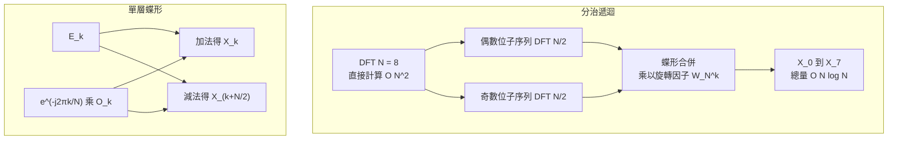

# 1.2 離散傅立葉變換（DFT）與視窗函數最佳化

波形是機器看不懂的原始雜訊，頻譜才是語音的母語。把一段離散信號變成頻譜的標準工具是離散傅立葉變換（DFT），而把它計算到可用的規模，靠的是 1965 年的快速傅立葉變換（FFT）。這一章的敘事有兩條交錯的線：一條是計算複雜度從 $`O(N^2)`$ 到 $`O(N \log N)`$ 的演算法革命，另一條是頻譜洩漏與窗函數之間的取捨數學——後者決定了每一次 DFT 輸出的可信程度，也直接污染或潔淨了後續濾波器組的每一個通道。

## DFT 的矩陣形式與平方代價

設長度為 $`N`$ 的複數序列 $`\mathbf{x}`$ ，其 DFT 定義為一個 $`N \times N`$ 的線性變換：

$$
\mathbf{X} = \mathbf{W} \mathbf{x} \quad W_{kn} = e^{-j 2\pi kn/N}
$$

矩陣 $`\mathbf{W}`$ 的每一行都是一個旋轉速率不同的複指數，秩指數 $`k`$ 對應頻率 $`k f_s / N`$ 。這個視角的好處是工程上的透明：DFT 就是一次矩陣-向量乘法，直接給出 $`N^2`$ 次複數乘法的代價——對 $`N = 1024`$ 這已是百萬級運算，對需要以每秒百幀速度處理語音的 STFT 而言完全不可行。數值上另一個微妙之處是 $`\mathbf{W}`$ 為對稱的酉矩陣，滿足 $`\mathbf{W}^{-1} = \mathbf{W}^* / N`$ ，正逆變換共享同一套核心結構，這為後續的分解埋下伏筆。

值得停下來細看的是這個矩陣的每一列到底在做什麼。固定 $`k`$ 的那一列，其元素 $`e^{-j 2\pi kn/N}`$ 是 $`N`$ 個單位複數均勻分佈在單位圓上，索引 $`n`$ 每增加一，相位就前進 $`2\pi / N`$ 。把序列 $`\mathbf{x}`$ 的第 $`n`$ 個樣本乘上這枚旋轉因子再相加，等於在複平面上把樣本向量投影到該旋轉方向上，得到的實部即為該頻率分量在 $`\mathbf{x}`$ 上的正交投影強度。DFT 因而是對一組由 $`N`$ 個正交基向量構成的頻率網格做投影，而 $`N`$ 個頻率格點在 $`[0, f_s)`$ 上均勻分佈——這個「均勻」正是下一節要挑戰的對象。

DFT 還有一個常被忽略的代價是隱含的循環性。 $`N`$ 點 DFT 把序列視為以 $`N`$ 為週期無限重複的訊號，因此序列起點的選擇會直接改變結果，於是就有了循環卷積與循環移位這兩個只對週期訊號成立的運算形式。線性卷積要透過零填到 $`N_1 + N_2 - 1`$ 再取前段才能取得，這是後續章節在梅爾濾波器組的有限衝擊響應合成時必須處理的細節。

## Cooley-Tukey 的分治：1965 年的冷戰與 1805 年的高斯

FFT 的核心思想是把長度 $`N`$ 的變換拆成兩個長度 $`N/2`$ 的變換。當 $`N`$ 為 2 的冪時，偶數位樣本與奇數位樣本可以各自組成一個子 DFT，再以旋轉因子 $`e^{-j 2\pi k/N}`$ 交織合併：

$$
X_k = E_k + e^{-j 2\pi k/N} O_k \quad X_{k + N/2} = E_k - e^{-j 2\pi k/N} O_k
$$

這組加減乘結構被稱為蝶形（Butterfly），每層 $`N/2`$ 個蝶形、共 $`\log_2 N`$ 層，總複雜度 $`O(N \log_2 N)`$ 。從 $`1024^2 \approx 10^6`$ 到 $`1024 \times 10 \approx 10^4`$ ，百倍加速讓即時頻譜分析從超算奢侈品變成語音處理的日常運算。

這個分解之所以成立，純粹是因為複指數的乘法結構滿足 $`e^{-j 2\pi k(2n)/N} = e^{-j 2\pi kn/(N/2)}`$ ：把偶數位抽出來時，頻率格點自動折疊成子變換的格點，剩下的只是一組加權相加。換言之，FFT 不是一個新發明的變換，而是 DFT 內在結構的一次展開——它把「所有頻率都直接和所有樣本互動」的稠密耦合，改造成「先在子集內互動、再逐層交換」的稀疏耦合。

## 歷史的重演：Gauss 1805 與冷戰的交集

Cooley 與 Tukey 於 1965 年發表《An Algorithm for the Machine Calculation of Complex Fourier Series》時，正值冷戰高峰，該工作的技術動機之一是對蘇聯地震監測站訊號做核爆偵測的頻譜分析，而 Tukey 參與的總統科學顧問委員會正好關心這類統計信號處理。更早的先例在 1805 年：Gauss 在做小行星軌跡內插時，手上已經寫出了等價於 FFT 的遞迴計算，只是因為手算時代不需要「加速」這個概念而被歷史埋沒六十餘年。

這段歷史提醒我們，演算法的價值不僅在於思想本身，更在於它遇見了什麼樣的計算機與什麼樣的社會需求。Gauss 有正確的數學，但沒有電子管可讓他同時並行數千次乘法；Cooley 與 Tukey 面對的是核測震監測站累積的巨量地震記錄，而數位電腦正好提供了他們需要的乘積累加器。同樣的思想在不同的算力條件下會被發現一次、忽略兩百年、再被重新發明一次。

另一個耐人尋味的細節是 FFT 在二十世紀後半的統計學應用。Cooley 與 Tukey 原本是從統計角度切入：1930 到 1960 年代的統計學界充滿了對時間序列頻譜估計的需求，韋氏-凱法（Welch-Kac method）估計器正是依賴分段平均的 DFT 來估計功率譜。FFT 把這條路徑的成本壓到可負擔的程度，才讓譜估計從少數專家的工具變成標準前置處理環節——這條從物理量測到統計工具的路徑，與後來語音訊號處理的技術文化高度同構。

## 頻譜洩漏：截斷的代價

DFT 隱含著一個殘酷的假設：輸入序列是以 $`N`$ 為週期循環的一個完整週期。真實語音並非週期信號，截斷一段長度 $`N`$ 的資料等價於在時域乘上一個矩形窗 $`w[n] = 1`$ （窗內）而窗外為零。時域相乘在頻域就是卷積，矩形窗的頻譜是一個主瓣加無限延伸旁瓣的 sinc 函數：

$$
W_{rect}(f) = e^{-j\pi f(N-1)} \frac{\sin(\pi f N)}{\pi f}
$$

旁瓣的包絡以約 $`1/f`$ 的速度滾降，第一旁瓣高度約為主瓣的 $`-13`$ dB ，這是所有窗函數中旁瓣抑制最差的一個。卷積的結果是：即使信號只含單一純音，頻譜也會呈現主瓣兩側的旁瓣枝椏，能量沿頻率錯誤分布——這就是頻譜洩漏（Spectral Leakage）。

更糟的是洩漏的方向性：若純音頻率恰落在 DFT 格點上，週期性完全吻合，旁瓣因相消而乾淨；一旦落在兩個格點之間，能量會在格點之間以 sinc 形狀攤開，遠處旁瓣的能量足以遮蔽 $`-40`$ dB 以下的弱諧波。語音中弱摩擦音正是這種受害者，其高頻共振峰的能量可能比強元音的低頻共振峰低兩個數量級，任何洩漏都足以把它抹平。

洩漏的嚴重程度可以用一個量化的指標說明：把純音頻率落在相鄰格點正中間的最壞情況考慮進去，此時主瓣能量的一半洩漏到左右兩個格點，等效於有效解析度下降為 $`N/2`$ 點。換言之，取樣點數的浪費不只體現在運算量，也體現在頻譜解析度的直接損失上。

## 窗函數的取捨數學：主瓣寬度對抗旁瓣抑制

窗函數設計的根本矛盾是：塑形窗緣越平滑、旁瓣抑制越深，頻域主瓣就必被撐得越寬。這是第 2 章 Gabor 極限的頻譜版本：時間與頻率的聯合解析有下界，壓低旁瓣（提升頻率局部性）必然犧牲主瓣銳度。工程上以兩個指標表達這組張力：主瓣寬度（決定兩個近距頻率能否分辨）與旁瓣水平（決定強訊號對弱訊號的污染上限）。

常用窗的定義與典型參數如下。矩形窗是最基本的對照組： $`w[n] = 1`$ ，主瓣最窄約 $`2/N`$ ，旁瓣水平 $`-13`$ dB ，只在純音頻率恰好對齊格點時乾淨。Hann 窗以半餘弦兩端歸零：

$$
w[n] = \frac{1}{2} \left( 1 - \cos\left( \frac{2\pi n}{N-1} \right) \right)
$$

其旁瓣約 $`-31`$ dB ，主瓣寬度約 $`4/N`$ ，旁瓣以每倍頻程 $`18`$ dB 的速度滾降，是語音 STFT 的最大公約數。Hamming 窗刻意把常數調整以壓低最靠近主瓣的那一個旁瓣：

$$
w[n] = 0.54 - 0.46 \cos\left( \frac{2\pi n}{N-1} \right)$
$$

它的第一旁瓣約 $`-42`$ dB ，但代價是遠端旁瓣衰減較慢（約 $`6`$ dB 每倍頻程），這對需要偵測固定頻率成分的場景反而有利。Blackman 窗以雙餘弦疊加換取更深的抑制：

$$
w[n] = 0.42 - 0.5 \cos\left( \frac{2\pi n}{N-1} \right) + 0.08 \cos\left( \frac{4\pi n}{N-1} \right)$
$$

旁瓣推到約 $`-58`$ dB ，主瓣寬到 $`6/N`$ ，適合以解析度換乾淨度的高動態範圍場景。Kaiser 窗則把整組取捨參數化，用第一類零階 Bessel 函數 $`I_0`$ 構造：

$$
w[n] = \frac{I_0 \left( \beta \sqrt{1 - \left( \frac{2n}{N-1} - 1 \right)^2 } \right)}{I_0(\beta)}
$$

$`Bessel`$ 函數的參數 $`\beta`$ 直接控制旁瓣抑制深度： $`\beta = 0`$ 退化成矩形窗， $`\beta \approx 4`$ 給出約 $`-30`$ dB 而已接近 Hann 窗， $`\beta \approx 6`$ 對應約 $`-44`$ dB 而接近 Hamming 窗， $`\beta \approx 8.6`$ 則給出約 $`-60`$ dB 的旁瓣水平，而 $`\beta`$ 增大時主瓣寬度平滑地增加（零點對零點寬度由約 $`5.7 / N`$ 增至 $`\beta = 12`$ 時的約 $`7.9 / N`$ ）。旁瓣衰減量 $`A`$ 與 $`\beta`$ 之間有一條實用的經驗反解式 $`\beta \approx 0.1102 (A - 8.7)`$ ，其中 $`A`$ 以負 dB 代入；工程師可依阻帶規格反解 $`\beta`$ 與窗長，成為濾波器設計的通吃解。

| 窗函數 | 旁瓣水平 | 主瓣寬度 | 滾降速度 | 典型用途 |
|---|---|---|---|---|
| 矩形 | $`-13`$ dB | $`2/N`$ | $`6`$ dB/倍頻程 | 頻率完全對齊時的最省算力方案 |
| Hann | $`-31`$ dB | $`4/N`$ | $`18`$ dB/倍頻程 | 語音 STFT、梅爾頻譜前端 |
| Hamming | $`-42`$ dB | $`4/N`$ | $`6`$ dB/倍頻程 | 固定頻率偵測、古早 ASR 前端 |
| Blackman | $`-58`$ dB | $`6/N`$ | $`18`$ dB/倍頻程 | 高動態範圍頻譜分析 |
| Kaiser（ $`\beta = 8.6`$ ） | 約 $`-60`$ dB | 隨 $`\beta`$ 可調 | 可調 | 濾波器設計、規格驅動場景 |

## 洩漏如何污染濾波器組

窗函數的選擇從不只是頻譜美學問題。語音處理的下一步幾乎總是濾波器組：把 $`M`$ 個三角形或帶通濾波器沿頻率軸排列，各自對功率譜加權積分。若洩漏嚴重，一個強共振峰的旁瓣能量會越過濾波器邊界流入鄰近通道，讓濾波器組讀出「不相干通道的雜訊」。以線性頻率均勻排佈的低頻通道受害最深，因為語音能量集中在數百 Hz 的基頻與前兩個共振峰，旁瓣污染在絕對頻寬最小的通道中相對值最大。

Hann 窗因此成為梅爾濾波器組前端的慣用配對： $`-31`$ dB 的旁瓣在 $`20`$ 到 $`30`$ ms 的幀長下已足以把洩漏壓在語音能量動態範圍之下，而 $`4/N`$ 的主瓣寬度配合相鄰幀 $`50`$ % 重疊，維持了時間解析度。Kaiser 窗則在需要明確規格（例如「旁瓣必須低於輸入噪聲底」）的工業場景中勝出，因為 $`\beta`$ 提供了從需求到參數的閉式解。

污染的傳遞路徑值得再說清楚一步。梅爾濾波器組的通道輸出是功率譜在帶通範圍上的積分，洩漏引入的旁瓣能量會同時抬高相鄰通道的讀值，而在取對數之後，一個固定的加性雜訊能量會被轉換成一個近似固定的加性對數偏差。於是頻域的洩漏被轉化為倒頻譜域的系統性偏置，並且會在整個特徵向量上形成緩慢漂移——這類漂移正是 MFCC 系統中需要倒頻譜均值正規化（Cepstral Mean Normalization）來對付的現象。

在設計語音前端時，還有一個把主瓣寬度拉回現實尺度的補充工具是零填充。若對長度為 $`N`$ 的片段補零到 $`M = cN`$ 再做 DFT，頻率格點的密度會提高 $`c`$ 倍，插值出的頻譜曲線外觀更連續。但零填充並不增加真實解析度——它只是讓頻譜取樣點更密，主瓣寬度仍由 $`N`$ 與窗函數決定。工程上常見的誤用正是把零填充後的「峰看起來更尖」誤認為「解析度變好」，實際上那條峰的物理寬度一點都沒有改變。

窗長的選擇則是把這組取捨落到時間軸上。幀長 $`N`$ 決定主瓣寬度的下限，同時也決定了時間解析度： $`N = 512`$ 在 $`16`$ kHz 取樣下是 $`32`$ ms ，對應的頻率格點間隔約 $`31`$ Hz ；而語音的基頻在 $`100`$ 到 $`300`$ Hz 之間，共振峰的移動速度則更快。幀長越長，頻域越穩健但瞬態的時間定位越差；幀長越短，時間定位越精確但頻域估計的變異越大。 $`25`$ ms 幀長配 $`10`$ ms 步距（ $`75`$ % 重疊）之所以成為事實標準，就是因為它在這個取捨中找到了跨說話人最穩健的平衡點。

## DFT 之外：Goertzel 與濾波器組的另兩條路

DFT 並非唯一的頻譜量測方式。Goertzel 演算法是其中最實用的一支：它只計算單一指定頻率上的幅度，而不求出全部 $`N`$ 個頻率格點，因此複雜度從 $`O(N)`$ 降為與 DFT 同級但常數因子極小。它的原理是把遞迴式設計成二階共振子，其共振頻率恰好落在目標頻率上，輸出振幅即為該頻率分量的大小。在韻律與音高研究中（例如測量基頻週期、追蹤共振峰軌跡），Goertzel 的成本遠低於整段 FFT，也避免了不必要的頻率資訊。

另一條路是數位濾波器組本身。若直接把梅爾濾波器組實作成有限衝擊響應濾波器並對每一幀做捲積，就完全不需要 DFT 階段，其代價是運算量與濾波器數目成正比而非對數因子。這個取捨在通道數少、只需少數頻率特徵的場景（如早期的聲紋辨識特徵）中有時是划算的，但在需要完整頻譜做梅爾倒頻譜 DCT 的情境下，FFT 加濾波器組的組合仍是最優解。本書後續章節採用的正是這條主流路線。

值得附帶一提的是，濾波器組與加窗並非互斥：一旦通道邊界是濾波器組的積分範圍，窗函數的旁瓣決定了相鄰通道間的實際隔離度，而濾波器組本身在設計時往往也會自帶類似 Kaiser 的加權以控制自身通帶外的滲漏。兩層濾波串聯，意味著總體的旁瓣抑制並非簡單相加，而是取決於兩者的卷積，這也是為什麼梅爾濾波器組的實作細節在文獻中佔有相當篇幅。

## 定點 FFT 與工程實作

FFT 從紙面走進產品的過程中，還有一層純工程的考驗。浮點 FFT 的運算量仍嫌昂貴，尤其在嵌入式與行動裝置上，因此定點實作成為必然選擇：把旋轉因子與蝶形運算全部改為整數算術，只在最終尺度上做一次正規化。定點化的代價是量化誤差會沿蝶形網路逐層累積，而洩漏在定點環境中會顯得更加刺眼——因為整數乘法的截斷本身就是一種量化雜訊源。

為了控制定點誤差，早期的 FFT 晶片設計曾引入「位元反轉」與「數值縮放」等技巧，確保蝶形運算中的加法不會超出定點範圍。與此同時，實時系統還面對時間軸上的硬性約束：一幀的頻譜必須在下一幀的 hop 到達前算完，否則資料會在佇列中堆積。這使得視窗長度、幀移、FFT 尺寸三者的關係不只是統計上的選擇，而是即時性與記憶體預算的共同結果——這也是為何後來的 Whisper 系統最終把幀長定為 $`25`$ ms 且恰好對應 $`400`$ 點的梅爾通道配置，而非任意挑選的數字。

最後值得記住的是設計理論上的天花板：在給定主瓣寬度下，旁瓣抑制存在理論上限，由 Dolph-Chebyshev 不等式給出，其最優窗即為等波紋窗。Kaiser 窗是這一最優解的良好近似，正因如此它才能用單一參數 $`\beta`$ 統整整個取捨家族，成為濾波器與譜分析工程中引用最多的窗函數。理解了這條上限，也就理解了為什麼工程文件中給窗函數選型時，總是把「旁瓣水平」與「主瓣寬度」並列成一組永遠不可同時最優的指標。

一個常被忽略的細節是：窗函數也重塑了幀邊緣的樣本權重，時間步長必須配合重疊相加才能重建平滑的能量軌跡。這些約束將在第 2 章的 STFT 反演架構中正式登場，此處只需記住一點：窗函數不是加在最後的裝飾，而是決定了頻譜可信度的第一道閘門。
