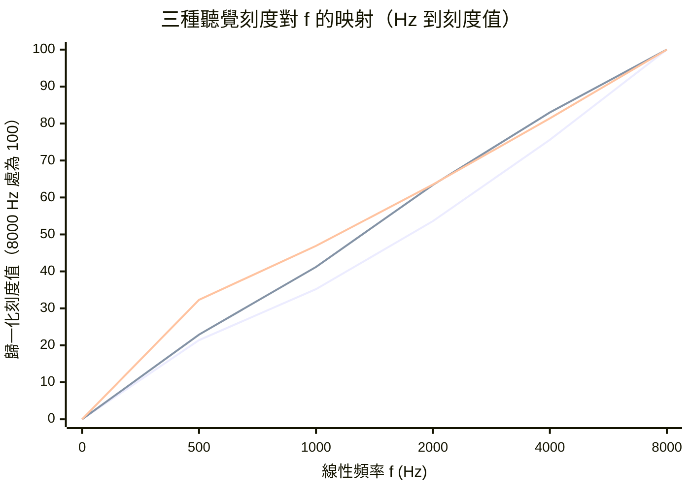

# 1.3 聽覺感知尺度轉換的非線性數學：Bark、ERB 與 Mel

線性頻率軸是物理學家的語言，不是人耳的語言。這一根本錯位是本節的起點：若把 $ 0 $ 到 $ 8000 $ Hz 均勻切分給特徵通道，人耳感知上最重要的 $ 200 $ 到 $ 2000 $ Hz 語音共振區只分得四分之一資源，而 $ 6000 $ Hz 以上幾乎沒有可聽辨內容的頻段同樣站著整整一格。語音處理的第一個感知革命，就是把這條直線彎成人耳的形狀——而彎折的數學有三個版本：Bark、ERB 與 Mel。

## 為什麼需要感知刻度：對數感受的兩層數學

人耳的頻率感受在低頻近似對數、在高頻近似線性： $ 100 $ Hz 與 $ 200 $ Hz 之間的音高距離，聽起來與 $ 1000 $ Hz 到 $ 2000 $ Hz 相同（一個八度），但 $ 8000 $ Hz 到 $ 9000 $ Hz 的差異已接近辨識極限。更精確的生理事實是耳蝸的力學：基底膜的特徵頻率沿其長度呈指數衰減分佈，位置換算成頻率的 Greenwood 函數正是指數形式：

$$
f(x) = A \left( 10^{2x/b} - 1 \right)
$$

其中 $ x $ 是從耳蝸頂點量起的距離，參數通常取 $ A = 20.86 $ Hz 、 $ b = 0.88 $ 。這個指數分佈解釋了對數感受的來源，也預告了純對數在高頻端的失真——因此所有實用的感知刻度都是「低頻對數、高頻漸線性」的混合曲線，而非教科書文章粗略宣稱的純對數。

純對數刻度還有一個更實際的缺陷：它無法通過原點。在 $ f = 0 $ 處對數發散，使得刻度值在低頻端被無限壓縮，這既不符合數學上的連續性需求，也讓濾波器組的中心頻率無法從零開始合理排佈。所有工程刻度都以某個線性段起步，正是為了解決這個原點奇異性。

另一個容易被忽略的問題是響度不均。粗糙的響度級（Roughness）與尖銳度（Sharpness）感知模型顯示，同樣的能量差在低頻聽起來比高頻更響，說明頻率與強度之間存在交互作用，純粹的一維頻率刻度在心理聲學上是不完整的。但對語音前端而言，這個二階效應的實務影響遠小於刻度形狀本身的選擇，因此工程實作仍以一維刻度為主。

## Mel 刻度：工程近似的勝利

Mel 刻度最早可追至 1937 年 Stevens、Volkmann 與 Newman 的音高標定實驗，其工程界最常引用的形式為：

$$
f_{mel} = 2595 \log_{10} \left( 1 + \frac{f}{700} \right)
$$

反公式直接解對數方程即得：

$$
f = 700 \left( 10^{f_{mel}/2595} - 1 \right)
$$

在 $ f = 700 $ Hz 以下的低頻段，函數約為 $ 1000 $ 倍縮放的線性；高頻段 $ \log(1 + f/700) \approx \log f $ ，進入對數。它的偉大之處不在精確而在簡潔：單一公式、兩個常數、可微可反演，成為 1980 年 Davis 與 Mermelstein 推出 MFCC 時的既定選擇，從而固化為四十年的工業標準。常數 $ 2595 $ 與 $ 700 $ 本身沒有生理機制的精確來源——這是它被 Bark 學派詬病之處，卻也是它被工程界擁抱的原因。

Mel 與 Bark 的量化差異可以從數字上直接看出：在 $ 1000 $ Hz 處，Mel 刻度約為 $ 1000 $ mel，而 Bark 刻度約為 $ 8.5 $ Bark 、ERB 刻度約為 $ 15.4 $ ERB。三者不是同一個量的不同單位，而是三種不同的量：三者的數值都無法直接解釋為「可聽辨的最小頻率差」，它們各自是「音高判別的實驗單位」、「臨界頻帶的實驗單位」與「等效矩形頻寬的實驗單位」。這個區別在文獻中經常被含混帶過，卻是比較三者時最需要先釐清的東西。

## Bark 與臨界頻帶：實驗生理學的路線

與 Mel 的工程直覺不同，Bark 刻度來自 Zwicker 於 1961 年整合的臨界頻帶（Critical Band）實驗：掩蔽效應研究表明，耳蝸分析頻譜時使用的不是任意窄的解析度，而是隨頻率變寬、寬度約從 $ 100 $ Hz 增到數千 Hz 的一組生理帶通。Zwicker 將整個可聽頻域切成 $ 24 $ 個臨界頻帶，每帶 $ 1 $ Bark，頻率到刻度的映射在低頻線性、自約 $ 500 $ Hz 起轉為對數。Bark 與其帶寬函數的多段近似公式為：

$$
z \approx 13 \arctan\left( 0.00076 f \right) + 3.5 \arctan\left( \frac{f}{7500} \right)^2
$$

$$
\Delta f_{bark}(f) \approx 25 + 75 \left( 1 + 1.4 \left( \frac{f}{1000} \right)^2 \right)^{0.69}
$$

這條公式的結構值得拆解：兩項反正切分別負責低頻的線性段與高頻的飽和段，中間的平方與 $ 0.69 $ 次方描述臨界帶寬隨頻率的次線性成長。這種「多段擬合」的形式是 Bark 刻度的標誌，也是它最大的工程弱點：沒有簡潔的閉式反函數，必須以數值查表或分段反解來使用。

Bark 刻度的實驗地位卻極為崇高。臨界帶概念是心理聲學中最常被引用的框架之一，被用來解釋掩蔽曲線的彎折、寬頻噪音的粗糙度、以及聽覺系統為何寧可用多個臨界帶的總和去合成寬頻刺激而不產生過度遮蔽。Zwicker 的能量相加法則指出，跨越多個臨界帶的遮蔽量應以能量而非振幅相加，這正是後續 OGG 與 MPEG 響度模型的核心機制。

## ERB：Glasberg 與 Moore 的精煉

臨界頻帶實驗在 1980 年代被重新檢視，Glasberg 與 Moore 於 1990 年提出等效矩形頻寬（Equivalent Rectangular Bandwidth, ERB），以更乾淨的掩蔽（notched-noise）實驗方法取代舊有的雙音掩蔽，得到一條與 Bark 帶寬相近但低頻端更窄的曲線：

$$
\mathrm{ERB} = 24.7 \left( 4.37 f_{kHz} + 1 \right)
$$

對應的刻度映射（以 kHz 為單位）常用形式為：

$$
x = 9 \ln\left( 1 + \frac{f_{kHz}}{22.85} \right)
$$

這個刻度在 $ 1000 $ Hz 處給出 $ 15.6 $ ，在 $ 8000 $ Hz 處給出 $ 33.3 $ ，覆蓋整個可聽域時約為 $ 41.7 $ 個 ERB 單位。ERB 的設計哲學是連續函數而非離散帶表：它給出的是「任一中心頻率處耳蝸的解析度」，可直接生成任意數量的濾波器，這使得它在此後的心理聲學與現代神經聲碼器前端（如以 ERB 設計濾波器的模型）中逐漸吃重。

ERB 與 Bark 的差異不只是數值上的。1990 年的實驗採用更嚴謹的心理物理學方法（例如遮蔽噪聲中心頻率處的凹陷切割），能更精確地界定帶通寬度，因此 ERB 曲線被視為當時更可信的生理量估計。附帶一提，現代耳機的等響曲線標定（equal-loudness contour）也常以 ERB 尺度作為橫軸的參考基準，把「聽覺解析度」與「響度感知」兩套獨立的量化體系放在同一張圖上比較。

三種刻度的數值曲線揭示了歷史與哲學的全部差異。上圖把三條曲線各自在 $ 8000 $ Hz 處歸一化為 $ 100 $ ，於是形狀差異得以直接比較：ERB 在低頻端上升最快，代表它在低頻區給出的解析度最細；Bark 與 ERB 在中頻段幾乎重疊，但在高頻段 Bark 稍緩，對應臨界頻帶隨頻率次線性變寬的實驗觀察；Mel 的曲線在整個頻域最平緩，因為它來自音高分類實驗而非掩蔽生理學，本質上是一個較粗略的工程近似。三者共同的形狀是「低頻陡、高頻緩」的凹形曲線，差別只在拐點位置與壓縮強度，這正是同一套耳蝸力學在不同實驗方法下的投影。

| 刻度 | 年代 | 來源 | 形式 | 可聽域通道數 | 反函數 |
|---|---|---|---|---|---|
| Bark | 1961 | Zwicker 臨界頻帶實驗 | 多段擬合、離散 $ 24 $ 帶 | $ 24 $ | 需數值反解 |
| Mel | 1937 至 1980 | 音高感知實驗與工程簡化 | 單一封閉公式 | 任意（常用 $ 26 $ 到 $ 80 $ ） | 閉式可解 |
| ERB | 1990 | Glasberg 與 Moore 掩蔽精測 | 帶寬閉式、連續刻度 | 約 $ 41.7 $ 個（涵蓋 $ 0 $ 至 $ 20 $ kHz） | 閉式可解 |

## 刻度之間如何互相轉換

在實際系統裡，三種刻度常常同時出現：模型內部用梅爾通道做前端，訓練時卻要用 Bark 或 ERB 尺度來解釋共振峰的寬度，聽力測試報告則多用 ERB 軸來呈現門檻曲線。因此刻度之間的轉換並非學術裝飾，而是工程必備。

一般而言，只要取得任一刻度 $ s(f) $ 及其反函數 $ f(s) $ ，其餘刻度的轉換就由複合函數給出：

$$
s_{Bark}(f) = s_{Bark}\left( f\left( s_{Mel}^{-1}( s_{Mel}(f) ) \right) \right)
$$

更實用的做法是直接擬合各刻度之間的多項式對映關係。實驗上常用的是梅爾與 Bark 之間的三次多項式：

$$
bark \approx 15.26 + 6.16 \frac{mel}{1000} + 11.85 \left( \frac{mel}{1000} \right)^2
$$

以及赫茲與 Bark 之間的近似式：

$$
bark \approx 13 \arctan\left( 0.00076 f \right) + 3.5 \arctan\left( \frac{f}{7500} \right)^2
$$

這些轉換在 $ 1000 $ Hz 以下相當準確，在 $ 4000 $ Hz 以上誤差會顯著放大——這提醒我們，跨刻度比較只在共同適用的頻段內才有意義，任何在整個可聽域宣稱的「精確」轉換都應被審慎對待。

一個實用的基準是選 $ 1000 $ Hz 作為刻度錨點。在 Bark 的定義中， $ 1000 $ Hz 恰好被定為第 $ 9 $ 至 $ 10 $ 臨界帶的交界附近；梅爾刻度在 $ 1000 $ Hz 的值約為 $ 1000 $ mel；而 ERB 刻度在 $ 1000 $ Hz 處約為 $ 15.6 $ ERB。三個數字的懸殊本身就是最直觀的提醒：這些刻度的單位從來不能互換，它們是三套獨立的度量。

## 從刻度到濾波器組：三角窗的數學與通道分佈

感知刻度本身不產生特徵，它必須先轉化為一組實際的濾波器，才會進入資料流。梅爾濾波器組的標準作法是：先在梅爾軸上等間距地取 $ M $ 個中心點 $ m_1, \dots, m_M $ ，再用反函數換算成線性頻率 $ f_1, \dots, f_M $ ，最後以相鄰中心點的中點作為帶邊界：

$$
f_{low}(i) = f\left( \frac{m_{i-1} + m_i}{2} \right) \quad f_{high}(i) = f\left( \frac{m_i + m_{i+1}}{2} \right)
$$

每個通道的權重函數是一個三角形，在自己的中心頻率處取 $ 1 $ ，在兩側邊界處取 $ 0 $ ：

$$
H_i(f) = \frac{f - f_{low}(i)}{f_{center}(i) - f_{low}(i)} \quad f_{low}(i) \leqq f \leqq f_{center}(i)
$$

$$
H_i(f) = \frac{f_{high}(i) - f}{f_{high}(i) - f_{center}(i)} \quad f_{center}(i) < f \leqq f_{high}(i)
$$

三角形的斜率為 $ 1/\text{bandwidth} $ 意味著每個通道對其中心頻率附近的能量給予最高權重，並在邊界平滑歸零——這正是抑制前一節所說的頻譜洩漏跨通道污染的機制。通道數 $ M $ 的選擇本質上是分辨率與維度的折衷：通道太少，低頻的基頻微結構會被混在同一格裡；通道太多，高頻的空頻段會引入近乎純雜訊的通道，徒增下游模型的負擔。

log-Mel 這個名字裡還藏著第二層非線性。梅爾濾波器組的輸出先取平方得到功率譜，再取自然對數：

$$
\log S_{mel}(m) = \ln\left( \sum_{k} |X(k)|^2 H_m(k) \right)
$$

對數把動態範圍從線性的數十 dB 壓縮到以 dB 為單位更接近常數的尺度，其作用與 1.1 節的振幅壓擴同源：讓小振幅區域不被大振幅的強共振峰淹没。Whisper 前端的 log-Mel 還會歸一化到 $ [-1, 1] $ 區間，這一步把所有說話人與錄音條件的整體增益差異吸收掉，是深度模型能快速收斂的重要前置。

## 三刻度的交會之處：濾波器組與 Whisper 的 80 通道

刻度只有寫成濾波器組才有工程生命。梅爾濾波器組在 Mel 軸上等間距放置三角形濾波器，再反算回線性頻率得到各帶邊界；帶的數量、中心頻率與寬度全部繼承 Mel 公式的非線性。MFCC 進一步對濾波器組輸出取對數、做 DCT，把「振幅壓擴加上頻率彎折」兩種感知壓縮一併封裝成 $ 13 $ 維向量，統治 ASR 前端直到深度學習元年。

2022 年的 Whisper 沿用同一哲學但加大規模： $ 80 $ 通道的 log-Mel 頻譜，Hamming 窗、 $ 25 $ ms 幀、 $ 10 $ ms 步距。 $ 80 $ 通道在 $ 16 $ kHz 取樣下的 Mel 配置，正好把 $ 300 $ 到 $ 4000 $ Hz 的語音共振區切得相當細，而 $ 8000 $ Hz 以上的通道轉寬為對數間距。這個配置說明了一件重要的事：即使在深度學習時代，感知刻度並未被廢棄，而是被保留為一個經過驗證的資訊打包策略——模型雖有能力自己學出頻率表徵，但把對數化的頻率結構預先寫進輸入端，仍舊是有效的歸納偏置。

對照之下，純線性刻度的舊模型為何在高頻浪費解析度？兩個原因疊加。第一，線性切格讓高頻帶佔據與語音訊息不成比例的維度預算，模型過擬合於幾乎無辨識價值的頻段，等價於把有限的通道數浪費在一片空白上。第二，線性頻率的鄰帶間距在低頻過窄，基頻諧波單獨構成的能量微結構被硬生生切進不同的通道，洩漏與噪聲易被放大成虛假的諧波峰。

用一個具體的數字來看這筆帳： $ 80 $ 個線性通道覆蓋 $ 0 $ 到 $ 8000 $ Hz ，每通道 $ 100 $ Hz ；而 $ 80 $ 個梅爾通道覆蓋同一範圍， $ 300 $ Hz 以下的通道間距只有約 $ 25 $ Hz ， $ 3000 $ Hz 以上則寬到數百 Hz。也就是說，同樣的維度預算，感知刻度把解析度集中在語音資訊最密集的地方。等效矩形頻寬的數據提供了另一個佐證：在 $ 1000 $ Hz 處人的耳蝸解析度約為 $ 250 $ Hz ，而線性 $ 80 $ 通道給出的解析度只有 $ 100 $ Hz ，等於在低頻過度取樣、在高頻嚴重不足。

感知刻度同時解決兩個問題——把維度預算重新分配到耳蝸真正使用的解析度分佈上。這個思想在 1.1 節是壓擴振幅，在本節是彎折頻率，在本書後半（第 6 與第 9 章）它將以「感知加權損失」的形式再次出現在神經聲碼器的訓練目標中：當純粹的波形誤差指標無法反映聽感時，人類聽覺的對數性與遮蔽效應就必須被寫進最佳化的目標函數裡。

## 深度學習時代的刻度存亡之爭

感知刻度在深度學習時代並非沒有受到挑戰。2010 年代中期，出現了一股「端到端讓模型自己學」的聲音：既然卷積網路的第一層就能學出濾波器係數，何必還要人手刻意的梅爾三角窗？初步的實驗結果確實令人振奮——以原始波形或以線性頻譜直接輸入的模型，在若干基準上追平甚至超越了梅爾前端。研究者據此主張，梅爾刻度不過是資料不足時代的權宜之计。

但隨著模型規模與資料量擴大，更細緻的比較顯示出梅爾前端仍然具有難以取代的優勢。一個關鍵的解釋是：在梅爾域中，不同說話人的語音譜圖會自然對齊到相似的共振峰位置，因為梅爾刻度本身就是一個以聽覺為校準的座標系。也就是說，梅爾濾波器組不是單純的特徵工程，而是把資料放進一個「聽覺上等價」的座標空間，從根本上降低了模型所需的容量與資料量。

另一個理由更偏向效率。梅爾前端把 $ 16 $ kHz 取樣的 $ 25 $ ms 幀從 $ 400 $ 個時域樣本壓縮成 $ 80 $ 個通道能量值，這個壓縮是無損地把「無資訊區域」丟掉的： $ 6000 $ Hz 以上在語音中幾乎不承載資訊，線性前端卻仍要為它配置通道與參數。相較之下，讓模型自行從時域波形中發掘同樣的結構，需要更多資料與更大模型才能收斂到相同的規律。

現在的折衷方案是把兩者接在一起：多數現代系統仍以 log-Mel 作為輸入端的第一道處理，但在骨幹網路內部以可學習的卷積進一步 refine 頻率表徵。這種「先驗加微調」的組合，某種意義上重現了本章開頭的歷史主題——純粹依賴物理均勻刻度的人，和純粹依賴手工感知刻度的人，兩邊都對了一半。

從技術史的角度回望，三種刻度並存三個年代卻在同一個教材中並列，本身就是一部壓縮編碼理論的演化史：Mel 是工程師從實驗數據中提煉出的簡潔近似，Bark 是心理學家為現象命名而建立的離散框架，ERB 則是統計學家為量測方法改進而重新推導的連續估計。三者共享同一個底層信念——**物理頻率軸不是聽覺頻率軸**，而這個信念的實踐成果，就是今日每一個語音模型前端的第一段程式碼。
