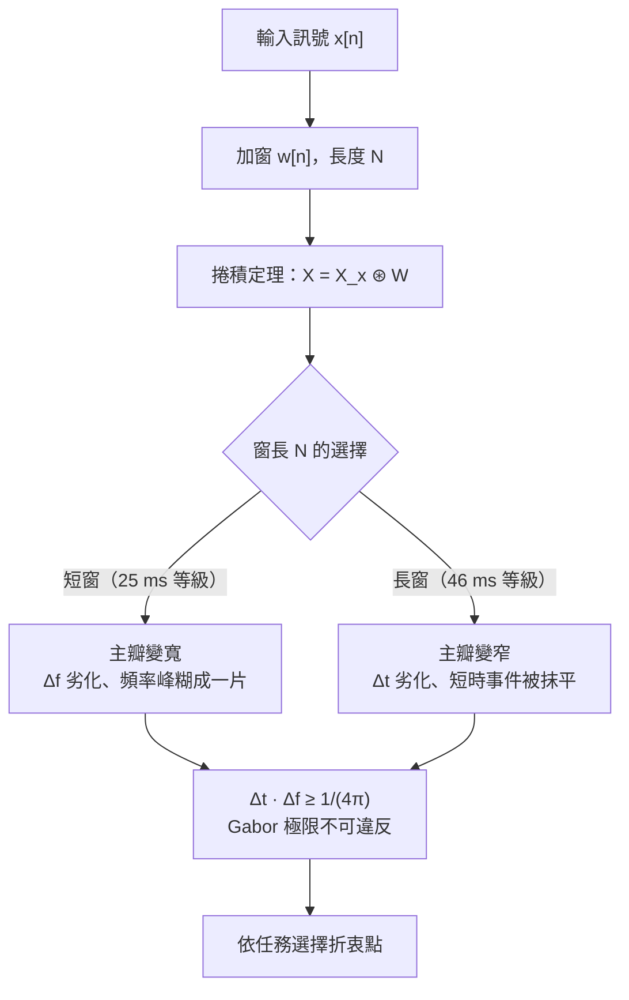
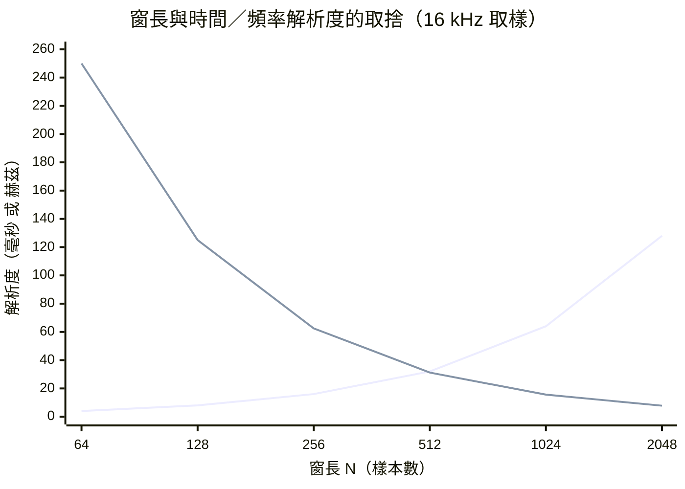
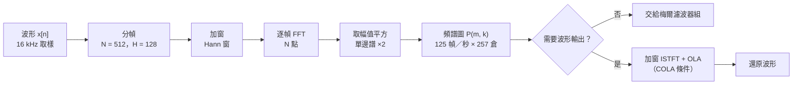

# 2.1 短時距傅立葉變換（STFT）與時頻不確定性原理

## 語音為何必須用時變頻譜來描述

傅立葉變換的預設前提是訊號具有平穩性，也就是說，頻率成分與能量分佈在整段觀測期間保持不變。這是一個極其方便、卻與語音幾乎無關的假設。一句日常的話裡塞滿了爆破音的毫秒級瞬態、擦音的高頻白噪底、尾音漸弱的衰減尾巴，以及基頻不斷滑動的母音。若把三十秒的語音整段做一次離散傅立葉變換，得到的將是一鍋被時間平均糊掉的漿糊：所有音素的共振峰結構被疊加成一團，所有瞬態的能量被攤薄到不可辨認，任何時間上的先後關係都被徹底抹平。整體 DFT 的結果不是「不夠好」，而是與語音的物理本質無關。

問題的根源在於「平穩」這個假設只在很短的時間尺度上勉強成立。聲學語音學的實測給出了明確的答案：一個音素的典型長度大約在五十到兩百毫秒之間，而聲道形狀在一段母音內部的變化相當緩慢，喉頭與舌頭的位置在一百毫秒內幾乎不動。這使語音獲得一個關鍵的分類性質——**准平穩訊號**（quasi-stationary signal）：在二十到三十毫秒的小片段內，訊號近似平穩、頻譜包絡有意義；一旦跨過這個尺度，頻譜便開始劇烈演化。工程上因此發展出「以短窗切片、逐段求譜、再沿時間軸堆疊」的策略，這正是短時距傅立葉變換（STFT, Short-Time Fourier Transform）的思想核心。第 1 章的取樣定理告訴我們如何把連續波形離散化，而本節的 STFT 則負責回答下一個問題：如何把一維波形變成機器可學習的二維時頻矩陣。

值得強調的是，STFT 不是「退而求其次」的近似，它是一種有明確代價函數的資訊重排。我們放棄的是全局平穩假設，換來的是局部平穩下的高解析度描述；代價則被一條硬性定理限制住，那就是時頻不確定性原理。整節的敘事可以概括為一句話：STFT 把「要在哪裡看得多細」的自由，交給了窗長與幀移兩個參數，而這兩個參數都被同一條不等式鎖死在取捨線上。

## STFT 的定義與兩個自由參數

給定離散訊號 $ x[n] $ 、 窗函數 $ w[n] $ （長度為 $ N $ 個樣本），STFT 的定義為：

$$
X(m, k) \, = \, \sum_{n} x[n] \, w[n - mH] \, e^{-j 2\pi kn / N}
$$

其中 $ m $ 是幀的索引、 $ k \in \{ 0, 1, \ldots, N-1 \} $ 是頻率倉的索引，實務上通常在求完幅值後只保留 $ k \in \{ 0, \ldots, N/2 \} $ ，因為實訊號的頻譜具有共軛對稱性。定義中有兩個至關重要的自由參數。第一個是**幀長** $ N $ ：它決定每一次觀測的時間視野，等價於把訊號切成一張張長 $ N $ 、彼此重疊的短幀，再逐幀套上窗函數以抑制切邊所產生的頻譜洩漏。第二個是**幀移** $ H $ ：它決定相鄰兩幀在時間軸上的步進距離，也就是頻譜圖在時間方向的取樣密度，實務上常取 $ H = N/4 $ ，意即相鄰幀之間有百分之七十五的重疊。

以 $ 16 \, \mathrm{kHz} $ 取樣、 $ N = 512 $ 為例：每一幀涵蓋 $ 512/16000 = 32 \, \mathrm{ms} $ 的音訊，頻率方向的解析度為 $ 16000/512 \approx 31.25 \, \mathrm{Hz} $ ， 幀移 $ H = 128 $ 對應每秒約一百二十五幀。這個組合並非任意拍腦袋而定，而是「人耳音素時長」與「共振峰間距」兩個語音物理量折衝後的工業慣例。之所以幀移取幀長的四分之一而不取一半，是因為時間軸上的取樣密度必須遠高於特徵本身在時間上的變化速率，否則共振峰的移動軌跡會被抽樣混疊成一團模糊的雲。接下來我們將看到，這組參數並非只是在「方便」與「麻煩」之間選邊，而是被一條不可逾越的數學極限所約束。

此處有個容易被忽略的細節：STFT 的第二個參數 $ H $ 與第一個參數 $ N $ 並非獨立的。理論上 $ H $ 可以任意小，時間軸上的取樣密度可以任意高，代價只是運算量線性上升；實務上之所以不取更小的值，是因為相鄰幀的頻譜在時間上高度相關，過度取樣只是複製幾乎相同的資訊，徒增儲存與計算而不帶來新知。實驗上常見的判準是取 $ H $ 使得相鄰幀的譜變化量約在一到兩個數量級之內，這個經驗法則的物理內容，就是時間軸上取樣率恰好略高於信號在該尺度上的帶寬。

## Gabor 極限：取捨的數學根源

STFT 到底能不能同時把時間與頻率都看得無限清楚？答案是否定的，而且根源不在工程，而在純數學。回憶第 1 章的捲積定理：時域相乘等價於頻域卷積。加窗的 DFT 實際上是「訊號頻譜與窗函數頻譜」的卷積，也就是說我們在頻譜圖上看到的每一根譜線，都披著窗函數主瓣與旁瓣的外衣。窗越窄，其頻譜的主瓣越寬，一個純音在頻譜圖上就會糊成一團寬闊的隆起——頻率解析度崩壞；反之窗越寬，主瓣越窄、頻率看得越準，但窗在時間上拉得越長，短時間內的任何變化都被長窗平均掉——時間解析度崩壞。這就是為什麼在說明中要反覆強調：窗的頻譜是被「卷積」進 STFT 的每一個倉裡的，取捨無處可逃。

若用不確定性的語言表述，設窗的等效時寬為 $ \Delta t $ 、 等效頻寬為 $ \Delta f $ ， 則對任何窗函數恆有：

$$
\Delta t \cdot \Delta f \, \ge \, \frac{1}{4\pi}
$$

這條著名的 Gabor 極限在數學上與量子力學的 Heisenberg 不確定原理同構——兩者都是關於一對傅立葉對偶變數的方差不變式。等號只有在高斯窗時才能達到，這正是 Gabor 本人在 1946 年主張以高斯函數進行時頻分析的原因，他甚至因此發明了時頻分析用的 Gabor 原子。極限式的意涵可以翻譯成工程語言： $ \Delta t \approx N/f_s $ 與 $ \Delta f \approx f_s/N $ 互為倒數，把一格資源投給時間，就必然要從頻率那裡扣掉等價的份額。語音辨識與聲碼器的整條前處理史，說到底就是在這條直線上挑點的歷史。

這條取捨線可以先用一張流程圖的骨架說清楚：訊號進來，窗長決定觀測尺度，尺度決定你能看見時間事件還是看見頻譜細節。取捨的形狀如下：

把兩個解析度隨窗長變化的數值畫在同一張圖上，取捨的剪刀形狀一目了然：

兩條曲線呈完美的交叉剪刀形：窗長越短，時間解析度越好而頻率解析度越差，反之亦然。不存在「同時最佳」的點，只有依任務妥協的點。語音辨識通常落在 $ 25 \, \mathrm{ms} $ 幀長附近，而音樂分析因旋律相對穩定、需要緊密的頻率解析度，常取 $ 46 \, \mathrm{ms} $ 到 $ 93 \, \mathrm{ms} $ 的長窗。

## 窄窗與寬窗：輔音瞬態與母音穩態

這條理論取捨線投射到語音上，正好對應兩類音素的不同需求。**輔音**，尤其是塞音（如 $ /p/ $ 、 $ /t/ $ 、 $ /k/ $ ）與塞擦音，其能量以毫秒級的瞬態爆發，發聲結構在一二十毫秒內完全改變；要捕捉這種「時域事件」，必須使用窄窗，寧可犧牲頻率精細度也不能錯過爆衝的到達時刻。**母音**則相反：聲道形狀在百毫秒內近乎恆定，頻譜上呈現三到五條清晰而貼近的共振峰，若相鄰共振峰僅相差 $ 100 \, \mathrm{Hz} $ 而頻率解析度只有 $ 250 \, \mathrm{Hz} $ ， 兩峰將融為一峰；此時必須用寬窗才能把疊時的穩態結構攤開看清楚。實務上取 $ 25 \, \mathrm{ms} $ 幀長加 $ 10 \, \mathrm{ms} $ 幀移，正是在「母音共振峰可分」與「塞音瞬態不丟」之間找到的慣例折衝點——一個已被四十年工業實證固化下來的甜點。

這個取捨還有更深的一層：窄窗並非「壞的」，它其實是更忠實地表達了輔音的物理意義。塞音的診斷特徵恰恰在於爆破的時間結構與頻譜斜率，而這些資訊在長窗下會被平均成一道緩慢的上升斜坡。學者們後來發現，把窄窗與寬窗的特徵並排擺在一起（例如短窗的瞬態能量與長窗的共振峰位置）比任何單一尺度都更有辨識力，這也是多解析度特徵至今仍偶爾出現於文獻的原因。

值得注意的是，取捨的本質並非「工程 vs 數學」的對立，而是人類聽覺自身的設計。人的外耳與中耳構成一個分頻器，耳蝸的基膜在基部窄而硬、在頂部寬而軟，這個物理結構讓低頻得到高時間精度、高頻得到高頻率精度。內耳的時頻分析本質上就是一個受到生物結構限制的 Gabor 濾波器族。因此「窄窗抓瞬態、寬窗抓音色」不只是工程上的妥協，而是與人耳的物理構造同構的選擇。這個觀察在第 2.2 節會再度出現：那裡的梅爾刻度，正是把耳蝸基膜的非線性拓撲寫進濾波器組的方式。

## 功率譜密度與單邊譜的因數

STFT 的複數輸出 $ X(m, k) $ 含有相位資訊，但許多特徵只需要能量的分佈，因此取模平方：

$$
P(m, k) \, = \, \left| X(m, k) \right|^{2}
$$

得到的 $ P(m, k) $ 是訊號在幀 $ m $ 、頻倉 $ k $ 處的功率譜估計。由於輸入為實數，正負頻率的功率對稱： $ P(m, k) = P(m, N-k) $ ， 全部資訊濃縮在 $ k \in \{ 0, \ldots, N/2 \} $ 。 習慣上會把捨去的另一半功率「折回」保留的那一半：對 $ k \in \{ 1, \ldots, N/2 - 1 \} $ 的頻倉乘以 $ 2 $ ， 而直流倉 $ k = 0 $ 與 Nyquist 倉 $ k = N/2 $ 恰好各自坐落於對稱軸上，不乘二也不缺份。這就是單邊譜（one-sided spectrum）與雙邊譜（two-sided spectrum）之間的因數 $ 2 $ 修正——漏掉它，能量報表會無聲地縮水一半，後續的濾波器組能量、信噪比、增益計算將全部連坐出錯。

順帶一提，功率與幅值的選擇會進一步改變下游統計的性質。取模平方等於把高斯分布的樣本變成卡方分布，方差相對更大，因此在統計建模時常會再做一次開根號以還原近似正態性；若下游是神經網路，這種修正的必要性則大為降低，因為網路的第一層就能自行學會開根號那樣的非線性映射。

## 重疊相加與 COLA 條件

STFT 是一種有損的表述嗎？並非如此：只要參數安排得當，它其實是可逆的冗餘展開，這個性質由**重疊相加法**（OLA, Overlap-Add）保證。想法很直觀：對每幀乘窗後做處理，做反變換，再把它們沿時間軸逐格放回、相互疊加。疊加時窗函數的重疊部分會互相補償，若要完美還原原訊號，窗與幀移必須滿足：

$$
\sum_{h} \, w[n - hH] \, = \, C
$$

其中 $ C $ 為與 $ n $ 無關的常數，此即**COLA 條件**（Constant Overlap-Add）。以 Hann 窗為例，取 $ H = N/2 $ 時和恰為 $ 1 $ ， 為嚴格 COLA；取 $ H = N/4 $ 時和為 $ 1.5 $ ， 屬於加權 OLA，尚可在合成端除以窗和予以校正，這也是為什麼「幀移取幀長四分之一」幾乎成為教科書的默認值。數學上還有更精緻的表述：只要 $ H \cdot f_{\mathrm{bin}} $ 的組合不落進窗頻譜的零點格點，COLA 便可在頻域得到嚴格驗證。總之，重疊夠密、窗夠平滑，重建誤差便可壓到聽不出來的程度。若再多加一步「平方根 Hann 窗」（Hann 的平方），則連窗和本身的起伏也被平掉，可得到幅度一致的完美重建，代價是有效幀長略微縮短。

值得附帶一提的是相位問題。STFT 的幅值本身不帶相位資訊，而重建卻需要相位，因此「知道幅值不知道相位」是一個資訊論上的缺口。Griffin-Lim 之類的演算法就是反覆在「已知幅值譜」與「相位一致性」兩個集合之間投影，用統計假設去補那個缺口。這個缺口的大小隨窗長變化：窗越長，相鄰幀之間的相位關係越平滑，統計模型越好用；窗越短，則相位幾乎不可預測，重建品質急遽惡化。這是 Gabor 極限在相位域的另一個投影，也是為什麼所有以 log-Mel 為中間表示的神經聲碼器，幾乎都選擇偏長的幀長。

## 重建可行性決定下游一切

COLA 條件看似純理論，實則是一張資格證：它決定了哪些下游系統「可以在 STFT 域修改之後再重建」。語音增噪的經典管線是 spectral subtraction 與 Wiener 濾波：在 STFT 域逐倉降噪後，用逆 STFT——加窗、反 FFT、重疊相加——合成出乾淨波形，若 COLA 不成立，重建帶來的調變雜訊將比原本的噪聲更加刺耳。神經聲碼器的革命同樣踩在這塊基石上：在 WaveNet 之前的世界，TTS 就是以 log-Mel 頻譜為中間表示、再用神經網路把它合成回波形；Griffin-Lim 演算法反覆投影於「已知幅值譜」與「相位一致性」之間，其收斂品質同樣受 OLA 幾何的支配。可以說，STFT 是聲音世界裡少數兼具「無損可逆」與「直觀可讀」兩種美德的表示法，而這份可逆性正是它作為通訊中間站的資本——讀取、修改、寫回，樣樣都能做。

## 常見聲學前端參數對照

把上述零件接起來，一個最小可用的 STFT 前處理管線如下：

最後用一張常見配置的速查表收束，所有數值皆以 $ 16 \, \mathrm{kHz} $ 取樣、實訊號單邊譜（ $ N/2+1 $ 個倉）為基準：

| 取樣率 $ f_s $ | 幀長 $ N $ | 幀長時長 | 幀移 $ H $ | 重疊率 | 頻率解析度 $ f_s/N $ | 單邊頻倉數 $ N/2+1 $ |
|---:|---:|---:|---:|---:|---:|---:|
| $ 16 \, \mathrm{kHz} $ | 256 | $ 16 \, \mathrm{ms} $ | 64 | 75% | $ 62.5 \, \mathrm{Hz} $ | 129 |
| $ 16 \, \mathrm{kHz} $ | 512 | $ 32 \, \mathrm{ms} $ | 128 | 75% | $ 31.25 \, \mathrm{Hz} $ | 257 |
| $ 16 \, \mathrm{kHz} $ | 1024 | $ 64 \, \mathrm{ms} $ | 256 | 75% | $ 15.6 \, \mathrm{Hz} $ | 513 |
| $ 22.05 \, \mathrm{kHz} $ | 1024 | $ 46.4 \, \mathrm{ms} $ | 256 | 75% | $ 21.5 \, \mathrm{Hz} $ | 513 |
| $ 44.1 \, \mathrm{kHz} $ | 2048 | $ 46.4 \, \mathrm{ms} $ | 512 | 75% | $ 21.5 \, \mathrm{Hz} $ | 1025 |

讀表的方式是直向比較取捨：同為 $ 16 \, \mathrm{kHz} $ ， 幀長從 256 翻倍到 1024，頻率解析度改善四倍，時間解析度同步惡化四倍——Gabor 極限在每個數字背後悄悄執行。這張表也預告了本書後續章節的參數底色：Whisper 用 $ 16 \, \mathrm{kHz} $ 、神經聲碼器有效頻譜來自 $ 22.05 \, \mathrm{kHz} $ 或 $ 24 \, \mathrm{kHz} $ 的重取樣，而它們全部是這一節數學的具象化。

## 小結

本節完成了三件事：說明了語音作為准平穩訊號必須以時變頻譜來描述，給出了 STFT 的定義與 $ N $ 、 $ H $ 兩個參數的工程慣例，並用捲積定理與 Gabor 極限說清了時間—頻率取捨的數學必然性。隨後的功率譜、單邊修正與 COLA 重建條件，則確立了 STFT 作為可逆中間表示的地位。下一節我們將在這些頻譜格上，鋪設人耳形狀的濾波器，把線性的物理頻率軸彎折成感知的梅爾刻度。
