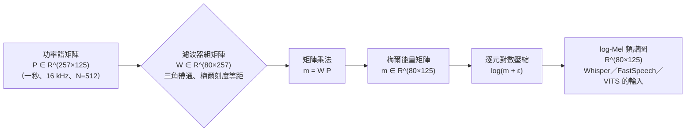
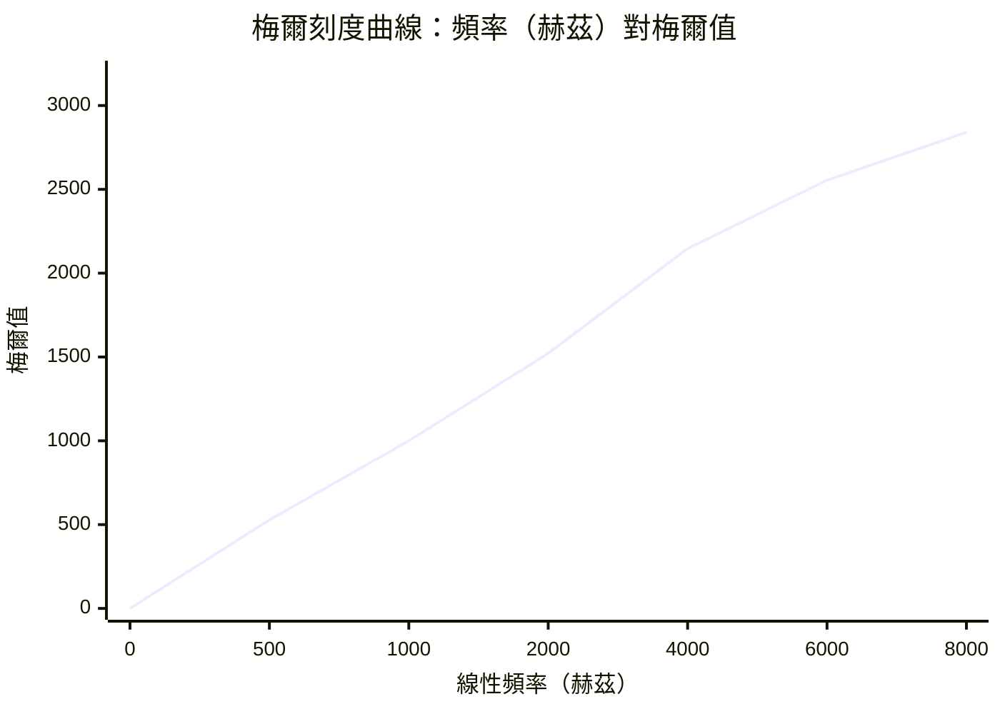

# 2.2 梅爾頻譜圖與濾波器組矩陣（Mel-Filterbanks）

## 從物理頻譜到感受頻譜

STFT 給了我們一張物理上忠實的頻譜圖： $`N/2+1`$ 個**等距線性**頻倉，每倉 $`f_s/N \, \mathrm{Hz}`$ 寬。但人耳並不這樣聽世界。第 1.3 節的梅爾刻度告訴我們：在 $`1000 \, \mathrm{Hz}`$ 以下，人耳對音高的感知大致與線性頻率成正比；超過 $`1000 \, \mathrm{Hz}`$ ， 感知轉為**對數**伸縮， $`3000 \, \mathrm{Hz}`$ 與 $`5000 \, \mathrm{Hz}`$ 之間聽起來的「遠近」遠小於 $`1000 \, \mathrm{Hz}`$ 與 $`3000 \, \mathrm{Hz}`$ 之間。若直接把線性頻譜餵給模型，我們等於把運算與參數浪費在人耳根本不敏感的高頻細節上，同時又對低頻共振峰的感知尺度做了錯誤的線性假設。

梅爾頻譜圖（Mel-spectrogram）的工程回答極其漂亮：**不改變 STFT，只在它的頻率軸上加一組聽覺形狀的濾波器組**，把線性刻度重採樣成感知刻度。這一節的數學主題，就是把這組濾波器寫成一個矩陣。這個做法之所以能成立，是因為 STFT 的輸出本身就是一組連續的頻率取樣點，而重採樣在數學上就是一次加權求和，也就是一次矩陣—向量乘法。

從更根本的物理角度來看，梅爾濾波器組其實是一個**聽覺外周模型的離散化**。耳蝸內的絨毛細胞排列在一條從寬到窄的基膜上，低頻區的基膜寬而鬆、高頻區窄而緊，每個位置只對一小段頻率範圍敏感，這就是耳蝸的分頻器拓撲。而耳蝸的另一個關鍵性質是它的輸入—輸出非線性：同樣寬度的頻率範圍，在低頻處被貼上緊密的一排濾波器，在高頻處則被稀疏地貼上少數幾個。梅爾刻度正是這種非均勻密度的解析表達，濾波器組則是它的離散實現。這解釋了為什麼在梅爾軸上「等間距」聽起來才對等——在梅爾軸上等間距的一組頻率，在聽覺上佔據了等量的主觀空間。

這個解釋也讓三角形的選擇變得自然：理想的多重帶通濾波器應該在梅爾域上保持恆定的增益與恆定的頻寬，但由於梅爾域是非線性的，直接在線性頻率域上鋪放這樣的濾波器會得到不連續的形狀。三角形的線性上升段是這個非線性座標變換下最簡單的平滑替代方案，它保證了相鄰通道在交界處平滑過渡、不會出現階梯狀的斷裂，雖然頻寬會隨頻率略微改變。實驗證明這種細微的形狀失真，在聽覺與辨識性能上幾乎沒有可測量的代價。

## 梅爾濾波器組的矩陣化

設 $`M`$ 為梅爾通道數。我們在梅爾刻度上取 $`M + 2`$ 個**等間距**的點： $`f_{\mathrm{mel}, 0}`$ 到 $`f_{\mathrm{mel}, M+1}`$ ， 逆變換回線性頻率後，以相鄰三點為頂點搭出 $`M`$ 個**三角濾波器**：第 $`j`$ 個濾波器在 $`f_j`$ 處上升到 1、在 $`f_{j+1}`$ 處維持峰頂、在 $`f_{j+2}`$ 處降回 0， 且相鄰兩個三角形在半腰處重疊相接。所有頻率軸上的操作都可以彙整成一個濾波器組矩陣：

$$
\mathbf{W} \, \in \, \mathbb{R}^{M \times (N/2+1)}
$$

其中第 $`(j, k)`$ 元素就是三角濾波器 $`j`$ 在線性頻倉 $`k`$ 處的增益。由於三角在重疊區外為零， $`\mathbf{W}`$ 天然**稀疏**。於是每一幀的梅爾頻譜就是一次矩陣—向量乘法：

$$
\mathbf{m} \, = \, \mathbf{W} \, \mathbf{P}
$$

其中 $`\mathbf{P} \in \mathbb{R}^{(N/2+1) \times T}`$ 是把 $`T`$ 幀的功率譜 $`P(m, k)`$ 沿列堆疊得到的矩陣， $`\mathbf{m} \in \mathbb{R}^{M \times T}`$ 就是**矩陣化梅爾頻譜圖**——每列一個通道、每幀一個時間步。整個梅爾濾波器組在實作裡不過是一次預先構建好的稀疏矩陣乘法，沒有任何時間遞迴，可完全向量化、可上 GPU，這是它能在四十年裡橫跨 DSP 與深度學習兩個時代的最深層原因。

三角濾波器的形狀選擇並非隨意。三角形的線性上升段意味著對相鄰的線性頻率倉做**線性插值**，這與梅爾刻度在低頻近似線性的性質互相呼應：低頻處梅爾間隔小，一個三角只覆蓋少數幾個倉，因此高解析度得以保留；高頻處梅爾間隔大，一個三角橫跨數十個倉，等於自動做了低通與平滑。換句話說，濾波器組的寬度本身就是一個隨頻率遞增的模糊核，把「人耳在此處不敏感」的資訊轉化成了統計上的平滑先驗。

這個平滑先驗在統計上非常關鍵。語音的譜包絡本身是一條光滑曲線，而濾波器組的加權平均正是把 noisy 的逐倉估計投影到「光滑」這個低維子空間上，等於一次隱式的正則化。沒有這一步，257 個逐倉能量估計中的隨機起伏會被直接餵進模型，造成嚴重的過擬合；有了這一步，模型看到的是八十三個已經被物理先驗平滑過的通道值。

## 具體維度走勢：16 kHz、 $`N = 512`$ 、 $`M = 80`$

用一組現代 TTS 的標準參數把維度走完一遍。取 $`f_s = 16 \, \mathrm{kHz}`$ 、 幀長 $`N = 512`$ 、 幀移 $`H = 128`$ 、 梅爾通道 $`M = 80`$ ：

1. 原始頻倉數： $`N/2 + 1 = 257`$ ， 覆蓋 $`0`$ 到 $`8000 \, \mathrm{Hz}`$ 的線性軸，倉距 $`31.25 \, \mathrm{Hz}`$ 。
2. 梅爾軸刻度： $`0`$ 到 $`8000 \, \mathrm{Hz}`$ 換算約為 $`0`$ 到 $`2840.04 \, \mathrm{mel}`$ ， 取 $`M + 2 = 82`$ 個等間距點，間隔約 $`35.12 \, \mathrm{mel}`$ 。
3. 逆映射到線性頻率後，低頻端三角寬約 $`100 \, \mathrm{Hz}`$ 級且可能只橫跨兩到三個倉；高頻端單個三角可橫跨數十個倉——刻度的對數伸縮直接顯形為濾波器寬度的遞增。
4. 濾波器組矩陣： $`\mathbf{W} \in \mathbb{R}^{80 \times 257}`$ ， 總計 $`20560`$ 個儲存格，其中絕大多數為零——典型的非零元只有幾百到一千多個，稀疏度超過 $`95\%`$ 。
5. 一秒音訊 $`= 16000`$ 樣本 $`= 125`$ 幀： $`\mathbf{P} \in \mathbb{R}^{257 \times 125}`$ ， 乘出 $`\mathbf{m} \in \mathbb{R}^{80 \times 125}`$ ， 每秒音訊被壓成 $`10000`$ 個梅爾能量值。

維度走勢總結為 $`16000 \to 257 \to 80`$ ： 取樣率壓到頻倉、頻倉壓到通道，第一段由取樣定理與 DFT 完成，第二段正是 $`\mathbf{W}`$ 的功勞。注意壓縮並非均勻的：原始 $`16000`$ 個樣本裡，真正被人耳分辨的獨立維度遠少於此，濾波器組做的正是把物理維度映射到感知維度。

另一個視角是計算量。對每秒音訊而言，FFT 的成本是 $`125`$ 次 $`512`$ 點複數變換，約 $`125 \times 512 \times 9 \approx 576000`$ 次蝶形運算；而濾波器組若以稀疏形式實作，非零元總數約一千上下，乘積的實際計算量只有 $`125000`$ 次乘加，也就是說在前端的所有運算中，濾波器組比 FFT 還便宜一個數量級。這個比例解釋了為什麼後來幾乎所有研究都把精力放在後端的網路架構，而前端維持原封不動——前端不是瓶頸，瓶頸永遠在後端。

其中 $`\varepsilon`$ 是逐元的常數，典型值 $`10^{-6}`$ 到 $`10^{-2}`$ 之間（ $`2^{-24}`$ 也常見於 librosa 風格的實作），目的有二：避免 $`\log 0 = -\infty`$ ， 並在靜音幀上把能量地板固定在一個可預測的值。

## 對數壓縮的三重動機

乘上 $`\mathbf{W}`$ 之後為什麼一定要取對數？這一步不是習慣，而是三條互補的數學與生理理由。**第一，Weber-Fechner 律**：心理物理學兩百多年來的實驗都指向同一結論——人對刺激的感知差異正比於刺激的相對變化而非絕對變化，響度感知因此近似對數。聽覺系統自己就在做「耳朵內建的 log」，特徵工程追隨生理是最便宜的先驗。

**第二，動態範圍壓縮**：語音功率的動態範圍輕易跨越五到六個數量級，尖峰爆破音與呼吸雜訊之間可以差了近 $`10^{6}`$ 倍；對數把這條數軸重新標定，讓小能量區間獲得大的數值解析度，大能量區間被鎮壓，後續的統計建模（無論是 GMM 還是神經網路）不必再應對如此病態的尺度。若不用對數，動態範圍會直接淹沒掉模型對低能量段的辨識能力。

**第三，乘性效應的加性化**：這是最常被忽略、對下游最關鍵的一條。同一句話經過不同麥克風、不同房間、不同嘴到麥的距離，頻譜近似被一組隨頻率緩變的增益 $`g_k`$ 所**乘**： $`p_k \mapsto g_k \, p_k`$ ； 取對數後變成 $`\log p_k + \log g_k`$ 的**加**性偏移。加性噪音好處理得多——均值平移可用倒譜均值正規化一行消除，也為第 3 章的 GMM 建模掃清了尺度障礙。對數在此同時扮演生理近似、數值穩定器與通道不變性轉換器三重角色。

值得補充的是第四個好處：對數之後，譜包絡與譜紋理在視覺上分離得更乾淨。這使得 log-Mel 頻譜圖能被人眼直接觀察，語音學者能像看地形圖一樣辨認共振峰的走向，這在特徵調參與錯誤分析時極為實用。

還有一個常被忽略的技術細節：濾波器組的正規化方式。當相鄰三角以半腰相接時，每個頻倉被恰好兩個濾波器覆蓋，因此濾波器組的列和約為 2 ， 高頻區因覆蓋面寬而列和更大。若不做任何正規化，高頻通道會系統性地比低頻通道攜帶更多能量，雖然加權平均的相鄰性最終會讓比值趨近常數，但逐幀的絕對值差異仍會影響後續統計模型。這也是為什麼實務上常見兩種做法：一種是把濾波器正規化成面積為一，使各通道能量可比；另一種則保留原始的三角面積，讓通道值直接反映該頻段的絕對能量。這兩種選擇在文獻中並存，各有支持者，是一處真實存在的實作分歧。

## 濾波器組的兩種替代形態

矩陣化的梅爾濾波器組並非唯一的寫法，至少有兩個常見的變體值得知道。第一個是**史密斯—威爾金森（Smith-Wilkinson）濾波器**，它用一個中心頻率與兩個尾巴參數刻畫每個通道：在中心頻率處增益為 1，向兩側以冪律形式衰減，尾巴指數可依頻率連續變化，使得低頻通道窄、高頻通道寬。它的形狀比三角更貼近耳蝸基膜的非線性，但參數較多且不如三角容易推導。另一個是**矩形濾波器組**，即所謂的二值梅爾，直接以梅爾刻度切出等寬的頻段。它的優點是極簡且與梅爾軸嚴格對齊，缺點是相鄰通道之間在邊界處不連續，頻譜圖上會出現可見的爬格子。

在大規模語料的處理上，還有一種常見的工程優化叫**分組卷積**：把所有三角濾波器的非零區段依據覆蓋範圍分組，同一組內的濾波器以 stride 為一的捲積一次性算出，再依組別拼接。這把原本 $`O(MN)`$ 的稀疏矩陣乘變成幾次規則卷積，在 GPU 上能達到數倍加速。對大多數研究者而言，這個最佳化被封裝在套件深處、從不顯露，但它確實是 log-Mel 能夠成為業界事實標準的基礎設施之一。

## 80、40 還是 257：通道數的取捨

通道數 $`M`$ 是資訊量與成本的旋鈕，三個常用值各自對應一個時代。 $`M = 257`$ （不放濾波器、直接使用線性倉）保留全部物理細節，但高頻區浪費大量維度在人耳不敏感處，且維度與頻率刻度都不利於度量學習——早期頻譜降噪用它，現代 ASR 幾乎不用。 $`M = 40`$ 是 1990 年代 MFCC 時代的典型配置：一秒音訊只產出 $`40 \times 100`$ 個數，對算力以 MFLOP 計的 CPU 極為友好，代價是高頻共振峰的分辨粗化。

$`M = 80`$ 是 2015 年之後的主流：算力不再是瓶頸，而現代聲碼器需要更精細的頻譜細節以重建音色，80 個三角在梅爾軸上每通道約 $`35 \, \mathrm{mel}`$ 寬，對共振峰與音色紋理的取樣已足以支撐 HiFi-GAN 級的波形重建。取捨的本質仍是中間表示的資訊預算：通道越少越像特徵、越易於統計建模；通道越多越像訊號、越利於生成還原。值得注意的是，通道數的上限並非越大越好——當 $`M`$ 接近 $`N/2+1`$ 時，濾波器組退化成恆等矩陣，感知刻度的全部好處都消失了。

## log-Mel 的現代統治：為什麼 Whisper、FastSpeech、VITS 都不換

一個自然的質疑是：深度學萬物皆可端到端學習，為何純手工的 log-Mel 依舊是 Whisper（2022）、FastSpeech（2019-2021）、VITS（2021）乃至大規模音訊編解碼器的共同前端？答案有三層。**其一是語義先驗的免費移植**：梅爾刻度與對數壓縮把注意力資源導向人耳敏感區，等於把數十年的聽覺心理學免費注入模型的第一層，訓練資料再多也難以從零學出如此經濟的有偏採樣。**其二是成本的壓倒性優勢**：一次預計算的稀疏矩陣乘，把波形的 $`O(N \log N)`$ 變成逐幀 $`O(M \cdot N/2)`$ 的小運算；相較之下，原始波形做端到端的代價是每一秒要處理一萬六千個具有長程依賴的樣本點。**其三，刻度統一與可比性**：log-Mel 是跨論文、跨資料集的通用貨幣，預訓練模型之間可以無縫比較、微調與蒸餾。

此外還有一個常被低估的工程理由：log-Mel 讓前端與後端解耦。前端是純粹的、可被形式化驗證的訊號處理，後端是純粹的、神經網路式的序列建模，兩者各自獨立演化。Whisper 之所以能從容地把取樣率統一為 $`16 \, \mathrm{kHz}`$ ， 正是因為它的前端把一切都歸約成了固定的 $`80 \times T`$ 張量。實務上的共識可以概括為一句話：除非你在做波形級生成（WaveNet、RVQ 編碼器必需原始樣本），或做需要極高頻解析度的聲源分離，否則 log-Mel 依然是那個便宜、穩定、夠用的正解。

## 刻度曲線與通道數速查

梅爾刻度的非線性可以直接畫出來：橫軸取線性頻率，縱軸取對應的梅爾值，曲線在 $`1000 \, \mathrm{Hz}`$ 之前近乎直線、之後明顯彎折成對數形狀——濾波器組正是沿這條曲線的縱軸做等距取樣、再投回橫軸放置三角形：

不同通道數對應的典型用途與代價整理如下（皆以 $`16 \, \mathrm{kHz}`$ 取樣、 $`N = 512`$ 為基準）：

| 通道數 $`M`$ | 每幀維度 | 梅爾軸等距間隔 | 各自的典型舞台 | 主要代價 |
|---:|---:|---:|---|---|
| 257 | 257 | —（直通線性倉） | 頻譜降噪、相位重建研究 | 高頻冗餘、維度病態 |
| 40 | 40 | 約 $`71 \, \mathrm{mel}`$ | 1990s MFCC、GMM 時代 | 高頻音色粗化 |
| 80 | 80 | 約 $`35 \, \mathrm{mel}`$ | Whisper、FastSpeech、VITS | 計算略增、仍需對數壓縮 |
| 128 | 128 | 約 $`22 \, \mathrm{mel}`$ | 高保真聲碼器、聲源分離 | 記憶體與運算負擔上升 |

## 小結

本節把聽覺刻度轉成一個稀疏矩陣 $`\mathbf{W} \in \mathbb{R}^{M \times (N/2+1)}`$ ， 並展示了 $`\mathbf{m} = \mathbf{W} \mathbf{P}`$ 如何把一秒音訊從五十六萬個樣本壓縮為八千個感知對齊的能量值；對數壓縮則以 Weber-Fechner 律、動態範圍治理與乘性加性化三重理由，奠定了統計建模的尺度基石。至此我們有了 log-Mel 頻譜圖——現代聲音 AI 的事實標準中間表示。下一節將在這個表示上完成最後一步經典變換：DCT 去相關，那正是 MFCC 統治語音辨識四十年的秘密。
