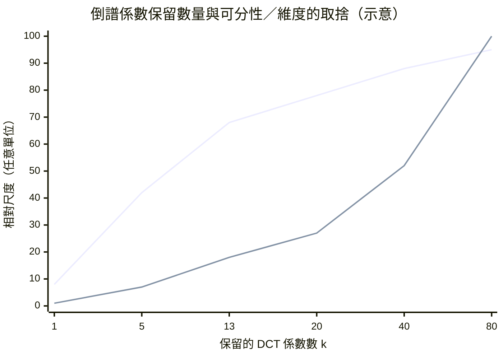
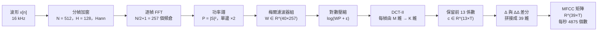

# 2.3 梅爾倒頻譜係數（MFCC）的矩陣推導

## 倒頻譜的源流：一場回聲檢測的意外

1963 年，Bogert、Healy 與 Tukey 在一篇研究地震回聲的論文裡開了一個影響深遠的玩笑：他們把頻譜（spectrum）的字母前半重組，發明了 cepstrum（倒頻譜）、quefrency（倒頻）、ralpis（倒幅）等一整族倒寫術語。玩笑背後是一個嚴肅的觀察：當訊號 $`y[n] = x[n] + x[n - \tau_0]`$ 因回聲而含有延遲副本時，其功率譜會呈現週期為 $`\tau_0`$ 的**週期性**包絡起伏——起伏週期是時間存在於頻域中的倒影。於是對功率譜再做一次傅立葉變換就能把這個週期掀出來，得到一個名為倒頻譜的表示。

這個為偵測回聲而生的工具，很快在 1975 年被 Davis 與 Mermelstein 嫁接到語音上。嫁接的關鍵在於語音的二元結構：聲道的共振峰形狀與激勵源的音調，恰好一個屬於緩變的**頻譜包絡**、一個屬於快速的**譜紋理**，二者在倒頻譜上分居不同的倒頻帶，可以用 liftering（倒譜提升濾波器）乾淨地分開。梅爾刻度版本就此誕生，並在 1980 年代的 HMM-GMM 語音辨識中以驚人的速度征服整個學界。倒頻譜的第一個倒頻係數大致對應整體能量，隨後的係數依序對應譜包絡由粗到細的細節。

要理解為什麼倒頻譜能分離這兩者，需要一點乘法模型的背景。線性聲學模型把語音看成音源激勵通過聲道濾波的結果，在頻域上寫成 $`Y(f) = X(f) \, H(f)`$ ； 取對數後，濾波的乘法變成了加法： $`\log Y = \log X + \log H`$ 。其中 $`\log H`$ 隨頻率緩慢變化，是譜包絡； $`\log X`$ 隨頻率劇烈起伏，是譜紋理。再對頻率做一次傅立葉變換，緩變與急變在倒頻譜軸上就分居低倒頻與高倒頻兩端，一條簡單的截止濾波器即可把二者分開。這套取對數再變換的思路後來被推到極致：倒譜域上再做一次卷積、再取對數，就是倒譜域的倒譜，而 MFCC 的 DCT 正是這條階梯上的第二步。

值得補充的是「倒」這個字眼的精確含義。倒頻譜把頻譜當作一個新的訊號序列來處理，因此它的自變數不再是頻率，而是**倒頻**（quefrency），單位與時間相同。倒頻軸上的位置 $`\tau`$ 直接對應週期為 $`\tau`$ 的成分： $`\tau`$ 很大表示變化很慢（譜包絡）， $`\tau`$ 很小表示變化很快（譜紋理）。理解了這一點，前述的分離操作就不再是技巧，而是定義的直接後果。

## DCT-II：把包絡壓縮成係數

從上節的梅爾能量矩陣 $`\mathbf{m} \in \mathbb{R}^{M \times T}`$ 出發，MFCC 的核心是對每一幀、沿梅爾通道方向施行**第二型離散餘弦變換（DCT-II）**。設 $`\mathbf{m}_n \in \mathbb{R}^{M}`$ 為第 $`n`$ 幀的 $`\log(\mathbf{m} + \epsilon)`$ 向量，則第 $`k`$ 個倒頻譜係數為：

$$
c_k \, = \, \sum_{n = 0}^{M - 1} \mathbf{m}_n \, \cos\left( \frac{\pi k (2n + 1)}{2M} \right)
$$

其中 $`k \in \{ 0, \ldots, M - 1 \}`$ 。把全部 $`M`$ 個係數按 $`k`$ 排列成一個向量，就完成了一次「把頻譜包絡表示為餘弦基底展開」的影像；實務上**只保留前 13 到 40 個係數**，捨棄其餘。

這是經典影像壓縮的直系思想——與 JPEG 同源的 DCT 能量集中性在此被用於語音：包絡的能量幾乎全部集中在低階餘弦基底，前 13 個係數已解釋了每幀九成以上的感知資訊，尾部係數則多為快速譜紋理（音調與其諧波結構）與噪聲的載體。捨去它們不僅省維度，還是一種聲學隱式降噪。 $`k = 0`$ 的係數在加上一個 $`1/\sqrt{2}`$ 的歸一因子後正比於對數總能量，實作中往往被剔除或代之以真實的幀能量特徵，以消除增益的不變性。

換個角度說，DCT 在這裡扮演的角色是把連續曲線參數化：譜包絡本質上是一條低階平滑曲線，用前十幾個餘弦係數描述它，就像用多項式座標描述一條拋物線。截斷的意義因此非常清楚——不是砍掉特徵，而是用一個低維模型去擬合一條本來就低維的曲線。

為什麼是餘弦而不是正弦？DCT-II 的基底函數為 $`\cos\left( \frac{\pi k (2n+1)}{2M} \right)`$ ， 在 $`k = 0`$ 時恆為 1 ， 因此第零係數精確地承載了整體能量，這在聲學上非常實用。此外餘弦基底在偶對稱延伸下相當於把訊號做週期鏡像再取 DFT，而鏡像擴充讓變換基底的頻率解析度加倍，等於在不增加維度的條件下獲得了更細的頻譜取樣能力。傳統的 MFCC 慣例還會把第一個係數（能量項）獨立成「幀能量」特徵，於是最終的 13 維通常被描述成 12 個倒譜加 1 個對數能量。

還有一個實作細節值得留意：正交化的 DCT-II 在數學上是正交的，但在實務中常用的加速版本（快速 DCT、以矩陣乘實作的 DCT）往往不做正規化，其正交性只近似成立。由於 MFCC 之後緊接著要估計高斯混合模型，尺度的不精確會直接影響協方差參數的估計品質，因此在嚴謹的系統裡通常會把 DCT 的正交性納入考量，或至少在初始化時留意各維的尺度一致性。

## DCT 去相關與 PCA 的深刻近似

為什麼偏偏是 DCT，而不是 DFT 或別的正交變換？關鍵在**去相關**——把維度間的統計相關性榨乾，讓每個係數盡可能各自獨立。數學上，經典 MFCC 管線輸出的是一階序列的局部統計，而**一階自迴歸 AR(1) 訊號**（相鄰維度相關係數 $`\rho \to 1`$ ， 幾乎滿足譜能量隨頻率平滑衰減的形態）恰有一個著名結論：DCT-II 是這類訊號在漸近意義下的**KLT**（Karhunen-Loève 變換），而 KLT 正是讓協方差矩陣**趨近對角化**的最優正交變換——在極限場景中，DCT-II 等價於對頻譜包絡的隨機過程做了一次逐幀 PCA。

這一性質對第 3 章的 HMM-GMM 架構是雪中送炭而非錦上添花。GMM 的每個高斯有 $`d(d+1)/2`$ 個協方差參數要估計， $`d = 39`$ 時即 $`780`$ 個，資料不足時矩陣病態、EM 收斂崩壞；工業界的解法是改用**對角協方差**，只在 $`d = 13`$ 個變數間假設獨立——而這個假設只有在輸入特徵已然去相關時才勉強成立。因果鏈因此閉合成一句話：**DCT 的 KLT 近似，是三十三年之後對角高斯混合得以數學自洽的前提**。沒有這一步，1980 到 2010 年的整個 HMM-GMM 王朝都將建在流沙上。

需要誠實地補上一句：這個近似從來不是精確等式。真正的 KLT 需要知道協方差矩陣的特徵向量，而 DCT 只是一個與之無關的固定基底，因此「DCT 等於 PCA」在本質上是一個啟發式的替代——它之所以在實踐中有效，是因為譜包絡在梅爾軸上的相關結構恰好接近那個讓 DCT 趨近 KLT 的 AR(1) 模型。

這個近似的實踐後果非常具體。若 DCT 真的產生了完全去相關的特徵，那麼在對角協方差的假設下，39 維的 GMM 每個成分只需要估計 39 個方差加上 39 個均值，共 78 個參數；若沒有去相關，觀測維度間的協方差就必須被估計，參數數量回到 $`39 \times 40 / 2 = 780`$ 個，是前者的十倍，而訓練語料的量級遠不足以支撐這麼多自由參數。學者們在 1990 年代中期大量實驗中反覆觀察到的「MFCC + 對角 GMM」組合之所以能贏過「原始譜 + 全協方差 GMM」，正是因為它把模型容量從資料量無法支撐的區間拉回到了可估計的區間。

此外，KLT 的視角還解釋了為什麼「保留前 13 個係數」是安全的：在對角化之後，各係數彼此獨立，因此丟掉高階係數只是丟掉少量獨立的資訊，不會像在未去相關的特徵上截斷那樣丟掉混合了許多原始維度的資訊。截斷在去相關之後才是無害的，這個先後次序不能顛倒。

## Delta 與 Delta-Delta：差分的二階擬合

倒頻譜係數只描述一個幀內的靜態形狀，而語音的識別資訊大量藏在**軌跡的斜率**裡——同一組靜態係數，聲道張開的過程與閉合的過程對應不同的母音。1976 到 1986 年間，實務引入一階差分（Delta）與二階差分（Delta-Delta）來補這一課。最常用的一階差分取前後各兩幀：

$$
d_t \, = \, \sum_{\tau = -2}^{2} \tau \, \mathbf{c}_{t + \tau}
$$

這是加權和 $`\mathbf{c}_{t+1} - \mathbf{c}_{t-1}`$ 加上 $`2(\mathbf{c}_{t+2} - \mathbf{c}_{t-2})`$ 的組合，本質上以固定係數的滑動窗做一次**局部線性回歸**的斜率估計，窗長為 $`9`$ 幀（更常見的 $`5`$ 點差分屬另一形式，工業慣例多在 $`2`$ 幀到 $`9`$ 幀之間微調）。二階差分對 Delta 再做一次同型卷積，得到曲率特徵。三級特徵拼接後，每幀維度變成 $`3 \times 13 = 39`$ —— 1980 至 2010 年代語音辨識論文頁腳處出現頻率最高的數字。

差分特徵的加入也讓 HMM 的狀態模型變得更貼近聽覺直覺：靜態係數描述「當下的形狀」，Delta 描述「正在往哪裡去」，Delta-Delta 描述「變化有多急」。三者的拼接，等價於把倒譜係數當成一個以幀為時間軸的三次曲線的係數。

差分並不是沒有代價的。時間方向的差分會放大高頻噪音，因此實務上通常在做差分之前先套用倒譜均值正規化（cepstral mean normalization, CMN）：把整段語音或整句話的倒譜係數在時間上求平均，再從每一幀減去這個平均向量。這一步同時解決了兩個問題：消除通道與講話人的固定偏移，以及抑制差分對殘餘直流量的放大效應。在現代系統裡，CMN 幾乎是 MFCC 管線的標準配備，它也解釋了為何傳統 MFCC 系統在跨語料測試時表現穩健——它內建了一種粗略的說話人正規化。

## 完整管線：一步一格的矩陣流程

把全書前兩章與本節的所有零件串起來，經典 MFCC 管線是一條純矩陣流水線：

以一組具體數字走完全程：一秒的 $`16 \, \mathrm{kHz}`$ 波形是 $`16000`$ 個樣本；分幀加窗後成為 $`T = 125`$ 個 512 維向量總計 $`64000`$ 個數（重疊引入了四倍冗餘）；FFT 與功率譜化為 $`257 \times 125 = 32125`$ 個實數；梅爾過濾後剩 $`40 \times 125 = 5000`$ 個能量值；對數給出同維數的 log-Mel；DCT-II 與截斷壓到 $`13 \times 125 = 1625`$ ； 加上 Delta 與 Delta-Delta 各一份，最終 MFCC 是 $`39 \times 125 = 4875`$ 個數。從 $`16000`$ 個序列樣本出發，得到 $`4875`$ 個結構化特徵——壓縮比約 $`3.3`$ ， 而資訊損失集中在人耳與辨識都不敏感的音調細紋理上。

| 階段 | 輸出形態 | 尺寸（一秒，16 kHz） | 該步的功能 |
|---|---|---:|---|
| 原始波形 | $`x[n]`$ | 16000 | 連續聲壓的離散採樣 |
| 分幀加窗 | 125 個 $`N`$ 維向量 | 64000 | 切出准平穩片段 |
| 功率譜 | $`\mathbf{P} \in \mathbb{R}^{257 \times 125}`$ | 32125 | 能量分佈、去相位 |
| 梅爾能量 | $`\mathbf{m} \in \mathbb{R}^{40 \times 125}`$ | 5000 | 感知刻度化 |
| log-Mel | $`\log(\mathbf{m} + \epsilon)`$ | 5000 | 壓縮動態範圍 |
| DCT 截斷 | $`\mathbf{c} \in \mathbb{R}^{13 \times 125}`$ | 1625 | 去相關、能量集中 |
| 加差分 | $`39 \times 125`$ | 4875 | 加入動態軌跡資訊 |

整條管線可以再用一個矩陣的視角重述一次：所有運算都是左乘一個固定矩陣與右乘一個差分算子，因此從原始波形到最終 MFCC，數學上等價於一次線性映射與一次有限差分。這個「線性」的觀察在 2.1 節的時頻不確定性討論裡其實沒有出現過——它說明 MFCC 特徵在特徵空間中丟棄了原始波形中的所有非線性資訊（相位、跨幀的絕對位置、精確的譜形狀）。這既是它的效率來源，也是它最終被捨棄的原因。

也正因為如此，MFCC 時代的語音辨識幾乎完全仰賴 HMM 的時間對齊來補償靜態特徵的不足：模型必須用狀態機記住我們已經走到哪裡，因為特徵本身不記得。一旦卷積神經網路能夠從局部特徵中學到跨時間的上下文，這份負擔就被卸下了——這正是第四章的 DNN-HMM 混血架構所帶來的變化。

## 從四十年統治到 log-Mel 的回歸

MFCC 以「便宜、去相關、量表良好」三項資產統治了語音辨識前端四十年：從早期的動態時間彎曲，到 1980 年代的 HMM-GMM，再到 2000 年代的大規模 GMM-HMM 評測，幾乎每一篇論文的實驗節都寫著同樣一句「使用 39 維 MFCC」。它的退位不是因為失效，而是因為前提消失。

DCT 的全部美德都服務於一個假設：下游是**線性統計模型**（對角高斯），需要特徵事先去相關。深度神經網路不是這樣的模型——卷積層與全連接層的第一件事就是學出跨維度的線性組合，去相關這件禮物對它近乎沒有價值；而 DCT 的低通截斷反而會不可逆地抹掉音調與音色細節，成為端到端學習的瓶頸。於是歷史發生了乾淨的回歸：**模型一強，中間表示就讓位**。log-Mel 頻譜圖（保留全部 $`M`$ 個通道、不做 DCT）重新成為 Whisper、FastSpeech、VITS 的選擇，通道數從 40 恢復到 80，把「去相關」的工作徹底交給第一層神經網路自己去學。

更細緻地說，深度模型不僅不再需要去相關，它反而**受益於**保留原始相關結構。全連結層的第一層若接在 log-Mel 上，等於可以自由學出任何跨通道的線性組合，包括 DCT 這個特定的組合——也就是說，網路有機會自己發現倒頻譜係數，只是不再受限於工程師事先指定的那十幾個基底。這個現象在實驗中是可以觀察到的：把 log-Mel 送進卷積網路，其第一層濾波器在視覺上與倒譜基底頗為相似。

有趣的是，DCT 並未死亡——它轉身成為倒譜正規化的後處理工具與某些串流模型的廉價變換，繼續以低調的方式服務。更深層的轉變是觀念的：MFCC 時代我們相信「好的特徵應當在物理上無關」，而深度學習時代的共識變成「好的特徵應當保留足夠的資訊，讓模型自己學會如何無關」。這兩種哲學的分野，幾乎是整個人工智慧史的一條縮影。

## 小結

本節從倒頻譜的地震學起源講起，給出了 DCT-II 的定義與係數截斷的依據，論證了 DCT 在一階 AR 模型下近似於 KLT 與 PCA 的去相關性質，並指出這一性質正是第 3 章對角協方差 GMM 能夠成立的數學前提。最後我們以差分特徵與完整管線的矩陣流程收束，得到 $`39 \times T`$ 的經典 MFCC 矩陣，同時解釋了它為何被 log-Mel 取代。

回頭看這三節的敘事結構，會發現一條貫穿的因果鏈：第 2.1 節用 Gabor 極限確定了「能看見多少」的上限，第 2.2 節用梅爾濾波器組決定了「值得看見的是哪些頻率」，本節則用倒譜變換決定了「如何把看見的東西壓縮成可統計的形狀」。三個問題的答案分別是時間—頻率取捨、感知刻度選擇與去相關壓縮，三者共同決定了語音前端在深度學習出現之前的全部設計空間。

而深度學習的到來，恰好把這三個問題都重新打開了：卷積核的尺寸讓時間—頻率取捨重新變得可學，梅爾濾波器組可以被訓練成可學的卷積層，倒譜去相關則被交給第一層全連接。下一章我們將看到，正是坐在這組特徵上的高斯混合模型，把貝氏語音辨識推上了它的黃金年代；而第四章之後，那個特徵又會被神經網路一層一層地吃掉。
