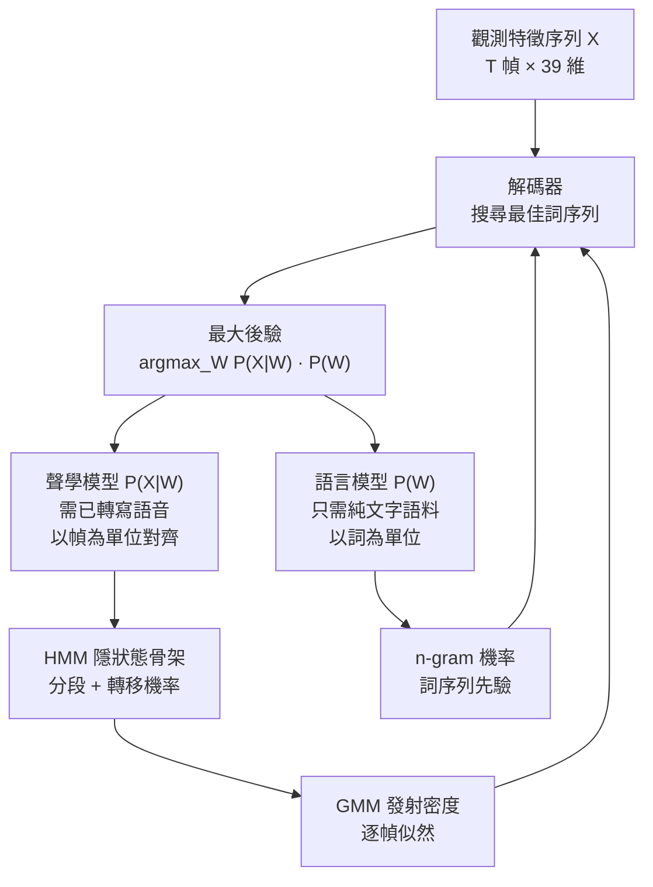

# 3.1 語音辨識的貝氏框架

## 從特徵序列到文字序列的機率問題

在前兩章，我們把連續的聲波一路轉換成 MFCC 特徵矩陣：每隔 $`10`$ 毫秒取一幀，每幀以 $`39`$ 維向量描述聲道的頻譜形狀。到此為止，機器手上有一個長矩陣 $`X = (x_1, \dots, x_T)`$ ，其中每一幀 $`x_t`$ 都是實數向量，而整段語音對應的答案是離散的詞序列 $`W = (w_1, \dots, w_N)`$ 。語音辨識因此成為一個結構清晰的推論問題：**給定觀測到的特徵序列，找出最有可能生成它的文字序列**。

乍看之下，這像一個翻譯的問題，但統計語音學家的切入方式是機率論的。特徵 $`X`$ 是隨機向量序列， $`W`$ 是離散隨機序列，兩者之間不存在確定性的函數映射——同一句話由不同的人、在不同噪音環境下說出，會產生截然不同的 $`X`$ 。因此我們不問「 $`X`$ 對應哪個 $`W`$ 」，而問「哪個 $`W`$ 使 $`P(W \mid X)`$ 最大」。這是古典貝氏決策理論（Bayes decision theory）在序列資料上的直接應用：最小化錯誤率的最佳決策規則，就是選後驗機率最大的假設。

把這個想法寫下來，就是最大後驗（Maximum A Posteriori, MAP）估算。我們的目標是

$$
\hat{W} = \arg\max_W P(W \mid X) \, .
$$

貝氏定理把這個後驗展開成三個因子的乘積：

$$
P(W \mid X) = \frac{P(X \mid W) \, P(W)}{P(X)} \, .
$$

分子裡的 $`P(X \mid W)`$ 是在已知所說內容的條件下，觀測到這段音訊特徵的機率——這是**聲學合理性**； $`P(W)`$ 是這段文字本身在該語言中出現的先驗機率——這是**語言合理性**。分母 $`P(X)`$ 則是證據（evidence），它與 $`W`$ 無關，對所有候選詞序列都是同一個常數，因此在 $`\arg\max`$ 中可以直接消去。於是決策規則化簡為

$$
\hat{W} = \arg\max_W P(X \mid W) \, P(W) \, .
$$

這一行公式，就是整個統計語音辨識的憲法。它看似平淡，卻完成了一件極不平凡的事：把「聽懂語言」這個無法直接下手的人工智慧難題，拆解成兩個可以各自建模、各自訓練、各自評估的子問題。

## 分解如何切出兩個子模型

我們先把整個系統的符號固定下來。下表列出本章三節會反覆使用的模型符號與其對應的工程組件，這張表本身就是整個 GMM-HMM 時代的零件清單。

| 符號 | 名稱 | 型態 | 在系統中的角色 |
|---|---|---|---|
| $`X`$ | 觀測特徵序列 | $`T`$ 個 $`39`$ 維實數向量 | 輸入 |
| $`W`$ | 詞序列 | $`N`$ 個離散符號 | 輸出 |
| $`S`$ | 隱狀態序列 | $`T`$ 個狀態編號 | 分段骨架（不可觀測） |
| $`P(X \mid W)`$ | 聲學模型 | 機率密度 | 把詞串映射成音訊 |
| $`P(W)`$ | 語言模型 | 機率 | 把詞串變成通順句子 |
| $`b_j(x)`$ | 發射密度 | 機率密度 | 狀態 $`j`$ 產生特徵 $`x`$ 的機率 |
| $`a_{ij}`$ | 轉移機率 | 機率 | 狀態 $`i`$ 走到狀態 $`j`$ 的機率 |
| $`\pi_j`$ | 初始機率 | 機率 | 序列起點落在狀態 $`j`$ |

這個分解的結構可以用一張流程圖表達：最上層是待解的 MAP 問題，向下分岔成兩條彼此獨立的建模路徑，最後在解碼器中重新合流。

這張圖的關鍵在於中間那兩條支線的**資料來源完全不同**。聲學模型需要的是語音學知識——聲道形狀、音素、協同發音——它的訓練資料必須是「音訊 + 逐字稿」；語言模型需要的是語言學知識——詞彙、語法、語用——它的訓練資料只要純文字，後者可以從報紙、網頁、書籍無限供應。這種「資料異質性被機率分解吸收」的性質，是這個框架能成為三十年主流架構的根本原因。

## 為什麼這個分解贏了

現在回頭看，為什麼貝氏分解會贏過它的競爭者？在它之前，語音辨識有兩條主要的技術路線：模式比對與規則系統。前者把每個詞的參考模板存起來，用動態時間彎曲（Dynamic Time Warping, DTW）去對齊測試語音；後者則把音素識別規則與句法規則手工寫進系統。兩者的共同弱點是**沒有處理不確定性的數學語言**：DTW 只給出距離，不給出機率，因此無法把「這個詞比那個詞更可能」這件事形式化，也無法在系統裡加入語言先驗。規則系統的弱點更根本——它把語言知識硬編碼成 if-then 鏈，一旦遇到規則沒有覆蓋的輸入就完全失能。

貝氏框架的決定性優勢不在於它更「聰明」，而在於它**把不可計算的整體變成了兩個可計算的局部之積**。所謂最大後驗，本質上是一個在巨大離散空間上的最佳化問題，但它在數學上被切成兩個各自有解、且解可以分開儲存的因子。於是「可計算性」從不可能變成了工程細節。

此外還有一項常被忽略的好處：**貝氏框架讓「解碼」成為一個獨立的、可被最佳化的物件**。既然目標函數被寫成了兩個因子的乘積，那麼任何能提高其中一個因子準確度的技術改進，都必然改善整體辨識率——這提供了一條不依賴端到端標註的進步路徑。在深度學習之前的年代，能夠取得大量「音訊加逐字稿」但無法取得音素級時間對齊的資料，是常態；而貝氏框架讓這些資料在沒有細粒度對齊的情況下仍然可用，因為對齊本身就是模型的一部分。

三項具體的好處值得點出。第一是**分別訓練**：聲學模型的訓練需要對齊，需要迭代；語言模型的訓練只是一個計數問題，幾分鐘就能更新一版 n-gram 統計。兩者的迭代速度差了數個數量級，可以各自以自己的節奏推進。第二是**分別精調**：實務上，聲學模型偏好的輸出與語言模型偏好的輸出常常不同，系統需要一個權重來平衡兩者，這個權重可以在同一套已訓練的模型上反覆掃描，找到驗證集上的最優值。第三是**分別評估**：聲學模型用似然或 per-frame 準確率衡量，語言模型用困惑度（perplexity）衡量，兩者各自有明確的優化方向，不必等整個系統端到端才能判斷哪一環出了問題。

這三項好處合起來，就是「資料異質性被機率分解吸收」的完整意義：一個模組升級不牽動另一個，兩者只需要在解碼介面處以分數匯合。而後來所有的工程演化——從 GMM 換成 DNN、從 n-gram 換成 RNN、從稀疏特徵換到 log-Mel——都只是在這個固定的介面上替換零件，而介面本身紋絲不動。

這裡有一個容易被忽略的技術細節：公式中的機率必須全部改寫成對數形式才能實作。這不是美觀考量，而是動態規劃的硬性要求——Viterbi 遞迴是對數域上的乘加，若直接用機率， $`T`$ 幀的連乘會使數值在數百幀內下溢為零。所以實務上定義 $`\hat{w}_{jm} = \log w_{jm}`$ 、 $`\log b_j(x_t)`$ 與 $`\log a_{ij}`$ ，遞迴式變成加法：

$$
\hat{\delta}_j(t) = \max_i \, \hat{\delta}_i(t-1) + \hat{a}_{ij} + \hat{b}_j(x_t) \, .
$$

這個改寫還帶來一個好處：整個解碼過程的總分可以直接相加，也就是說模型分數變成「弧權重的總和」，這正是第 3.3 節能把它們摺疊成單一加權圖的前提。可以說，貝氏框架的實作路徑從這裡就已經指向有限狀態機的形式化了。

實務上，使用者還會對 $`P(W)`$ 乘上一個可調指數 $`\kappa`$ （語言模型權重，language model weight），並加上詞插入懲罰 $`b`$ 以控制搜尋的喘息空間：

$$
\hat{W} = \arg\max_W P(X \mid W) \, P(W)^{\kappa} \, e^{b N_{W}} \, ,
$$

其中 $`N_{W}`$ 是詞數。這兩個超參數沒有貝氏詮釋，純粹是在兩個機率模型估計偏差之間做實證調校——這個「理論上不純、工程上必須」的細節，恰好預告了整個 GMM-HMM 時代的氣質。

## 統計轉向的歷史現場

這個框架的勝利並非顯而易見。在 1970 年代之前，語音辨識由符號方法主導。真正的典範轉移發生在 1980 年代，以三個機構為軸心。

CMU 方面，Lee 與 Reddy 等人把 SPHINX 系統建立在隱馬可夫模型上，證明統計方法在與說話者無關的任務上全面勝出；這是一個決定性的示範，因為它同時用上了本章的三樣東西——貝氏分解、HMM 分段、以及 n-gram 語言模型。IBM 方面，Jelinek 團隊延續他們在統計語言翻譯上的方法論，把 n-gram 語言模型推到工業強度，並留下那句名言——「每次我解僱一位語言學家，系統的辨識率就上升」；這句話並非全然玩笑，它精確描述了把語言知識從規則轉為計數後的資訊效率增益。MIT 則在 Rim 與 Zue 等人的努力下，以 Summitt 系統貢獻了大量關於分詞與樹狀語法結構在統計框架中之整合的研究。

1989 年，Lawrence Rabiner 在 *Proceedings of the IEEE* 上發表〈A Tutorial on Hidden Markov Models and Selected Applications in Speech Recognition〉。這篇綜述把 HMM 的三個基本問題——似然評估、參數重估、最佳狀態序列搜尋——以教科書等級的嚴謹度完整整理，成為此後二十年每個語音工程師的入門文本。它標誌著一個技術社群的成熟：現代已經有一套完整、自洽、可傳授的方法論。

這段歷史還有一層常被略過的技術伏筆：貝氏框架之所以能在 1980 年代落地，前提是算力足以支撐它的核心操作。具體來說，Viterbi 與前向-後向都是 $`O(N^{2} T)`$ 的乘加，而 HMM 的狀態數 $`N`$ 在上下文相依系統中輕易破千， $`T`$ 以每秒上百幀計——這意味著每秒需要數十億次浮點運算。在沒有平行向量硬體的年代，這種計算量只有超級電腦才承擔得起，而 DARPA 的評測正是為超級電腦而設。於是出現了一個少有人明說的因果鏈：**聯邦資助的評測體系同時提供了演算法競爭的場地與硬體資源的來源**。統計方法在 1990 年代的壯大，某種意義上是資源體制的一部分。

與此同時，美國的資助體系扮演了看不見的推手。DARPA 自 1980 年代起持續舉辦以任務為導向的評測，先是 Resource Management 語料，再有 Wall Street Journal 、Switchboard 與 Broadcast News 等規模遞增的共享資料集。競賽規則迫使各實驗室採用同樣的詞錯誤率度量，採用互相可比的貝氏分解架構，推動演算法與資料在社群內快速流通。這段 1988 到 2008 年由 DARPA 訴求所塑造的評測文化，效果好壞參半——它加速了工程收斂，卻也使整個領域的目光被鎖定在中小詞彙、朗讀語音的任務上——但它確實讓「統計方法」從眾多方案之一，變成唯一的正統。

值得強調的是，這個分解並不意味著兩個因子是彼此獨立的物理現象。 $`P(X \mid W)`$ 與 $`P(W)`$ 在真實語音裡顯然相關——說話人選詞時的用詞習慣會改變發音，語境也會改變聲學細節。貝氏框架並不否認這一點，它只是把這類相關性全部吸收進 $`P(W)`$ 這個可調、可訓練的先驗裡，而不去建模它們。這是一個明確的工程取捨：把語言學與聲學學之間的介面現象降級為一個經驗參數。三十年後的端到端 seq2seq 架構所做的恰恰相反——它試圖讓這一層關聯也變成可學的。

## 分解切出三個組合難題

貝氏決策規則只是「答案的形狀」，不是「計算的方法」。要把

$$
\hat{W} = \arg\max_W P(X \mid W) \, P(W)
$$

落到可用程式，至少要跨過三道障礙，而這三道障礙恰好對應本書接下來兩章的全部內容。

第一是**分段**（segmentation）問題： $`X`$ 有 $`T`$ 幀， $`W`$ 有 $`N`$ 個詞，但沒有人告訴你第 $`k`$ 個詞從第幾幀開始、到第幾幀結束；更小的單位——音素——同樣沒有邊界標註。連續語音不但在頻域上是連續的，在時間軸上的語音學事件邊界也常常是模糊的：爆破音的閉塞段在母音前被拉長，子音被鄰近的協同發音染色。我們需要一個隱變數架構，允許「念這段音時，機器內部走過了哪些不可觀測的狀態」，並在訓練時自動學出時間對應——這正是隱馬可夫模型（HMM）的角色，我們接受的解法是讓狀態序列成為隱變數，用期望值把它的不確定性寫進目標函數。

第二是**模型估計**（estimation）問題：一旦決定用「HMM 狀態發射出 MFCC 向量」的形式來表示 $`P(X \mid W)`$ ，發射機率 $`P(x_t \mid s)`$ 需要一個連續向量的機率密度函數，而且這個密度要能在有限的訓練資料上被穩健估計。第 3.2 節將看到，教科書的答案是把每個狀態配上高斯混合模型（GMM）作為發射密度，並用 EM 演算法（在語音社群中稱為 Baum-Welch 演算法）交替執行隱狀態後驗推算與參數重估。

第三是**搜尋**（search）問題：「對所有 $`W`$ 求最大」在一個詞彙量上萬、語音長達數十秒的場景下，是天文數字的組合爆炸。即使是中等長度的句子，候選詞序列的數量也會與詞彙量大小的句長次方成正比，窮舉一秒鐘都嫌多。第 3.3 節將看到，動態規劃把這個組合問題壓回多項式的規模：Viterbi 演算法在狀態圖上做一次單遍掃描，同步完成分段的搜尋與機率的累積；而把聲學模型、上下文相依性、詞典與語言模型四張圖組合成一張加權有限狀態自動機的技術，則把等號右邊的整個機率模型變成一次可以在記憶體裡攤平的靜態物件。

## 框架的美德與代價

回頭看，這個貝氏分解之所以能統治三十年，在於它使三大難題彼此解耦：聲學模型的進步不牽動語言模型，語言模型的升級不重訓聲學模型，解碼器對兩者一視同仁地當作兩組分數來消費。每一個模組都有清晰的輸入輸出與獨立的評測指標，這種模組化讓數百人的研究社群得以分工，也讓 DARPA 的競賽變得可能。第 2.3 節留下的伏筆——為什麼 MFCC 要做倒譜與截斷——也將在第 3.2 節獲得真正的解答：那是為了讓高斯模型的協方差矩陣可以取對角形式，把參數量壓到可估計的範圍。

但代價同樣寫在架構裡。分解出了僵硬的邊界：聲學模型在 $`39`$ 維手工特徵上估計高斯密度，永遠無法捕捉跨幀的非線性時間結構；語言模型只看得到詞序列，對聲音的細節一無所知；三個模組的誤差不斷在介面處累積，而整條鏈上沒有任何一個環節可以從最終的詞錯誤率反向獲得端到端的梯度。2010 年代後，深度學習正是沿著這三條裂縫逐層瓦解這個框架的——但要看清瓦解的方式，必須先澈底理解它築起的三座高塔。接下來的兩節，就是那三座塔的地圖。
