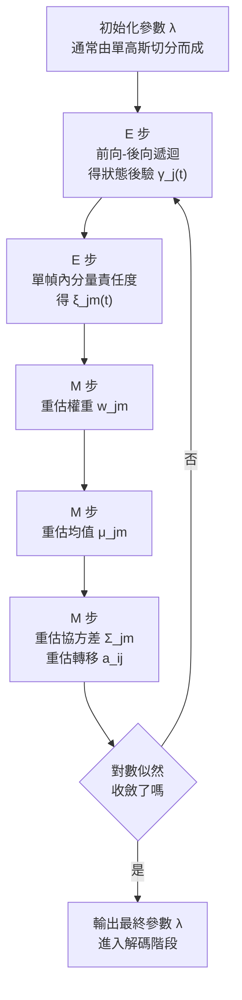

# 3.2 高斯混合模型（GMM）與期望最大化（EM）

## 狀態要發射什麼

第 3.1 節把辨識分解為 $ \hat{W} = \arg\max_W P(X \mid W) P(W) $ ，並承諾用 HMM 的隱狀態解決分段問題。現在剩下的是一個純粹的統計估計問題：當聲學模型聲稱「第 $ t $ 幀的特徵向量 $ x_t $ 是由狀態 $ s_j $ 發射出來的」，這句話對應的機率密度 $ b_j(x_t) = P(x_t \mid s = j) $ 必須具體寫成數學形式。

MFCC 特徵是實數向量，直觀的第一選擇是高斯密度——它在熵最大的意義上是最不武斷的連續分佈，而且對數似然對均值和對角變異數都有解析解。但單一高斯的鐘形曲面太僵硬：同一個音素的聲譜會隨說話者、語速、前後文而滑動，實測的特徵散佈幾乎從來不是單峰。工程上的妥協是用加權的混合密度，

$$
b_j(x) = \sum_{m=1}^{M} w_{jm} \, \mathcal{N}(x ; \mu_{jm}, \Sigma_{jm}) \, ,
$$

其中 $ w_{jm} \geq 0 $ 是分量權重、滿足 $ \sum_{m=1}^{M} w_{jm} = 1 $ ， $ \mu_{jm} $ 與 $ \Sigma_{jm} $ 分別是第 $ m $ 個分量的均值向量與協方差矩陣。混合的每一個分量可以專門負責一種發音子風格——男聲一顆、女聲一顆、鼻化變體再一顆。理論上，只要分量數 $ M $ 充分大，GMM 能以任意精度逼近任何連續分佈，這正是它作為密度估計器的表達力保證。

值得強調的是，這個模型的參數數量會隨上下文相依狀態數與分量數雙向膨脹，因此工程上必須嚴格管制。下表給出經典 HMM-GMM 組件的參數量級估算，以 $ 39 $ 維 MFCC 為例。

| 組件 | 數量 | 每單位參數量 | 參數總量級 | 說明 |
|---|---:|---:|---:|---|
| 單高斯狀態 | 1 個 | $ 1 + 39 + 39 = 79 $ | 百位數 | 對角協方差的最小可用配置 |
| GMM 狀態（ $ M = 8 $ ） | 1 個 | $ 8 \times 79 = 632 $ | 千位數 | 語音社群的主流設定 |
| 全協方差 GMM | 1 個 | $ M \times (39 + 780) $ | 數萬 | 資料量不足，實務淘汰 |
| 上下文相依音素類 | 約 $ 10^{3} $ 至 $ 10^{4} $ | — | 百萬至億 | 由 triphone 綁定共享參數 |

這張表已經預告了下一節的主題：參數量對資料量的比值，是這個時代所有工程取捨的真正支配變數。

還有一個常被忽略的結構性選擇值得在此點出：GMM 分量數 $ M $ 的增加並非線性免費。每多一個分量，就多一組均值與協方差要靠資料餵養；在資料量固定的前提下， $ M $ 從 $ 1 $ 增加到 $ 16 $ 的收益（密度逼近更好）與代價（每個分量的有效樣本數變少、估計方差變大）會在某處交叉。實務上這條曲線的轉折點通常落在 $ M $ 介於 $ 8 $ 與 $ 16 $ 之間，而具體位置取決於狀態是共享的還是獨立的。這也解釋了為什麼對角協方差 GMM 在同一份 $ 39 $ 維特徵上，表現優於全協方差 GMM：它不是因為前者更「有表達力」，而是因為在有限的資料量下，模型容量的最佳化方向是縮小而不是擴大。

## 對角協方差：一場被特徵工程預先打好的仗

現實立刻出現摩擦。 $ 39 $ 維的 MFCC 向量若配全協方差矩陣，每個分量光是協方差就需要 $ (39 \times 40) / 2 = 780 $ 個獨立參數，再加上均值與權重就接近 $ 860 $ 個。一個上下文相依系統有數千乃至上萬個 HMM 狀態，即使每個狀態只配一個分量，參數總量也在千萬級，而可用的已轉寫語音往往只有幾十小時。協方差矩陣中每個非對角元素描述的是兩個特徵維度之間的線性相關，在資料有限時根本估不準，結果是矩陣接近奇異、馬氏距離爆炸、似然被單一樣本支配。

教科書的解法是直接令 $ \Sigma_{jm} = \mathrm{diag}(\sigma_{jm,1}^{2}, \dots, \sigma_{jm,39}^{2}) $ ，只保留對角線，參數量降到每分量 $ 39 $ 個，縮減二十倍。但這一步有隱藏前提：特徵的各維必須近似不相關，否則丟掉非對角元素就是在丟失真實的統計結構。

這正是第 2.3 節埋下的伏筆——MFCC 對對數梅爾頻譜做了 DCT，而 DCT 對平滑的譜包絡恰好是一個近似去相關變換，把能量集中到低階倒譜係數上。整條特徵管線的設計動機至此收束成一句話：梅爾刻度模擬人耳的解析度，對數壓縮模擬響度感知，DCT 去相關則是為了讓下游的 GMM 能用對角協方差被便宜地估計。特徵工程在這裡不是為了浪漫地模擬人耳，而是為了服從估計器的數學限制。

值得補充的是「綁定」在其中的角色。語音系統並不真的為數千個 triphone 各配一套獨立參數，而是把發音相近的 triphone 綁定（bundle）到同一組參數上，靠共享資料量來穩健化估計。這是一個純粹的統計工程折衷：它犧牲了語音學上的細緻區別，換來每組參數背後數倍的訓練樣本。整套 GMM-HMM 的參數共享體系——從音素類（phone class）到狀態叢聚（state clustering）——本質上都是同一種思想的不同粒度版本。

從解碼的觀點看，參數共享還有第二個作用：它降低了搜尋圖的規模。若每個 triphone 都有自己的狀態序列，HCLG 圖的狀態數會膨脹到數十萬，維特比掃描的常數因子會變得不可接受；透過把數千個 triphone 摺疊到數百個共享狀態，搜尋圖被壓到可以在單次掃描中走完的規模。也就是說，參數共享不只是統計上的必要，更是計算上的必要——這是第 3.3 節的主題，也說明為什麼第 3.2 節與第 3.3 節在工程上是同一個問題的兩面。

## EM 演算法：在不知道對齊的情況下估計

真正的困難不在 GMM 本身，而在混合項。如果每幀特徵都附有一張標籤寫明它屬於分量 $ m $ ，各分量的最大似然估計就是閉式的樣本均值與變異數；但分量歸屬是隱變數，沒有人能觀測。更糟的是，連「哪幀屬於哪個 HMM 狀態」也是隱的——訓練語料只有音訊和逐字稿，沒有時間標註。

這正是期望最大化（Expectation-Maximization, EM）的經典場景；在語音社群中，作用於 HMM 全模型的 EM 迴圈被稱為 Baum-Welch 演算法。EM 的骨架是這樣的：既然我們無法同時知道「隱變數是什麼」與「參數是多少」，那就交替進行——先在舊參數下把隱變數的後驗算出來（E 步），再把這個軟性的後驗當作已知的加權資料去重估參數（M 步）。

設模型參數為 $ \lambda = \{ w_{jm}, \mu_{jm}, \Sigma_{jm}, a_{ij} \} $ ，其中 $ a_{ij} $ 是 HMM 轉移機率。**E 步**固定舊參數 $ \lambda^{\text{old}} $ ，沿整段特徵序列 $ X $ 計算隱狀態的後驗，

$$
\gamma_j(t) = P(s_t = j \mid X, \lambda^{\text{old}}) = \frac{\alpha_j(t) \, \beta_j(t)}{P(X \mid \lambda^{\text{old}})} \, ,
$$

其中 $ \alpha_j(t) $ 是由起點累積到 $ t $ 幀、落在狀態 $ j $ 的前向機率， $ \beta_j(t) $ 是由 $ t $ 幀走到序列末端的後向機率。同時需要更細一層的量 $ \xi_{jm}(t) = P(s_t = j , m \mid X , \lambda^{\text{old}}) $ ，即「 $ t $ 幀既在狀態 $ j $ 又用了分量 $ m $ 」的後驗，它等於 $ \gamma_j(t) $ 乘上單幀內分量的責任度

$$
r_{jm}(t) = \frac{w_{jm} \, \mathcal{N}(x_t ; \mu_{jm}, \Sigma_{jm})}{\sum_{m'} w_{jm'} \, \mathcal{N}(x_t ; \mu_{jm'}, \Sigma_{jm'})} \, .
$$

前向與後向機率各是一次 $ O(N^{2} T) $ 的動態規劃，整套 E 步可以逐幀平行。

**M 步**把全部隱變數的期望代入對數似然，對參數求導並令其為零，得到封閉更新式。把 $ \Gamma_j = \sum_{t=1}^{T} \gamma_j(t) $ 記為狀態 $ j $ 的期望占用次數，三組參數的重估為

$$
\hat{w}_{jm} = \frac{\sum_{t=1}^{T} \xi_{jm}(t)}{\Gamma_j} \, ,
$$

$$
\hat{\mu}_{jm} = \frac{\sum_{t=1}^{T} \xi_{jm}(t) \, x_t}{\sum_{t=1}^{T} \xi_{jm}(t)} \, ,
$$

$$
\hat{\Sigma}_{jm} = \frac{\sum_{t=1}^{T} \xi_{jm}(t) \, (x_t - \hat{\mu}_{jm})(x_t - \hat{\mu}_{jm})^{\top}}{\sum_{t=1}^{T} \xi_{jm}(t)} \, .
$$

形狀與普通的樣本均值、樣本共變異數一模一樣，差別只在每一筆樣本都以後驗責任度加權。

這就是 EM 的魔法：隱變數的不確定性被「軟分配」吸收之後，剩下的是一個加權版本的封閉估計。所謂「軟」是指 $ r_{jm}(t) $ 是一個連續的權重而非 0-1 指示變數——機器不必先決定「這幀屬於哪個分量」，而是允許它同時屬於多個分量、比例由後驗決定。這種「不確定但不逃避」的處理方式，正是最大後驗框架在推論層的同一個思想在估計層的實現。

## Baum-Welch 為什麼是 EM 的特例

這裡有一個值得停下來想清楚的事：EM 是一個相當一般的演算法，它並不保證存在閉解的多數問題。為什麼在 HMM 上它能封閉？原因在於隱變數的**結構**：HMM 的隱狀態是一條馬可夫鏈，它把整個序列的似然寫成初始機率、轉移機率與發射密度的乘積連乘，而這個連乘形式讓對隱變數求期望可以化為兩次動態規劃的乘積。前向-後向演算法之所以存在，正是因為馬可夫性把高維的邊緣化分解成逐步的局部乘積。

於是 Baum-Welch 與 EM 的關係可以精確陳述：Baum-Welch 是一個被 HMM 的隱變數結構武裝起來的 EM 實例。它利用馬可夫性把 E 步中不可解的期望變成可解的前向-後向遞迴，然後把一般 EM 中「可能沒有封閉解」的 M 步，落在高斯混合這種指數族的幾何裡，讓它有閉解。

反過來說，一旦離開這兩項條件之一，EM 的實踐就立刻變得困難：若隱變數不再是馬可夫鏈，前向-後向分解失效，E 步就必須用抽樣或變分近似；若觀測模型不再是高斯，M 步的加權均值-共變異數更新式失效，必須退回數值最佳化。LDA 與高斯混合的 EM 之所以能如此漂亮地成立，正因為它們同時握有這兩把鑰匙。

這也解釋了 Baum-Welch 的另一個著名特性：它保證對數似然單調不減，因此演算法收斂到似然的局部極大——但僅僅是局部。這是所有 EM 的共同命運，而不是 HMM 特有的缺陷。

實務上因此發展出完整的初始化劇本：先訓練單高斯、再逐次分裂分量（從 $ 1 $ 到 $ 2 $ 、到 $ 4 $ 、到 $ 8 $ 、到 $ 16 $ 重複訓練），並為變異數設下限（variance flooring）以防稀疏資料把變異數壓到近零、使解碼時出現無限尖峰。迭代次數、共振峰遮蔽、變異數下限這些看似瑣碎的細節，都是在為「局部極大」這個數學事實買保險。

這裡可以補上一個常被引用的統計直覺：EM 之所以對語音特別有效，是因為它把「找對齊」與「估參數」這兩件困難的事互相藉力。若沒有參數，無法算對齊；若沒有對齊，無法算參數——這是一個循環依賴，而 EM 用「在參數的當前猜測下把對齊軟化」來打破循環。每一次迭代，模型對資料的解釋都更精確一點，於是下一輪的對齊也就更準一點。這個自我強化的迴圈在實務上是驚人地有效，但也意味著若初始化落入了差的局部極大，模型會非常堅定地朝著錯誤方向收斂——所以隨機重啟與多個初始化取最優，是 1990 年代 GMM 訓練腳本的標準配備。

## 表達力的上限與結構性的死穴

從單幀密度的角度看，GMM 的上限不低：整個 1990 到 2010 年，工程界沿著「更多分量、更多狀態、更緊的綁定」一路推高密度品質，再加上 MMI 與 MPE 等區分性訓練目標對參數做貝氏純最大似然之外的校正， $ P(X \mid W) $ 在手工特徵空間內被推到了極限。

可是有兩道牆是加分量永遠翻不過去的。第一，**GMM 只看見單幀**： $ b_j(x) $ 說的是「 $ x $ 這一刻出現在狀態 $ j $ 的密度」，相鄰幀之間的關聯被完全交給一階 HMM 的轉移機率，而後者根本不觀察聲學內容；頻譜的動態、共振峰滑動的軌跡、時序微結構這些跨幀的非線性依賴，在架構上被排除在外。第二，**GMM 站在手工特徵上**：封閉式的 M 步更新只在高斯這種指數族分佈的幾何中成立，特徵一旦換成任何可微分的非線性變換，整套 EM 推導立刻失效——梯度之路被解析解堵死，模型無法端到端地改良自己的輸入表示。

第二道牆尤其值得強調，因為它解釋了為什麼「把 GMM 做得更好」的研究方向在 2000 年代中葉就已趨於枯竭。只要特徵固定，密度估計的上限就固定；只要 M 步必須閉合，輸入表示就不能學。研究者發現自己在一個已經優化的方程式內部做微調，而方程式的形式本身就是瓶頸。

還有一層更深的結構性限制值得指出：整個 GMM-HMM 的一致性建立在「每個狀態的發射密度互相獨立」這個假設上，但真實語音中相鄰狀態的特徵分佈是強相關的——同一個說話人的音色會同時影響所有狀態。GMM-HMM 沒有任何機制去表達這種「說話人層級」的共享隨機效應，因此說話者適應只能靠外部的前處理（倒譜均值正規化）或事後的說話人正規化來處理，而不是被模型本身學到。這也解釋了為什麼 GMM 系統在跨說話人測試時性能下滑明顯，而神經網路時代的說話者自適應（speaker embedding、動態神經說話人向量）會成為一整個研究方向。

## 為什麼是深度網路接手

2010 年前後，George Dahl 、Abdel-rahman Mohamed 與 Geoffrey Hinton 在微軟研究院與多倫多大學完成了一個後來改寫全行業的實驗：用深度信念網路（DBN）逐層預訓練一個多層網路，以幀級分類的方式微調，再把網路輸出的狀態後驗 $ P(s_t = j \mid x_t) $ 直接替換掉 GMM 的發射密度 $ b_j(x_t) $ 。在 Switchboard 上，詞錯誤率一口氣下降將近三分之一，是該資料集十年來最好的單項改進。

這個替換的深刻之處在於：HMM、Baum-Welch 的訓練對齊、Viterbi 的解碼，全部原封不動，被換掉的只是密度估計器。網路吃下拼接的上下文幀、用非線性層直接逼近 $ P(s_t = j \mid x_{t-\ell}, \dots, x_{t+r}) $ ，一舉繞開了「單幀視野」與「手工特徵」兩道牆；GMM 降級為提供初始與強制對齊的工具，系統由「GMM 發射、HMM 相依」翻轉成「DNN 發射、HMM 相依」。

這個轉向在統計上也有清晰的意義：神經網路提供的是**判別式**的訓練目標，而 Baum-Welch 提供的是**產生式**的。當分類目標直接可用時，用最可能的分佈去逼近資料就不再是最有效率的路徑。GMM-HMM 時代花費大量心血設計的 MMI、MPE 這類區分性校正，實質上是在用笨拙的手工方式逼近一個神經網路可以學到的東西。

時間尺度上的分工也值得記下。DNN-HMM 混血架構最保守、也最成功的做法，是完全保留 GMM-HMM 的解碼骨架，只把發射密度換成神經網路給出的狀態後驗；此時 Baum-Welch 仍被用來產生初始對齊與做重估。這說明整個架構的樞紐不在於解碼器，而在於「發射密度是什麼」這個問題——只要發射密度換掉，前面兩節所有的統計機械都還站得住腳。這也預告了下一節的主題：即使發射端改寫了，狀態圖、動態規劃、有限狀態機的組織方式仍然是解碼的主流，直到 CTC 與注意力出現為止。

第 4 章將沿這條線走到 DNN-HMM 混血與 CTC；但在此之前，還有這個框架的最後一塊拼圖——給定已估計好的 $ P(X \mid W) $ 與 $ P(W) $ ，機器究竟如何在整個詞序列空間裡找到那個 $ \arg\max $ 。這是第 3.3 節的主題：解碼圖與 Viterbi 搜尋。
