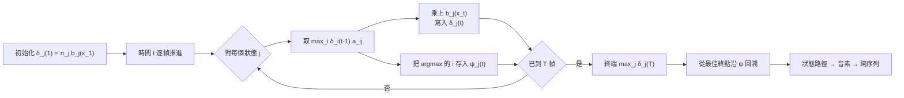
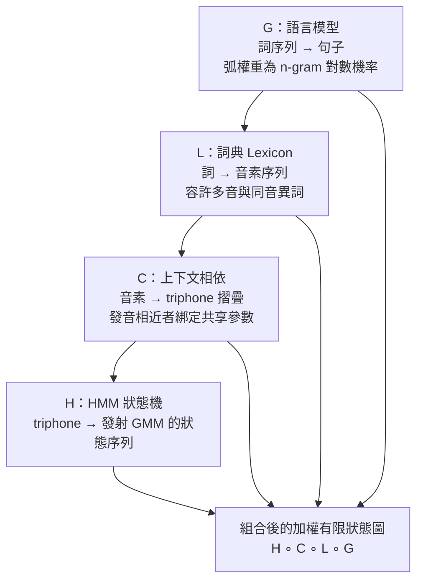

# 3.3 解碼圖與維特比搜尋（Viterbi Decoding）

## 組合爆炸的形狀

前兩節給出了目標函數的完整零件：HMM 提供分段骨架，GMM 提供發射密度 $`b_j(x)`$ ，n-gram 語言模型提供 $`P(W)`$ 。但它們只是把 $`P(X \mid W) P(W)`$ 變成「任給一個 $`W`$ 都能算出一個分數」——而辨識需要在所有可能詞序列的空間中找到最大者。

假設詞彙量為 $`V = 10^{4}`$ 、句子長 $`N = 10`$ 個詞，粗略的候選空間大小就是 $`V^{N} = 10^{40}`$ 量級；再考慮每個詞的時間對齊可能有數十幀的伸縮，窮舉在任何宇宙的計算預算下都不可行。解碼（decoding）要解的不是機率問題，而是如何在不走遍空間的前提下，保證找到（或足夠接近）最大值。

我們把搜尋空間的維度攤開來看：狀態數 $`N`$ 乘以序列長度 $`T`$ 的組態空間是 $`N^{T}`$ ，而詞彙量與句長組成的詞序列空間是 $`V^{N}`$ 。兩者都是指數。整個 1980 到 2000 年代的語音工程實踐，本質上就是這場「把指數壓成多項式」的戰役。

值得停下來看清楚這個「戰役」的本質。指數爆炸的根源不是搜尋演算法不夠聰明，而是問題本身帶有組合結構：一段語音的每一幀可以落在任何一個 HMM 狀態，而每一個詞的邊界可以出現在任何位置。我們真正想問的，其實是「哪一條路徑同時滿足聲學與語法」，而這本質上是一個路徑最佳化問題而非機率計算問題。機率只是用來比較路徑好壞的記分規則。認清這一點，才能理解為什麼整個領域的技術焦點集中在「如何把問題表示成一張圖」上——圖一旦建好，指數就自動塌縮成多項式。

| 搜尋策略 | 搜尋空間 | 複雜度 | 問題 |
|---|---|---|---|
| 窮舉詞序列 | $`V^{N}`$ | 指數 | 詞彙與句長皆不可行 |
| 窮舉狀態路徑 | $`N^{T}`$ | 指數 | 即使狀態數很少也不行 |
| Beam search | 束寬內 | 近似 | 可能漏掉最優解 |
| Viterbi 動態規劃 | 單一圖 | $`T \times N^{2}`$ | 需要圖的正確分解 |

## Viterbi 遞迴：把指數壓成平方

解鎖的鑰匙是動態規劃，其核心觀察由 Andrew Viterbi 在 1967 年為通訊中的卷積碼解碼提出：**沿任何最佳路徑走到狀態 $`j`$ 的前綴，其最佳子路徑不需要知道未來**。定義

$$
\delta_j(t) = \max_{s_{1:t-1}} \; P(s_{1:t-1}, s_t = j, x_{1:t}) \, ,
$$

即到 $`t`$ 幀為止、以狀態 $`j`$ 結尾的那段狀態序列與觀測聯合機率的最大值。遞迴式為

$$
\delta_j(t) = \left[ \max_{i} \, \delta_i(t-1) \, a_{ij} \right] b_j(x_t) \, , \qquad \delta_j(1) = \pi_j \, b_j(x_1) \, ,
$$

其中 $`\pi_j`$ 是初始機率。

內層的 $`\max_i`$ 說明：一旦決定在 $`t`$ 幀抵達狀態 $`j`$ ，最佳歷史只在 $`\{ \delta_i(t-1) \}`$ 的最大值處選出，而這個結論對所有更早的幀遞迴成立——最佳性原理把「考慮所有間隔組合」的問題縮成了「每幀只需比對所有 $`(i, j)`$ 對」。最終似然為 $`\max_j \delta_j(T)`$ ，再乘上語言模型分數（在詞邊界處由 n-gram 提供弧上的加分）即可對候選詞序列計分。

演算法維護一個 $`T \times N`$ 的表格 $`\delta`$ ，並在每次填表時把達到最大值的前驅狀態 $`i^{*}(t, j)`$ 存入指標矩陣 $`\psi`$ ：

$$
\psi_j(t) = \arg\max_{i} \, \delta_i(t-1) \, a_{ij} \, .
$$

掃描完 $`T`$ 幀後，從 $`\arg\max_{j} \delta_j(T)`$ 出發，沿 $`\psi`$ 逐幀回溯（backtrace），即還原出整條最佳狀態路徑，再將連續同名的語音狀態合併成音素、音素按詞典拼成詞，得到輸出句。複雜度的帳目乾淨得驚人：直接窮舉所有狀態序列的代價是 $`N^{T}`$ ，而 Viterbi 的代價是 $`T \times N^{2}`$ 的乘加與 $`T \times N`$ 的儲存——把時間上指數的搜尋，掃平成二次的動態規劃。

這個複雜度改寫可以用一個具體數字來感受。若語音長 $`T = 1000`$ 幀，HMM 狀態數 $`N = 3000`$ ，窮舉的組態數是 $`3000^{1000} \approx 10^{3471}`$ ，這已經超出可表示的整數範圍；而 Viterbi 的運算量是 $`1000 \times 3000^{2} = 9 \times 10^{9}`$ 次乘加——在 2000 年的硬體上是數秒到數十秒的工作量，正好落在互動式辨識可接受的邊緣。這個數字對比說明，為什麼解碼器的最佳化在實務上是一級議題，也解釋了為什麼系統工程師花在資料結構上的精力，往往不亞於花在數學上的。

值得強調的是 Viterbi 恰好就是貝氏框架對應的解碼：它在 HMM 節點內取狀態路徑的最大值，節點間則吸收轉移與語言模型的獎勵。作為對照，還存在邊際化版本的解碼——不對隱狀態取最大、而把它們積掉，直接對詞序列算 $`P(W \mid X)`$ ——後來還發展出 lattice rescoring 的整支生態。但在 2010 年以前，幾乎所有生產系統的骨幹都是 Viterbi：簡單、單遍、可在有限記憶體中流式執行，天然適合即時解碼。

從實務的觀點看，Viterbi 的單遍性是一項被嚴重低估的優勢。它意味著解碼器只需在記憶體中保留當前的 $`\delta`$ 向列與整個 $`\psi`$ 指標矩陣，音訊可以一幀一幀地流入而不需要回頭重讀。相較之下，若採用需要反覆存取輸入的迭代式方法，串流辨識就會變得笨重。而在 1990 年代的手機與數位助理上，能把辨識器塞進有限記憶體並即時跑出結果，往往比多賺幾個百分點的正確率更重要。

這個「取最大」與「求和」的差別，其實是整個生成式與辨識式分界的源頭。取最大值問的是「最可能的那條解釋是哪一條」，它給出單一解；求和問的是「所有解釋加起來是什麼」，它給出分布。當我們在第 3.2 節看到 Baum-Welch 的 E 步用前向-後向機率算狀態後驗時，其實已經在使用那個「求和」的版本——同一份 HMM 拓樸，兩種邊界條件，兩種用途：前向的 $`\alpha`$ 與後向的 $`\beta`$ 相乘給出後驗（辨識式），而前向的 $`\alpha`$ 掃到終端給出整體似然（產生式）。理解這組對偶，是理解整個 HMM 工具箱的鑰匙。

順帶一提，Viterbi 演算法與前向演算法的差別只有一個字： $`\max`$ 取代了 $`\sum`$ 。這個替換把「最可能的一條路徑」從「所有路徑的總機率」中分離出來，前者是產生式的解碼決策，後者是辨識式後驗的計算。兩者共用同一套前向-後向的遞迴骨架，這也解釋了為什麼 Baum-Welch 的 E 步與解碼器能共用前向演算法。

## 把四個模型疊成一張圖： $`H \circ C \circ L \circ G`$

Viterbi 解決了「給定狀態圖怎麼走」的問題，但真正的系統裡，這張圖不是手畫的，而是由幾個模型組合出來的。語音辨識的標準組合寫成複合（composition）的形式 $`H \circ C \circ L \circ G`$ ，四個字母各司其職。

- $`G`$ 是**語言模型**：把詞序列接成句子，弧上掛著 n-gram 的對數機率；
- $`L`$ 是**詞典**（lexicon）：每個詞展開為音素序列，容許同音異詞、多種讀法；
- $`C`$ 是**上下文相依**：把音素序列摺疊（folding）成 triphone——每個音素依左右鄰居改寫成「左-中-右」的三音子狀態，並將發音相近的 triphone 綁定（bundle）到同一組 HMM 參數上，這是 GMM 參數共享的關鍵層；
- $`H`$ 是 **HMM 層**：每個 triphone 狀態對應一小段三狀態的左-右 HMM，自遞迴（self-loop）吸收語速伸縮，發射密度即前節的 GMM。

組合的語義是「路徑的串接與分數的相乘」：一條通過 $`H \circ C \circ L \circ G`$ 的路徑，同時滿足聲學、上下文、詞典與語法約束，總分就是四段分數之和（對數域）。這樣視角下，前兩節的所有模型——對數發射密度、n-gram 機率、綁定決策——全部被換算成同一張加權圖上的邊權重，搜尋問題退化成普通的最佳路徑問題。

這個觀點的價值在於它把問題的複雜度重新分配了。組合前，四個模型各有各的演算法與資料結構：HMM 是狀態矩陣，n-gram 是巨型的稀疏計數表，詞典是查表，triphone 是腳本生成的樹。組合後，它們全部變成同一種東西——一張圖上的帶權弧。這意味著任何一層都可以被替換而不影響其他層，只要新層也能寫成帶權圖。這正是 1990 年代末期 n-gram 語言模型從 ARPA 格式轉換為 FST 格式後，語音社群能夠在同一天之內讓全球的解碼器支援新模型的原因。

四層之間的分工值得再說清楚一次，因為它決定了參數在何處被共享。 $`C`$ 層是共享發生的地方：語言學上相鄰的音素會互相染色，同一個音素在不同上下文裡的實際發音並不相同，triphone 摺疊就是把這個現象顯式建模。而摺疊之後又必須綁定，否則狀態數會從數百膨脹到數萬，參數量隨之爆炸。

三態結構也是一個值得留意的設計。每個 triphone 在 $`H`$ 層被展開為三個狀態，分別對應音素的主體、起始與結尾部分，中間夾著兩個自遞迴（self-loop）弧以吸收語速伸縮。這三個狀態共享同一套 GMM 發射參數（這是第二種參數共享，狀態內的共享），但各自的轉移機率略有不同——起始狀態的離開機率較高，結尾狀態的進入機率較高，這些「非對稱」的小參數讓模型能區分音素的起始過渡與穩定段。整個設計可以說是把語音學的直覺編碼進了一個狀態自動機裡，而它的代價是狀態數直接乘以三。

| 層 | 輸入 | 輸出 | 典型規模 | 共享的參數 |
|---|---|---|---:|---|
| $`G`$ 語言模型 | 詞 | 詞 | $`10^{4}`$ 個詞 | n-gram 計數（ $`10^{7}`$ 至 $`10^{9}`$ 項） |
| $`L`$ 詞典 | 詞 | 音素序列 | $`10^{4}`$ 至 $`10^{5}`$ 條 | 音素串與變體 |
| $`C`$ 上下文相依 | 音素序列 | triphone 序列 | $`10^{3}`$ 至 $`10^{4}`$ 類 | 綁定後的 HMM 參數 |
| $`H`$ HMM 層 | triphone | 狀態路徑 | $`10^{3}`$ 狀態、每狀態 $`8`$ 分量 | GMM 發射參數 |

## FST 時代與它的遺產

把這個組合做成資料結構，是 2000 年代最重要的一次工程收束。Mohri 、Pereira 與 Riley 在 AT&T 發展了加權有限狀態轉換器（Weighted Finite-State Transducer, FST）框架，以**加權半環**（semiring）上的組合運算為統一語言：語言模型、詞典、上下文改寫、HMM 拓樸，各自寫成一張小的加權有限狀態自動機，再用確定化（determinization）與最小化（minimization）把 $`H \circ C \circ L \circ G`$ 離線折疊成單一、龐大而緊湊的搜尋圖。

Mohri 等人 2002 年的綜述把這套代數寫得足夠通用——只要半環滿足結合律與分配律，組合、確定化、最小化全部自動成立——從此任何新模型只要能表示成加權有限狀態機，就免費獲得整套組合與優化工具鏈。這是一個非常徹底的抽象層次提升：它把「模型」重新定義為「帶權的圖」，把「組合」重新定義為「圖的代數」，於是語音解碼與字詞轉換（word error rate 計算、拼寫檢查、機器翻譯）在同一套工具下變成了同一類操作。

半環的抽象看起來抽象，實際上非常樸素。加權有限狀態機的邊上帶一個值，而「加」與「乘」這兩個運算的具體含義由半環決定。概率半環裡，乘是機率相乘、加是機率相加，這就是本章一路用起來的貝氏分數運算；對數半環裡，乘是相加、加是取對數和，正是實務上為了避免下溢而採用的形式。同一張圖，換一個半環就換一種語義，而所有組合、確定化、最小化的演算法完全不需要修改——這正是這套框架最漂亮的地方。

FST 的勝利不僅是數學優雅，更是實際效能的躍升。離線組合把分布在四個模型中的結構冗餘一次性合併：相同前綴的狀態被合併（確定化），相同子圖被共享（最小化），一台動態組合、邊走邊展開的解碼器由此變成只要一次查表乘加的靜態圖遍歷。像 Kaldi 這樣在 2010 年代成為開源標準的工具鏈，日常工作流就是「訓練各模型成表 → fst TableCompose 離線組合 → 解碼在單一圖上掃描」，HCLG 圖 $`H \circ C \circ L \circ G`$ 成了無數論文實驗的共同地基。

離線組合之所以關鍵，還有一個純工程的理由：語言模型的規模會隨 n-gram 階數與詞彙量急遽膨脹，若在解碼時才即時組合，每一幀都要重做一次摺疊運算，成本高到不可行。把它變成離線步驟，就可以在解碼時退化成對一張已經攤平的靜態圖做單遍遍歷——而圖的大小儘管以數 GB 計，它的節點結構卻高度規則，掃描時的記憶體存取模式對快取非常友善。整個 GMM-HMM 解碼器的效能，幾乎完全取決於這張圖的構造品質。

框架的另一項遺產是解耦的持久化：聲學模型升級只重訓 $`H`$ 、語言模型升級只重做 $`G`$ ，組合工具鏈不動——這正是第 3.1 節所述「分別訓練、分別精調」美德在資料結構層面的最終形態。回頭看，這也解釋了為什麼貝氏分解能在三十年裡撐住整個領域：它不是一個公式，而是一組長久穩定的介面。

值得注意的是 FST 框架的適用範圍遠超語音。相同的組合運算也支撐著詞圖（word lattice）的建構與評分、語音辨識系統的最小失真規則（Minimum Distortion Principle）最佳化、以及後來的關聯式語音辨識——在其中，語言模型的多個候選序列被保留成一個網狀圖而非單一路徑，於是最終輸出可以由一個二次的候選重排（rescoring）程序決定。整個 2000 年代到 2010 年代的語音辨識研究，有相當大一部分是在這張圖的內部做精細操作，而圖的抽象本身始終不變。

然而這張精巧的圖，也是整個 GMM-HMM 時代的原子受難面。切換聲學模型要重組整張圖、圖的規模隨詞彙與 n-gram 階數膨脹到數 GB、這條組合式的每一環都鎖死在離散狀態與加權弧上——深度學習最想要的訊息流（從詞錯誤率一路反傳回聲音特徵），在這種結構裡沒有通道。

第 4 章將看到 DNN-HMM 混血如何在這張圖的發射端撕開第一道裂口，CTC 又如何沿裂口把整條組合鏈從架構中拆除。而在那之後，第 5 章的 seq2seq 與 Whisper 將徹底放棄這張圖，讓注意力機制承擔起原本由動態規劃與 FST 代價表所承擔的搜尋職責——一場橫跨三十年的解碼範式遷移。

回顧整條線索，第 3 章的三節其實是一個連續的收束故事：第 3.1 節給出目標，第 3.2 節給出第一個可用的機率引擎，第 3.3 節給出讓它跑得動的搜尋機械。三者合起來，是一個在任何現代語音系統中都已經不存在的架構，但它的每一個零件都以某種形式存活了下來——狀態對齊的思想活在 CTC 的對齊演算法裡，貝氏分解的思想活在 seq2seq 的交叉注意力與 softmax 語言模型裡，發射密度的思想活在神經網路的 softmax 分佈裡。歷史的技術演進從來不是拋棄，而是摺疊。
