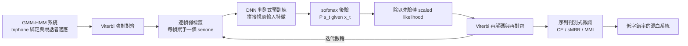
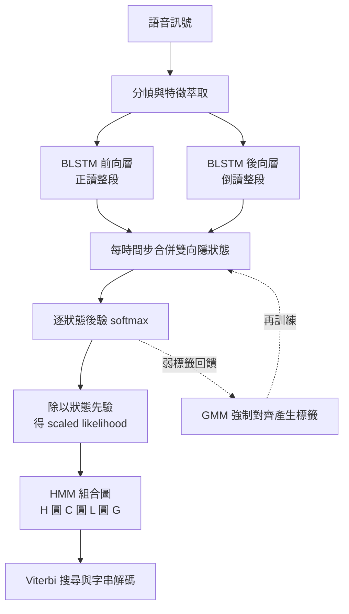

# 4.1 混血架構（DNN-HMM / LSTM-HMM）：後驗機率估計器

## 2012：一次只在工程層面發生的革命

2012 年是語音辨識學界記憶最清晰的一年。三十年來，高斯混合模型（GMM）搭配隱馬可夫模型（HMM）的框架在狀態似然估計的崗位上近乎不可替代，其數學自洽性在第 3 章已完整鋪陳，但它始終有一塊無法透視的暗影：GMM 對聲學特徵向量做的是局部、逐段的密度擬合，當特徵維度升高、上下文依賴加深時，混合成分數量會以組合級速度膨脹，最終失控。這一年，George Dahl、Abdel-rahman Mohamed 與 Geoff Hinton 在微軟語音組的協作下，把已嶄露頭角的深度信念網路（DBN）推進語音戰場，用一個五層前饋 DNN 直接取代 GMM 的似然估計器，在約三千小時的說話者無關系統上把字錯率一口氣壓低兩成以上，訓練時間相較傳統大模型縮短數個數量級。這一擊被普遍稱為深度學習在工業界的第一個殺手級應用，2011 至 2012 年間 Hinton 與微軟、Google、IBM 三家巨頭的平行合作將結果迅速複驗到數千小時級的 Switchboard 任務上，GMM 的王座在兩年之內土崩瓦解。

回頭看，這條曲線的爬升其實橫跨了三年多，並且是在三個不同的失敗之後才找到形狀。2009 年，Yu 和 Deng 在微軟把受限玻爾茲曼機的預訓練用於整個句子級的深度架構上，論文的標題很直白地說明了他們要做的是一整套語音系統的深度神經網路化；那時的結果還不足以擊敗傳統系統，但方法論的骨架已經出現。2010 年，Dahl 與 Mohamed 展示了 DBN 作為音素後驗分類器、在加上上下文視窗後大幅優於 GMM 的結果，指明了「深度網路 + 上下文」這條配方。2011 年，微軟把這條配方完整地推到 TIMIT 與 Switchboard 上，並且同時做了一件在工程上極為關鍵的事：把聲學後驗估計與解碼圖解耦，讓網路輸出的每幀後驗直接作為 scaled likelihood 進入既有的 HMM 解碼器，不必重寫解碼部分。2012 年，Hinton 團隊與 Google、IBM 各自發表的白皮書與論文把結果推到產業能感知的規模。

微軟內部流傳的 Hiteye 系統是這段歷史最生動的註腳。所謂 Hiteye，是把 Hinton 的深度神經網路技術與解碼端的多重編碼搜尋框架組合起來的整體系統名稱。它意味著深度網路在微軟不是一個孤立的實驗，而是被嵌入到整套商用解碼架構裡的一個元件，並且以「打擊弱點」為命名意象——正是它用來針對傳統系統最脆弱處的寫照。這條由研究到產品的路徑之所以重要，是因為它讓整個產業看見了一個此前不可見的機會：把深度學習放進一個已經可用的工業系統裡，而不是要求整個系統推倒重來。

但真正值得技術史反覆咀嚼的，不是那個字錯率數字，而是這一擊的落點極其精準：它沒有推翻任何一條既有的機率論命題。第 3 章那條貝氏解碼方程 $`\hat{W} = \arg\max_W P(X \mid W) P(W)`$ 依然成立，字典與 $`H \circ C \circ L \circ G`$ 的組合圖結構依然成立，Viterbi 搜尋依然是最後一哩。被替換的只有最末端那座似然引擎，也就是原本由 $`b_j(x) = \sum_{m=1}^{M} w_{jm} \mathcal{N}(x ; \mu_{jm}, \Sigma_{jm})`$ 撐起來的發射密度。這是一場外科手術而不是換心臟，也正因如此，它能在十八個月內被整個工業界吞下去。

## 判別式取代生成式：架構上只換一座引擎

理解 DNN-HMM 最清醒的方式，是回到第 3 章的貝式解碼方程 $`P(s_t \mid x_t) \propto P(x_t \mid s_t) P(s_t)`$ 。整座 Viterbi 大廈沒有動搖，被搬走的只是「似然引擎」那一格：原本由 GMM 的逐狀態混合密度計算 $`P(x_t \mid s_t)`$ ，如今交給一個深度神經網路。DNN 學到的是反向條件，接收 $`x_t`$ 所在的上下文視窗，在輸出層以 softmax 直接吐出每個 HMM 狀態後驗 $`P(s_t \mid x_t)`$ ，而三音素綁定後的 senone 則成為分類的類別標籤。這不是技術名詞的置換，而是歸納偏好的徹底反轉：GMM 以生成觀點從特徵空間裡畫出每個狀態的佔據區域，DNN 則以判別觀點直接學決策邊界。當標籤充足時，判別式模型的漸近錯誤率遠低於生成式擬合，這個方向統計學界早在 1990 年代就由 Bourlard 與 Morgan 的 MLP-HMM 經典工作預言過。

這個反轉之所以能帶來實質而非僅僅是工程上的收益，是因為它改變了建模的對象與自由度的分配。生成式的 GMM 必須為每個狀態各自刻畫一份分佈，狀態數一多，參數量就爆炸；判別式的 DNN 則讓所有狀態共享同一組深層隱層，隱層只需學到一套通用的聲學特徵抽取器，狀態之間的區別由輸出層那幾千個 softmax 神經元承擔。於是「狀態數量」從一個直接決定模型大小的硬約束，變成了一個只影響輸出層寬度的溫和參數。也正因如此，深度網路才能在語音上第一次真正贏過 GMM：不是它的密度估計更準，而是它的參數配置方式在資料量上升時能持續獲利，而 GMM 的參數量會隨狀態數線性膨脹、隨上下文深度指數膨脹。

而代價則是統計學上的身分喪失。GMM 的輸出是概率密度，可以代入任意的機率圖模型、被 Viterbi 用、被貝氏決策用、被拿來計算邊際機率；DNN 的 softmax 輸出是一個條件機率的估計，直接當似然用是錯的，必須經過一次貝氏反轉才能回到 HMM 熟悉的語言。這個小小的語意錯位，正是下面要細細拆開的技術環節。

Hinton 接手這套做法時，學界對 MLP-HMM 的興趣早已消退，失敗原因有三：沒有無監督預訓練，多層網路梯度消失；上下文 triphone 標籤爆炸；逐幀交叉熵訓練所用優化器太弱。2006 年 DBN 的逐層無監督預訓練以受限玻爾茲曼機的對比散度恰好修復第一項，GPU 的大規模矩陣並行修復第三項，而 2011 年後的多方實驗更證明只要網路夠大、資料夠多，預訓練甚至不再是必要步驟。考古地講，DNN-HMM 的每一塊磚都在兩個時代被人撿到過，2012 年的勝利與其說是發明，不如說是設計約束同時鬆綁的歷史性時刻。

## 貝氏反轉：把後驗換回似然的關鍵除法

DNN 的 softmax 輸出是後驗 $`P(s_t \mid x_t)`$ ，而 HMM 的合成律需要的是似然 $`P(x_t \mid s_t)`$ 。兩者由貝氏定理連結：

$$
P(x_t \mid s_t) = \frac{P(s_t \mid x_t) \, P(x_t)}{P(s_t)}
$$

其中 $`P(x_t)`$ 對所有狀態相同，在 Viterbi 累加之中只扮演常數比例因子，可以吸收進聲學模型與語言模型之間的尺度平衡項；但分母的先驗 $`P(s_t)`$ 絕對不能省略。若直接把後驗當似然用，系統等於偷偷假設先驗均勻分布。統計上的後果是那些看起來像什麼音都像的浮泛音段（靜音、交談串音、模糊元音）被過度崇拜，而高頻出現的狀態天然擁有大先驗，省略除法就等於系統性地偏袒高頻狀態，解碼器會近乎成癮地在便宜狀態上徘徊。實務上 $`P(s_t)`$ 直接用訓練集的逐幀標籤統計頻率估計，或乾脆把 $`\ln P(s_t)`$ 寫進狀態轉入分數。

這個小小的除法在 GMM 時代同樣存在，只是 GMM 天然給出似然而不必顯式處理；混血架構把估計方向反轉之後，先驗校正從隱含約定變成顯式必做步驟。這是混血架構複雜性的一個小而尖銳的標本：整個系統的核心改進，其實是一個除法符號的重新擺放；也正因如此，當年微軟的工程實作裡，這個縮放因子是被當成關鍵的調校旋鈕而非可選項。

| 維度 | GMM-HMM 估計器 | DNN-HMM 估計器 |
| --- | --- | --- |
| 學習觀點 | 生成式：估計 $`P(x \mid s)`$ | 判別式：估計 $`P(s \mid x)`$ |
| 條件結構 | 逐狀態獨立的高斯混合 | 深度非線性映射，狀態共享隱層 |
| 脈絡利用 | triphone 擴張與狀態綁定 | 視窗拼接與多層共享表示 |
| 語義輸出 | 對數似然 $`\ln b_j(x)`$ | 後驗須除以先驗轉 scaled likelihood |
| 資料效率 | 少資料下穩健 | 大資料下優勢爆炸 |
| 硬體條件 | CPU 工時代謝 | GPU 矩陣並行 |
| 銜接角色 | 提供初始對齊與先驗 | 端到端時代的前夜 |

## 訓練策略：弱標籤、判別式預訓練與序列級準則

混血架構的第一個悖論深刻而且漂亮：要訓練 DNN 估計 $`P(s_t \mid x_t)`$ ，就必須先知道每幀屬於哪個狀態，而這個答案本來只有訓練好的 HMM 才知道。解法是把雞生蛋問題化約為解耦：先在傳統陣營裡充分訓練一個 GMM-HMM 系統（含 triphone 綁定、MLLR 適應），用 Viterbi 強制對齊把每一幀賦予一個 senone 標籤。這些標籤不是真值，是弱標籤：它們攜帶 Viterbi 搜索當下認知的誤判，卻仍然足以把數百萬個幀與數千個類別綁在一起。DNN 以逐幀交叉熵準則在此標籤上做監督訓練，再回頭用於新的 Viterbi 對齊，對齊與網路輪流精化，幾輪之後系統收斂到一個自洽的不動點。

Hinton 團隊把這段流程記述為 discriminative pre-training：先以 RBM 逐層無監督預訓練，再以對齊標籤做監督微調，最後以序列級準則收尾。而序列級準則的引入，才真正把這套混血體從「更好的逐幀分類器」推進為「更好的整句辨識器」。sMBR（state-level minimum Bayes risk）以序列後驗的期望風險最小化為目標，MMI（最大互資訊）與 MPE（minimum phone error）則各自定義不同的替代目標，它們把訓練目標從逐幀正確改寫為整句正確，並用 lattice 上的後驗近似計算梯度。這正是第 3 章埋伏筆的古典判別式訓練在神經網路時代的還魂：HMM 的強項從「提供似然」退守為「提供對齊與 lattice 結構」，而優化的主導權交給了網路。

值得強調的是預訓練與微調在時間軸上的分工。DNN 層級越深，隨機初始化的梯度訊號越容易在反傳中被稀釋，逐層貪心式地先學 RBM 的分佈再堆疊，是當時唯一能讓深網穩定收斂的辦法。一旦大資料與更好的初始化器到位，隨機初始化的端到端反傳也能收斂，但序列級微調的價值卻始終存在：它直接優化解碼器真正關心的那個目標，與逐幀交叉熵之間存在不可忽略的目標落差。

序列級微調的實作本身就是一段工程史。sMBR 需要在解碼 lattice 上累積後驗機率，MMI 需要辨識字串與音素序列兩種標籤的統計量，而 MPE 則要把「錯誤音素數」這個非可微的整數指標改寫成可微的近似。三者都需要把數千萬條候選路徑的後驗彙整成有限的一階統計量，再以這些統計量作為權重，對網路做一次重加權的交叉熵更新。整個過程就是把第 3 章那套古典判別式訓練的精華，在 GPU 上以神經網路的語彙重寫一遍。

值得注意的是，這些序列級準則並非 CTC 之前獨有。第 3 章裡的 MMI 與 sMBR 早就在 HMM 的框架內做著同樣的事：它們解決的從來不是「對齊不存在」，而是「對齊存在但有多個可能，如何讓訓練目標承認這份不確定性」。CTC 的突破在於把這個問題從解碼側挪到了網路的訓練目標內，用一個封閉形式的機率來容納所有對齊，而不必再借助 lattice 的近似求和。

## 為什麼 GMM 尚不能拋棄

既然 DNN 的判別式能力全面壓過 GMM，為什麼 GMM 在 2012 年之後仍長期留在流水線裡？原因是它是全流程中唯一能從無標籤資料自舉出時序與狀態對齊的組件。DNN 需要逐幀標籤才能監督學習，而 DNN 本身沒有能力生成對齊；對齊既是它的養分，也是它的枷鎖。於是 GMM 被降級為導師：它提供第一輪強制對齊、提供每個狀態的先驗占比、提供 senone 綁定樹的骨架，也提供說話者自適應所需的變換基。

混血架構因此不是替代，而是寄生式的升級。它把 GMM 從決策者改為導師，開出教師—學生迴路的雛形：學生從教師的弱標籤中學習，同時用自己的輸出重新生成更準的標籤，形成自我精化。這種教師提供弱標籤、學生超越教師的訓練哲學，後來也成為弱監督語音模型（以偽標籤大規模擴充訓練集）的體系原型。代價則是整條流水線變成了四層膠水：GMM、對齊、DNN、再對齊，任何一環腐化的產物都會傳染整座系統，而錯誤在層層遞迴中往往難以歸因。

## LSTM-HMM：把脈絡從十一幀拉到整段時序

DNN-HMM 的視窗拼接在哲學上是矛盾的：用固定的左右各五幀手工定義脈絡，像用一把固定長度的尺丈量所有長度的問題。同一個音素在快速語流裡可能只佔三幀，在緩慢發音裡可能拖過二十幀，固定視窗要嘛切斷共鳴峰滑動的軌跡，要嘛把無關的鄰音塞進來。LSTM 以其門控細胞的加性記憶解決了循環網路的梯度消失，讓脈絡長度從硬編碼變成習得的函數；前饋 DNN 的視窗本質是有限脈衝響應的濾波器，BLSTM 則是無限脈衝響應的非線性對應物。

Graves 在 2006 年前後的手寫識別與音素辨識工作中證明了雙向 LSTM 的優勢，而 Graves、Mohamed 與 Hinton 在 2013 年把深層多層雙向 LSTM 與 DNN-HMM 的後驗估計角色結合：網路先正讀整段語音、再倒過來讀第二遍，於每個時間位置合併兩個方向的隱狀態再做判斷，實現了每一幀的判斷都看過全部未來也看過全部過去的理想狀態。注意這裡的分工極其關鍵：LSTM 負責的是時序記憶與上下文聚合，最後那一層狀態後驗仍然餵給 HMM，HMM 仍然負責把逐幀後驗串成有語法結構的句子。時序建模能力上升了，但架構的馬可夫骨架沒被拆掉。

代價是計算結構的換軌：時間維度上的串行依賴違背了 GPU 的並行本能，序列再長就得等比例拉長訓練時鐘。Graves 的連接主義時序分類（下一節主題）與 2013 年並行化的 deep BLSTM-HMM 恰在同一場演講體系中交錯生長，一個走的是把對齊吸收進損失函數的路線，另一個走的是把時序放進網路迴圈的路線。

## Kaldi 的整合與工業界的吞嚥

混血架構能成為時代標準，一半功勞在工程平台的吞嚥能力。Kaldi 在 2011 年後逐步加入神經網路訓練器，GMM 流水線產生的對齊文本、senone 標籤與先驗統計，以極低的摩擦成本餵進 DNN 訓練，再回頭強化整條解碼鏈。傳統體系的 $`H \circ C \circ L \circ G`$ 組合圖一行不改，只把 $`H`$ 內的似然表替換為 DNN 的前向計算，這種模組化相容讓上千個學術與工業系統在既有投資上新陳代謝，擴散速度遠超後來任何端到端系統。

實務細節也累積出驚人的手藝。數萬路 senone 的 softmax 負擔可以用層次化 softmax 或按頻率挑選的輸出子集來紓解；sMBR 需要 lattice 後驗累積，Kaldi 的 lattice 消融與打分工具鏈把這整套東西工程化到指令列的一行；序列級微調的隨機學習率排程與多段式訓練腳本，則讓「先預訓練、再微調、再序列微調」三段式變成可複製的模板。TensorFlow 生態的 kaldi 社群移植把這套流程延續到今日，今日許多語音課程的開篇仍是 DNN-HMM，因為它確實是理解整個時序辨識產業鏈最短的那條路徑。

## 語言模型的角色與解碼的實際樣貌

混血架構還有一個容易被忽略的後果：語言模型的權重被推到了前台。第 3 章那條貝氏式 $`P(X \mid W) P(W)`$ 在純 GMM 時代，語言模型通常只是一個低權重的 n-gram，用來在相近的幾個假設之間做微調；當 DNN 把聲學通道的鑑別度拉高之後，重音界線與模型容量都必須重新分配，否則語言模型會過度壓制聲學模型、把正確的聲學選項誤殺。於是插值權重、動態規劃的聲學與語言權重平衡、以及 n-gram 剪枝後的搜尋速度，成為整個 2012 到 2015 年間產業界最主要的調校主題之一。

解碼的實際樣貌也因此變了。GMM-HMM 時代，解碼時最貴的是每個狀態的混合密度求值（每幀數千次高斯評估）；DNN-HMM 時代，最貴的變成網路的前向計算加上 Viterbi 在樹狀解碼圖上的擴張。工程上的解法是把 DNN 的輸出做成「近似分桶」的似然表，讓 Viterbi 走查的仍是舊式的整數打分，而不是每個節點都即時呼叫網路。這個看似保守的工程選擇，反過來也說明了混血架構的本質：它是一次保守的升級，正因保守，才能在既有投資上無痛落地。

## 代價：資料量、延遲與黑盒性

混血架構的三項代價也在 2012 年之後陸續浮現。第一是資料量：DNN-HMM 幾乎沒有小資料自我Adaptation的能力，幾百小時的語料在對比上千小時的語料時會明顯落後，而 GMM-HMM 在同一個資源量下依然能給出穩健的基線。第二是延遲：BLSTM 必須讀完整段語音才能給出每一幀的判斷，這對即時語音辨識是致命的，除非引入 chunk-wise 的因果化處理。第三是黑盒性：GMM 的混合分量在視覺上可以對應到具體的聲學現象，而深度網路的狀態後驗無法被直接解釋，模型的錯誤只能靠統計量觀察，不能靠「看」出來。

這三項代價共同構成了 CTC 與 seq2seq 的出發點：CTC 用結構化的損失函數取代外部對齊，讓訓練資料需求下降；CTC 與注意力機制的結合讓系統得以端到端地從原始音訊學起，放棄分幀特徵；而注意力提供的那種可視化解釋，某種意義上又把黑盒重新打開了一條縫。於是混血架構的三大缺陷——資料需求、對齊依賴、非端到端——在 2014 年之後被一條新的技術路線逐一針對。那條路線的核心，正是下一節的主題：把對齊從解碼的負擔變成損失函數的內在結構。

## 混血體的天花板：分幀、對齊、與三層膠水

回頭看，DNN-HMM 是深度學習給古典處方的一次化身成犬，而不是革命。第一，它仍是分幀架構：每幀接收一個獨立決策，時序結構仍由外部 HMM 的轉移矩陣供給，神經網路只是更好的似然表，馬可夫假設的天花板原封不動。第二，它仍需外部對齊：訓練的第一顆種子必須由 GMM 提供，而這一顆種子本身的品質上限，也就成了整條流水線的品質上限。第三，它拒絕思考字母層：建模對象是手工設計的 senone，而非直接的字元或詞，發音字典與音素集的鎖鏈依然拴腳，無法處理訓練語料中未見過的詞。

還有一層更深的無奈：整套系統並非端到端。音訊進入時先被切成分幀特徵，特徵表示無法隨著任務目標一起優化；深度網路能學到的極限，也就被手工管線的極限框住。更麻煩的是，這種非端到端性沿著訓練鏈條傳播：特徵管線的失真無法被 DNN 補償，語音前端的一次梅爾刻度設計失誤，會同時汙染 GMM 的初始對齊與 DNN 的弱標籤，構成一個無法歸因的共同誤差項。2012 年的成功因此只是把力量從正確的方向引導到了狹窄的走廊裡。工程上早已察覺到這條走廊的盡頭：既然類神經網路學得出後驗機率，為什麼不能讓網路直接對字元序列負責，甚至連對齊本身也一起學掉？

下一節就沿著這道縫走進去：連接主義時序分類將證明，對齊不必被估計，而可以被邊際化掉。整座混血大廈的骨架不會倒塌，但其中最關鍵的那根柱子——外部對齊——將被直接抽走。當這根柱子消失，剩下的就只是一個把聲音直接變成文字的神經網路。
