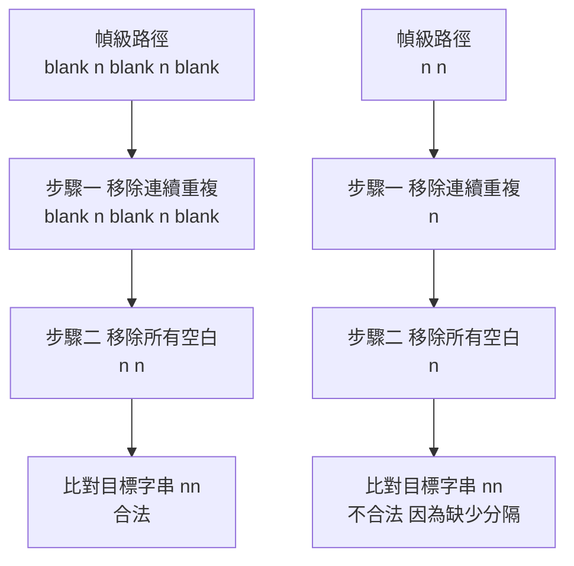
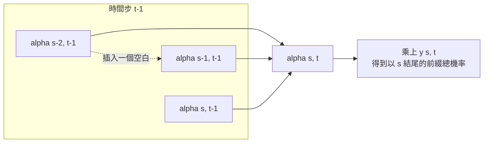
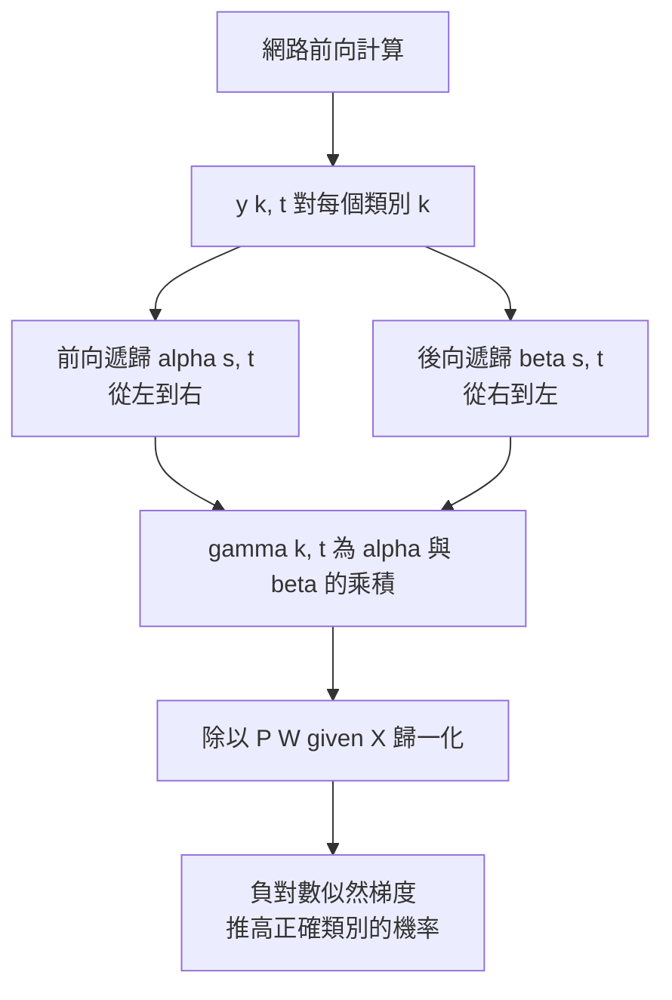

# 4.2 CTC（Connectionist Temporal Classification）損失函數的數學極致

## 問題的根源：兩個長度不相等的序列

第 4.1 節的混血架構留下了一個頑固的病灶：對齊。訓練語音時，開發者拿到的是一段長度為 $`T`$ 的幀序列與一個長度為 $`U`$ 的目標字串，兩者之間沒有任何時間戳對應。 $`T`$ 通常是 $`U`$ 的十倍甚至數十倍，因為一個音節在語速正常時要佔據數十幀，而一個字元只佔一個位置。要用交叉熵訓練網路，必須知道「輸入的第 $`t`$ 幀對應到目標的第 $`u`$ 個字元」，但這正是訓練資料從未提供的東西。

第 3 章用 HMM 的狀態序列解決了這個問題：引入一層比字元更細的狀態（senone），讓字元與幀透過狀態間接對應，再用 Baum-Welch 在 EM 的迴圈裡交替估計狀態佔用與發射機率。代價是整套訓練必須跑在 HMM 框架裡，發射機率必須有封閉形式的 M 步更新，且整體不是端到端的。2006 年，Alex Graves 在序列分類的框架下提出了一個更激進的想法：不引入任何中間狀態，直接把字串 $`W`$ 對應到所有可能的幀級路徑上，並把這些路徑的機率加總，作為網路的訓練目標。這個函式就是連接主義時序分類（Connectionist Temporal Classification, CTC）。

Graves 的洞見可以一句話概括：**對齊不需要被估計，只需要被邊際化掉**。如果目標字串 $`W`$ 對應到多條幀級路徑，那麼在給定網路輸出的情況下， $`W`$ 的機率就是所有合法路徑機率之和；把這個總和的負對數作為損失，梯度就會自動把機率質量推往那些能解釋觀測的最佳對齊上。整個對齊搜尋從訓練流程中被徹底移除。

## 空白標籤與重複：一個符號承擔兩種語意

CTC 的第一個關鍵設計是擴充標籤集合。原來的目標字串 $`W = (w_1, w_2, \dots, w_U)`$ 之外，加入一個特別的空白符號（通常記作 $`\langle \text{blank} \rangle`$ 或 $`\epsilon`$ ），得到大小為 $`|\Sigma| = U_{\text{char}} + 1`$ 的輸出類別。這個符號承擔了兩種看似矛盾、實則互補的語意。

第一種語意是**填充幀**。 $`T`$ 通常遠大於 $`U`$ ，多出來的幀必須被解釋為某種東西，而空白正是最自然的答案：某幀沒有對應任何字元發音，只是語音中的停頓、閉塞段、爆破的釋放，或是純粹的冗餘觀測。第二種語意是**分隔連續相同字元**。若目標字串含有相鄰的重複字元，例如「安安」，那麼在幀級路徑上，「安」必須出現兩次，中間不能直接相鄰；否則合併規則會把它們併成一個「安」。插入空白就解決了這個問題：「安、空白、安」在合併後才是合法的兩個「安」。

更細緻的規則是：合併時先**移除連續的重複字元**，再**移除所有的空白**。這個次序不可交換，因為空白正是用來區隔重複的。舉一個完整的例子：目標字串「nn」在三幀上的路徑可以是 $`\langle \text{blank} \rangle, n, n`$ 或 $`n, n, \langle \text{blank} \rangle`$ 或 $`n, \langle \text{blank} \rangle, n`$ ，三者在合併後都還原為「nn」；但路徑 $`n, n`$ 在合併後變成「n」，映射回目標字串失敗，因此不合法。而目標字串「n」對應路徑 $`\langle \text{blank} \rangle, n, \langle \text{blank} \rangle`$ 則是合法的。空白的兩種語意由此在同一條規則下統一。

## 對齊集合：把所有合法路徑攤平

定義 $`\mathcal{B}`$ 為從字元序列到幀級路徑序列的「展開」映射。給定目標字串 $`W`$ 與一個長度為 $`T`$ 的路徑 $`\pi = (\pi_1, \pi_2, \dots, \pi_T)`$ ，若把 $`\pi`$ 經上述合併規則還原後恰好等於 $`W`$ ，就稱 $`\pi`$ 是 $`W`$ 的一條合法對齊。所有合法對齊構成的集合記為 $`\mathcal{B}^{-1}(W)`$ 。

這個集合有兩個關鍵的結構性事實。第一，它非空：只要 $`T \geq U`$ ，總能構造出至少一條合法對齊（例如把所有字元前各放一個空白）。第二，它的基數隨 $`T`$ 與 $`U`$ 的差距而膨脹得極快：把 $`U`$ 個字元排成一列，中間有 $`U-1`$ 個縫隙可插入空白以分隔重複，兩端各可插入任意多個空白，於是路徑數大致是 $`\binom{T - 1}{U - 1} \cdot 2^{U - 1}`$ 這個量級。當 $`T`$ 是 $`U`$ 的二十倍時，這個數字大到不可能枚舉。

這就是為什麼 CTC 必須用動態規劃而不是顯式求和。第 3 章的 Baum-Welch 已經示範了處理這類隱變數和的標準手段：前向與後向遞歸。CTC 沿用了同一套思想，但對象從 HMM 的狀態佔用換成了幀級路徑。值得留意的是， $`\mathcal{B}^{-1}(W)`$ 這個集合雖然龐大，但它的結構高度規則：所有合法路徑構成的是一個有向無環圖，節點是「時間步加上已消耗的字元索引」這類複合狀態，邊是「時間步加一或加二」的合法跳躍。動態規劃之所以適用，正因為這個圖是稀疏且分層的。

## 前向變數：沿 lattice 遞迴

CTC 的網路在每個時間步 $`t`$ 對每個類別 $`k`$ 輸出一個機率 $`y_{k,t} = P(k \mid x_1, \dots, x_t)`$ ，所有類別在同一時間步上的機率構成一個 softmax 分佈。在把 $`T`$ 幀的路徑限制為合法的前提下，整條路徑的機率就是各幀條件機率的乘積：

$$
P(\pi \mid X) = \prod_{t=1}^{T} y_{\pi_t, t}
$$

現在定義**前向變數** $`\alpha_{s,t}`$ 為所有長度為 $`t`$ 且以類別 $`s`$ 結尾的前綴路徑的機率總和，集合限定在 $`\mathcal{B}^{-1}(W)`$ 之內。初始化為 $`\alpha_{s,1} = y_{s,1}`$ （若 $`s`$ 是空白或目標的第一個字元），否則為零。遞迴式為：

$$
\alpha_{s,t} = \sum_{s' \in \{ s, s-1, s-2 \}} \alpha_{s', t-1} \, y_{s, t}
$$

這個遞迴的結構值得逐項拆解。之所以只往前看三格，是因為一條合法的幀級路徑在相鄰兩步之間最多只能跳過一個位置：從 $`s'`$ 跳到 $`s`$ 意味著時間步前進了 $`1`$ 或 $`2`$ ，前進 $`2`$ 對應中間插入了恰好一個空白。三格的窗口恰好覆蓋了「不跳」「跳過一個空白」兩種合法跳躍，而更大的跳躍會意味著連續兩個空白夾著一個字元，這在合併後仍合法但無法被這個狀態定義吸收——Graves 的處理方式是把空白也納入狀態集合（把字元序列 $`W`$ 展開成 $`\tilde{W}`$ ，在相鄰重複字元之間插入空白），使得空白成為狀態空間中的一等公民，遞迴就能統一處理。

由於狀態集合大小是 $`T + U`$ 量級而非指數量級，每一個 $`\alpha_{s,t}`$ 的計算只需三項，總時間是 $`O(T \cdot |\Sigma|)`$ 。這是整個 CTC 最核心的效率紅利。整個訓練一趟完成，不需迭代到收斂，也不需要把整段 lattice 存進記憶體： $`T`$ 幀、 $`|\Sigma|`$ 類別的前向與後向表各只需要 $`O(T \cdot |\Sigma|)`$ 的儲存，實作上常以浮點陣列的形式逐行掃過即可。

數值穩定性是實作上唯一需要留意的技術細節。由於 $`P(W \mid X)`$ 是一個極小的機率，直接計算很容易在浮點下溢。標準的處理方式是在對數域運算：把每個 $`\alpha_{s,t}`$ 與 $`\beta_{s,t}`$ 都以對數形式保存，遞迴式改寫成 $`\ln \alpha_{s,t} = \ln \sum_{s'} \exp \big( \ln \alpha_{s',t-1} + \ln y_{s,t} \big)`$ ，並使用 log-sum-exp 的穩定版本。實務上還有更簡潔的替代：把 $`\alpha`$ 與 $`\beta`$ 分別正規化，使每一步的最大值為一，最後再把各步的正規化因子累積回來。這些技巧與第 3 章 HMM 的 scaled forward-backward 完全同源，是同一門動態規劃技術的第三次應用。

## 後向變數：另一端的對稱遞迴

**後向變數** $`\beta_{s,t}`$ 定義為所有從時間步 $`t`$ 的狀態 $`s`$ 出發、走到時間步 $`T`$ 並最終形成合法對齊的後綴路徑的機率總和。它與前向變數攜帶完全相同的信息，只是從相反的方向對同一棵 lattice 做累加。終端條件為 $`\beta_{s,T} = 1`$ （若 $`s`$ 落在目標字串的合法結束位置上），否則為零。遞迴式為：

$$
\beta_{s,t} = \sum_{s' \in \{ s, s+1, s+2 \}} y_{s', t+1} \, \beta_{s', t+1}
$$

前後兩個變數是對稱的：前向從序列左端累積，後向從右端累積，兩者的遞迴窗口都是三格，只是方向相反。它們的存在目的完全相同，也就是把「所有合法對齊的機率總和」這個指數級的求和，壓縮成兩次線性時間的動態規劃。值得留意的是，後向遞迴並非前向遞迴的複製品：它的窗口是 $`\{ s, s+1, s+2 \}`$ 而非 $`\{ s, s-1, s-2 \}`$ ，因為從當前狀態出發，下一步可以停在原地（跳過一個空白）、前進一格或前進兩格。這個方向性的差異，正是三格窗口能覆蓋全部合法跳躍的證明。

## 條件機率、損失函數與梯度

有了前後向變數，目標字串的條件機率可以寫成最前面那個狀態與最後面那個狀態的乘積。這個式子是把兩張動態規劃表接起來的關鍵一步。它之所以能夠成立，是因為前向表累積的是合法路徑的前綴，後向表累積的是同一批路徑的後綴，而兩者的接點必須是同一個狀態。整個式子最值得玩味之處，是它把一個龐大的集合求和壓縮成了兩個動態規劃表的乘積：

$$
P(W \mid X) = \sum_{\pi \in \mathcal{B}^{-1}(W)} P(\pi \mid X) = \sum_{s \in \tilde{W}} \alpha_{s,1} \, \beta_{s,T}
$$

其中 $`\tilde{W}`$ 是展開後的字串在序列首尾的可能結束位置。更常用的寫法是取 $`s`$ 為目標序列首字元（若有重複或空白插入則取對應的展開位置），此時總和退化成單項。由於 $`\alpha`$ 與 $`\beta`$ 各自已把所有合法路徑加總，兩者相乘時同一條路徑被重複計數的問題，恰好由「首尾狀態唯一」的組合條件所排除。這正是前後向演算法能夠在不枚舉任何一條路徑的情況下，精確算出整個 $`\mathcal{B}^{-1}(W)`$ 之和的原因：任何一條完整路徑，在前向表與後向表中的貢獻被分配到它所經過的各個狀態上，加總之後每條路徑恰好被計入一次。CTC 損失函數因此是負對數似然：

$$
\mathcal{L}_{\text{CTC}} = - \ln P(W \mid X)
$$

對網路輸出 $`y_{k,t}`$ 求偏導數並套用連鎖律，可以得到那個著名的梯度公式。這個式子可以讀成一句話：每一幀的每一個類別，其梯度的絕對值等於「在所有合法對齊中把這一幀解釋成這個類別的機率份額」，除以整串的機率後取負。換言之，網路會被推著去增加那些能夠解釋整串字元的標籤配置：

$$
\frac{\partial \mathcal{L}}{\partial y_{k,t}} = \frac{-1}{P(W \mid X)} \sum_{\pi \in \mathcal{B}^{-1}(W)} \mathbf{1}[\pi_t = k] \, P(\pi \mid X)
$$

這個梯度式子的分母 $`P(W \mid X)`$ 正是那個歸一化常數，它讓各幀各類別的貢獻加總回到單位量級。除此之外，梯度的絕對值只由路徑佔用機率決定，而佔用機率又只由前後向遞迴決定。整個推導於是收斂到一個乾淨的訓練迴圈。

這個式子可以直接用前後向變數寫成可計算的形式。把「所有在時間步 $`t`$ 佔據類別 $`k`$ 的合法路徑的機率總和」記為 $`\gamma_{k,t}`$ ，它就是所有佔據該格子的路徑的機率總和。這個量在整套推導中的角色，是把一個不可微的集合求和，化成一個可以在網路輸出的連續空間上做自動微分的量：

$$
\gamma_{k,t} = \sum_{s \in \tilde{W}} \alpha_{s,t} \, \beta_{s,t} \, \mathbf{1}[s = k]
$$

而梯度就是 $`\frac{\partial \mathcal{L}}{\partial y_{k,t}} = \frac{-1}{P(W \mid X)} \gamma_{k,t} \frac{\partial y_{k,t}}{\partial \theta}`$ 。用矩陣形式寫， $`\gamma`$ 是前後向變數逐元素相乘後沿路徑索引求和的結果，這正是第 3 章 Baum-Welch 中佔用機率的同一個量。**CTC 的梯度，其實就是 HMM 的佔用機率**——這是一個極為漂亮的對應：把 HMM 的狀態換成字元、把發射機率換成網路的 softmax、把 Baum-Welch 的 E 步換成 CTC 的前後向遞歸，整套數學是同構的。

## 佔位符與訓練動態

在 CTC 的訓練語境裡， $`\gamma_{k,t}`$ 有時被稱為佔位符（placeholder），因為它回答的正是「在給定模型的情況下，第 $`t`$ 幀應該被解釋成類別 $`k`$ 的機率是多少」。這個量是連接前向遞歸與網路反傳的橋樑：它把一個不可微的、定義在有限集合上的總和，轉成了一個可以在網路輸出的連續空間上做自動微分的量。

訓練動態也因此簡潔得驚人。每一步只需要三件事：前向遞歸、後向遞歸、然後對每個類別套上 $`\frac{1}{P(W \mid X)} \gamma_{k,t}`$ 的權重做一次softmax交叉熵更新。整個流程沒有 Viterbi、沒有 EM 迴圈、沒有強制對齊、沒有 lattice 的近似求和。所有對齊的不確定性都被封裝在那兩個遞迴裡，而推理時解碼可以直接採用最簡單的貪心策略。

| 面向 | DNN-HMM 混血 | CTC |
| --- | --- | --- |
| 對齊來源 | GMM 強制對齊提供弱標籤 | 不需對齊，直接邊際化 |
| 中間層 | HMM 狀態與 senone | 無中間狀態，直接字元 |
| 訓練目標 | 逐幀 CE 加序列級微調 | 單一目標 $`P(W \mid X)`$ 的負對數 |
| 對齊處理 | 近似為單條硬對齊 | 對所有合法對齊精確求和 |
| 標籤需求 | 每幀都需要狀態標籤 | 只需整句目標字串 |
| 計算複雜度 | 訓練需多輪迭代 | 單趟前後向遞歸 |
| 推理成本 | Viterbi 搜尋解碼圖 | 貪心或束搜尋即可 |

## 條件獨立假設：代價與收穫

CTC 之所以能寫出如此乾淨的機率乘積，是因為它採用了一個極強的假設：**每一幀的標籤在給定整段觀測之後條件獨立**。形式化地說，給定 $`X`$ 之後，路徑的機率是各幀條件機率的乘積；這意味著第 $`t`$ 幀的標籤與第 $`t'`$ 幀的標籤在給定 $`X`$ 之後互不相關。這個假設在數學上是錯的——顯然相鄰幀的標籤高度相關——但 CTC 用一個巧妙的變換換來了代價。

這個變換是：把時序相關性「吸收」進網路的輸入端。若網路本身是循環網路或具有足夠大的上下文感受野，那麼網路可以先在內部把時序資訊整合，再輸出近似的條件獨立分佈。這正是 Graves 在深層 LSTM 加上 CTC 時能取得效果的機制：LSTM 負責時序相依，CTC 負責對齊的不確定性，兩者分工互補。CTC 因此不是要取代時序建模，而是要取代對齊估計。

這個假設在何時合理？在字母層的語音辨識中，大致是合理的。英文字母的時長分布相對均勻，每個字母佔據的幀數有相當程度的離散，但整體仍接近「每個字母對應固定數目的幀」的近似；加上 CTC 的損失是所有對齊的機率加權平均，效果上又進一步平滑了對齊分布，於是條件獨立的偏差被大幅稀釋。在書寫筆跡辨識中同樣如此。

這個假設在何時不合理？在音節層、尤其在中文上明顯失效。漢語的音節在時間軸上彼此重疊：聲母與韻母的界線不清晰，捲舌與舌尖元音的過渡音會跨越兩個音節的邊界，聲調的邊界更是一段連續的基頻輪廓而非離散的時間點。若把中文切成拼音字元序列餵給 CTC，模型被迫假設每個拼音字元有一個乾淨的起止時間，而實際情況是相鄰拼音的聲學實現彼此黏連，條件獨立的近似因此系統性失準。

更根本的問題是，CTC 的條件獨立假設使得它無法建模「跨越標籤邊界的依賴」。舉例而言，兩個相鄰的音素之間存在協同發音，同時影響兩者的實現；CTC 把它們當成兩個獨立的分類問題，網路只能靠內部感受野去補償，而損失函數本身並不鼓勵這種跨標籤的一致性。

還有一層容易被忽略的後果：CTC 對語言的建模能力極弱。因為它的損失只關心「整串的字是否正確」，而這個目標的實作方式是把機率質量平均分配給所有合法對齊，所以網路沒有任何機制去偏好那些語法上更合理的對齊。在有聲調語言中這一點尤其致命：同一段音訊可以對應到不同的聲調組合，CTC 必須把機率在它們之間平分，除非外接一個語言模型否則無從分辨。CTC 的官方實作提供了一個外部的語言模型介面，正是為了補上這個缺口，但這也意味著語言能力終究沒有內生於網路本身。

## 收穫：推理時不需要任何對齊搜尋

CTC 最大的實用紅利在推理端。傳統的 HMM 系統必須跑 Viterbi 在解碼圖上搜尋，才能決定哪個字串的機率最高；CTC 因為已經把所有對齊的機率加總成了一個封閉的 $`P(W \mid X)`$ ，推理時只要做**最佳解碼**即可：對每個時間步取 argmax 的類別，然後套用合併規則。這是 $`O(T)`$ 的貪心過程，不需要任何搜尋，不需要語言模型的配合（雖然加上語言模型仍能進一步提升），也不需要 beam search 的複雜度。

嚴格來說，貪心最佳解碼與真正的最大機率解碼並不等價。CTC 的最大機率路徑是那個讓 $`P(\pi \mid X)`$ 最大的單一路徑，而不是逐幀取 argmax 得到的路徑，後者可能是全局次優的。束搜尋（beam search）可以在近似 CTC 機率下改善結果，實作上常用的做法是把前向變數 $`\alpha`$ 在束內展開並保留最高分的若干條部分路徑，最後再對束內路徑做一次合併與評分。最簡單的貪心路徑已經相當接近最優，這是 CTC 在工程上極受歡迎的原因之一：推理端幾乎不需要維護複雜狀態。

更重要的是，CTC 讓整個系統第一次可以在字元層直接訓練。沒有 senone 綁定、沒有發音字典的鎖鏈、沒有 HMM 的狀態拓撲需要設計。當輸入語言是英語時，字母到聲音的不規則性不再需要被建模，因為字母就是輸出單位；當輸入語言是中文時，雖然音節重疊的問題仍在，但架構上已經開通了以字元或以詞為單位訓練的道路。訓練資料的準備成本也隨之大幅下降：只要有音訊與字串轉寫，不再需要音素層的標註、不需要發音字典的維護、不需要強制對齊的品質檢測。

## 演算法全景與歷史座標

把整條鏈路回顧一遍：網路前向計算得到逐幀的類別機率，前向遞歸 $`\alpha`$ 從左向右累積所有合法前綴路徑的機率，後向遞歸 $`\beta`$ 從右向左累積所有合法後綴路徑的機率，兩者相乘得到佔位符 $`\gamma_{k,t}`$ ，佔位符除以總機率 $`P(W \mid X)`$ 後成為每幀每類別的目標分佈，再以交叉熵回傳更新網路參數。整個過程沒有任何一步需要知道「這幀對應哪個字母」。

歷史上，CTC 由 Graves 在 2006 年的手寫筆跡辨識工作中提出並給出完整推導，隨後在 2009 至 2012 年間被應用到語音辨識，特別是結合 LSTM 時展現出強大的辨識能力。它在 2014 至 2015 年間成為端到端語音辨識研究的主流基線，並被 Deep Speech 與後來的端到端系統廣泛採用。

這段歷史有一個耐人尋味的節奏。CTC 的數學在 2006 年就已經完備，但整套想法要等到 2014 年才被主流接受，中間隔了八年。理由並非數學不成熟，而是三個條件同時到位：第一，GPU 讓深度 LSTM 的訓練成本降到可接受；第二，大規模的英文字母級語料讓「用字元而非音素作為輸出單位」這個選擇的代價被接受；第三，人們重新體認到「資料標註成本」本身就是一道牆，而 CTC 恰好是拆掉這道牆的工具。技術的成熟與時機的到來之間，往往隔著這樣一段令人無奈的距離。

然而，CTC 的天花板也同樣明確：它無法建模標籤序列本身的語言結構，無法處理需要長距離上下文的語義依賴，也無法解釋網路到底把哪一幀對應到哪個字——因為對齊在數學上已被邊際化掉了。要同時獲得 CTC 的無對齊訓練優勢與語言建模能力，必須引入另一種機制：注意力。第 5 章將描述 seq2seq 架構如何用交叉注意力取代動態規劃的狀態轉移，讓聲學編碼器與語言解碼器之間的對齊在訓練過程中自發浮現，同時獲得CTC 難以提供的條件獨立之外的建模能力。

## 技術史的最後一筆

回顧整個第 4 章，兩節文字其實講述了同一場遷移的兩半：4.1 節把對齊從網路外部移進網路外部的框架裡（用 DNN 取代 GMM，但對齊仍由 HMM 提供），4.2 節則把對齊從框架裡徹底移進網路的損失函數裡。從 GMM 到 DNN，變化的是機率估計器的表達力；從 DNN-HMM 到 CTC，變化的是目標函數的結構。

而下一章要處理的問題，已經不再是如何把對齊藏起來，而是如何讓模型同時擁有語言能力。CTC 給了無對齊的訓練，卻沒有給了語言模型；注意力給了動態的、可解釋的對齊，卻把訓練的難度轉移到了優化動態上。第 5 章的 Whisper 之所以能站在這一切的頂點，是因為它把這兩條路線的優點，用一種更簡潔的方式重新組裝了起來。
