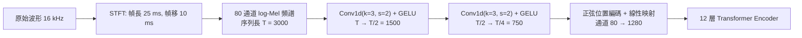

# 5.1 語音前端與 2D 卷積降維（2022）

## 一、背景與動機：一場針對「資料品質」的反叛

2022 年 9 月，OpenAI 發布 Whisper，論文由 Alec Radford、Jong Wook Kim 等人署名。這些作者正是 GPT-2、GPT-3 與 CLIP 的核心成員，他們把「規模化、弱監督、直取原始資料」的路線搬進了語音辨識。Whisper 的出現不是又一個架構上的巧妙發明，而是對整個 ASR 領域資料慣性的一次公開質問。

Radford 等人在論文開頭直接指出痛點：現代 ASR 模型長期訓練在監控品質的自動轉錄資料上，例如暗資料公司提供的 Google Speech，以及 LibriSpeech 這類公開資料集，其中許多標註來自過時且精準度不足的自動系統。這些資料單一說話者占比高、領域偏向朗讀式、文本過早被清洗到只剩下乾淨的閱讀語音。人類只需要幾十小時的接觸就能聽懂語音，而模型吃了十萬小時仍會在口音、雜訊與專有名詞上出錯，這說明瓶頸不在模型容量，而在資料的多樣性與監督訊號的品質。

Whisper 的核心假設因此變得清晰：與其花人力清洗資料，不如盡量擴大資料規模，讓 617,000 小時的多語言多領域語料以其原始樣貌流入模型，並用多任務訓練目標取代繁瑣的前處理工序。這條路線的直接先例是 GPT-3 與 CLIP——兩者都證明了「規模與多樣性」可以取代「精工細作的清洗」。而本章前兩節鋪陳的架構背景（seq2seq 與注意力機制）也已經成熟，Whisper 選擇的正是 5.2 節將展開的 Encoder-Decoder Transformer，但把訓練目標與資料策略整個換掉。

值得留意的歷史對稱性：2017 年 Transformer 出來時，語音界的主流仍是 HMM-GMM 與 LSTM-HMM 的混合體；2022 年 Whisper 出來時，語音界的主流已是 Conformer 與 RNN-T。也就是說，五年的時間讓 Transformer 的思想完全統治了語音，而 Whisper 的任務是把已被驗證的架構與已被驗證的規模路線組合起來，交給同一批人執行。這是一種工程上的收束，而非科學上的突破——但收束本身同樣具有歷史意義：它意味著某個研究議題已經成熟到可以用「把參數放大」的單一策略解決。

## 二、輸入表示：以最小改動繼承四十年的前端

Whisper 輸入端的設計哲學可以用四個字概括：極度保守。模型假設輸入為 16 kHz 的單聲道波形，先計算 25 毫秒幀長、10 毫秒幀移的短時傅立葉變換，再套用 80 通道的 Mel 濾波器組，取對數得到 log-Mel 頻譜圖。這套流程與第 2 章推導的標準前端完全一致——25/10 毫秒的幀參數是自 1980 年代 HTK 時代就定型的慣例，80 通道的 Mel 刻度沿用的是 Kaldi 與 TensorFlow 社群常見的設定。

這個選擇在當時頗具深意。2022 年此時，wav2vec 2.0 等自監督模型已經證明直接吃原始波形、讓第一層卷積自己學濾波器組是可行的；wav2vec 系列更主張端到端可學習的前端優於人工 Mel。但 Radford 等人反而回到 log-Mel——理由除了保留一點「人類聽覺偏置」之外，工程上的動機同樣關鍵：Whisper 的訓練目標是多語言多領域的巨量混合資料，前端若也學習，等於在已經巨大的搜尋空間裡再多放一個不穩定自由度。固定的 Mel 前端讓所有算力集中於聲學與語言之間的那座橋。

一個細節：log-Mel 特徵表達式為

$$
m_n = \log \left( \sum_{k=0}^{N/2} |X[n,k]|^2 \, H_{c}(k) \right)
$$

其中 $`H_{c}(k)`$ 是第 $`c`$ 個 Mel 三角濾波器， $`c`$ 遍歷 80 個通道。Whisper 不做 DCT 去相關（即不做 MFCC），也不做每說話者均值變異正規化（CMVN），因為訓練資料的多樣性本身就讓模型學會了對通道與說話者的穩健性。16 kHz 這個取樣率同樣是歷史包袱而非理論最優：語音的有效頻寬大約落在 300 Hz 到 3400 Hz，16 kHz 給了 8 kHz 的奈奎斯特頻率，留下了足夠的裕度；更高的取樣率在多數電話與網路語音中根本拿不到。

## 三、卷積下採樣：兩層 Conv1d 完成時間壓縮

log-Mel 頻譜進入 Transformer 之前，先通過兩層一維卷積，記作 $`\operatorname{Conv1d}(k = 3, s = 2)`$ ，各接一個 GELU 激活。第一層把時間維度從 $`T`$ 降到 $`T/2`$ ，第二層再降到 $`T/4`$ ，通道數則映射到模型寬度（large 版本為 1280 維）。下採樣後再加正弦位置編碼（模擬原版 Transformer 的做法），隨後進入 12 層的編碼器。

以 16 kHz、10 毫秒幀移計算，1 幀等於 160 個取樣點；下採樣 4 倍之後每個 token 對應 640 個取樣點，即 40 毫秒的音訊。這意味著 30 秒窗口（原始頻譜 3000 幀）經前端後只剩 750 個 token。兩層卷積的參數量相對整個模型微不足道，卻換來了後面所有自注意力計算的四倍節省——這是整個前端中最「四兩撥千斤」的一步。

值得注意的是，論文標題談的是 2D 卷積的觀念：把 log-Mel 頻譜視為時間 × 頻率的二維影像，卷積核同時在兩個軸上掃描。實作上以 $`\operatorname{Conv1d}(k = 3, s = 2)`$ 表達，效果等同於在頻率方向取 $`k = 3`$ 的感受野、在時間方向以步距 2 滑動——一次覆蓋 3 個 Mel 通道與 2 幀時間。這種「影像式前端 + 序列式主幹」的分工自 ConvLSTM 時代就常見，Whisper 只是把它壓縮到最精簡的形式。

維度變化的數字值得單獨列出來看：時間軸 3000 → 1500 → 750，頻率軸 80 通道在第一層被映射到模型寬度，之後不再改變。也就是說，前端並沒有像傳統 MFCC 那樣把頻率擠壓成 13 個係數，而是把「聽覺刻度上的頻率」原樣交給網路去學。這是一個反直覺但重要的取捨：它保留了高頻資訊的細節（響音、擦音的區別），代價是序列寬度無法像 MFCC 那樣大幅削減。

## 四、卷積核與步幅的寫法： $`k = 3`$ 與 $`s = 2`$ 的意義

$`\operatorname{Conv1d}(k = 3, s = 2)`$ 這三個符號承載了整個降維策略的資訊。核寬 $`k = 3`$ 決定了每個輸出位置在時間軸上的感受野，步幅 $`s = 2`$ 決定了相鄰輸出間隔多少個輸入幀。兩層串聯的效果是：第二層的一個輸出位置，回溯到原始頻譜的跨度約為 $`(2 \times 2 - 1) \times 2 + 1 = 7`$ 幀，也就是 70 毫秒。

70 毫秒恰好覆蓋一個典型音素的持續時間區間。這說明 $`k = 3`$ 與 $`s = 2`$ 的組合並非任意，而是讓一個 token 的時間尺度「略大於單一音素」。若核寬取 1（等於逐點線性映射加降採樣），感受野只有 3 幀，30 毫秒，資訊不足以讓網路辨識出音素邊界；若核寬取 5 或更大，參數量與過擬合風險上升，且在第一層就抹去過多高頻細節。

通道數的映射同樣重要。第一層卷積把 80 個 Mel 通道映射到模型寬度（large 為 1280 維），第二層維持這個寬度。這意味著網路在降採樣之後，時間軸變短但每個時間位置的向量變寬——資訊總量大致守恆。這是「把資訊從時間軸搬到特徵軸」的典型手法，與最大池化或固定步幅抽樣相比，保留了線性可組合的資訊重分配能力。

| 前端設定 | 幀長 | 幀移 | Mel 通道 | 30 秒幀數 | 卷積層數 | 前端 token 數 |
| --- | --- | --- | --- | --- | --- | --- |
| Kaldi 傳統 fbank | 25 毫秒 | 10 毫秒 | 80 | 3000 | 0 | 3000 |
| wav2vec 2.0 | 約 20 毫秒 | 約 10 毫秒 | learned | 約 3000 | 7 層卷積堆疊 | 約 1500 |
| Conformer | 25 毫秒 | 10 毫秒 | 80 | 3000 | 1 層 Conv | 1500（步幅 2） |
| Whisper large-v2 | 25 毫秒 | 10 毫秒 | 80 | 3000 | 2 層 Conv1d | 750 |
| Whisper large-v3 | 25 毫秒 | 10 毫秒 | 128 | 3000 | 2 層 Conv1d | 750 |

### 對數壓縮與動態範圍

在寫下 $`\log`$ 之前，Mel 能量在語音中的動態範圍可以高達 80 dB 以上：元音的共振峰能量可能是背景噪聲的數千倍。直接餵線性能量會讓少數高能幀主導梯度，而取對數則把能量尺度壓縮成近似分貝，同時使「能量相加」在對數域變成「能量相乘」的語意。

這個對數運算還帶來一個副產品：它讓輸入的分佈更接近高斯。Transformer 層歸一化雖然能處理尺度差異，但輸入分佈的尾部形狀仍會影響訓練初期的不穩定性。log-Mel 加上一次線性投影之後，量綱與分佈都更適合深層網路的梯度傳遞。

值得記錄的是 Whisper 沒有做的事：它不做 MFCC 的 DCT 去相關，也不做每說話者的均值變異正規化。前者會把 80 個通道混成 13 個去相關係數，後者需要說話者身分資訊（Whisper 處理單一混合音軌時根本無從取得）。省略這兩步意味著前端更「原始」，也意味著更多的事情被推給了網路本身。

## 五、GELU 與殘差連接：把降採樣做成可堆疊的區塊

兩個卷積層各自遵循 Transformer 的基本區塊慣例：卷積之後接 GELU 激活，再接殘差連接與層歸一化。GELU 的解析式為

$$
\operatorname{GELU}(x) = x \, \Phi(x) = x \int_{-\infty}^{x} e^{-t^2/2} \, dt \, / \sqrt{2\pi}
$$

其中 $`\Phi`$ 是標準常態累積分布函數。與 ReLU 的硬門檻不同，GELU 是平滑的、原點附近近似恆等映射，因此卷積層在初始化時幾乎不破壞輸入訊號，訓練初期格外穩定。相對 ReLU 的另一個好處是它有非零負半軸梯度，允許負值資訊以小權重的方式流入殘差支路。

殘差連接在這裡的意義特別實際：下採樣是一個不可逆的資訊丟棄操作，如果沒有殘差支路，梯度在穿過兩次步幅為 2 的卷積時容易衰減。殘差連接讓「保留高頻資訊」與「壓縮時間軸」兩件事解耦——網路可以讓主要路徑負責降採樣，而把細節交給跳連。這在實務上意味著，即使卷積把某些瞬態抹平了，原始的 log-Mel 仍有一條加法路徑可以把它們加回來。

## 六、位置編碼與 Transformer 輸入序列長度

降採樣後的 750 個 token 進入編碼器。與原版 Transformer 一樣，Whisper 在序列上加上正弦位置編碼

$$
\operatorname{PE}(pos, 2i) = \sin \left( \frac{pos}{10000^{2i/d}} \right), \quad \operatorname{PE}(pos, 2i+1) = \cos \left( \frac{pos}{10000^{2i/d}} \right)
$$

其中 $`pos`$ 為時間位置、 $`d`$ 為模型寬度。用正弦而非可學習的位置嵌入，是因為它讓模型對「輸入長度」的變化更自然：編碼器理論上能處理任意長度的序列，而 30 秒只是訓練時的固定切片長度。

位置編碼的必要性在這裡有一個容易被忽略的理由：注意力機制本身是置換等變的，如果沒有位置資訊，編碼器無法分辨兩個相同的聲學片段出現在句首還是句尾。對 ASR 而言這尤其關鍵，因為語序與標點都依賴絕對位置——同一串語音放在 30 秒窗口的開頭與結尾，其後接的語境完全不同。

輸入序列長度的實際數字：750 個聲學位置。這個數字落在 2022 年主流 Transformer 的舒適區內，且遠小於 GPT-3 時期常用的 2048 甚至更長的上下文，為的是讓「聲學位置 + 文字位置」能同時塞進訓練時設定的上下文長度。

## 七、為什麼必須下採樣： $`O(T^2)`$ 的暴力數學

答案冷靜得近乎殘酷：自注意力的計算量是序列長度平方。對長度 $`T`$ 的序列，單層注意力需要 $`O(T^2 \cdot d)`$ 的矩陣乘法與 $`O(T^2)`$ 的注意力圖記憶體；12 層堆疊只是把常數放大，曲線不變。若不降採樣，30 秒音訊產生 3000 個 token，注意力矩陣就有 $`3000 \times 3000`$ 個元素，訓練這樣的模型在 2022 年既昂貴又徒勞——因為語音的資訊密度遠低於文字，40 毫秒一個 token 已經足以承載音素與韻律的主要變化。

數據對比：30 秒窗口在三種前端下的 token 數分別是——逐樣本 480,000（不可行）、逐幀 3000（昂貴）、下採樣後 750（合理）。人類說話平均每秒約 2 到 3 個詞，30 秒大約 60 到 90 個詞；750 個聲學 token 對應一個典型文字 token 數級別，使得 Whisper 的困惑度負擔與 LLM 相當。工程上，44 kHz 語錄的 LibriSpeech long-form 與 10 秒短句反而無壓力——下採樣讓訓練時可以用 30 秒的完整段落，不必截斷句子。

還有一個常被忽略的收益：訓練時的遮罩策略可以是全遮罩而非因果遮罩，因為編碼器本來就是雙向的。全遮罩意味著每一個位置都同時作為上下文被使用，同樣的算力預算下，資訊利用率顯著高於因果遮罩。

## 八、三十秒窗口的設計哲學

Whisper 把訓練與推理都固定在 30 秒的窗口上，這不是隨意的工程參數。第一層理由是人類聽覺跨度：人在對話中跟蹤語義的工作記憶尺度大致在 10 到 30 秒，超過這個長度人就依賴摘要式重述而非逐字記憶。30 秒恰好容納一段完整的語義片段——一句長句加稍許上下文，且短到時序依賴不會失控。

第二層理由是與文字模型的一致性。Whisper 的解碼器是一個標準的 Transformer 文字模型，它需要「聲學條件 + 文字自迴歷史」的序列不超過注意力圖能負荷的長度。30 秒聲學（750 token）加上約 200 到 440 個轉錄 token，總計在 512 到 1024 的位置數內，正好落在 2022 年 Transformer 的舒適區。這個窗口也決定了 timestamp token 的粒度：5.3 節會看到，模型以 20 毫秒粒度對齊時間戳，恰好對應下採樣後每個 token 的 40 毫秒已可細分。

第三層理由是吞吐的工程經濟學：批量訓練時所有樣本都 pad 到 30 秒，這樣做浪費了 padding 的算力，但換來了 batch 內形狀一律相同的簡潔性，避免了變長序列 bucketing 的複雜度。OpenAI 顯然判斷這個簡潔性值得——從結果看，這個「前端極簡、窗口固定、目標豐富」的三角形設計，正是 Whisper 得以單模型橫掃多語言多領域的物質基礎。

對長音訊而言，30 秒窗口並不構成限制，因為推論時可以滑動：把長音訊切成相鄰的 30 秒片段，逐段解碼，再利用時間戳把片段縫合回來。這種「滑動視窗 + 重疊」的做法後來被大量第三方工具採用，也讓 Whisper 能處理 podcast 乃至數小時的會議錄音。

| 世代 | 前端 | 時間粒度 | 主幹 | 每秒 token 數 |
| --- | --- | --- | --- | --- |
| DNN-HMM（2012 前後） | MFCC + 方差歸一 | 10 毫秒幀 | 深層 NN + HMM | 100 幀 |
| Kaldi 時代（2014-2019） | MFCC/fbank + i-vector | 10 毫秒幀 | TDNN/LSTM | 100 幀 |
| wav2vec 2.0（2020） | 原始波形 + 可學習卷積 | 自定 | 12 層 Transformer | 約 50 |
| Conformer（2020-2021） | 80 通道 log-Mel | 25 毫秒 | 卷積 + 自注意力 | 40 |
| Whisper（2022） | 80 通道 log-Mel | 40 毫秒（下採樣後） | Encoder-Decoder | 25 |
| Omni 端到端（2024-2026，據公開報導） | 原始波形或離散 token | 12.5-80 毫秒 | 全模態 Transformer | 12-80 |

## 九、小結：保守的前端，激進的後端

Whisper 的前端是全模型中最不具創新性的部分——STFT、Mel、兩層卷積，沒有一項前人沒做過。但把「不創新」當作一種設計美德，本身就是一種論述：當資料規模與監督訊號的品質成為瓶頸時，前端與架構都應該退居配角。

這一節我們看到了前端如何把 30 秒語音壓成 750 個 token、如何在 $`O(T^2)`$ 的注意力成本下撐出可訓練的序列長度。有幾個數字值得記住：幀長 25 毫秒與幀移 10 毫秒決定了原始幀數 3000；兩層步幅為 2 的卷積把它壓成 750；每個 token 因此對應 40 毫秒的音訊。這三個數字共同決定了整個模型的算力預算，也決定了 5.2 節的交叉注意力要在怎樣的序列長度上運作。

更有價值的不是數字本身，而是方法論：把「資訊在哪裡被壓縮」的責任明確交給一個可解釋的、可計算的位置。傳統前端把壓縮責任分散在濾波器組與 DCT 裡，讀者無從得知哪些頻率被保留、哪些被丟棄；而 Whisper 的前端只有兩個明確的降採樣點。清晰性本身就是一種工程資產。

下一節將進入論文的主幹——聲學與語言如何在同一座 Encoder-Decoder Transformer 中透過交叉注意力會合，以及為什麼 Whisper 選擇完全不經過音素這個中間層。
