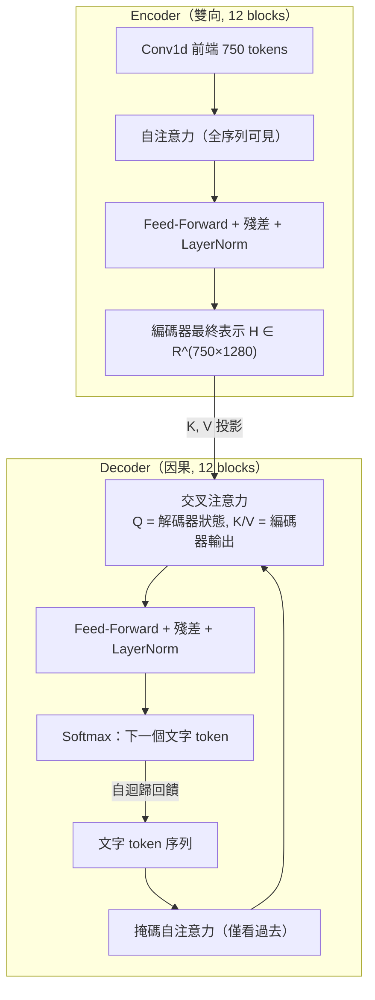

# 5.2 聲學-語言聯合編解碼器（Encoder-Decoder Transformer）與交叉注意力（2022）

## 一、把 seq2seq 的勝利搬進 ASR

Vaswani 等人 2017 年的 Transformer 最初就是為機器翻譯而生：一個編碼器讀源語言，一個解碼器自迴歸地寫目標語言，兩者以交叉注意力相連。這個結構對 ASR 的吸引力是天然的——聲學序列與文字序列本來就是不同「語言」、長度懸殊、需要某種非單調但有界的對齊。2019-2021 年的 LAS、RNN-T、Conformer-Transducer 等工作已把這條路走通，Whisper 的貢獻不是發明它，而是在它之上做出足以承載 617,000 小時的工程量與訓練策略。

Whisper large v2 的規格可以近似概括如下：編碼器與解碼器各 12 個 block，模型寬度 512 或（large 版本）1280 維，解碼器採用較少的注意力頭數（large 為 20 頭、維度切分 64）。官方同時發布了 tiny、base、small、medium、large 五個規格，參數量從 39M 到 1550M。這個規格譜系本身就是一個宣言：同一份資料與同一組訓練目標下，模型的取捨開放給使用者依照算力選擇，而大版本才是權衡了所有極限的旗艦。

要強調的是，Whisper 是以方向為序的架構對稱體：編碼器是雙向的，可以自由地看整段 30 秒聲學序列；解碼器是因果的，每一步只能看已生成的文字 token。這個不對稱正是「聲音進、文字出」的不對稱的鏡像，也決定了兩個模塊各自的注意力形態。

### 潛在序列這個詞的雙重歧義

「潛在序列」這個說法在 ASR 語境裡需要小心，因為它至少指涉三種不同的東西。第一種是統計語言學意義上的潛在變數——像 HMM 中的狀態序列那樣，存在但不可觀測。第二種是深度學習意義上的 latent representation——編碼器輸出的那個 1280 維連續向量序列。第三種是 Transformer 時代特有的「中間表示被整個拿掉」——不預設音素、不預設音節，只讓網路學出對下游有用的連續編碼。Whisper 用的是第三種。

這個區別在文獻裡經常被含混帶過，但它是理解 Whisper 設計哲學的關鍵。傳統 ASR 的隱藏狀態是「音素狀態機的軟化版」，它的維度與結構受制於音素表；而 Whisper 的編碼器輸出是一個完全由訓練目標塑造的連續表示。它的維度、它的內容、它是否線性可解碼成音素，理論上都不受任何先驗約束。這就是為什麼 Whisper 能處理多達 99 種語言而只需一套編碼器——因為編碼器根本沒有被設計成去還原某個特定語言的音系。

## 二、交叉注意力：對齊在此發生，也僅在此發生

交叉注意力是整座架構中唯一允許解碼器「看見」聲學的地方。標準的縮放點積注意力寫作

$$
\operatorname{Attn}(Q, K, V) = \operatorname{softmax} \left( \frac{QK^{\top}}{\sqrt{d_k}} \right) V
$$

在解碼與編碼的交會處， $ Q $ 來自解碼器當前層的查詢、 $ K $ 與 $ V $ 都來自編碼器的最終輸出經線性投影。換句話說，當解碼器要產生第 $ t $ 個文字 token 時，它以自身的文法狀態為鑰匙，去整段聲學表示中「取出」相關的聲學加權和。這個機制與第 4 章 CTC 的哲學形成尖銳對比：CTC 先假設幀與標籤獨立、再對所有可能對齊路徑做邊際化；序列到序列則乾脆放棄獨立假設，把對齊隱藏在注意力分散信用分配的過程中，由梯度自己去學。

注意力矩陣的可視化因此成為一種診斷工具。在 Whisper 的實作中，每一解碼層、每一注意力頭都給出一個形狀為「文字位置 × 聲學位置」的權重矩陣。當轉錄內容是「今天我們來談談深度學習」時，注意力圖上會出現沿對角線分布的帶狀結構，並在標點與停頓處出現水平的跳躍。這種圖形與 CTC 的強制對齊路徑在視覺上相似，但本質不同：CTC 的對齊是一條離散的單調路徑，而注意力的對齊是多頭、軟性、且可以同時看多處的。

必須承認注意力對齊並非天然可靠的。實務上常見注意力圖出現大段重複高亮、或在語音含糊處完全平坦的情形，這也是幻覺（hallucination）現象在視覺層面的投影之一。

## 三、與 CTC 的根本差異：邊際化對抗注意力

第 4 章詳細推導過 CTC 的前向-後向遞歸，其核心是把所有對齊路徑的機率加起來：

$$
p(y \mid x) = \sum_{\pi \in \mathcal{B}^{-1}(y)} \prod_{t=1}^{T} p(\pi_t \mid x_1, \dots, x_t)
$$

CTC 的哲學是「不挑一條對齊，而是把所有可能的對齊都算進來」，代價是輸出層必須是幀級的、不能有詞彙級的上下文依賴。Whisper 的注意力走的是相反的路：它明確地選出一條（軟性的）對齊，代價是必須自迴歸地逐 token 生成、推論速度較慢。

兩者的取捨可以這樣總結。CTC 的輸出分佈是條件獨立的近似：每幀的分類互相不知道對方，因而無法修正先前的錯誤，只能靠前綴束搜尋與語言模型在搜索階段事後補救。注意力架構的輸出分佈是自迴歸的完整機率模型：當模型在第 10 個 token 發現自己搞錯了，前面的 token 可以透過重算來修正。這就是 seq2seq 在長句子與低噪音場景下 WER 明顯優於 CTC 的結構性原因。

另一個差異在時間戳。CTC 系統的時間戳是從強制對齊的後驗幀位置上推導出來的，屬於「推論產物」；Whisper 的時間戳是模型主動發射的 token，屬於「訓練目標的一部分」。後者更簡單也更容易對齊到字幕工作流，但精度受制於標註中時間軸本身的可靠性。

## 四、注意力頭的分工：多頭不是裝飾

多頭注意力的意義在 ASR 裡比在機器翻譯裡更為具體。每一個頭擁有自己的投影矩陣，於是不同頭可以在同一個 decoder 位置上專注於不同性質的聲學資訊。

Whisper 的 large 版本在編碼器使用 20 個注意力頭，在解碼器也使用 20 頭但維度切分較小（每頭 64 維，總寬度因此低於編碼器）。這個刻意的不對稱值得留意：解碼器每生成一個文字 token 都要同時跑自注意力與交叉注意力，其計算成本是每個文字位置的兩倍注意力，因此縮減解碼器寬度是一種直接的省算手段。

在文獻分析中，人們觀察到編碼器注意力頭可以粗略分成幾類：對齊到基頻與韻律的頭、對齊到爆破音脈衝的頭、以及跨越整段序列做「一句話級」聚合的頭。解碼器的交叉注意力頭則分工更明顯——一部分負責前視的對齊（一個 token 對應一個或多個聲學位置），另一部分負責回頭修正（把注意力拉回前面某個位置以修正誤判）。這種分工是自發形成的，沒有任何明確的監督去指定它。

值得注意的是縮放因子 $ \sqrt{d_k} $ 的必要性。在 Whisper 的規模下，每頭維度為 64，點積的數值範圍會隨維度線性增長，若不縮放，softmax 會在早期訓練中進入飽和區，梯度趨近於零。這個除法看似瑣碎，卻是 Transformer 能夠穩定訓練的關鍵細節之一。

### 交叉注意力的複雜度與 KV 快取

交叉注意力的計算負擔可以用一個簡單的式子刻畫：解碼第 $ t $ 個 token 時，需要計算一個 $ t \times T $ 的注意力矩陣，其中 $ T $ 是 750。若總共生成 $ N $ 個文字 token，全部的交叉注意力計算量是 $ O(N \cdot T \cdot d) $ ，加上注意力矩陣的儲存 $ O(N \cdot T) $ 。

但由於 $ K $ 與 $ V $ 來自編碼器輸出、在整個解碼過程中固定不變，它們可以只計算一次並快取起來。於是每個解碼步的實際成本只有 $ Q K^{\top} $ 與加權和兩項，注意力矩陣甚至不必完整物化（可以分段計算）。這就是束搜尋在 Whisper 中仍然可行的技術原因：束內的 $ B $ 條假設共用同一份編碼器快取，只有解碼器狀態不同。

對照 CTC 的推論成本：CTC 只需要對 750 個位置各做一次分類與前綴束搜尋，完全不需要自迴歸。Whisper 的推論延遲因此顯著更高——這也是為什麼後來社群會推出 faster-whisper 這類以 CTC 或量化蒸餾為主的加速實作（據公開報導），以及為什麼 Whisper large-v3-turbo 選擇剪枝而非量化（據公開報導）。

## 五、文字 token 的機率語言：Softmax 與特殊詞彙

解碼器末端是一個線性層接 softmax，把隱狀態映射為詞彙表上的 emission 機率。Whisper 的詞彙表沿用 GPT 系列的位元組級 BPE，具備 51,865 個英文與多語言 token，並擴充了一整套以 `<|...|>` 包裹的特殊 token 體系：`<|startoftranscript|>` 開啟一段推斷、`<|endoftext|>` 或 `<|endoftranscript|>` 收尾、`<|notimestamps|>` 關閉時間戳輸出、以及 1501 個 `<|0.00|>` 到 `<|30.00|>` 的時間戳 token。

推論時，Prompt 的結構就是一份特殊 token 的編隊：`<|startoftranscript|>`、`<|lang_id|>`、`<|transcribe|>` 或 `<|translate|>`，然後讓模型自迴歸下去。`<|lang_id|>` 位置的選擇本身就是一次語言識別推斷——當不指定語言時，模型在該位元上表現出了與專門的語言識別系統可匹敵的能力，這正是多任務訓練的附產品。而 `<|transcribe|>` 與 `<|translate|>` 則把「幫我轉錄」與「幫我翻譯成英文」兩個任務寫進了同一個條件結構，後者是論文中將 X 到英翻譯性質驚人的來源之一。

還有 `<|nospeech|>`：當輸入是純雜訊或靜音時，我們無法在解碼過程中強迫模型停止，因此需要一個合法的特殊 token 來表達「此處無語音」。整個機制使 Whisper 的行為像一個微型命令介面——聲學序列是環境輸入，特殊 token 序列是命令列參數，文字 token 是最終輸出。

這套特殊 token 設計有一個值得玩味的形式美感：它把「任務選擇」本身也變成了一段可以被模型自迴歸生成的文字。所謂多任務，在推論時看起來與單任務毫無區別——同一個解碼循環，只是前面塞的 prompt 不同。

## 六、為什麼沒有音素中間層

1990 年代到 2017 年，所有主流 ASR 都以音素或 subword 音素為中間表示：GMM-HMM 的 triphone 狀態、DNN-HMM 的 senone、以及 2015 年前後 Grapheme-to-Phoneme 進入管線的各種嘗試。音素給了模型強大的先驗——它是一個手工設計的、語言學上有意義的離散空間。但它是雙面刃：音素表因語言而異、方言與口音使得邊界模糊、且音素到文字還需要發音字典這類脆弱的橋樑。

Whisper 的答案是拋棄音素，讓模型直接從聲學表示預測文字 token（BPE 子詞）。這在 CTC 之外再次展現了注意力架構的另一個紅利：解碼器的語言建模能力已經足以承擔「音素到文字」的知識，沒有必要把它分成兩個顯式階段。多語言本身就是論證：一個統一的子詞詞彙表上，英文、中文、日文、韓文的差異僅以 token 分佈呈現，不需要各自設計一套音素表。代價是可解釋性的下降——你無法像舊系統那樣讓模型攤出音素後驗圖，但換來的是端到端的純文字輸出，以及標點、大小寫、詞形等正交寫作細節的天然保留。

從工程角度還有一個實際好處：不需要維護跨語言的發音字典。整個系統的下游介面就是「音訊進、文字出」，任何下游應用不需要知道底層是什麼語言、用了什麼文字系統。這是 Whisper 能夠被廣泛嵌入各種應用的關鍵。

## 七、推論期的束搜尋：把語言先驗編回解碼

訓練用的是教師強制，推論則是自迴歸的束搜尋：維持 $ B $ 條假設，每步對每條假設計算 softmax 分佈、取 top- $ k $ 擴展、以累積對數機率與長度懲罰排序。Whisper 默認 $ B = 5 $ ，加之 5.3 節將描述的溫度機制，使得解碼在遇到難段時可以自動退火重試。這個過程中的束搜尋可行性完全無需外接語言模型——因為解碼器本身就是語言模型，這是 seq2seq 相對 CTC 在推論工程上的最大極簡。

值得對比的是 CTC 推論的成本結構：CTC 每幀獨立出分佈，配合前綴束搜尋與外部語言模型可以做到極快，但需要維護兩套模型；Whisper 的束搜尋每生成一個 token 都要走一遍解碼器，計算成本高了一個常數因子級別，但整個系統只剩一個模型。在 GPU 時代，這個「單模型、單次前向、束內共享 KV 快取」的折衷成為顯然優選。

溫度抽樣的引入，形式上像是把束搜尋的一部分鬆開：當溫度 $ \tau > 1 $ 時，softmax 分佈被平滑化，束內多個假設之間的機率差距被壓縮，於是「開始重複」的吸引子不再那麼獨佔。實務上這被當成故障排除的最後手段——只有在偵測到重複或異常時才啟用，正常情況下仍走貪心或低束寬的確定性解碼，以保證輸出的可重現性。

| 架構世代 | 代表系統 | 對齊機制 | 中間表示 | 推論 |
| --- | --- | --- | --- | --- |
| GMM-HMM | HTK、Kaldi 前身 | 維特比（外狀態） | triphone 音素 | 幀同步搜尋 |
| DNN-HMM | DNN/HMM 混血 | 維特比 | senone | 幀同步搜尋 |
| CTC | Deep Speech 2、wav2vec 2.0 | 邊際化 | 幀級標籤 | 前綴束搜尋 |
| Transducer | RNN-T、Conformer-T | 內建 lazily 對齊 | 幀與 token 聯合 | 有效同步 |
| Seq2seq + 注意力 | LAS、Whisper | 交叉注意力 | 無（直出文字） | 束搜尋 |

## 八、小結：一座橋的完成

這一節我們看清了 Whisper 的主幹：編碼器把 750 個聲學 token 壓成全序列可見的表示，解碼器以自迴歸與交叉注意力把語言一個 token 一個 token 地拉出來。對齊不再是 HMM 的狀態圖、也不是 CTC 的路徑和，而是每次 softmax 採樣前那一刻的注意力分佈。特殊 token 體系把語言識別、轉錄、翻譯、時間戳與不可言說的「無語音」都寫進了同一個解碼協議。

回頭看這一節的三個技術選擇，可以發現它們共享同一個傾向：把原本由工程師手工設計的組件，改成由同一套網路從資料中學出。第一個選擇是放棄音素表與發音字典，改讓模型直接學到文字層。第二個選擇是放棄外部語言模型，改讓解碼器本身成為語言模型。第三個選擇是放棄預先標註的對齊，改讓注意力分佈承擔對齊的功能。每一次放棄都換來了同一件事：可擴充性。所有被移除的組件都是有限資源的產物——音素表需要語言學家、發音字典需要annotator、強制對齊標註需要時間；而注意力與解碼器的容量，只要餵更多資料就能成長。

這也解釋了為什麼 Whisper 能夠用同一個模型服務 99 種語言，而傳統系統需要為每種語言分別維護前端、字典與解碼器。手工組件是硬編碼的邊界，網路學到的東西則是連續的、可插值的。

但架構只是骨架。真正決定這座橋能承受多大交通量的，是橋墩的材料——下一節轉入訓練目標：OpenAI 如何用弱監督的多任務損失，把 617,000 小時未清洗的聲音變成這座橋的建築材料。
