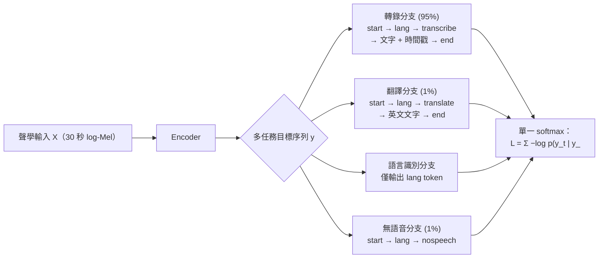

# 5.3 弱監督多任務聯合訓練目標（2022-2023）

## 一、617,000 小時的力量與不平衡

Whisper 用到了約 617,000 小時的多語言多領域音訊——這是迄今（截至 2022 年）公開論文中最大的 ASR 訓練語料，比現有最大監督語料集大了近一個數量級。其中約三分之一（438,000 小時）是英文，其餘依序為多語言轉錄、以及 127,000 小時的 X 到英翻譯對，覆蓋約 96 種語言。關鍵在於資料來源：絕大部分取自網際網路，轉錄由人產生，但沒有經過逐條人工校驗——此即「弱監督」的精確含義。

資料的分佈極度不平衡：英文幾乎氾濫，少數資源匱乏的語言只有個位數小時。OpenAI 的判斷是「規模取勝」：與其把人力花在平衡取樣與清洗低端資料，不如把全部 617,000 小時都餵進去，讓模型在長尾上至少獲得「見過」的經驗，在頭部語言上則獲得前所未有的多樣性。論文對此做了對照實驗：把唯一不同（規模與清洗比例）的訓練集組合餵給同構模型，規模增益在對照組上始終勝出——這正是 GPT-3 與 CLIP 路線在語音上的直接類比。

弱監督不是沒有監督：它意味著標註不可靠但多樣。雜訊（口音誤差、自動字幕的錯字、時間戳漂移）在巨量資料中呈長尾分佈，模型的交叉熵損失在期望上仍指向正確的語言結構，噪聲則被視為可壓制的方差。這個論證按照論文的表述是：清洗與否的取捨應該服從總效用，而非直觀的資料潔癖。

### 弱監督的統計學直覺

要理解為什麼這種做法能奏效，可以把每條弱標註視為「真實標註 + 一個噪聲過程」的結果。若噪聲是獨立於內容的隨機擾動，那麼大量樣本的期望交叉熵仍會把參數推向最佳解——這正是統計學習的標準結論。真正危險的是系統性偏差：例如某個字幕供應商慣用非標準的標點風格，或把笑聲標成「哈」，這類偏差會被模型學進去，成為系統性的偏置。Whisper 的多任務設計在這裡扮演了部分緩衝的角色：因為不同的任務分支帶來不同的標註風格，模型被迫抽取「跨風格一致」的語言結構。

## 二、多任務目標：把整個 ASR 疊成一個 softmax

Whisper 的訓練目標從本質上就是一個條件語言模型：對任一序列 $ X $ （聲學輸入）與 $ y $ （目標 token 序列），最大化

$$
\mathcal{L} = \sum_{t} - \log p \left( y_{t} \mid y_{<t}, X \right)
$$

變的部分是 $ y $ 本身可以由多段拼成：特殊 token（`<|startoftranscript|>`、`<|lang_id|>`、任務 token `<|transcribe|>` 或 `<|translate|>`）、可選的時間戳 token 交錯、BPE 轉錄、`<|endoftranscript|>`，以及對純雜訊片段的 `<|nospeech|>`。所有這些共用同一個 softmax、同一個 5.2 節描述的解碼協議——這就是「多任務」在 Whisper 裡的字面實現：不是多個損失頭，而是一個更豐富的目標序列詞彙空間。

訓練批次內，每個樣本被隨機指派到其中一條分支：95% 做轉錄輸出（含時間戳），1% 做 X 到英翻譯，1% 做 `<|nospeech|>` 判別（資料內部刻意混入靜音段），其餘用以平衡各語言與長度。這種「單一損失形式、多重內容」的隨機化，等價於把多任務學習的重要性加權取樣隱藏在了 Prompt 分佈的設計中，而架構側完全不用修改。

從更一般的多任務學習觀點來看，Whisper 的做法可以寫成加權損失的形式：

$$
\mathcal{L} = \sum_{k} \lambda_k \, \mathcal{L}_k
$$

其中 $ k $ 遍歷轉寫、翻譯、語言識別、語音活動偵測與時間戳預測等任務分支， $ \mathcal{L}_k $ 是各分支的交叉熵， $ \lambda_k $ 是權重。在 Whisper 裡這個分解並不顯式存在——所有分支被寫成同一個序列對數機率的不同實例，權重則隱含在分支的取樣機率裡。這是形式上的簡化，但工程上的結果是一個令人滿意的收斂：單一損失、單一詞彙表、單一解碼協議。

### 各任務分支的語義分工

語言識別分支看似最簡單，卻承擔了最關鍵的條件作用。當目標序列只有語言標記時，模型必須在尚未產生任何文字之前，從聲學表示中判斷出「這是哪一種語言」。這個前置判斷的梯度會回傳到編碼器，使得編碼器的主幹必須保留足以區分語言的聲學線索（音位系統、韻律、詞長分布），而不能只保留發音細節。

翻譯分支的價值則在於跨語言的語義監督。轉寫分支只教模型「音素到文字」的映射，這個映射本身幾乎不含跨語言的資訊；翻譯分支要求模型理解句子的意思，而理解意思必須依賴發音之外的抽象表示。這條分支等於是在說：編碼器不要只當一台拼寫機。論文報告的 X 到英翻譯品質，是這種額外監督的直接兌現。

語音活動偵測分支的作用看似邊緣，實際上決定了長音訊處理的行為品質。若模型沒有內生的「這段是無聲」概念，它在遇到靜音時就會傾向於產生幻覺性的文字（例如重複上一段的內容）。有了 `<|nospeech|>` 這個合法的結束出口，模型在靜音段的行為從「被迫生成」變成「可以合法終止」，這是抑制幻覺的第一道閘門。

### 資料配方與取樣機率的意義

取樣機率的數字值得單獨解讀。轉錄佔 95% 意味著模型的主職仍是轉寫，這符合 Whisper 作為 ASR 系統的定位；翻譯與無語音各佔 1%，看似極小，卻因為資料量本身龐大而仍然可觀——若翻譯資料有 127,000 小時，即使只抽 1%，也有 1,270 小時的翻譯監督，足以把解碼器推向「理解語意」而非「拼湊音素」的方向。這是多任務學習中的一個重要經驗：小比例的高價值任務，其效果取決於絕對量而非比例。

同理，靜音片段只需要 1% 就足以讓模型學會「無語音」這個概念，因為這是一個容易分類、邊界清晰的任務；反過來，若把它提高到 20%，反而會讓模型過度傾向輸出 `<|nospeech|>` 而犧牲轉錄召回。任務權重的設計本質上是一個偏好的微調，而不是重要性排序。

## 四、時間戳 token：20 毫秒粒度的顯式對齊

在轉錄分支的目標序列中，模型被訓練去在適當的位置發射時間戳 token，粒度為 20 毫秒（即每秒最多 50 個可選時間標記，以 `<|0.00|>` 到 `<|30.00|>` 編碼）。這個設計有兩個目的：一是讓輸出天然攜帶可用於字幕或強制對齊的時間資訊，二是在 30 秒窗口被分段時，為邊界處的推理提供顯式錨點——模型知道上一段結尾在 `<|12.40|>`，下一段就從相近的時間格開始，從而可以在長音訊上滑動切片而不丟失連貫性。

有趣的問題是，時間戳 token 不是從對齊後驗中監督學出的，而是被直接寫進標註（來源資料的時間軸本身）。若標註的時間軸可靠，模型學到的是精確對齊；若標註漂移（很多自動字幕便是如此），模型則學到一種統計平均意義下的對齊。Whisper 顯然把弱監督邏輯推到了連「對齊」本身也交由資料分佈決定：20 毫秒粒度上的對齊能力最終被證明足以支援字級時間戳。

這與 CTCLoss 在損失內做路徑邊際化截然不同——對齊在這裡是可學習的顯式離散 token，而非隱式積分變數。取捨在於：顯式對齊可解釋、可剪輯、可直接餵給字幕機，但在弱標註下的精度上限被標註品質鎖死。

## 五、損失之外的調味：溫度退火與重試

Whisper 的訓練目標很乾淨，但訓練有一個關鍵的推論策略：在解碼時，若模型在 30 秒窗口產生了重複的文本（logprob 突降或重複 token 佔比過高，如 gzip 壓縮率異常），則重新解碼。第一次用默認溫度 0（即貪心），重試時把取樣溫度提升至 0.2、0.4、0.6、0.8、1.0——在 log 機率分佈上除以 $ Z_{\tau} $ 並重加 softmax：

$$
p_{\tau}(v) = \frac{p(v)^{1/\tau}}{\sum_{v'} p(v')^{1/\tau}}
$$

溫度愈高，分佈愈平坦，模型愈敢「跳出」自我強化的重複吸引子。這個機制（論文中的貪心解碼直到失敗為止策略）不修改任何參數，只修改取樣行為——卻被大量使用者在生產環境中驗證為序列到序列長文本解碼的救命索。後續 Hugging Face 生態的 sequential decoding 實現皆沿用了此協議；2023 年以降的 faster-whisper、whisperX 等衍生實作，也基本照搬這條退火鏈（據公開報導）。

從機制上說明為什麼會出現重複：自迴歸解碼器的錯誤是累積的，一旦在某個位置發生了重複，這個重複會被放進上下文，於是下一個 token 的條件機率更加偏向重複，形成正反饋。溫度退火的作用正是在於擾動這個正反饋迴路，讓模型回到搜尋樹的另一個分支。

## 六、為什麼「弱監督多任務」是通用方向

把 Whisper 的訓練策略抽象出來，可以寫成一個命題：當資料規模與品質不可兼得時，單一模型多損失優於在清洗上無限投入。這個命題有三個支撐：

1. **互補式監督**：翻譯分支為轉錄分支提供了跨語言的語義先驗，語言識別分支為所有分支提供了「先決定我在哪個語言世界」的條件，語音活動偵測分支讓模型對靜音有內生的表述能力。多任務之間的梯度共享形成了一個正則化網路。
2. **雜訊的長尾把我推向多樣性**：弱標註包含的錯誤（尤其是時間戳漂移、口音轉寫變異）本身是一種資料增強，迫使模型不能死記任何單一標註系統的習慣。
3. **單一 softmax 的統一性**：所有任務共用一組參數，任務間的知識轉移是白搭的，不會因為多任務頭的參數分裂而互相牽制。

多任務之所以能緩解資料不平衡，機制可以這樣描述：若只有轉寫一條分支，資料量只有幾千小時的語言會得到一個嚴重過擬合的模型——它記住了那幾千小時的寫作風格，而不是學到該語言的規則。加入翻譯分支後，這些語言多出了「語意正確」的監督；加入語言識別分支後，多出了「語音獨特」的監督。不同分支提供的訊號互不重疊，於是有限的資料被「摺疊」成更豐富的訓練訊號，而不必真的增加該語言的音訊時數。

這三點在 2023 年後的語音大模型（據公開報導：SeamlessM4T、MMS、Canary、OWSM 等）中都有體現，只是任務集與資料分佈更替。可以說，Whisper 標定了「多任務訓練目標設計即模型能力設計」的新常態。

## 七、評估：多語言 WER 與穩健性的實證

先談評估方法本身的意義。Whisper 的測試設定是零樣本：模型從未在 FLEURS、Common Voice 或 LibriSpeech 的測試集上微調過。這與 2010 年代那種「在同一個測試集上反覆調參」的標準完全不同，因此這些數字衡量的是遷移能力而不是擬合能力。零樣本設定也意味著，任何基準的污染風險都直接暴露在結果裡——模型在訓練中是否見過類似文本，是讀者無法從論文完全排除的疑慮。

論文以零樣本（無任何目標資料集微調）方式在 LibriSpeech、Common Voice、FLEURS 等多語言基準上評測。英文 large 版本在人類可及的資料上已達到與監督最優模型打平或超越的字錯誤率（LibriSpeech test-clean 上個位數 WER），而帶噪與長尾語言上，Whisper 零樣本根本性地超越了以往任何非微調模型。多語言上尤為驚人的是 X 到英翻譯：CoVoST2 分數逼近監督系統、FLEURS 翻譯指標也顯示它已經是一個可用的語音翻譯引擎——這是 617,000 小時裡 127,000 小時翻譯對的直接饋贈。

在對照穩健性的測試（加了雜訊的 LibriSpeech、口音偏移的腳本變化、專有名詞的腳本測驗）中，Whisper 的退化曲線顯著比監督模型平緩：在 +7 分貝噪訊上僅下降約 5 個 WER 百分點，非母語口音上退化也明顯低於監督基線。零樣本這個條件尤其值得強調：Whisper 沒有在這些基準上微調過，因此這些數字直接反映了「互補式監督」帶來的泛化能力。

失效模式同樣有規律。第一類是口音：模型在母語者的非標準口音上仍會替換詞彙。第二類是噪聲下的幻覺：輸入幾乎沒有可辨識的語音時，模型傾向於生成流暢但錯誤的文字。第三類是專有名詞，尤其是人名與機構名——這類資訊在弱標註語料中本來就常被誤寫，模型忠實地學到了這些錯誤。第四類是繁體中文與中英夾雜：中文的書寫高度依賴上下文與慣用語，弱標註語料中的繁簡混用、標點全形半形不一致、以及夾雜英文術語的寫法，會直接反映在輸出上；同時中英夾雜的輸入也讓 `<|lang_id|>` 的判定變得模糊，模型可能在同一段內反覆切換語言標記。

| 版本 | 年份 | 參數量 | 相對 large 的訓練量 | 重要差異 |
| --- | --- | --- | --- | --- |
| large-v1 | 2022.09 | 1,550 M | 基準 | 初版，3 epochs，部分屬未收束 |
| large-v2 | 2022.12 | 1,550 M | 基準 | 增加訓練、修字幕格式，WER 較低 |
| medium | 2022.09 | 769 M | 約 0.5 | 英文仍強，多語略遜 |
| small / base / tiny | 2022.09 | 244/74/39 M | 依規格遞減 | 端側與嵌入用 |
| large-v3 | 2023.11 | 1,550 M | 數據未公開 | 新 128 Mel-bin、處理更多語言與標點（據公開報導） |
| large-v3-turbo | 2024.10 | 809 M | 架構剪枝 | 減層加速（據公開報導） |

值得注意的是 large-v3 對前端的修改：Mel 通道從 80 增加到 128，等於前端參數與輸入資訊量的一次擴容（據公開報導）。這說明前端的取捨並非永遠凝固的——在資料規模成長到一定程度之後，更細的頻率解析度重新變得划算。

## 八、小結：從「聽懂」到「開口」

截至這三節，Whisper 把「波形到文字」這半條迴路整個改寫了：前端從 MFCC 繼承而來的保守性、主幹上 Encoder-Decoder 與交叉注意力的簡潔、以及弱監督多任務的訓練野心，三者共同證明——當資料規模與任務設計到位時，端到端直接生成文字是最經濟的 ASR 終局。

而「資料規模與任務數量」之所以是這一階段的主要武器，有一個結構性的理由：當監督訊號的品質無法再提升時，唯一還能擴展的兩個軸就是資料量與任務種類。這兩者都是「加法」而非「乘法」——加資料不需要重新設計架構，加任務也不需要新增參數頭部。在 Transformer 的 scaling law 已經確立、而語音領域卻普遍缺乏高品質標註的 2022 年，這是唯一可行的擴張方向。

但這本書的敘事線前方還有另一半迴路：從文字回到波形。Whisper 是「張量到文字」，而下一章將回到自迴歸的原始動機，迎接「文字到波形」——WaveNet 的因果擴張卷積，也正是整本書意圖統合的語音生成端之起點。
