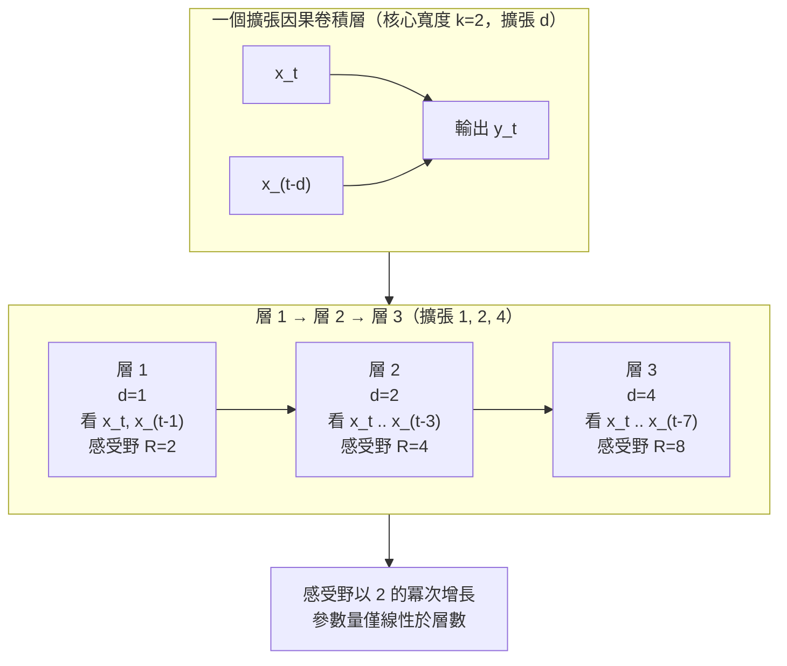

# 6.2 擴張因果卷積（Dilated Causal Convolutions）（2016）

## 一、感受野：一個被序列長度綁架的量

要理解擴張卷積的必要性，先要精確定義「感受野」（receptive field）。對卷積網路中的某個輸出位置而言，感受野是指「該位置的輸出所能看到的輸入位置範圍」。在影像領域這是空間概念，在音訊領域則是時間概念：一個 3 層、核心寬度 2 的因果卷積堆疊，其感受野只有 4 個取樣點，也就是 0.25 毫秒。

這個數字與語音的結構需求相差數個數量級。判斷當前取樣點處的聲音是清音的「s」還是「f」，模型需要看到摩擦音已經持續了一段時間；判斷音素的共振峰軌跡，需要看到前一個音素的過渡；判斷一句話的節奏與停頓，需要跨越數百毫秒甚至更長。換言之，一個真正有用的聲學模型必須能夠在時間上「看得夠遠」——WaveNet 論文設定的目標感受野是 2047 個取樣點，在 16 kHz 下約為 128 毫秒，足以涵蓋一個完整音素甚至數個連續音素。

問題在於，直接的做法代價極高。若用單層卷積覆蓋 2047 個取樣點，核心寬度就要是 2047，參數量隨核寬**線性**成長；若改用堆疊方式且維持核心寬度 2，則需要 2046 層。兩條路都不可行——前者參數爆炸，後者深度爆炸，而且後者每一層的捲積核都很小，參數共享的優勢也幾乎喪失。

捲積核寬度與堆疊深度的取捨可以寫成一個簡單的等式。對核心寬度為 $ k $ 的因果卷積，若要覆蓋 $ R $ 個取樣點，至少需要 $ n $ 層滿足

$$
R = 1 + n \left( k - 1 \right)
$$

在固定的 $ R $ 下， $ k $ 與 $ n $ 此消彼長。而當 $ k $ 大到一定程度，參數量（正比於 $ k $ ）與計算量（正比於 $ k $ ）都會失控。擴張卷積正是針對這個矛盾提出的解方。

## 二、擴張卷積的數學

擴張（dilation）的想法非常簡單：在一維因果卷積中，卷積核的取樣位置不再是連續的，而是乘上一個**擴張因子** $ d $ 。若卷積核的權重為 $ w_0, w_1, \dots, w_{k-1} $ ，則在位置 $ t $ 的輸出為

$$
y_t = \sum_{i=0}^{k-1} w_i \, x_{t - i \, d}
$$

當 $ d = 1 $ 時，這就是普通的因果卷積；當 $ d = 2 $ 時，卷積核每隔兩個取樣點取一次，覆蓋的區間長度是 $ k \cdot d $ ；當 $ d = 512 $ 時，一個寬度為 2 的核就能覆蓋近千個取樣點。**參數量完全不變，但感受野成倍擴張**——這就是擴張卷積的全部魔法。

因果性限制則是另一個必備條件。所謂因果，指的是 $ t $ 位置的輸出只能依賴 $ t $ 與更早的輸入，也就是說，卷積核中所有偏移量都必須非負：

$$
y_t = f \left( x_t, x_{t-1}, \dots, x_{t - (k-1)d} \right)
$$

這與「中心裁剪」（same padding 但向左對齊）或「全連接」（允許看未來）截然不同。在語音合成中，因果性不是可選項而是硬性要求：自迴歸生成時，第 $ t $ 步的取樣必須只依賴已產生的前綴，否則模型等於偷看了未來，訓練時的高準確率將無法在推理時重現。

值得強調的是，因果性與擴張性在實作上是彼此獨立的兩個旋鈕，但必須同時開啟才有意義。若只有擴張而沒有因果（例如標準的「same」填充擴張卷積），網路在訓練時能同時看到左右上下文，得到的其實是一個**雙向**模型——它在特徵抽取上或許更強，但無法用於自迴歸取樣，因為取樣時未來的取樣點尚未存在。反過來，若只有因果而沒有擴張，模型就退化為固定窗的滑動過濾器。WaveNet 兩者兼備，這使它既能作為一個**特徵萃取器**（用於理解與重建），也能作為一個**生成器**（用於自迴歸取樣），兩種用法在架構上是同一套卷積。

最後要提到一個實作細節，它在數學上不顯眼，但在工程上決定了模型品質的下限：因為因果卷積只在序列左側有有效內容，序列開頭的取樣點會「看見」零填充。這些零填充代表的是「音訊開始之前的虛無」，對第一個音素的建模實際上是錯的。WaveNet 的解法是在每一層都使用零填充，但因為殘差連接的存在，錯誤的資訊會隨著層數累積。因此實作上常配合**自條件化**（self-conditioning）機制：把上一個取樣步驟產生的分佈摘要回饋給當前層，作為額外的輸入通道。這一機制在原始論文中就已存在，其作用正是修補序列起始處的資訊不足。

## 三、感受野的遞推公式

多層擴張卷積堆疊時，感受野可以逐層遞推。設第 $ k $ 層的核心寬度為 $ k_k $ 、擴張因子為 $ d_k $ ，且第 $ k $ 層的輸出依賴第 $ k-1 $ 層輸出的一個跨度為 $ (k_k - 1) d_k $ ，則感受野的遞推式為

$$
R_k = R_{k-1} + \left( k_k - 1 \right) d_k, \qquad R_0 = 1
$$

其中 $ R_0 = 1 $ 表示零層時的退化感受野只有當前位置一個點。這個式子的直覺是：每增加一層，該層就能透過「看到下層的更早位置」把時間跨度再拉長 $ (k_k - 1) d_k $ 這麼多。

以 WaveNet 的實際設定為例：核心寬度固定為 $ k = 2 $ ，擴張序列取 $ \{1, 2, 4, \dots, 512\} $ ，共 10 種取值循環使用兩輪、合計 30 層。代入遞推式，由於 $ (k_k - 1) = 1 $ ，感受野變成等比級數累加：

$$
R_{30} = 1 + 2 \left( 1 + 2 + 4 + \dots + 512 \right) = 1 + 2 \times 1023 = 2047
$$

| 層區段 | 擴張因子 $ d $ | 該段結束時的感受野 | 覆蓋時間（16 kHz） |
| --- | --- | --- | --- |
| 層 1 | 1 | 2 | 0.06 ms |
| 層 2 | 2 | 4 | 0.19 ms |
| 層 3 | 4 | 8 | 0.44 ms |
| 層 4 | 8 | 16 | 0.94 ms |
| 層 5 | 16 | 32 | 1.94 ms |
| 層 6 | 32 | 64 | 3.94 ms |
| 層 7 | 64 | 128 | 7.94 ms |
| 層 8 | 128 | 256 | 15.9 ms |
| 層 9 | 256 | 512 | 31.9 ms |
| 層 10 | 512 | 1024 | 63.9 ms |
| 層 11–20 | 1→512（循環） | 2047 | 127.9 ms |
| 層 21–30 | 1→512（循環） | 2047 | 127.9 ms |

這個表格揭示了一個重要的工程事實：**擴張因子每輪循環一次，感受野就不再增加**。當第 11 層重新使用 $ d = 1 $ 時，它只是把輸出再往回看 1 個位置，而非先前那輪已經涵蓋的 512。這正是「堆多層」的真正用意——不是為了增長感受野，而是為了讓每一層都能在**不同的時間尺度上**抽取特徵：低擴張層負責細緻的局部波形形狀，高擴張層負責長距離的音素與韻律結構。這種「多尺度並列」的性質，是擴張卷積相較於單純加深網路的重要優勢。

擴張序列的選項本身就是一個設計決策，值得單獨討論。最直觀的選擇是 $ \{1, 2, 4, 8, \dots\} $ 這種純指數序列，它能在最短的層數內達到最大感受野，但代價是各層的時間尺度差距過於懸殊——第 1 層只看 1 個點，第 10 層就看 512 個點，中間尺度被跳過。另一個極端是線性序列 $ \{1, 2, 3, \dots\} $ ，尺度分佈均勻，但感受野成長為 $ O(n^2) $ ，需要多得多的層數。WaveNet 採用的折衷方案是**循環使用指數序列**，即前 10 層覆蓋 $ \{1, \dots, 512\} $ ，接著再重複一輪。這樣既保留了指數級的感受野效率，又讓模型有兩組不同擴張因子的層可以交替作用於同一段訊號，不同尺度的特徵因此能互相對齊與整合。

第二輪的存在還有一個純粹的實作理由：它把總層數從 10 增加到 30，等於在不增加任何參數量級的前提下把模型深度提高了三倍。深度是表達力的來源——每多一層，網路就多一次非線性複合的機會。這個「用感受野已飽和的層數換取深度」的設計，在後續的 TTS 架構中被廣泛沿用，成為幾乎所有擴張式聲學模型（例如 Tacotron 系列的解碼器、部分神經聲碼器）的標準配置。

還有一個容易被混淆的設計點必須釐清：擴張因子與下採樣率是兩個正交的旋鈕。下採樣讓模型在粗時間尺度上工作、降低計算量但損失細節；擴張則讓模型在保持每一步時間解析度的前提下看得更遠。在語音生成中，WaveNet 拒絕了下採樣——理由很直接：聲帶振動的基本頻率本身就是高於取樣率一半的資訊，一旦下採樣，基頻就無法被完整重建。這與影像分割中的慣例形成鮮明對比，在那裡下採換取感受野是合理的取捨，因為自然影像的內容多在低頻。聲音的「內容」恰恰在高頻，這是聲學建模與視覺建模在本質上的一項分歧。

另一個實作層面的考量是**核心寬度與擴張因子的取捨**。核心寬度 $ k $ 為 2 時，每層只做一次加權，參數最省，但每層只能「看到」兩個位置；核心寬度為 3 或 4 時，單層能聚合更多鄰域資訊，在早期層（低擴張、對應細微局部特徵）特別有用。原始 WaveNet 選擇最省的 $ k = 2 $ ，把表達力完全押在深度與擴張上；後續許多改進工作則在低擴張層使用較寬的核心。這個取捨的普遍規律是：**高擴張層用窄核、低擴張層用寬核**，因為前者需要的是跨越距離，後者需要的是聚合鄰域。

## 四、參數效率的量化比較

現在可以做一次徹底的參數量核算。假設通道數為 $ C $ （即每層輸出的特徵維度），核心寬度為 2。單層擴張因果卷積的權重數為 $ 2 C^2 $ （一組用於濾波器路徑、一組用於閘門路徑），30 層共約 $ 120 C^2 $ 個權重。

相較之下，若用**單層**卷積直接覆蓋 2047 個取樣點並維持相同通道數，權重數是 $ 2047 C^2 $ ，是前者的 17 倍；若用**堆疊**普通因果卷積（核心寬度 2、不擴張）來覆蓋同樣的 2047 點，需要 2046 層，權重數是 $ 4092 C^2 $ ，是前者的 34 倍，而且堆疊深度本身會造成梯度傳遞困難與訓練不穩定。

這裡還有一層更深的直覺：擴張卷積讓「感受野」與「參數量」解耦。參數量隨層數線性成長，感受野卻隨擴張因子的指數成長。這個解耦使得模型可以在**幾乎不增加參數**的情況下獲得數千取樣點的時間視野。

## 五、與 LSTM 的正面对照

在 2016 年，處理長序列的主流答案是 LSTM 或 GRU。它們確實具備不受固定輸入窗限制的長程記憶能力，但在聲學波形這個特定場景下有幾個致命劣勢。

第一是**時間上的串行依賴**。LSTM 的狀態更新是 $ h_t = f(h_{t-1}, x_t) $ ，必須逐步迭代，無法像捲積那樣把所有時間步攤平到一次批次矩陣乘法裡。這使得 LSTM 在時間軸上的訓練效率低於平行捲積數個數量級。

第二是**梯度路徑長度**。要让梯度跨越 2047 個取樣點，LSTM 的反向傳播需要經過同樣數量的時間步，梯度衰減與爆炸的風險隨之上升；而擴張卷積的每層只做局部連接，梯度可以透過多條並行的短路徑傳遞。

第三是**推理延遲的量級**。LSTM 的狀態必須逐步推進，WaveNet 的擴張卷積雖然也必須逐步取樣，但它的每一步只是一次固定計算量的捲積，可以高度優化且容易被 GPU 攤平。

第四是**參數效率在聲學任務上的具體差距**。要让 LSTM 記住 2047 個取樣點範圍內的資訊，必須讓其隱層具有足夠的容量並堆疊足夠深；實驗中使用的 LSTM 配置大約是每層 1000 個單元、共四層。相較之下，擴張卷積的通道數在整個堆疊中保持一致，感受野的擴張完全不靠增加寬度來達成。這個對比在參數量上意味著：擴張卷積能用一個小得多的模型，在長程時間結構上與 LSTM 匹敵甚至勝出。

於是有了那個著名的對照實驗：把 WaveNet 的 30 層擴張堆疊與一個堆疊了 4 層的 LSTM（每層約 1000 個單元、並以 32 層 LSTM 作為回饋連接）放在一起比較，後者的速度約快二十倍，但輸出品質明顯較差。這個結果確立了一個後續反覆被重演的結論：**在序列建模中，擴張因果捲積可以在很小的計算預算下提供極佳的長程建模能力**，而 LSTM 必須依賴大量參數與多層堆疊才能逼近類似效果。

對照結果之所以對 LSTM 不利，還有一個常被忽略的統計學理由：LSTM 的記憶機制是**加性且狀態受限**的，它把歷史資訊壓縮進固定大小的隱狀態向量中，要區分「過去 100 毫秒的基頻是 120 Hz 還是 240 Hz」這樣的細節，需要把狀態精確編碼成千維向量的某個方向。而擴張卷積保留的是**原始時間片段的直接存取路徑**——高擴張層的第 $ t $ 個輸出，其實是對 512 個原始取樣點的加權和，資訊並未經過壓縮。對需要捕捉基頻這種「局部高頻細節 + 長程上下文」的聲學任務而言，保留原始存取路徑顯然更有利。

## 六、先例與血統

擴張卷積並非 WaveNet 發明的。相關思想可以追溯到 2015 年在 NIPS 發表的擴張卷積研究，以及更早的 WaveNet 前身論文（題為 "A Dilated Convolution for ..." 系列工作），後者正是 DeepMind 對擴張因果結構的早期嘗試。2016 年的 PixelCNN 則把擴張因果捲積成功帶進了影像生成領域，證明了這套結構在自迴歸建模上的有效性，並且明確處理了因果性與取樣順序的問題。

WaveNet 借鑑了這些先例，把它們組合到音訊場景：PixelCNN 提供了「擴張 + 因果 + 自迴歸 Softmax」的模板，DeepMind 自己的擴張卷積研究提供了結構上的雛形，而條件機率的連鎖律（見 6.1 節）提供了目標函數的合法性。三者合流，才產生了那個能以 24 kHz 原聲品質說話的系統。

回頭看，這段血統也說明了一個常見的技術演進模式：新技術往往不是憑空誕生，而是**既有結構被移植到新的資料型態**。擴張因果捲積在 2015 年是被當作影像分割網路中的上下文聚合工具（用來擴大感受野而不損失解析度），在 2016 年被重新理解為「自迴歸序列模型的操作基礎設施」，而移植的關鍵前提，正是上一節所強調的因果性限制。

這也解釋了一個耐人尋味的巧合：PixelCNN 在處理二維影像時之所以需要擴張，是因為影像的空間尺度很大（數百像素），而 GPU 的平行度集中在高度而非寬度上，因此擴張帶來的主要是**參數效率**；而 WaveNet 需要擴張，是因為音訊的時間長度更大（數萬取樣點），帶來的主要是**感受野覆蓋**。同一個技術在兩個領域被需要的理由並不完全相同，卻共享同一個結構解。

最後需要補一句歷史定位：擴張因果卷積並不是聲學領域的專利。同一時期，它也在字元層級的深度語言模型中被使用，並且在醫學影像分割、時序訊號分類等任務中被廣泛應用。WaveNet 的貢獻，是把這套已經成熟的結構與自迴歸 Softmax 離散化結合，用一個統一的架構同時解決了「時間視野」與「生成機制」兩個問題——而這個組合，後來一路演化成神經聲碼器、HiFi-GAN 之前的各種聲學解碼器、以及所有以擴張堆疊為骨幹的 TTS 聲學模型。
