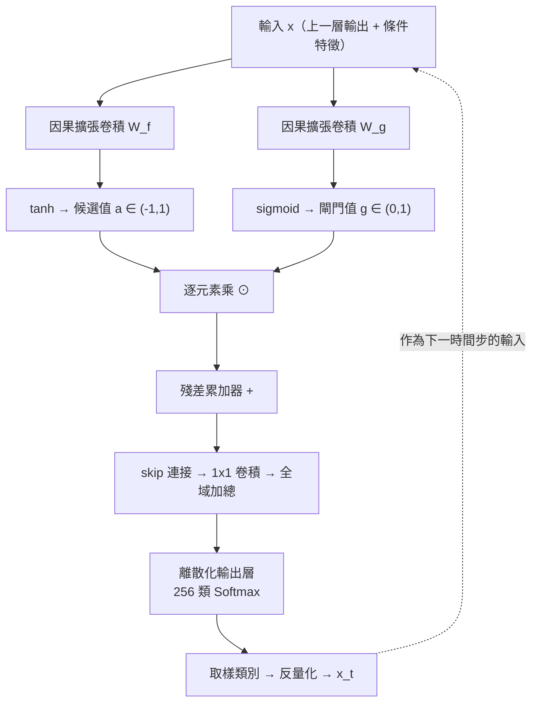

# 6.3 門控激活單元（Gate）與 Softmax 離散化（2016-2017）

## 一、把連續波形變成分類問題

回到 6.1 節留下的一個關鍵問題：連鎖律給出的目標函數是對數機率，而 WaveNet 必須用交叉熵來訓練它——但交叉熵是**分類**損失，原始波形卻是連續實數。要讓兩者接上，只有一條路：把連續取值**離散化**成有限個類別。

具體做法是把 16-bit 取樣值（取值範圍 $ -32768 $ 到 $ 32767 $ ，共 65,536 個可能值）量化到 256 個類別。每個類別 $ k $ 對應一個量化區間，落在區間內的取樣值共享同一個類別標籤。於是原本連續的波形變成一條「類別序列」，而模型要做的，就變成在每一個時間步預測 256 個可能類別的分佈。訓練目標是最小化：

$$
\mathcal{L} = - \log p \left( x_t \mid x_{<t}, c \right)
$$

對 $ T $ 個時間步求和即為整段序列的負對數似然。取樣時，模型先從第 256 維的 softmax 分佈中依機率抽出一個類別，再把該類別對應回量化區間中心值，作為該取樣點的實際取值。

這個看似粗糙的近似，卻是整個架構得以成立的關鍵。它的代價是量化誤差——一個落在區間內的實際取值被強制投影到區間中心，這個投影誤差會累積成背景噪訊。256 個類別意味著每個類別覆蓋約 256 個原始取值，等效於把位元數從 16 位降到 8 位。對大多數聽覺內容而言 8 位已是可接受的下限，但高頻細節與低振幅成分會明顯受損。

## 二、為什麼需要 Softmax 離散化

離散化帶來的第一個好處是**數值穩定性**。若直接對連續值做回歸並最小化 MSE，梯度的大小會隨目標值的動態範圍而劇烈變動；語音波形的振幅跨越好幾個數量級（爆破音瞬態與呼吸間的靜音段相差超過 60 dB），MSE 很容易被少數高振幅樣本主導。相比之下，交叉熵的梯度只依賴預測機率與真實類別的關係，是有界的，不會被異常值拉爆。這對混合了不同音量與不同錄音條件的訓練語料尤其重要。

第二個好處是**能夠使用標準的分類訓練工具鏈**，並且——這才是關鍵——**能夠把強化學習用於微調**。一旦問題被表述為「最大化累積對數機率」，就可以直接套用 REINFORCE 或策略梯度方法來優化序列級的目標，例如調整語速、停頓位置或韻律，而不必重新設計一個適用於連續值的獎勵機制。事實上，WaveNet 論文本身就展示了以強化學習方式在已經以交叉熵訓練好的模型上做微調的結果，用來改善韻律與停頓的聽感。這條思路後來在諸多韻律合成研究中持續發揮影響。

離散化的第三個好處是**與壓縮編碼的天然親和**。一旦語音變成類別序列，它就可以用算術編碼或熵編碼壓縮——這正是後續神經音訊編解碼器（EnCodec、SoundStream 等）的基本出發點。可以說，WaveNet 的離散化決定，不只影響音訊合成這一個領域，而是埋下了「聲音可以用語言模型來建模」這條主線的第一顆種子。

唯一的代價就是量化誤差的高頻雜訊：離散化把細微的振幅差異資訊丟棄，這些差異在聽感上多表現為嘶嘶聲或金屬感。緩解之道包括使用更多類別、依據取樣值動態範圍設計非均勻量化刻度，以及讓解碼端做後處理平滑。

這個量化表的關鍵是一個容易低估的工程事實：256 個類別**並非均勻分配在整個振幅範圍上**。真實語音的振幅分佈是重尾的——絕大多數取樣點集中在接近零的低振幅區，偶爾出現的爆破音瞬態才會衝上高振幅。因此理想做法是對低振幅區配置更密的類別（例如對數刻度），對高振幅區配置較疏的類別。這樣 256 個類別就能覆蓋比均勻量化多得多的有效動態範圍，把實際的等效位元數往上推。這個小技巧在後續的神經音訊編解碼器中被發揚光大——SoundStream 等模型正是用一組學習到的編碼簿來取代手工設計的量化刻度。

| 量化位元數 | 類別數 | 每秒類別數（16 kHz） | 量化雜訊能量 | 典型聽感 |
| --- | --- | --- | --- | --- |
| 4 bit | 16 | 16,000 | 高 | 明顯沙沙聲、金屬感 |
| 8 bit | 256 | 16,000 | 中 | 可接受，細節略失 |
| 10 bit | 1,024 | 16,000 | 較低 | 接近原聲 |
| 16 bit | 65,536 | 16,000 | 極低 | 原始 PCM，無量化雜訊 |

離散化還帶來一個純粹數學上的便利：模型輸出的每一個機率值都可以直接解讀為「下一個取樣點落在某個振幅區間的機率」，這使得整套系統的概率語義完全一致——從條件變數 $ c $ 到每一個類別分佈，全部是機率語言，沒有任何一個環節需要處理「連續期望」與「離散類別」之間的轉換。這正是 6.1 節所說的「把問題重新表述為機率建模」能夠貫徹到底的原因。

## 三、門控激活單元的數學

離散化解決了「輸出層」的問題，但中間層該用什麼激活函式？在原始 WaveNet 中，每一層擴張因果卷積之後並不直接接 ReLU 或 Tanh，而是接上一個**門控激活單元**（gated activation unit）。設第 $ k $ 層的輸入為 $ x $ ，則該層的輸出為

$$
z = \tanh \left( W_{f,k} * x \right) \odot \sigma \left( W_{g,k} * x \right)
$$

其中 $ * $ 表示因果擴張卷積， $ W_{f,k} $ 是濾波器路徑的權重， $ W_{g,k} $ 是閘門路徑的權重， $ \odot $ 是逐元素乘積， $ \sigma $ 是 sigmoid 函數。於是每個通道的輸出是「一個被壓縮到 $ (-1, 1) $ 的候選值」乘上「一個介於 0 與 1 的門檻」。

這個設計的直覺非常接近 LSTM 的遺忘機制，但更為精細。Sigmoid 閘門的每一個通道值都獨立決定「該通道的候選資訊有多少比例被寫入」。當閘門值接近 0，該通道的資訊被完全抑制；接近 1 則完全通過。與 LSTM 單一遺忘門控制整個狀態向量不同，WaveNet 的閘門是**逐通道**的，這讓模型可以在同一層內選擇性地保留不同性質的資訊：例如某個通道負責追蹤基頻週期、另一個負責追蹤共振峰位置、還有一個負責追蹤整體能量包絡，而閘門可以讓它們在不同時間各自淡入淡出。

更關鍵的是，這個機制是**完全資料驅動的**。 LSTM 的遺忘門雖然也是學來的，但它作用在一個被設計好的狀態更新公式上；WaveNet 的閘門則直接作用於殘差流的寫入量，模型可以自由決定「這一層此刻要不要改變殘差累積器的內容」。實驗上可以觀察到，閘門在濁音段傾向開啟（需要保留週期性資訊），在爆破音瞬間傾向關閉再重開（瞬態需要新的資訊寫入）。

把門控單元與 LSTM 的遺忘機制並列比較，可以看清兩者的分工。LSTM 的遺忘門作用於整個狀態向量上的一個標量門檻，而 WaveNet 的 sigmoid 閘門是 $ C $ 維的向量，每個通道獨立決定通過比例；更微妙的是，tanh 路徑提供的候選值被壓在 $ (-1, 1) $ 的範圍內，這意味著每一層對殘差流的修正量是有界的。這種「有界修正」的設計有兩個好處：其一，它讓深度堆疊在數值上穩定，30 層的累加不會因為某一層的輸出爆炸而發散；其二，它讓模型在每一步只能做小幅漸進的調整，與聲學訊號本身的時間平滑性相契合——真實波形在相鄰取樣點之間的變化本來就是連續的。

還有一個常被忽略的設計選擇：閘門作用在線性域而非概率域。也就是說， $ z $ 是音訊樣本的加權組合，而分佈的隨機性是在最終的 softmax 層才注入的。這個安排讓整個網路的主體保持確定性與可微性，只有輸出層是一個隨機分佈。相較之下，某些後續架構（例如直接對分佈參數建模的變分自編碼器）把隨機性貫穿到網路內部，訓練更複雜且容易產生模式崩潰。WaveNet 這種「確定性主體 + 隨機輸出頭」的分離，在後續的 VITS 等架構中被證明是更穩健的路線。

## 四、殘差連接與 30 層堆疊

門控單元要能堆疊到 30 層而不退化，必須依靠殘差連接。每一層的結構是：濾波器與閘門各經過一次因果卷積，兩者逐元素相乘後，**乘積直接加回殘差累加器**，而通過閘控後的訊號另外經過 $ 1 \times 1 $ 卷積沿「跳連」路徑往上送。層層堆疊後，最後把各層的跳連輸出相加，再經過兩層 ReLU 卷積與一個 softmax，得到當前時間步的分佈。

殘差連接在這裡扮演的角色與一般視覺網路略有不同。一般的殘差連接是為了讓梯度更容易回傳，而這裡還承擔了一個**功能性的角色**：殘差累加器儲存的是「目前已確定的波形內容」，而每一層只負責提出一個修正量（經過 tanh 壓縮在 $ (-1,1) $ 之間）。這是一種累加式（additive）的建構風格，與直接預測整段波形的乘法式風格截然不同。它帶來一個漂亮的性質：不同層可以在不同時間尺度上各自「修補」訊號——低擴張層修補局部波形形狀，高擴張層修補韻律與長期的音高軌跡。

跳連輸出在最後被加總的做法，則讓每一層都能直接對最終的類別分佈貢獻，縮短了深層資訊到輸出層的路徑。實測顯示，把跳連在深層才融合會顯著劣化訓練——這再次印證了殘差連接在深層網路中作為資訊高速公路的不可替代性。

## 五、缺陷與改進：從 2016 到 2017

WaveNet 架構幾乎在發表的同時就暴露了它的瓶頸：**自迴歸取樣的串行依賴**。生成 16 kHz 取樣率的音訊，意味著每秒要執行 16,000 次前向傳播，而且每一次都無法與其他時間步並行。論文的原話是，在當時的硬體上生成一段數秒鐘的音訊需要數分鐘。這個數字完全無法支撐任何即時應用——不是 TTS 產品能接受的品質與延遲組合。

2017 年的 Google 團隊提出了一個關鍵改進：**並行取樣**。既然取樣慢的原因是「每一步都要等前一步產出結果」，那麼，能否讓一個批次內的所有時間步同時進行？WaveNet 論文作者在同年的一篇研究中給出了答案——利用自迴歸模型的一個特殊性質：第 $ t $ 步的分佈雖然依賴前綴，但**若把前綴本身當作待估計的變數**，則分佈可以被重新表達成一個所有時間步共享的函數，而這個函數只需要在少數幾個時間步上「錨定」求值，其餘位置用線性插值或低階多項式近似。這樣一次前向傳播就能產出數十到數百個取樣點的草稿，再由後續的取樣過程逐步修正。

在數學上，這個想法可以寫成：把序列分成長度為 $ B $ 的區塊，在每個區塊的起點上執行一次完整的自迴歸前向傳播，得到區塊內各位置對前綴的「初步」估計，再用一次並行的卷積把這些估計細化。這個改進把取樣延遲從「與序列長度成正比」降到「與序列長度除以區塊大小成正比」，實測可達數十倍的加速。代價是模型需要重新訓練，並且逼近品質會隨區塊變長而下降——於是區塊大小成了一個可控的品質與延遲旋鈕。

並行化的思路還有一個更一般的版本值得記錄：既然第 $ t $ 步的分佈依賴前綴，那麼前綴本身若被視為待求的隨機變數，這個相依關係就是**隨機微分方程**的形式，理論上可以用各種數值方法近似求解。2017 年的改進正是沿著「把前綴的變化速率視為近似線性」這個直覺，把自迴歸迴圈展開成有限步的迭代，每一步處理一大段時間。這個直覺後來被繼承並擴張到連續時間的正規化流模型——那正是第 8 章 VITS 所採用的框架。換言之，2017 年這項為了解決延遲而做的小改進，意外地開啟了整整一代模型家族的技術路線。

另一條值得記錄的優化方向是**取樣溫度**。既然輸出是分佈，取樣時就可以用溫度參數 $ \tau $ 調整其平坦程度：溫度低於 1 時分佈更尖銳，輸出更保守但缺乏變化；溫度高於 1 時更平坦，聽感更生動但可能出現不自然的取樣值。這是分布建模相對點估計最直接的可控性收益——雖然代價是每次輸出都不一樣。

2018 年，Google 發布了 **WaveNet TTS** 的商業化版本，把原本的研究原型變成可以在伺服器上以接近即時的延遲運行的 TTS 引擎。同一年，Google 的 **Tacotron 2** 採用了類似的架構（seq2seq 預測梅爾譜 + 神經聲碼器還原波形），證明了「自迴歸神經聲碼器 + 序列到序列前端」這條路線的工業可行性，並在後續被廣泛商用：從智慧音箱到車載語音，生成式 TTS 的聽感品質在 2018 至 2020 年間出現了一次明顯躍升。

然而，結構性的缺陷始終存在：**單次前向傳播仍然需要多步取樣**，串行延遲隨輸出長度線性增長。在互動式對話系統中，這個延遲會直接轉化為使用者感知到的停滯——儘管每一步都很快，幾千步的累積仍然不可接受。

## 六、承上啟下：第 7 章

於是 2019 年前後，一個明確的問題浮出水面：**能否用一次前向傳播就產生完整的梅爾譜，甚至完整的波形？** 自迴歸的逐點取樣是 WaveNet 全部延遲的來源；只要保留自迴歸，就無法消除串行相依。

FastSpeech 的答案是把自迴歸解碼器換成**非自迴歸的前饋變壓器**，並用一個「長度調節器」把音素序列擴展到框架序列；後續的 FastSpeech 2 更引入目標音高與音量的預測，把韻律也納入非自迴歸框架。與此同時，VITS 與 HiFi-GAN 代表的另一條路線，則選擇徹底放棄逐取樣生成，改用**對抗訓練與正規化流**直接映射到波形，並以多週期鑑別器解決了 GAN 聲碼器長期以來在長序列上訓練不穩的問題。

第 7 章將從這個缺口出發，說明非自迴歸 TTS 如何用「一次前向傳播」取代「數千步取樣」，並分析它在多樣性與可控性上付出的代價——那正是 WaveNet 用連鎖律、擴張卷積與門控單元三件套建立起來的優勢所在。
