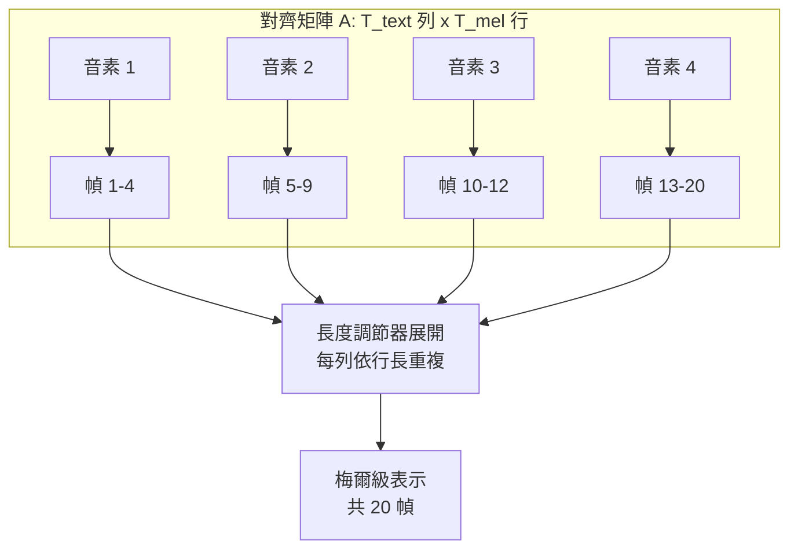

# 7.2 長度調節器（Length Regulator）與音素對齊（2019-2020）

## 一、長度問題的精確陳述

FastSpeech 的非自迴歸架構把輸出長度從「逐步生成」變成「內部決定」，但這個決定本身需要資料支撐。讓我們把問題寫清楚。

輸入是音素序列，長度為 $`T_{text}`$ ；輸出是梅爾頻譜，幀數為 $`T_{mel}`$ 。在 10 毫秒幀移的設定下，一個普通句子若有 20 個音素，大致對應 200 到 300 個梅爾幀，因此比值 $`T_{mel} / T_{text}`$ 通常落在 8 到 15 之間，且隨內容有相當大的浮動。語速、停頓、強調、語氣詞的拖長，都會讓這個比值在句子層級上變動。

值得先做一個數量級的估算：中文語速約每秒 4 到 6 個字，若一個字平均對應 1.5 到 2 個音素，一個 10 秒的句子大約是 15 個字、25 個音素、1000 個梅爾幀。也就是說，長度調節器要在一次前向中把 25 個向量展開成 1000 個向量，膨脹倍率約為 40。這個數字說明長度調節器的行為直接決定了輸出的時間解析度：每一次重複都是一個梅爾幀，10 毫秒。

這個不等長關係正是長度調節器存在的理由。Transformer 編碼器是等長映射： $`T_{text}`$ 個輸入位置對應 $`T_{text}`$ 個輸出位置。要把音素級表示送到解碼器去生成梅爾頻譜，就必須在中間插入一個把短序列變成長序列的模組。FastSpeech 給出的方案是最簡單但也最直觀的：**重複**。若音素 $`i`$ 的持續時間被預測為 $`d_i`$ 個梅爾幀，就把它的隱藏狀態連續重複 $`d_i`$ 次。

形式化地，長度調節器定義了一個對齊向量 $`A = (a_1, a_2, \dots, a_{T_{text}})`$ ，其中 $`a_i`$ 是音素 $`i`$ 對應的梅爾幀數，並構造

$$
h'_{t} = h_{i(t)}, \quad \text{其中 } i(t) = \max \{ i : \sum_{j=1}^{i} a_j \le t \}
$$

換言之， $`h'`$ 是音素級序列 $`h`$ 依對齊向量 $`A`$ 展平後的結果，總長度恰為 $`\sum_i a_i = T_{mel}`$ 。這個定義簡潔到近乎平凡，但它的後果一點也不平凡：**時長不再是一個隱式量，而是一個明確的、可被外部檢視與修改的向量。**

## 二、為什麼需要外部對齊

在自迴歸架構裡，這個問題不存在。Tacotron 的解碼器在生成第 $`t`$ 幀時，自己決定要對應哪個音素，注意力權重就隱含了對齊；整個對齊是生成過程的副產品，不需要預先知道。

非自迴歸架構把這個副產品變成了前置條件。在沒有逐步生成的過程中，模型沒有機會「觀察」音素與梅爾幀之間的對應關係。要在網路內部展開輸出，就必須先從外部或從網路的另一條分支取得每個音素的持續時間。

這個「顯式對齊」的需求，是非自迴歸 TTS 全部工程複雜度的源頭。FastSpeech 1 的做法是：在訓練資料的預處理階段，先用某種方法算出對齊向量 $`A`$ ，把它作為額外的標註餵給長度調節器。這聽起來像退步——端到端系統竟然依賴人為標註——但實務上這反而是當時最務實的選擇。原因是：非自迴歸的核心收益是推理速度，而訓練期的資料預處理成本是可以攤平的。

## 三、對齊工具的選擇與代價

那麼，這個 $`A`$ 從哪裡來？2019 年前後主要有兩條路。

**第一條路是 Montreal Forced Aligner（MFA）。** MFA 是一套基於 HMM 的強制對齊工具：給定音訊、音素序列與聲學模型，它會用維特比演算法在時變狀態圖上找出最可能的路徑，輸出每個音素的起止時間。它的對齊精度很高，尤其在有真人朗讀、句子有實質語意的情境下。但代價明確：要得到音素級時長，訓練語料必須同時擁有**音訊**與**音素級時間戳標註**。這就是 LJSpeech、M-AILABS 中文語料、VCTK 多說話者語料這類資料的價值所在——它們附帶了 CMU Pronouncing Dictionary 的音素切分與時間戳，讓 MFA 可以直接跑通。

MFA 的演算法本身值得簡述，因為它是第 3 章 HMM 與維特比演算法的直接應用。給定音訊的梅爾特徵序列，模型會為每個音素狀態建立一條高斯混合分佈的似然軌跡，然後在「音素狀態 × 時間」的格點圖上，用維特比演算法找出總似然最大的單調路徑。這條路徑的每個時間點對應一個音素狀態，取該音素狀態的起止邊界，就得到音素級時長。

這個演算法有兩個關鍵性質正好符合需要：路徑是單調的（音素順序不會錯亂），且計算量是 $`O(T_{text} 	imes T_{mel})`$ 的動態規劃，對一句話而言完全可行。代價則在於它需要一個校準良好的聲學模型，而這個模型本身的訓練需要音素級標註——這是一個遞迴的資源要求。

**第二條路是基於注意力的對齊。** 既然 Tacotron 已經能學到不錯的注意力對齊，那就用一個 Tacotron（或注意力式 seq2seq TTS）先在目標文字與目標音訊之間求出注意力權重矩陣，再從中推導出音素級時長。這條路不需要任何人工標註，只需要對齊的文字與音訊，因此在學術界的無標註資料集上是常見選擇。代價是對齊品質完全取決於那個代理模型，且代理模型的注意力本身就有已知缺陷。

## 四、合成語料與真實語料的分裂

這裡出現了一個在 TTS 文獻裡相當關鍵的張力。FastSpeech 類模型需要大量訓練資料，而公開的高品質語音資料幾乎都來自**真人朗讀**：有乾淨錄音、有文字稿、語氣單調但音素清楚。這類資料非常適合 MFA 對齊。

但 TTS 的商業價值往往在**風格化**語音上：客服對話、情感語料、歌唱、播客。這些資料的共同特徵是它們往往不是「讀出來的」，而是「說出來的」，包含大量的語速變化、停頓、填充詞、笑聲、情緒起伏。這類資料在網路上大量存在，但幾乎不可能帶有音素級時間戳。

結果是這樣一種分裂：**能用 MFA 對齊的資料，語氣平淡；語氣生動的資料，無法用 MFA 對齊。** 這個張力在 2020 到 2021 年間催生了大量以注意力代理對齊為基礎的訓練流程，也催生了第 8 章 VITS 的單調對齊搜尋——後者乾脆放棄外部對齊，改讓模型自己在訓練中學出對齊。

| 對齊來源 | 需要的資源 | 對齊品質 | 對合成語料的適用性 | 代表工具 |
| --- | --- | --- | --- | --- |
| 音素級標註 | 音訊 + 音素時間戳 | 高 | 不適用（難以取得） | 標註語料庫 |
| HMM 強制對齊 | 音訊 + 文字稿 | 高 | 不適用 | Montreal Forced Aligner |
| 注意力對齊 | 音訊 + 文字稿 | 中 | 適用 | Tacotron 注意力權重 |
| 單調搜尋對齊 | 僅需文字 + 音訊 | 中高 | 適用 | FastSpeech 2、VITS 的 MAS |
| 時長迴歸 | 音訊 + 文字稿 | 低 | 適用 | FastSpeech 1 的預測模式 |

用一句話總結這個張力：**FastSpeech 1 的訓練流程假設資料是「被念出來」的，而它的應用場景希望資料是「被說出來」的。** 這個矛盾在 2019 到 2021 年間沒有被彻底解決，而是被繞過了：社群大量使用 LJSpeech（單說話者、朗讀、附 MFA 對齊）與類似的資料集做示範與基準測試，把風格化資料留給後續的風格轉移工作處理。這種「用乾淨資料訓練基礎模型，再用風格資料微調」的分工，是整個 TTS 生態延續至今的基本結構。

## 五、注意力對齊的可微替代方案及其失效模式

注意力對齊作為替代方案，值得更仔細地看。它的做法是：讓文字 encoder 與梅爾 decoder 之間保留交叉注意力，訓練時最大化梅爾重建損失，注意力權重矩陣 $`A_{t,i}`$ 會隱式地收斂到「梅爾幀 $`t`$ 對應音素 $`i`$ 」的軟對齊。再把注意力圖沿音素維度做 argmax 或取期望，就得到離散的時長向量。

這種做法的誘惑力在於它完全可微、端到端、沒有標註需求。但它有一個著名的失效模式：**注意力塌陷或注意力洩漏（attention collapse / attention leakage）。** 由於注意力機制只需要「解碼器能重建出正確的梅爾頻譜」這一條件，任何有助於重建的權重分佈都能獲得高分，模型並沒有被強制要求權重圖具有語意上的單調性。

在實際訓練中，這會表現為幾種具體病症。**單調但錯誤的對齊**最常見：注意力圖看起來是乾淨的對角線，但音素邊界整體偏移了幾十毫秒——聽起來不會像壞掉，而只是「每個字都稍微早了一點或晚了一點」。**注意力洩漏**則是相鄰音素的注意力過度重疊，模型實質上跳過了某些音素的邊界資訊。**局部塌陷**更極端：注意力集中在少數幾個位置上，模型靠猜測而非對齊來完成重建。

這些問題在自迴歸 TTS 裡同樣存在，只是危害較小——因為逐幀生成的過程中，解碼器可以用當前的注意力狀態做局部修正，錯誤不會累積成全局的時間軸偏移。而在非自迴歸架構裡，整段梅爾頻譜的位置關係完全由對齊決定，一處錯位會讓整段語音的時間結構都偏掉。

這裡可以引入一個更細緻的診斷。注意力洩漏之所以發生，是因為交叉注意力的 softmax 是在整個音素序列上正規化的，模型可以合法地把權重分散到非當前音素上。如果把正規化限制在一個由外部提供的「允許範圍」內（例如只允許注意力落在當前音素與相鄰音素），洩漏就會被抑制。FastSpeech 2 的做法正是這種思路的軟化版本：把對齊搜尋限制在由時長預測器給出的先驗附近，讓注意力只能在這個窗口內移動。

這個思路的極致形態是 MAS：把對齊從「注意力分布」改為「在允許的單調路徑上做硬搜尋」，用動態規劃求全域最優解，再對搜尋結果做 soft-max 平滑以保持可微。MAS 將在第 8 章完整推導。

## 六、對齊誤差如何變成韻律錯亂

這一節是本章的技術核心：**對齊誤差不是一個無害的標註瑕疵，而會直接以聽覺可辨的方式扭曲輸出。**

考慮最簡單的情況：對齊向量 $`A`$ 中某個音素的時長被高估了 50 毫秒，也就是 $`a_i`$ 多算了 5 個梅爾幀。對長度調節器而言，這意味著音素 $`i`$ 的隱藏狀態被多複製了 5 次，多出的 5 幀梅爾頻譜會由同一個音素的特徵生成。這會產生三種可聽的後果。

第一是**音素被拉長**。音素內部的穩定段被延長，出現拖腔感。第二是**後續音素全部滯後**，因為總長度膨脹了，後面的內容整體往後挪，在固定語速下反而造成整句語速變慢。第三是**音高軌跡錯位**。這是最致命的一項：變異數預測器是逐音素預測音高軌跡的，當音素的時間落點被推遲，它預測出的那條音高曲線就會落在錯誤的時間位置。一句本來是「先升後降」的問句，如果對齊偏移，聽起來就會變成「先降後升」，語氣完全相反。

反過來說，對齊精度提升帶來的不只是語速正確，而是**韻律正確性**。這解釋了為什麼第 7.3 節的變異數建模必須建立在準確對齊之上：變異數預測器的輸出是「每個音素的音高與能量」，一旦對齊有偏差，這些值就會被貼到錯誤的時間格子上。

## 七、對齊矩陣的視覺化

把對齊想成一張矩陣，會讓許多直覺立刻清晰。行是音素（ $`T_{text}`$ 行），列是梅爾幀（ $`T_{mel}`$ 列），每個格子表示該音素在該幀上的權重或歸屬。理想的對齊是一條從左上到右下的單調階梯路徑：每一行覆蓋一段連續的列，行的區段從不重疊、也永不跳序。

不同的對齊方法，就是在不同地逼近這條階梯路徑。MFA 直接求出一條硬路徑，然後以指示函數填充矩陣；注意力對齊得到的是連續權重，其 argmax 近似於階梯路徑；而 MAS 則在允許範圍內做硬搜尋再平滑。三者的差異，就是「硬先驗」與「軟後驗」的差異。

## 八、對齊的單調性約束

既然注意力對齊的主要失效模式是「不保證單調」，一個自然的 remedy 就是把單調性寫進模型結構裡。注意力圖 $`A \in \mathbb{R}^{T_{mel} \times T_{text}}`$ 應當滿足

$$
A_{t,i} \ge 0, \quad \sum_i A_{t,i} = 1, \quad A_{t,i} = 0 \text{ 若 } i < i_{\min}(t)
$$

也就是說，隨著梅爾時間 $`t`$ 增加，被對應的音素索引 $`i`$ 只增不減。這正是 VITS 的單調對齊搜尋（Monotonic Alignment Search, MAS）所強制的不變量，而它的推導正是第 8 章的內容。

FastSpeech 2 在過渡期採用的做法更簡單：它讓變異數預測器的輸入直接來自對齊搜尋的結果，讓對齊本身成為模型內部可學的量，同時用一個小的時長預測器提供先驗，兩者的乘積作為長度調節器的權重。這種「先驗 × 學到的對齊」的組合，是一種工程上的過渡方案：它不保證嚴格單調，但比純外部標註靈活得多，也比純注意力可靠得多。

## 九、對齊誤差傳播的量化視角

如果把每個音素的時長誤差記為 $`\epsilon_i = a_i - a_i^{*}`$ ，其中上標星號代表真實時長，那麼梅爾時間軸上的累積誤差為

$$
E(t) = \sum_{i \le i(t)} \epsilon_i
$$

這是一個隨音素索引累加的隨機遊走。也就是說，即使每個音素的時長誤差都很小（例如平均 20 毫秒），只要誤差不完全隨機抵消，整句話結尾的時間偏移就可能累積到數百毫秒。

這個累積效應解釋了兩個常見的觀察。第一，句子的後半段韻律往往比前半段差，因為累積誤差在後半段最大。第二，用相同句子的不同朗讀做對齊時，長句子的一致性遠低於短句子。修正的方向因此也很明確：對齊的損失不該只在音素級局部計算，而應考慮全句的時間結構——這正是第 8 章 MAS 從全域動態規劃求取最優對齊路徑的思路來源。

## 十、小結

長度調節器是 FastSpeech 家族把「長度」這個變數外部化的機制，而對齊是它成立的前提。自迴歸模型免費獲得對齊，代價是推理慢；非自迴歸模型把對齊的成本轉嫁給了訓練期與資料準備期。這筆交易在大多數實務情境下是划算的，但只有在理解了對齊誤差如何沿時間軸累積、又如何被變異數預測放大成聽覺可辨的韻律錯亂之後，才能真正掌握非自迴歸 TTS 的關鍵瓶頸。

下一節我們進入那個被放大的環節：音高、能量與時長，這三樣在傳統系統裡由規則與統計模型負責的韻律要素，在 FastSpeech 中如何被拆成三條獨立的預測分支。
