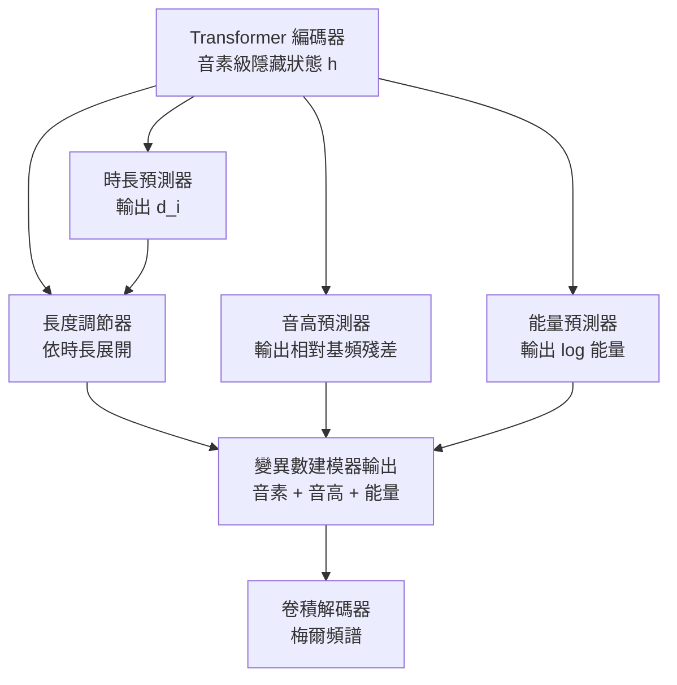

# 7.3 顯式變異數建模（Variance Adaptor）：音高、能量與持續時間（2019-2021）

## 一、傳統系統裡，韻律由誰負責

在深度學習之前的語音合成系統裡，韻律是一個被明確分工的問題。文本前端負責把文字轉成音素序列並標記韏度與重音；後端則由三套獨立的機制負責韻律：**時長模型**用統計方法（動態規劃配合線性回歸，或基於韻律樹的規則）預測每個音素的持續時間；**基頻模型**估計說話者的平均基頻與音高軌跡；**能量模型**控制每個音素的音量包絡。每一套機制都有自己的特徵工程與規則庫，維基百科式的「發音辭典加韻律規則」正是這種分工的頂點。

這套架構的問題不在於它不準，而在於它僵化。規則表是人類寫死的，無法從資料中學到說話者的個人風格；統計特徵是手工設計的，難以捕捉自然的韻律關聯；更關鍵的是，各個模組彼此獨立地工作，要做「讓這句話激動一點」或「把說話速度調慢」這種控制，只能在每個模組裡各改一套規則。

FastSpeech 的變異數建模器（Variance Adaptor）所做的，是把這三套機制整體搬進神經網路，並且——這是關鍵——讓它們共享同一個音素級隱藏狀態，同時把各自的輸出當作**獨立的顯式變數**擺在資料流的中間。

## 二、三條預測分支的架構

變異數建模器的結構可以分三塊來看。

**時長預測器（Duration Predictor）** 是一個卷積網路，輸入音素級隱藏狀態與相鄰音素的上下文，輸出每個音素的持續時間。FastSpeech 1 的做法是讓時長預測器同時看當前音素與前後各一個音素的隱藏狀態，因為時長具有強烈的相鄰依賴：短元音夾在長元音之間時會更短，爆破音的時長幾乎完全由前一個元音決定。

**音高預測器（Pitch Predictor）** 預測的是音高軌跡，而非單一數值。做法是把音素級隱藏狀態經過一個小的卷積網路映射到一個音高維度的表示，再與音素中心的基頻（由聲學模型算出的平均基頻）結合，做殘差預測。這裡的設計取決於一個關鍵事實：**音高的絕對值主要由說話者的生理特徵決定，而音高的相對變化才是語義與情緒。**

有一個容易被忽略的實作細節：音高預測器輸出的是音素級的音高特徵，但音高軌跡在真實語音裡是連續且細密的。FastSpeech 的處理方式是讓音高預測器在音素級隱藏狀態上工作，再由長度調節器把音素級的音高值同樣地按時長展開到梅爾級，最後由後處理模組在時間軸上插值並平滑，得到逐幀的基頻曲線。這樣一來，音高的時間解析度天然地與對齊一致——音素邊界的音高變化因此是階梯式的，需要靠平滑過渡。這也是為什麼對齊精度直接決定音高軌跡品質：對齊一偏，階梯的位置就一偏，平滑再怎麼努力也救不回來。

**能量預測器（Energy Predictor）** 結構與音高預測器平行，預測每個音素的能量值（通常用 log 尺度）。能量與音高相關但不等同：音高決定了基頻的週期長短，能量決定了振幅的大小；一句話的語氣激動，往往表現為基頻上升與音量增加的聯動，但兩者的軌跡形狀並不重疊。

## 三、损失的設計：三條分支各自的學 supervision

三個預測器各有各的損失函數，而損失的細節往往比架構更能決定最終品質。

**時長預測器**的目標是 $`d_i^{*}`$ ，即第 $`i`$ 個音素的梅爾幀數。真實時長的動態範圍可以很寬（元音可能超過 30 幀，塞音只有 5 幀），且分布右偏。直接用均方誤差會讓大時長的音素主導梯度，而直接用絕對值 L1 又會讓小時長相對誤差極大的音素（1 幀變 2 幀是 100% 誤差）獲得不合理的關注。因此實作上常在 log 域計算：

$$
\mathcal{L}_{dur} = \sum_{i=1}^{T_{text}} \left| \log ( \hat{d}_i + 1 ) - \log ( d_i^{*} + 1 ) \right|
$$

log 壓縮動態範圍，讓「相對誤差」而非「絕對誤差」主導梯度，這與第 4 章 CTC 的時間下標設計、第 5 章 Whisper 的時間戳處理屬於同一類的工程直覺。

**音高預測器**的損失設計是本章最值得玩味的部分。假設聲學模型（通常是 CREPE 或 WORLD 這類基頻提取器）給出每個音素的音高與其中心值 $`f_0^{c}`$ ，那麼預測器要學的是相對殘差：

$$
\mathcal{L}_{pitch} = \sum_{i=1}^{T_{text}} \left| \hat{p}_i - ( p_i^{*} - f_0^{c} ) \right| + \lambda \left| \hat{p}_i - ( f_0^{c} - f_0^{c} ) \right|
$$

其中 $`p_i^{*}`$ 是音素實際的基頻。第一項讓預測器學會相對音高軌跡的形狀；第二項把整體的平均基頻（說話者的音域中心）拉回目標值。這樣的分工讓模型在「說話者適應」與「韻律表現」之間取得平衡：如果只看相對值，模型會忽略說話者的音域而產生高音或低音的偏差；如果是絕對值，模型就得從零學會說話者的音色。

**能量預測器**的損失與音高類似，但因為能量的尺度效應更強（響的音素與輕的音素差距可達 20 dB 以上），通常在 log 能量域計算，並使用與音高相同的「相對 + 平均」雙項結構。

三項損失加權求和：

$$
\mathcal{L}_{variance} = \mathcal{L}_{dur} + \mathcal{L}_{pitch} + \mathcal{L}_{energy}
$$

再加上梅爾重建損失，構成 FastSpeech 的完整訓練目標。

值得強調的是，這三項監督的取得成本差異很大。時長需要音素級對齊，是最貴的一項；基頻與能量可以由成熟的信號處理工具（WORLD、CREPE、pymfc）從音訊直接批量提取，成本低得多。這也解釋了為什麼有相當一部分改進工作集中在時長這一項：它是瓶頸所在。

## 四、殘差預測的深層理由

「預測殘差而非絕對值」這個選擇，聽起來像一個技巧，實際上有相當深的理由。

考慮兩個說話者，A 的平均基頻 120 Hz，B 是 210 Hz。同一句話由兩人朗讀，音高軌跡的**形狀**（相對起伏）幾乎相同，差別在於整條曲線被平移了。這意味著「音高軌跡的形狀」是與說話者無關的語義資訊（陳述與疑問、驚訝與平敘），而「軌跡的中心」是說話者的生理屬性。

用一個共享的網路去擬合兩者，等於強迫模型在有限的容量裡同時學會一件與說話者有關的事和一件與說話者無關的事，效率低下。拆開之後：形狀由殘差預測器負責，中心由音高嵌入提供。這樣的分工讓模型在多說話者訓練時更容易收斂，也讓遷移時可以只替換中心值而保留韻律風格。

類似的道理在能量上成立，並且延伸出一個有趣的推論：**如果把音高中心替換成目標說話者的值，韻律形狀可以完整保留，這就是最早的風格遷移技巧之一。** FastSpeech 2 引入的目標聲學特徵，本質上是把這個想法從單一數值推廣到整個梅爾載體。

## 五、顯式建模與隱式學會的差異

這裡是本章的哲學核心。

**自迴歸模型隱式學會韻律。** Tacotron 的解碼器在生成每一幀時，從梅爾頻譜的局部形狀中學會「這個位置的音高該是多少」。它做到這件事非常成功——Tacotron 2 的自然度極高——但代價是韻律變成了網路內部的隱含狀態，無法直接檢視、無法直接修改。你無法對 Tacotron 說「把這句話的音高調高 20%」，除非重新訓練或做精巧的後處理。

**顯式建模把控制介面暴露出來。** 一旦時長、音高、能量各自成為一條可以攔截、替換、插值的支路，外部控制就變得平凡：改時長向量就改語速，改音高曲線就改調型，改能量向量就改音量。而且這些修改可以精細到逐音素，因為變數本身就是逐音素的。

但這個對比需要補上另一半，否則就成了片面的樂觀。**顯式建模的代價是它需要監督訊號。** 隱式模型只需要音訊與文字；顯式模型要學時長預測器就需要音素級時長標註，要學音高預測器就需要基頻軌跡，要學能量預測器就需要能量軌跡。這正是上一節反覆出現的資源問題的另一個面向：對齊標註、基頻提取、能量提取，每一項都是額外的前處理。

更實際的折衷是**代理目標（proxy target）**：不追求完美的真實時長，而是用一個現成模型的輸出當作目標，讓主模型去擬合它。例如時長預測器的目標可以是 MFA 對齊結果加上少量隨機擾動，音高預測器的目標可以是 CREPE 提取的基頻。這樣做的好處是讓模型自己去平滑代理目標的雜訊，損失掉一點精度但換來穩定性；FastSpeech 1 的時長預測訓練流程正是如此。

| 面向 | 自迴歸隱式（Tacotron 2） | 顯式變異數建模（FastSpeech） |
| --- | --- | --- |
| 韻律來源 | 從梅爾重建損失中隱式浮現 | 獨立預測模組，顯式參數 |
| 訓練所需 | 音訊 + 文字 | 音訊 + 文字 + 對齊 + 基頻 + 能量 |
| 控制粒度 | 整句或需要後處理技巧 | 逐音素，可直接攔截修改 |
| 風格遷移 | 需要重新訓練或參考音訊注入 | 替換音高中心與時長比例即可 |
| 可解釋性 | 低 | 高，每條曲線可視化 |
| 資料成本 | 低 | 高，需要多個代理目標 |
| 實作複雜度 | 單一網路 | 三個網路加一個展平器 |

從工程角度說，這種「代理目標 + 輕量擾動」的策略有一個好處：它讓模型的主觀性有了正當的名分。既然模型只是學一個更平滑的近似，那麼在目標值上加入輕微隨機抖動，反而能防止模型過度擬合代理目標的系統性偏差。

## 六、風格轉移與情感控制的基礎

因為韻律被顯式參數化，外部控制介面得以存在。這是 2019 年之後 TTS 生態裡最重要的能力增量。

**風格轉移**的基本流程是：從目標說話者的錄音中提取音高中心與時長統計量，把這些量注入預訓練的基礎模型。Megatron、STYLER TTS 這類工作在 2019 到 2020 年把這條路線推到可用程度。FastSpeech 2 引入的目標聲學特徵則是同一思路的強化版：不只注入統計量，而是注入目標說話者的梅爾頻譜片段（在下采樣後、於解碼器的部分層級），讓模型同時獲得韻律形狀與音色特徵。

**情感控制**則是風格轉移的細粒度版本。既然音高與能量各自獨立，就可以分別控制：情感透過「音高偏移 + 能量分布 + 時長壓縮率」的特定組合來表達，例如驚訝對應快速上升的基頻與能量前導，悲傷對應基頻下降與時長拉長。這些組合規則可以在推論時即時套用，不需要重新訓練。

**歌聲合成**是這個能力的極端測試。歌唱需要精確控制每個音符的時長與絕對音高，這正是顯式時長與音高預測最擅長的任務。因此 2019 年之後的歌唱合成系統（如 VISinger、SingingVoice 系列）幾乎全部採用了類似 FastSpeech 的架構。

## 七、同期工作的多樣化韻律注入

FastSpeech 並非唯一選擇韻律注入形式的答案，2019 到 2021 年間至少有四條平行路線。

**風格嵌入與對抗訓練**這一派，把風格標籤或風格編碼器接在解碼器前端，用 GAN 的判別器迫使輸出風格化。代表工作如 StyleTTS、Voice Conversion 領域的 StarGAN-VC。

**參考音訊的注意力式注入**這一派，在解碼時把參考音訊的梅爾頻譜透過注意力機制注入，藉此搬運韻律特徵。代表工作是 ATTN-TTS 系列與少數歌手音色轉換系統。

**顯式的音高與能量預測（FastSpeech 派）**這一派，就是本章的主線，把韻律拆成可插值的獨立變數。

**CycleGAN 與變分自編碼器的非配對轉換**這一派，企圖在沒有平行資料的情況下做風格轉換，數學優雅但訓練不穩定。

PitchNet 是其中一個有趣的中間地帶：它用一個獨立的卷積迴歸網路在梅爾頻譜域直接預測基頻軌跡，再由一個後處理網路把基頻資訊注入梅爾頻譜。它的哲學接近 FastSpeech 的顯式化，但作用在梅爾域而非音素域，因此不需要音素級對齊——這在對齊資源匱乏時是一個實用的取捨。SingingVoice 則把韻律注入延伸到歌唱領域，用相鄰音符的音高與能量差值作為輸入來預測當前音符的韻律特徵，並結合對抗損失訓練說話者與演唱者的音色。

這條技術地圖的座標是：**FastSpeech 選擇了「在音素域、把韻律拆成三個獨立可控變數」這個角落，而這個角落的兩端分別通往第 8 章的 VITS（把對齊也納入可微框架）與後續所有風格化 TTS 的控制介面設計。**

## 八、FastSpeech 家族之後：變異數建模的後續演化

2021 年之後，變異數建模的思路並沒有被淘汰，而是被吸收進更廣泛的架構。VITS 保留了時長與基頻預測，並把它們與單調對齊搜尋統一在一個可微流程裡；Diff-VC、DiffGAN 系列把聲學特徵的擴散過程與韻律注入結合；BigVGAN 則把焦點移到了梅爾到波形的還原品質上，但前端的韻律架構基本沿襲了 FastSpeech 的三分支設計。

這段演化史給出一個明確的判斷：**顯式韻律建模不是某一篇論文的技巧，而是一個已被證明的架構分層。** 它把「說什麼」（內容）、「說多快」（時長）、「怎麼說」（音高與能量）、「用誰的聲音」（音色載體）這四件事拆成獨立的介面，而這四件事恰好就是現代語音介面設計裡最常被使用者分開調節的旋鈕。7.1 到 7.3 三節鋪陳的因果鏈，到這裡已經閉合：長度被外化、對齊被求得、韻律被參數化，三者共同讓 TTS 從一個不可控的生成模型變成一個可操作的系統。

剩下的最後一個問題是：即使韻律控制得再好，輸出的仍然是梅爾頻譜，中間表示的瓶頸依然存在。要讓韻律精細到聽得出呼吸與齒音，還原波形這一關必須跨過去。第 8 章的 VITS 與 HiFi-GAN，正是對這個問題的回答。

## 九、承上啟下：梅爾頻譜仍然只是中間表示

必須再次強調：變異數建模做得再好，輸出的仍然是梅爾頻譜。要得到可播放的波形，仍然需要聲碼器。

這個分工在 FastSpeech 1 時代是明顯的短板。梅爾頻譜是壓縮過的表示，它丟掉了相位資訊，也丟掉了許多細節；用 Griffin-Lim 從梅爾頻譜還原波形是一個不適定的逆問題，需要耗時的迭代，且高頻部分幾乎總是失真。FastSpeech 1 論文自己配的是作者的 MelGAN，用对抗訓練的聲碼器取代了 Griffin-Lim，聽感明顯改善——但管線仍然是兩段式的：梅爾生成器負責內容與韻律，聲碼器負責還原聽覺細節與音色。

這個兩段式的問題在 2021 年被 VITS 解決。VITS 讓梅爾生成器與聲碼器在同一個端到端框架中共同訓練：聲碼器部分用 normalizing flow 與 GAN 對抗訓練，梅爾生成器部分則把變異數預測與對齊搜尋都納入可微流程。於是「顯式韻律變數」這個概念並沒有消失，而是被保留並擴充：VITS 同樣預測時長與基頻，只是把它們放進了一個能直接輸出波形的框架裡。

第 8 章將完整拆解 VITS 的三個支柱：VAE 的訓練框架、normalizing flow 帶來的直接波形建模，以及最關鍵的單調對齊搜尋——那正是本章與上一章一再鋪陳的問題的最終答案。
