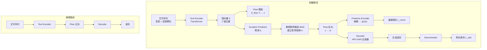

# 8.1 變分自編碼器與對抗訓練的結合：VITS 架構（2021）

## 一、兩條路線在 2021 年匯流

2021 年之前的文字轉語音系統大致分成兩個互相不信任的陣營。第一條路線是自迴歸對抗生成：模型直接把梅爾頻譜或某種聲學特徵當作條件，交給一個 GAN 生成器還原成原始波形，這一系的代表作是 WaveNet 的後繼者、GAN-TTS 以及 MelGAN、HiFi-GAN 這類神經聲碼器。它們的優點是波形逼真、速度快；缺點是它們只負責「梅爾到波形」這一段，在它們之前，整個文字到梅爾的前端仍然是另一套獨立的系統。第二條路線則走機率建模：模型用變分自編碼器或正規化流之類的機率模型去表達梅爾頻譜，把韻律的不確定性——哪裡會重音、停頓多長、音高如何起伏——都納入分佈的參數裡，這一系從 VAE-GAN、Flow-TTS 到 FastSpeech 的變分變體都有。

兩條路線各自解決了一半問題，卻也各自留下了一半問題。GAN 路線的弱點在於它對韻律沒有機率模型那樣的表達能力，它只能學到訓練資料裡「平均的那個說話方式」，多樣性要靠額外的條件或取樣技巧硬湊出來。機率模型路線的弱點更嚴重：它的對齊機制在第 7 章已經看過了，非自迴歸架構缺少內生的音素到幀的對應機制，往往得外掛 Montreal Forced Aligner 這類工具，而這類工具在真實錄音上會嚴重失敗。當一個人說話含糊、有雜音、或者句子裡夾著吸氣聲時，MFA 的強制對齊結果幾乎可以直接丟掉。

2021 年 Jaehyeon Kim 等人發表的 VITS，企圖做的事情可以概括為一句話：把這兩條路線拆開重組，變成同一個端到端模型。模型同時學會文字到梅爾的對齊與梅爾到波形的生成，中間不需要任何外部對齊工具，輸出端也不需要掛一個獨立的聲碼器——因為對抗式聲碼器已經被嵌進來了。這在當時是一件相當激進的事，因為要把「對齊」與「生成」塞進同一個可微分圖裡，而這兩件事的數學性質幾乎相反。

## 二、VITS 的組件拆解

VITS 的資料流可以拆成六個可辨識的模組，它們在訓練與推理時走的路徑並不相同，這是理解整個設計的關鍵。

**Text Encoder** 是一個相當淺的 Transformer。它的輸出並非直接對應音素的聲學特徵，而是一串與梅爾幀數無關的隱向量 $ \mathbf{h} = (h_1, \dots, h_T) $ ，每一個位置對應一個輸入音素。這裡的關鍵設計是：隱向量的數量與音素數相同，而不是與梅爾幀數相同，因此模型先在「音素空間」裡做推理，時間軸的拉伸留給後面的長度調節與對齊機制處理。

**Flow 模組** 是 VITS 相對於同儕最核心的貢獻。它是一串可逆的仿射耦合層加 permutation 層構成的正規化流，作用是把 text encoder 產出的隱向量分佈「拉齊」成一個標準高斯。這一步聽起來像個可有可無的分佈正規化，但事實上它是讓後面所有東西成立的技術前提，本節後段會說明。

**Posterior Encoder** 是一個標準 VAE 的後半段：它把真實梅爾頻譜編碼成一個後驗分佈的參數，在訓練時作為 flow 輸入的目標。**Duration Predictor** 預測每個音素的持續時間，並且是隨機的（stochastic），這是韻律多樣性的來源。**Decoder** 直接就是一個 HiFi-GAN 架構的生成器，把梅爾譜上採樣成波形。**Discriminator** 則是 HiFi-GAN 那一套多尺度鑑別器。

| 元件 | 類比 | 職責 | 訓練時 | 推理時 |
| --- | --- | --- | --- | --- |
| Text Encoder | FastSpeech 的 encoder | 音素到隱向量 | 使用 | 使用 |
| Flow | VAE 的 latent 映射 | 分佈拉齊與可逆資訊傳遞 | 使用 | 使用 |
| Posterior Encoder | VAE 的 encoder | 梅爾到後驗分佈 | 使用 | 不用 |
| Duration Predictor | FastSpeech 的 length regulator | 音素到持續時間 | 使用 | 使用 |
| Monotonic Search | FastSpeech 的外部對齊 | 隱向量到梅爾幀 | 使用 | 使用 |
| Decoder | HiFi-GAN 生成器 | 梅爾到波形 | 使用 | 使用 |
| Discriminator | HiFi-GAN 鑑別器 | 逼真度判別 | 使用 | 不用 |

把 VITS 放回整個譜系裡，幾種架構的差異會更清楚。FastSpeech 2 已經做到了非自迴歸與並行梅爾生成，但它仍需外掛聲碼器與外部對齊；Flow-TTS 引入了正規化流來處理多說話人的韻律差異，但對齊仍靠 MFA；VAE-GAN 則把變分框架與對抗訓練結合，同樣卡在對齊上。VITS 的差異不體現在某一個零件上，而體現在「把對齊變成模型內部可搜尋的變數」這個決定。

| 架構 | 年份 | 對齊來源 | 波形來源 | 韻律隨機性 | 外部相依 |
| --- | --- | --- | --- | --- | --- |
| Tacotron 2 | 2017 | 注意力（隱式） | Griffin-Lim | 無 | 需手調 |
| FastSpeech | 2019 | MFA 外部標註 | 外掛聲碼器 | 無 | 需 MFA |
| Flow-TTS | 2020 | MFA 外部標註 | 外掛聲碼器 | 有（flow） | 需 MFA |
| VAE-GAN | 2020 | 注意力 | 內建 GAN | 部分 | 需對齊標註 |
| VITS | 2021 | 內生單調搜尋 | 內建 HiFi-GAN | 有（dur + flow） | 無 |

## 三、四項損失的分工作業

VITS 的訓練目標可以寫成四個項目的加權總和：

$$
\mathcal{L} = \mathcal{L}_{\text{recon}} + \mathcal{L}_{\text{kl}} + \mathcal{L}_{\text{adv}} + \mathcal{L}_{\text{dur}}
$$

這四項看起來像一個雜燴拼盤，但每一項在架構裡都有明確對應的職責。

$ \mathcal{L}_{\text{recon}} $ 是梅爾頻譜的重建誤差，由真實梅爾與經由 flow 逆變換還原的梅爾比較。嚴格說它並不是傳統 VAE 的期望對數似然，而是對後驗樣本的 L1 距離近似——這是實務上比高斯負對數似然更穩定的選擇，因為梅爾頻譜的每個通道在聽覺上近似等權重，L1 讓少數高能幀不會主導整個梯度。

$ \mathcal{L}_{\text{kl}} $ 是正則化項，把 flow 映射後的隱向量分佈約束在標準高斯附近。它是 VAE 血統的直接遺留物，權重通常設得相當小（例如 $ 0.001 $ 量級），因為 VITS 的重建已經由對抗損失提供，不需要 KL 承擔主要的資訊負擔。若把 KL 權重設大，模型會退化成純粹的確定性映射，韻律隨機性隨之消失。

$ \mathcal{L}_{\text{adv}} $ 是最前者網與鑑別器之間的極小極大目標，它負責的是「聽起來像真人」而非「頻譜數值接近」。這是 VITS 能夠超越前人的關鍵：純粹的梅爾重建loss會讓模型學到「平均」說話人，最終聽起來平板而機械；對抗損失強迫模型把高頻的齒音細節、爆破音的尖銳瞬態都做出來。

$ \mathcal{L}_{\text{dur}} $ 則作用在持續時間預測器上。它的存在是為了讓韻律有表達的空間：一個說話人在同一句話裡，「重要」音素會被拉長，非內容詞則被吞掉，若沒有獨立的 duration 分支，模型只能靠梅爾重建的間接訊號去猜這些長度。

| 損失項 | 來源流派 | 作用對象 | 移除後的後果 |
| --- | --- | --- | --- |
| $ \mathcal{L}_{\text{recon}} $ | VAE / FastSpeech | 頻譜內容正確性 | 語音內容錯誤，發音含混 |
| $ \mathcal{L}_{\text{kl}} $ | VAE | 潛空間分佈正則化 | 潛空間爆炸或隨機性失控 |
| $ \mathcal{L}_{\text{adv}} $ | GAN | 感知逼真度 | 聲音機械、出現金屬雜訊 |
| $ \mathcal{L}_{\text{dur}} $ | FastSpeech | 音素持續時間 | 韻律平板，無停頓與重音 |

## 四、為什麼用 flow 取代傳統 VAE

這是 VITS 設計中最不直觀、但也最關鍵的一步。傳統 VAE 的編碼器是 $ q(z \mid x) $ ，解碼器是 $ p(x \mid z) $ ，中間夾著一個瓶頸。這種架構有個致命問題：**對齊搜尋的梯度穿不過去**。

在說明這個問題之前，值得先交代正規化流本身的數學骨架。正規化流是一串可逆變換的複合 $ f = f_K \circ \cdots \circ f_1 $ ，每一層都被限制成特定形式，使得既能把複雜分佈變成簡單分佈，也能反著做回去，而且兩者都可用一階自動微分精確計算。最常用的是仿射耦合層：把輸入維度切成兩半，一半保持不動、另一半被另一半的函數平移與縮放：

$$
\begin{aligned}
\mathbf{h}_1 &= \boldsymbol{\epsilon} \odot \exp \left( s(\mathbf{h}_2) \right) + t(\mathbf{h}_2) \\
\mathbf{h}_2 &= \mathbf{h}_2
\end{aligned}
$$

其中 $ s $ 與 $ t $ 是以殘差網路實作的函數， $ \boldsymbol{\epsilon} $ 對角元素為 1。由於第二半完全不變，這一層的雅可比行列式可以直接算出，正是一般變分網路難以做到的。

正因為雅可比是三角狀、且變換可逆，整個映射的對數密度可以精確寫成

$$
\log p(\mathbf{z}) = \log p(\mathbf{h}_K) + \sum_{k=1}^{K} \log \left| \det \frac{\partial \mathbf{h}_{k}}{\partial \mathbf{h}_{k-1}} \right|
$$

這就是為什麼 VITS 能夠同時享有「精確似然」與「可回傳梯度」兩項好處。

在第 7 章的非自迴歸架構裡，文字到梅爾的流程是：文字隱向量經長度調節器擴展成梅爾幀數。這個擴展需要知道每個音素對應哪幾幀，也就是需要一個對齊。傳統做法用外部工具（MFA）提供這個對齊，訓練時對齊是常數，梯度無從流動；即使改用可微分的注意力式對齊，注意力矩陣的計算成本與梯度路徑的長度也都不理想。

VITS 的解法是：用一個**可逆**的正規化流把隱向量映射到一個分佈簡單的潛空間，而對齊搜尋正是在這個潛空間裡進行的。搜尋過程中，每一步嘗試的對齊變化都會改變潛向量的取值，而因為 flow 可逆且可微，梯度可以完整地從對齊結果一路回傳到 text encoder。

更妙的是，flow 在搜尋結束之後還要做一次逆變換：把搜尋定下來的隱向量 $ z $ 拉回梅爾空間 $ w = f_{\text{flow}}^{-1}(z) $ ，再送進解碼器。這條可逆鏈讓「對齊」與「內容生成」共用同一組參數，而不是像傳統架構那樣需要兩套獨立的網路各做各的。

另一個好處在於正規化流提供的是**精確**的似然計算。VAE 的變分下界是一個下界估計，而流的對數密度可以逐元素精確算出（變分網路需要蒙地卡羅估計或重參數化技巧）。對一個要同時服務對齊搜尋與訓練的模型來說，精確性不是奢侈品。

## 五、隨機持續時間預測器與韻律

VITS 的 duration predictor 與 FastSpeech 的 length regulator 是兩個不同的東西。FastSpeech 直接回歸一個確定性長度，模型每次生成同樣的文字都會給出同樣的語速與停頓，聽起來機械。VITS 改成讓持續時間預測器輸出的是一組參數化分佈（論文中是以一組仿射變換把高斯樣本映射到持續時間），取樣後再做整數化處理並加上最小值限制。

這個設計帶來兩層好處。第一層是同一句文字可以有多種合理的說法：句末降調、停頓位置、重音落在哪個詞，都會因為採樣的不同而不同。第二層則更微妙——持續時間的隨機性與梅爾頻譜生成的隨機性是**耦合**的，因為 duration 決定了對齊，而對齊決定了哪些梅爾幀被送進解碼器。隨機的對齊加上隨機的解碼器取樣，讓模型能夠產生連續而非離散的風格變化。

代價是語氣控制變得困難：要控制語速，就必須控制隨機性，而隨機性又不能完全消除。實務上常見的折衷是讓推論時使用與訓練相同機率形式的採樣，並提供一個外部的說話人嵌入或風格向量作為條件。

## 六、訓練穩定性與實務教訓

VITS 的訓練不是一件省心的事，論文與後續社群累積了不少教訓。

第一是損失權重的權衡。重建與對抗的相對權重幾乎決定了成品性格：對抗權重過高會讓模型為了逼真而犧牲內容正確性，產生「發音錯誤但聽起來像真人」的輸出；過低則退化成梅爾重建器，出現相位不連續帶來的沙啞感。KL 項的權重則是隨機性與穩定性的調節旋鈕。

第二是切片長度。論文的經驗是短切片（例如 8192 個取樣點）讓鑑別器更容易提供有意義的梯度，因為多尺度鑑別器在長序列上會把一個韻律段落當成整體來判斷，局部瑕疵容易被稀釋；但切片太短又會讓鑑別器只看到不足一個完整音節的片段，失去判斷韻律的依據。

第三是鑑別器的更新頻率。VITS 採用的策略比純 GAN 保守得多：生成器更新得比鑑別器多，鑑別器在某些設定下甚至不更新，這大幅降低了訓練崩潰的機率。

第四是 warmup 與梯度裁切。初期先讓重建與對齊的部分收斂，再逐步加入對抗項，是被反覆驗證有效的做法。

| 疑難症狀 | 可能成因 | 常見處置 |
| --- | --- | --- |
| 語音內容出錯 | 對抗權重過高 | 降低 $ \beta_{\text{adv}} $ 或提高重建權重 |
| 聲音沙啞有金屬感 | 相位不連續 | 提高對抗權重並確認使用 HiFi-GAN 架構解碼器 |
| 每次輸出完全相同 | duration 未隨機取樣 | 確認推論路徑啟用機率分支 |
| 訓練中鑑別器獲勝 | 更新比例失衡 | 降低鑑別器更新頻率或使用梯度裁切 |
| 潛空間數值爆炸 | KL 權重過小 | 提高 KL 權重並檢查 flow 的層數與初始化 |

## 七、推理效率

VITS 在推理時的效率是它迅速被工業界接受的原因之一。一次前向只需要：text encoder 跑一次、duration predictor 抽樣並產生對齊、flow 做一次正向與一次逆向變換、解碼器跑一次。它完全沒有自迴歸迴圈，也不需要束搜尋，也不需要外部的對齊工具與獨立的聲碼器。

對比第 7 章的 FastSpeech 2 加上一個 HiFi-GAN 聲碼器的常見組合，那條鏈路需要跑前饋變壓器、外部或內建對齊、然後是聲碼器；VITS 把其中兩段合併並共用參數。實測的即時因數（RTF）通常落在 0.01 到 0.03 之間，對多併發的服務場景而言這是數量級的差異。

值得記錄的一個工程事實：HiFi-GAN 的生成器在 VITS 中不是外掛的，它就是解碼器。這正是第 8.3 節要處理的對抗式神經聲碼器細節，本章把它放在整體架構裡看，是理解「為什麼 2021 年之後的 TTS 幾乎都長得像 VITS」的前提。

## 八、與第 7 章的因果關係

第 7 章的 FastSpeech 解決了自迴歸的延遲瓶頸，卻留下了三個未解的難題：對齊要外掛、波形要外掛、韻律是確定性的。VITS 的歷史意義正在於它把這三題一併收掉，而且收掉的方式不是外掛更好的工具，而是改變建模方式本身。

其中最關鍵的一步是「機率建模」的重新定位。在第 7 章的敘事裡，機率模型與對抗模型被當成兩種互斥的風格選擇——要自然度就對抗，要多樣性就機率。VITS 證明了它們可以共存：對抗損失負責聲學逼真度，而變分與流的機率框架負責韻律的表達能力與對齊的可微分搜尋。非自迴歸、對抗訓練、機率建模三者合一，才是 2021 年之後的標準配備。

下一節將處理 VITS 內部最不尋常、也最具原創性的那一塊：單調對齊搜尋。它讓「不需要外部對齊工具」這個承諾真正落地，也讓我們得以重新思考語音的時間結構究竟該由誰來決定。
