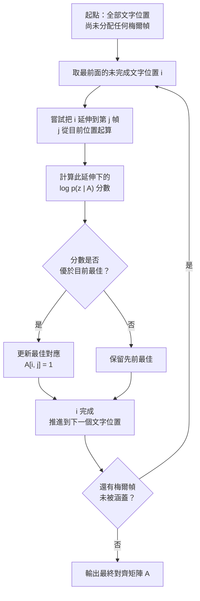

# 8.2 單調對齊搜尋（MAS, Monotonic Alignment Search）（2021）

## 一、第 7 章留下的難題

回顧第 7 章的 FastSpeech 架構：它的長度調節器要回答一個無可迴避的問題——文字裡的每一個音素，究竟對應到梅爾頻譜的哪一段幀？這個對齊一旦錯了，整個模型就會把聲學特徵貼到錯誤的音素上，產出聽起來發音錯誤的句子。

FastSpeech 2 的做法是拿 Montreal Forced Aligner 預先算好每個音素的時間邊界，再把這份「真值」當成訓練時的固定標籤餵進模型。這個做法在乾淨的朗讀語料（例如 LibriTTS）上確實有效，但在真實世界的語音上會崩潰，原因不難理解：MFA 是用 GMM-HMM 加上 Forced Alignment 的方式做強制對齊的，它假設每個音素對應一個固定的三狀態 HMM，並且需要字詞級的時間戳。當真人說話時有連音、有吞音、有笑聲、有吸氣、有背景電視聲，或者句子根本不是逐字朗讀出來的時候，強制對齊的結果會整片崩潰。

更麻煩的是，這種崩潰是沉默的。訓練流程不會報錯，loss 也會穩定下降，只是模型學到的對齊從一開始就是錯的。工程上，這意味著每一換一個說話人、每一換一種錄音環境、每一換一種語言，就可能需要重跑 MFA，而 MFA 本身的執行時間常常比訓練還久。

Tacotron 的注意力機制提供過另一條路：讓模型自己去學一個軟性對齊。但注意力有它自己的問題——它在訓練時容易退化成近似的局部對齊，推理時可能出現注意力跳躍或塌陷，而且它並不保證單調性。注意力機制並不是時間結構的可靠假設。

2021 年 VITS 論文提出的解法，是把對齊從「預先標註的常數」改造成「模型內部搜尋出來的變數」——而且是一個在訓練過程中持續更新、可以被梯度改善的變數。

## 二、對齊作為連續矩陣

MAS 的核心物件是一個對齊矩陣 $ A $ ，它把文字位置與梅爾幀位置關聯起來。令文字序列長度為 $ T $ ，梅爾幀數為 $ T' $ ，則 $ A $ 是一個 $ T \times T' $ 的非負矩陣，其中 $ A_{i,j} $ 表示第 $ i $ 個文字位置對第 $ j $ 個梅爾幀的「貢獻強度」。完整對齊要求每一列的總和為 1、每一行的總和為 1，也就是

$$
A_{i,j} \geq 0, \quad \sum_{j=1}^{T'} A_{i,j} = 1, \quad \sum_{i=1}^{T} A_{i,j} = 1
$$

這個雙邊隨機矩陣的形式很直觀：它意味著每一個梅爾幀的能量來源可以拆解成各個音素的加權組合，而每一個音素的能量又分配到若干個梅爾幀上。這正是梅爾頻譜作為非負線性加法 mixture 的物理直覺——一段含混的元音，聽起來就是兩個音素的連續過渡。

搜尋的目標是在所有滿足上述條件的 $ A $ 中，找使某個目標函數最大的那個。在 VITS 中，目標是讓 flow 映射後的隱向量分佈最接近標準高斯，也就是

$$
A^{\ast} = \arg \max_{A} \; \log p\left( \mathbf{z} \mid A \right)
$$

其中 $ \mathbf{z} $ 是由對齊矩陣把隱向量 $ \mathbf{h} $ 混合到梅爾幀網格後、再經過 flow 映射所得到的潛向量。

這個目標函數的巧妙之處在於它把「對齊」和「內容」綁在一起了。搜尋不只是在找一個看起來合理的時間划分，而是在找一個「讓內容看起來像它應該聽起來的樣子」的划分。如果對齊把「ㄅ」對到了清音的時段上，flow 的映射就會偏離高斯， $ \log p $ 下降，搜尋就會往別的候選移動。

## 三、搜尋的過程：逐步擴展的貪婪策略

MAS 演算法最漂亮的地方在於它的執行方式：它不是枚舉所有可能的對齊（那是天文數字級的搜索空間），而是用一個貪婪的、逐步擴展的動態規劃來近似。

其核心規則可以寫成：每一個文字位置 $ i $ 只能涵蓋一段**連續**的梅爾幀 $ [s_i, e_i] $ ，而且必須滿足

$$
s_1 = 1, \quad e_i + 1 = s_{i+1}, \quad e_T = T'
$$

也就是各音素所涵蓋的區段首尾相接、沒有交錯、沒有空洞。在這個約束下，設定一個長度為 $ T' $ 的陣列 $ D $ ，令 $ D_j $ 表示「走完前 $ i $ 個音素並恰好用到第 $ j $ 幀」時的最大累積分數，則遞迴式為

$$
D_{i,j} = \max_{j' < j} \left( D_{i-1,j'} + \log p\left( z_j \mid A_{i,j} \right) \right)
$$

這是一個標準的動態規劃：狀態是「已完成到哪一幀」，轉移是「這一個音素再吃幾幀」。每一幀的分數都不同音素而異，所以最長路徑的選擇自然反映了「哪個音素應該被拉長」。

實作上 VITS 採用的是一個更接近動態規劃的變體：維護一個長度為 $ T' $ 的分數向量，從第一個音素開始，對每個音素嘗試把它延伸到不同長度，比較各延伸方案給出的分數高低，留下最好的那個作為出發點，接著處理下一個音素。這個過程只有 $ T $ 個外層迴圈、 $ T' $ 個內層迴圈，複雜度是 $ O(T \cdot T') $ ，比起注意力那種 $ O(T \cdot T') $ 但要吃滿矩陣記憶體的做法，MAS 的記憶體需求低得多。

## 四、單調性作為先驗的合理性

MAS 的單調性約束是整個方法的基石，值得認真辯護一下它的合理性。

語音在時間上的產生本質上是依序的：說話人先發出「ㄅ」，再發出「ㄧ」，最後發出「ㄇ」。不存在「ㄅ」出現在「ㄧ」之後這種情況，除非模型自己搞錯了。語言學上的音素串本身就是有序的，這是語音學的基本事實。因此把「文字位置必須依序對應到依序的梅爾幀區段」當作硬約束，等於把一個在真實語音中幾乎永遠成立的先驗，直接編進搜尋空間。

這與自由注意力形成鮮明對照。注意力允許任意跳轉，它把「單調性」當作需要從資料中學出來的軟偏好；而 MAS 把單調性當作結構性保證，於是搜尋空間被大幅壓縮（從 $ T^{T'} $ 降到組合數量級的 $ \binom{T'}{T-1} $ ），訓練訊號效率也隨之提高。更重要的是，單調性讓「對齊」這個變數變得有意義：一個非單調的對齊在物理上是語音不存在的，因此不必讓模型去探索。

這個先驗的代價是它排除了某些真實現象：說話人重複、插入中斷、修正自我發言。這些「非單調」的語音現象在對話式語音中相當常見。VITS 論文本身承認這是簡化假設，也是後續工作的主要延伸方向之一。

另一個代價在於單調性本身不保證對齊的**精確性**。一個單調的對齊仍可能是錯的——把所有音素都擠在前半段、把後半段留給最後一個音素，單調性一樣成立，但聽起來完全錯誤。單調性只把搜索空間從天文數字壓縮到仍可接受的規模，真正的正確性仍然仰賴目標函數 $ \log p(\mathbf{z} \mid A) $ 給出的分數。這與直覺相反：約束條件減少了自由度，卻不等於保證了答案。

值得記錄的是「先驗的強度」這個概念在此處的應用方式。單調性在這裡不是一個可以調的權重，而是二元約束；這與注意力模型的做法形成對照，在後者那裡單調性是一個需要資料去發現的偏好，可以被違反。這兩種策略的取捨很清楚：約束越強，搜尋越穩、資料需求越少，但覆蓋的語音現象也越少。

## 五、從對齊到持續時間

搜尋完成後， $ A $ 立刻給出每個音素的持續時間：第 $ i $ 個音素佔據的幀數就是 $ e_i - s_i + 1 $ ，乘上梅爾幀移就得到毫秒數。這是一個極重要的副產品，因為它意味著**模型自己決定了說話速度與停頓位置**。

這裡有個設計上的巧妙分工：duration predictor 負責預測一個音素應該佔多長，而單調對齊搜尋負責在這個長度附近做最後的決定。實際上 VITS 的做法是先用 duration predictor 得到一個初始長度，再用搜尋在允許的範圍內微調。這個分工讓 duration 分支的學習變得容易——它不需要精確到幀，只需要提供一個大致正確的量級，剩下的對齊誤差由搜尋吸收。

對齊品質直接決定了韻律與音色。理由很直觀：如果對齊把「ㄟ」的尾巴切到了下一個音素的起始，那這個「ㄟ」的鼻音尾巴就會被截斷，聽起來像「ㄝ」；如果元音的中心被錯配到輔音的區段，整個音色的說話人特徵就會被扭曲。搜尋的目標函數雖然是分佈層面的（ $ \log p $ ），但它的效果卻體現在最細微的聽感差異上——這正是機率建模的威力所在。

## 六、與 MFA 的因果對比

把 MAS 與第 7 章的 MFA 依賴並排放，可以清楚看出兩種哲學的差異。

| 面向 | MFA 依賴（第 7 章） | MAS（VITS） |
| --- | --- | --- |
| 對齊來源 | 訓練前的外部工具 | 訓練中的內生搜尋 |
| 對齊性質 | 固定的離散時間戳 | 可微分的連續變數 |
| 失敗模式 | 靜默崩潰，模型學到錯的對齊 | 退化解可被觀察與調整 |
| 對雜訊容忍 | 低，需要手寫發音字典 | 較高，靠分佈似然容錯 |
| 新資料適配 | 需重跑對齊 | 重新訓練即可 |
| 語言擴充 | 需對應的 Forced Lexicon | 模型結構不變 |
| 額外成本 | 對齊時間常超過訓練時間 | 無額外工具 |
| 資訊流 | 單向（標註 → 模型） | 雙向（模型 ↔ 對齊） |

因果鏈上的定位是清楚的：MFA 把時間結構當成外部給定的先驗，MAS 把它當成需要從資料中推斷的隱變數。前者的失敗是隱性的，後者的失敗是可見的——如果搜尋找不到好的對齊， $ \log p $ 的數值會直接暴露出問題。

這也改變了「對齊是資料標註的一部分」這個觀念。在傳統 TTS 資料集裡，forced alignment 產出的時間戳常被視為與文字轉錄同級別的標註；MAS 則暗示時間結構其實是從音訊與文字的配對中**推導**出來的，不一定需要人工介入。

## 七、後續擴展

MAS 的框架留下了幾個明確的延伸方向。

**放寬單調性**是最直接的延伸。既然語音存在重複、插入與自我修正，放鬆或局部打破單調約束就是自然的改進。但這會讓動態規劃失效，因為狀態不再只由「已完成到哪一幀」決定，需要更一般的搜尋框架。

**多說話人與風格差異**方面，VITS 的 flow 機制提供了一個優雅解法：對齊搜尋是在 flow 映射之後的潛空間進行的，而 flow 承載了說話人的韻律差異，因此同一套搜尋演算法可以同時服務不同說話人，不必為每個人重新設計對齊邏輯。

**跨語言延伸**則挑戰了單調性假設的語言學基礎。某些語言的音節結構、形態變化或形態音位現象會讓「一個音素對應一段連續幀」的假設變得更複雜；漢語的聲調變調與兒化、粵語的入聲等現象，都要求對齊結果能承載超越純時間維度的資訊。

**多層次對齊**是另一個方向：把對齊從「音素到幀」擴展到「音素到音素」或「字到字」，在需要處理連音或兒化時更細緻。

值得補充的是 MAS 與第 4 章 CTC 的對照。CTC 用動態規劃計算一個序列所有可能對齊的機率總和，本質上是一種「把所有對齊邊際化掉」的策略；MAS 則是在對齊空間裡主動挑出最優的那一個。兩者都依賴單調性這同一個語言學先驗，也都用動態規劃來實現，但一個把對齊積分掉、一個把對齊選出來。CTC 的做法在 ASR 中之所以成功，是因為辨識任務不需要知道確切的邊界，只需要知道整個序列的機率；TTS 則相反，生成任務必須明確決定每個音素佔多長，沒有辦法把對齊積分掉。這個區分解釋了為什麼對齊機制的解法在 ASR 與 TTS 兩邊長出了不同的樣子。

## 八、小結：把時間結構還給模型

MAS 真正的貢獻不是一個演算法，而是一個立場的轉移：時間結構不需要被外部標註給定，它可以作為一個連續的、可微分的、與內容聯合優化的隱變數，由模型自己從資料中學出來。

這個立場轉移在架構史上留下的印記非常深。幾乎所有 2021 年之後的非自迴歸 TTS 系統——不僅是 VITS 本身，還包括後來大量以「隱式對齊搜尋」為名的改良版本——都建立在同一個發現之上：對齊搜尋與內容生成可以共用同一套參數，並且可以聯合訓練。

把這個發現放回第 7 章的脈絡裡，意義更為清楚。FastSpeech 的長度調節器把「音素數」與「幀數」之間的比例當成一組需要從資料中估計的參數（由 MFA 提供），它是一個被動的插值器；MAS 則把同一個比例變成一個主動搜尋的結果，而搜尋的方向由內容與聲學的一致性決定。換句話說，FastSpeech 假定「知道了正確的時長，模型就會學會發音」，MAS 則發現「正確的時長其實可以從發音目標裡反推」。

這個反推的可行性完全建立在 flow 的可逆性之上，值得再強調一次。若隱向量到潛空間的映射不可逆，搜尋過程中對對齊的每一次試探都會破壞已經算好的隱向量，梯度也就無從累積；正是可逆結構讓「試探」變成一種安全的、可回溯的行為。這是 8.1 節與 8.2 節在數學上真正的咬合點。

另一個容易被忽略的副產品是搜尋的**可解釋性**。對齊矩陣 $ A $ 是一張可以直接畫出來對照音素與音節的圖表，任何研究者或工程師都能用它檢查模型的時間結構是否合理。相較之下，注意力權重圖雖然也能視覺化，但它的語意是模糊的，難以直接讀出「這個音素佔了幾幀」。MAS 輸出的 $ A $ 幾乎就是一份自動產生的 forced alignment，只不過是模型自己算出來的。

### 實務上的注意事項

搜尋演算法有幾個在實作時會咬到人的細節。首先是搜尋的**離散化**問題：目標函數是連續的，但最終的對齊必須落到整數幀上，這中間的取捨會帶來邊界誤差。實作上通常以連續鬆弛值計算分數，最後再依長度調節器給出的整數幀數切分。

其次是**空對齊的防護**。若某個音素在目標分數下找不到合理的延伸長度（例如梅爾總幀數不足以容納所有音素的最小長度），搜尋必須有後備機制，否則會直接產生 NaN 或形狀錯配。實務上常見的作法是給每個音素一個最小幀數保底。

最後是**推理時搜尋的開銷**。因為對齊是在推理時也要重新搜尋的（非自迴歸模型沒有 teacher forcing 可以抄答案），所以這一段的計算量會直接反映在即時因數上。 $ O(T \cdot T') $ 的複雜度在句子長度增加時會明顯成長，這也是為什麼實務系統往往對輸入長度設有上限。

下一節要處理的，是 VITS 輸出端的那一半。梅爾頻譜丟掉了相位資訊，而正是相位與高頻的細節結構決定了語音聽起來是「像真人」還是「像機器」。HiFi-GAN 用多週期鑑別器與特徵匹配損失解決了這個問題，也讓「神經聲碼器」這個詞在 2020 年之後有了完全不同的內涵。
