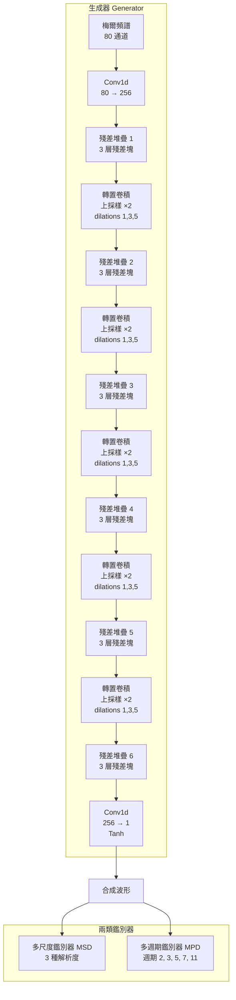

# 8.3 HiFi-GAN 的多週期鑑別器（MPD）與特徵匹配損失（2020-2021）

## 一、聲碼器要解決的問題：相位缺失與高頻的幽靈

在進入 HiFi-GAN 之前，先把神經聲碼器面對的技術難題攤開來看，因為這決定了後面所有設計的取捨。

梅爾頻譜是第 1、2 章那套聽覺刻度理論的產物：它把聲音壓成 80 個通道的時頻矩陣，丟掉了大部分相位資訊，也丟掉了絕大部分高頻能量。從梅爾反推波形，理論上有無限多組解——不同的相位排列會產生聽起來大致相同、但在波形上截然不同的訊號。這種多對一的映射正是聲碼器問題的本質。

傳統做法有兩條路。Griffin-Lim 演算法試圖用相位梯度整合把梅爾頻譜還原成波形，它迭代地估計相位，結果是語速可以聽出來、有金屬感的「相位不連續雜訊」，聽起來像從水底聽人講話。WORLD Vocoder 走的是另一條路：先用一個濾波器組分析出非週期成分與週期成分，分別合成再重疊。WORLD 在自然度上遠勝 Griffin-Lim，但它的分析合成過程是有損的，且運算負擔不小。

真正的難點其實集中在高頻。語音的能量集中在 200 Hz 到 4 kHz，但在這個範圍之上，仍然存在大量聽覺上可辨的資訊：摩擦音（ㄕ、ㄈ）的噪音成分、爆破音（ㄅ、ㄅ）的尖銳瞬態、齒音（ㄗ、ㄙ）的細緻顆粒。這些成分在梅爾譜裡被大幅量化掉了，梅爾重建的 L1 誤差幾乎偵測不出它們的缺失——但人的耳朵對它們極度敏感。這就是所謂的「金屬雜訊」與「鋸齒感」的來源：模型的梅爾譜完全正確，聽感卻是錯的。

這意味著單靠梅爾重建損失是刻意的「瞎子聾」設計。要解這個問題，必須讓模型**直接在時間域上**接受判斷，而這正是 GAN 的職責。

## 二、HiFi-GAN 的生成器

2020 年 Jungil Kong 等人在 NVIDIA 發表的 HiFi-GAN，把三個想法組合成一個極為有效的神經聲碼器。

**殘差堆疊**是生成器的主幹。HiFi-GAN 在每個解析度層級上堆疊數個殘差塊，每個殘差塊由兩到三層捲積組成，中間夾帶 WeightNorm 與 LeakyReLU，並在整塊外加一條殘差連接。殘差結構讓深層網路容易訓練，也讓每個尺度有獨立的「修正機制」。

**帶擴張的捲積**（dilated convolution）是另一個關鍵細節。在每個殘差塊內，捲積核的擴張率（Dilation）會隨層遞增，例如 1、3、5。擴張捲積能讓感受野在不增加參數量的前提下快速擴大，使模型能夠在固定的時間尺度內建模長距離依賴——這是處理諧波結構與共振峰連續性所需要的。

**轉置卷積**作為上採樣單元：梅爾的時間解析度是每秒 100 幀，原始波形是每秒 22050 或 44100 個取樣點，總共需要四到五次的倍率提升。HiFi-GAN 用結構化轉置卷積逐步放大，每次放大 2 倍，相較於先把梅爾插值到全解析度再做捲積的做法，避免了大量冗餘計算。

## 三、多尺度鑑別器（MSD）

第一類鑑別器處理的是**時間尺度**的問題。傳統 GAN 有一個已知弱點：當輸入是極長的時間序列時，鑑別器很容易只學到「整體分佈像不像」，而忽略局部瑕疵。

MSD 的解法是同時在多個解析度上執行鑑別。HiFi-GAN 使用三個子鑑別器，分別對輸入波形做不同的下採樣：一個看原始解析度（32768 取樣點，約 0.74 秒），一個看兩倍下採樣（16384 點），一個看四倍下採樣（8192 點）。每個子鑑別器都是一組捲積層，把時間維度逐步壓縮到一個固定的長度，再做分類判斷。

不同解析度的鑑別器負責不同的聽覺尺度：原始解析度上的鑑別器能偵測最細的瞬態瑕疵（單一取樣點級別的失真），而下採樣後的鑑別器看到的接近於「音節與音素層級」的可聽結構。三個尺度的意見共同構成一個分層的逼真度判斷，涵蓋了從取樣點到韻律段的完整範圍。

## 四、多週期鑑別器（MPD）：直接對應諧波結構

第二類鑑別器處理的是**諧波結構**的問題，這是 HiFi-GAN 相較於同期的 MelGAN、Parallel WaveGAN 等最獨特的貢獻。

語音的基頻在 80 Hz 到 300 Hz 之間。在 22050 Hz 的取樣率下，一個 110 Hz 的基頻對應的波形週期是 200 個取樣點。但真實的語音並不是只有基頻週期——諧波成分的存在意味著波形在更細的尺度上也有重複結構：二次諧波是 100 點週期、三次是 67 點週期，依此類推。

MPD 的做法非常直接：把輸入波形**摺疊**成不同的週期長度，再對摺疊後的序列做鑑別。具體而言，對週期 $`p`$ ，把長度為 $`T`$ 的波形重排成 $`T/p`$ 長度、 $`p`$ 行的矩陣：

$$
x_{p}[i, j] = x[ j + p \cdot i ], \quad i = 0, \dots, \frac{T}{p} - 1, \quad j = 0, \dots, p - 1
$$

這個重排把時間軸上相隔 $`p`$ 個取樣點的樣本放到同一列。於是每一列在理想情況下應該是**完全相同**的，因為它們對應的是基頻的整數倍相位關係。鑑別器要判別的正是「每一列內部是否一致」，這就是諧波結構的直接指標。

HiFi-GAN 使用五個週期 $`p \in \{2, 3, 5, 7, 11\}`$ ，各配一個子鑑別器。這五個數的選擇不是任意的：它們是 11 以內的質數，彼此互質，因此不會有公因數造成的系統性偏差。同時它們覆蓋了從基頻的 2 倍到 11 倍的諧波範圍——正好人耳對音高與音色細節最敏感的區段。

質數的選擇還有一層好處：若採用 $`\{2, 4, 6, 8\}`$ 這種偶數組合，週期 4 的子鑑別器其實只是週期 2 的延伸，因為兩個樣本都落在偶數索引上，摺疊後的資訊會高度冗餘。互質的週期集合確保每一個子鑑別器都看到不同的相位取樣組合，整體覆蓋才是互補而非重疊。

值得注意的是 MPD 判別的並不是「整個音訊是否像真人」，而是「波形在特定週期上是否自洽」。這是一個非常物理化的判準：真實的聲帶振動產生的波形，在理想情況下每隔 $`p`$ 個取樣點就會重複一次（對基頻的整數倍週期而言）。生成的波形若在某個週期上出現列與列之間的不一致，就代表諧波結構有瑕疵——而這正是「金屬感」的物理來源。也就是說，MPD 把一個原本模糊的聽覺概念（金屬雜訊）翻譯成了一個可以明確表述的統計性質。

| 鑑別器類型 | 摺疊/下採樣方式 | 關注的尺度 | 對應的聽覺現象 |
| --- | --- | --- | --- |
| MSD-1 | 不變，32768 點 | 取樣點級 | 瞬態波形、爆破音尖銳度 |
| MSD-2 | 下採樣 2 倍 | 音素內部 | 摩擦音顆粒感 |
| MSD-3 | 下採樣 4 倍 | 音節級 | 音節結構、連接的平滑度 |
| MPD-2 | 摺疊週期 2 | 高次諧波 | 音色的細膩諧波成分 |
| MPD-5 | 摺疊週期 5 | 中次諧波 | 基頻的整數倍結構 |
| MPD-11 | 摺疊週期 11 | 基頻附近 | 韻律中的基頻變化 |

## 五、特徵匹配損失

純粹的 GAN 分類損失有一個結構性弱點：鑑別器只輸出一個「真或假」的二元訊號，這個訊號要一路傳回生成器的所有層，對於「生成器的哪一部分出了問題」幾乎沒有資訊。訓練早期尤其如此，生成器收到的梯度充滿雜訊。

HiFi-GAN 的解法是**特徵匹配損失**（feature matching loss）：在鑑別器的每一個中間層，同時取出真實訊號與生成訊號的特徵圖，強制兩者靠近。

$$
\mathcal{L}_{\text{FM}} = \sum_{l} \frac{1}{l} \left\| D_l(x) - D_l(\hat{x}) \right\|_1
$$

其中 $`D_l`$ 表示鑑別器第 $`l`$ 層的特徵映射， $`x`$ 是真實波形、 $`\hat{x}`$ 是生成波形。這個式子的形式與第 4 章 GAN 原始論文中的中間分佈匹配損失幾乎相同，但 HiFi-GAN 的貢獻是把它與多尺度多週期的鑑別器結構結合，並證明這個組合在聲碼器任務上非常有效。

特徵匹配能穩定訓練的理由有幾層。第一，**特徵提供比二元真假更細緻的梯度**：每一層都給出具體的「往哪個方向調」的訊號，而不是一個籠統的「你被判為假」。這讓生成器的每一層都有明確的學習目標。

第二，**特徵匹配是逐元素的**：它要求的是特徵圖的**位置對齊**。對語音聲碼器而言，這意味著生成器不只要做出「聽起來像」的波形，還要在時間上對齊——在正確的時間點做出正確的諧波結構。相較之下，純 GAN 的最終層判別對時間位置完全不敏感。

第三，它提供了一種**隱式的結構先驗**。真實波形的各層特徵攜帶了局部時間結構的資訊，強制生成特徵靠近真實特徵，等於是把這些結構規矩灌進生成器，而不需要手寫任何規則。

總訓練目標是三項加權：

$$
\mathcal{L} = \mathcal{L}_{\text{adv}} + \lambda \mathcal{L}_{\text{FM}} + \mathcal{L}_{\text{mel}}
$$

其中 $`\mathcal{L}_{\text{mel}}`$ 保留了一項梅爾頻譜的 L1 重建損失作為輔助。這是一個務實的設計：純對抗訓練的 GAN 語音合成器常出現內容錯誤或訓練不穩定，加上一項梅爾約束能穩住內容，讓對抗部分專心處理梅爾看不見的細節。權重 $`\lambda`$ 通常設在 0.1 量級。

| 損失項 | 作用層次 | 提供的訊號 | 單獨使用的缺陷 |
| --- | --- | --- | --- |
| 對抗損失 | 輸出層 | 真假二元判別 | 梯度稀疏、訓練不穩 |
| 特徵匹配 | 鑑別器各中間層 | 逐位置、多尺度特徵對齊 | 對全局分佈約束弱 |
| 梅爾 L1 | 生成器輸出後 | 內容與頻譜包絡正確性 | 無相位與高頻資訊 |

## 六、訓練平衡與實務技巧

HiFi-GAN 的訓練在當時算是相當容易調的，但仍有幾個要點。

**生成器與鑑別器的更新比例**是最敏感的參數。HiFi-GAN 論文採用生成器更新兩次、鑑別器更新一次的安排，這讓生成器有足夠的機會回應鑑別器的意見，同時避免鑑別器壓倒性地獲勝。過度不平衡的典型症狀是：鑑別器過強時生成器輸出的是「安全的」平均化波形，聽起來平板無力；生成器過強時則會出現高頻雜訊與金屬感。

**訓練時與推理時的輸入差異**是另一個容易踩到的坑。梅爾頻譜的幀移與取樣率的比值決定了上採樣倍率必須是整數，若兩者不匹配就會產生時間軸的漂移或重複。另外生成器輸出時的取樣點數要精確對齊到訓練時的長度，否則邊界效應會在句尾產生可聽的雜訊。

**鑑別器的輸入長度**也影響效果。太長的輸入讓鑑別器傾向於判斷整體分佈，太短則失去韻律層級的判斷依據。論文選用的 32768 取樣點在 22050 Hz 下約 1.5 秒，是一個在穩定性與判別力之間取得平衡的折衷。

**實作細節**方面，WeightNorm 在生成器與鑑別器中都被使用，它把權重矩陣分解成範數與方向兩部分，能顯著加快 GAN 的收斂速度。殘差連接、啟動函數選用 LeakyReLU（避免梯度在負半軸被截斷）也都是標配。

**資料量與訓練時長**是另一個常被低估的因素。HiFi-GAN 這類模型需要相當大量的真實波形才能學會高頻細節，用幾百小時的語料訓練出來的版本，往往在主觀評測上明顯輸過用數千小時訓練的版本。這是為什麼同期各家大廠的模型在開放權重之前，普遍宣稱使用了大規模的內部語料。

**評估指標的選擇**也值得一提。客觀指標如 mel-cepstral distortion（MCD）在評估神經聲碼器時具有明顯誤導性，因為它無法反映高頻品質——這正是本章開頭說的「瞎子聾」問題。研究者因此發展出以 GAN 為基礎的客觀指標（例如 PEAQ 的神經網路變體），或直接採用主觀聽測（MOS 評分）。這段歷史留下的教訓是：當損失函數衡量的東西與聽眾關心的東西不一致時，指標也會一併失效。

**推理期的邊界處理**是容易被忽略的實務細節。梅爾到波形的轉換有著嚴格的時間對齊要求，實作上常用「取整」與「中心對齊」兩種偏移修正方式，若處理不當會讓輸出音訊整體位移數個取樣點，或在句尾留下突兀的截斷。成熟的實作通常會把梅爾的幀中心時刻與取樣點中心時刻做明確對齊，讓合成結果的時戳與原始錄音一致。

## 七、定位：與 Griffin-Lim、WORLD 的比較

| 面向 | Griffin-Lim | WORLD | HiFi-GAN |
| --- | --- | --- | --- |
| 原理 | 相位梯度整合迭代 | 分析合成（濾波器分解） | 對抗訓練 + 多尺度多週期判別 |
| 是否即時 | 否，迭代成本高 | 是 | 是（RTF 約 0.01 到 0.05） |
| 主觀品質 | 明顯金屬雜訊 | 較自然但有分析合成失真 | 最自然，接近真人 |
| 相位 | 估計出來的 | 解析重建 | 隱式生成 |
| 高頻細節 | 缺失 | 部分保留 | 充分保留 |
| 訓練需求 | 無需訓練 | 需訓練聲學模型 | 需大量真實波形 |
| 失敗模式 | 機械感 | 音色略微失真 | 訓練不穩、內容錯誤 |

三者的歷史定位因此很清楚：Griffin-Lim 是「不需要訓練」時代的湊合方案；WORLD 是「需要訓練但還沒想到對抗訓練」時代的折衷；HiFi-GAN 是第一個把「聽覺上重要的細節」明確寫進訓練目標的方案。它的成功證明了一件事：當損失函數設計得對，生成器可以自己學會人類耳朵認為重要的那些特徵，而不需要工程師手寫規則。

還有一個容易被低估的產業效果：HiFi-GAN 把神經聲碼器從「研究專用」變成「可部署」。WORLD 與 Griffin-Lim 的時代，要做一個能跑的 TTS 系統，聲碼器往往是瓶頸；HiFi-GAN 出現之後，任何團隊都能在標準化配置的基礎上把自己的前端模型接上一個高品質的輸出端。這種「組件化」的能力，才是它在產業上被普遍採用的真正原因。

## 八、成為預設元件

HiFi-GAN 的影響力可以從後續幾年的產業現況看出來。幾乎所有現代 TTS 系統都採用 HiFi-GAN 架構作為聲碼器：VITS 把它內建為解碼器；Microsoft 的 Neural TTS 以它為骨幹；Meta 的 Voicebox、OpenAI 的 Whisper-based 說話人複製工作也把它作為聲音重建環節；各類開源專案（NVIDIA 的 Tacotron 2 改版、Coqui TTS、StyleTTS 2、BigVGAN 等）幾乎都以它為基礎出發。它在技術史上獲得的地位，與 WaveNet 在自迴歸聲碼器的地位相當——後來者不是推翻它，而是把它當作基礎設施。

其中一個值得記錄的後續發展是 BigVGAN，它針對 HiFi-GAN 的弱點（部分訓練設定下會產生金屬感雜訊）引入了 Snake 激活函數，用一個帶週期性正弦的激活去強化諧波結構的建模。這個改動反過來印證了 MPD 設計的洞察：諧波結構確實值得用架構層面的機制去鼓勵，而不只靠鑑別器去批評。

## 九、與第 9 章的接續：從連續訊號到離散符號

在整本書的因果鏈上，HiFi-GAN 站在一個極有意思的位置：它是整個技術史中**最成功的連續訊號生成模型**之一，卻也暴露了連續訊號生成模型的天花板。

原因很直接。梅爾到波形的映射本質上是一個連續的、多對一的、沒有明確「詞彙表」的問題。生成器輸出的每一個取樣點都是一個連續實數，沒有辦法用交叉熵去衡量，也沒辦法把整段音訊塞進語言模型的序列裡。語言模型擅長的是離散的、可被 token 化的符號——它們有有限詞彙表、可計算的機率、可以 autoregressive 預測的結構。而神經聲碼器這邊什麼都沒有。

第 9 章要處理的殘差向量量化，正是架構史上對這個矛盾的回答：把連續音訊離散化成有限的 codebook 索引，讓神經聲碼器從「訊號生成器」變成「符號序列的接續器」。只有完成這一步，聲音才終於可以用語言模型的方式被建模、被預測、被組合。HiFi-GAN 解決了「生成得像真人」，而第 9 章要解決的是「讓聲音變成可以思考的東西」。
