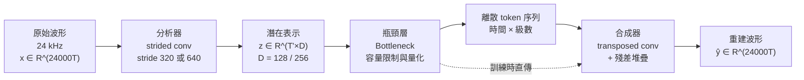

# 9.1 神經音訊編解碼器與瓶頸層（Bottleneck）設計（2018-2023）

## 一、從「壓縮」到「離散化」：目標的重新定義

傳統音訊編碼器（MP3、AAC、Opus）的目標很單純：在給定比特率下，盡量讓重建訊號在聽覺上接近原始訊號。Opus 的做法是把波形分解成諧波成分與噪音成分，對兩者分別做參數化編碼，再以算術編碼打包；MP3 則是繼承 MPEG-1 Layer III 的多解析度濾波器組加上位元分配的思路。它們的核心是「相位與頻譜感知」：先決定哪些頻率成分人耳聽得到，再用心理聲學模型把聽不到的量化掉。

神經音訊編解碼器把問題整個倒過來。它不再問「人耳聽不聽得到」，而是問「能不能學出一組潛在座標，使得連續波形可以被映射成一串離散符號，同時又能從這串符號重建出高保真波形」。這個重新定義帶來兩個好處：一是潛在表示由資料決定，而非人為的感知模型決定；二是潛在表示天然是時間序列，可以直接餵給自迴歸語言模型。第 10 章的 VALL-E 與 MusicGen 之所以能成立，全靠這一步。

具體來說，輸入是 24 kHz 的單聲道原始波形 $`x \in \mathbb{R}^{24000T}`$ ，輸出是每秒固定數量的離散 token。舉一個典型的尺度：幀長 640 個樣本，幀率就是 $`24000 / 640 = 37.5`$ 幀每秒；若採幀長 320，則為 75 幀每秒。每幀被壓成一個 $`D`$ 維的向量， $`D`$ 取 128 或 256。這個 $`D`$ 與幀率的乘積，連同每幀的量化位元數，共同決定了總比特率。

## 二、架構：分析器、瓶頸、合成器

**分析器**的任務是把高時間解析度的波形壓到低幀率的潛在空間。兩種主流做法：其一是 strided convolution，用一串一維捲積加下採樣，把 320 或 640 個樣本攢成一個幀向量；其二是小型 transformer 或因果卷積堆疊，讓每個潛在向量能「看」到更長的上下文，特別有助於處理相位連續性與諧波延展。

用 strided convolution 時，一個必須留意的細節是**下採樣倍率與核尺寸的配合**。若直接用 stride 640、kernel 640 的單層捲積，每個輸出點只看見 640 個樣本，等於完全沒有跨幀的上下文，諧波的延展關係（基頻數十個樣本週期地延伸超過一幀）就被切斷了。因此實務上通常是「數層小倍率捲積 + 最後一層大倍率捲積」的結構：先用 stride 2、4、8 的層層堆疊讓感受野擴大，最後再用一次 stride 320 或 640 完成降幀。這樣每個潛在向量實際涵蓋數千個樣本的上下文，基頻軌跡與共振峰的連續性才得以保留。

這個感受野是可以精確計算的。若第 $`i`$ 層的核尺寸為 $`k_i`$ 、步長為 $`s_i`$ ，則 $`L`$ 層堆疊後單一輸出位置所覆蓋的輸入長度為

$$
\text{RF} = 1 + \sum_{i=1}^{L} \left( k_i - 1 \right) \prod_{j=1}^{i-1} s_j
$$

以一組 $`2 \rightarrow 4 \rightarrow 4 \rightarrow 4`$ 的倍率為例，四層之後的累積下採樣率達 128，理論感受野遠大於單層的 320 或 640 個樣本。這個公式的物理意義是：潛在向量在時間上稀疏取樣，卻在內容上覆蓋了數百毫秒的語音脈絡，基頻的連續震盪與共振峰的緩慢移動因此不會被幀邊界切斷。倍率堆疊越多，感受野越大，但下採樣過程中不可逆的資訊損失也越多。

第二種做法是用小型 Transformer 取代捲積堆疊。EnCodec 的分析器在殘差卷積塊之後接了一層帶 EMA（Exponential Moving Average）遮罩的自注意力層：注意力權重不是均勻分攤，而是對鄰近位置給予較高權重、對遠處位置隨距離衰減。這樣的設計有兩個好處。一是注意力不受卷積局部性的限制，長距離的諧波關係可以直接被建模，不必仰賴堆疊深度來擴大感受野。二是它能以單條平行路徑處理極長的輸入序列，訓練時的平行度遠高於擴張卷積逐層累積的結構。代價是注意力的平方複雜度與對窗長的敏感性。

**合成器**是分析器的鏡像：先用轉置卷積把潛在幀上採樣回時間軸，再用殘差堆疊（residual stack）精修。殘差堆疊在第 8 章的 HiFi-GAN 裡已經證明是重建高頻瞬態的關鍵——它讓每個上採樣階段都有獨立的「修正機制」，能補回上採樣過程中丟失的細節。這一點在編解碼器裡同樣成立，因為量化本身引入的誤差正是一種高頻失真。

**瓶頸層**夾在中間，它不是一個獨立的網路層次，而是架構中「強制施加」的限制機制：潛在維度 $`D`$ 本身就是瓶頸，加上量化步驟把連續值壓成有限符號集的組合，才是完整的瓶頸。瓶頸越小，潛在空間越緊湊，越容易被少量比特描述，但重建時能還原的資訊也越少。

## 三、潛在空間的設計與群延遲問題

潛在表示不只是在做降維，它其實在重新選擇「什麼東西值得被保留」。一個自然的對比是梅爾頻譜：梅爾保留了頻率包絡，丟棄了相位；神經編解碼器的潛在表示則沒有這樣的人為假設，它由重建損失決定該留什麼。實驗結果是潛在向量裡同時帶著頻率結構與部分時間結構，這也是它能被殘差量化有效分解的原因。

但有一個物理約束無法迴避：**群延遲**。若編碼器與解碼器的卷積核長度不對稱，輸入與輸出之間會有一個固定的時間偏移，重建波形雖然聽起來正確，卻在時間上錯位數十個毫秒。對語音合成而言，這種錯位會讓音素邊界與文字對齊產生偏移，因此設計上通常要求編碼器與解碼器的時間感受野嚴格對稱，或者在訓練後做一次全域的時間平移校正。

另一個細節是**潛在向量是否應該強制平移不變**。若模型對音量的微小變化極度敏感，同一句話的輕聲與大聲版本就會落在潛在空間的不同區域，用掉不同的碼字，降低碼本的共享效率。加入音量正規化或潛在空間的平移正則，是提升碼本利用率的常見手段之一。

## 四、瓶頸的取捨：太小則失真，太大則量化不划算

考慮 24 kHz、幀長 640、 $`D = 128`$ 的設定。此時潛在表示的原始維度是 $`37.5 \times 128 = 4800`$ 維每秒，而原始波形是 24000 維每秒，壓縮比約為 5:1。若進一步要求每幀只用 $`b`$ 個比特描述，總比特率就是 $`37.5 b`$ bps。在 3 kbps 的目標下，每幀只有 80 個比特可用——這意味著整個 128 維向量只能由 80 個比特來近似表示，資訊論上這是一種極端的降維。

這就是瓶頸設計的核心矛盾：**瓶頸要夠小，小到可以被少量比特離散化；也要夠大，大到能承載聽覺上可辨的細節**。前一句決定了語言模型能以多低的成本建模，後一句決定了重建品質的上限。兩者是同一個旋鈕的兩端。

實務上，解決之道是「分工」而非「取捨」：讓第一級量化承載聲學的主要內容（音色、基頻軌跡、音素骨架），讓後續級別承載越來越細的殘差。這樣第一級碼本覆蓋的區域廣、每個碼字覆蓋得粗，但每一幀只需要少數比特就能定位到正確的「區域」。第 9.2 節會把這個想法形式化為殘差向量量化。

另一個關鍵設計問題是**幀率的取捨**。幀率從 37.5 Hz 提升到 75 Hz，時間資訊更精細，但同一段音訊的 token 數翻倍，語言模型的序列長度與運算量同步翻倍。幀率也決定了量化每一級所需的資訊量，因為相鄰幀的內容相關性下降，殘差會變大。反過來，幀率太低則瞬態（爆破音的尖峰）可能被整幀平均掉，這是 37.5 幀每秒在語音上勉強可接受、在音樂上卻明顯不足的原因。

從資訊論的觀點，編碼器的設計就是把神經網路當成一個率失真（rate–distortion）編碼器：率 $`R`$ 是每秒的比特數，失真 $`D`$ 是重建誤差。當碼本大小固定而幀率提高時， $`R`$ 上升、 $`D`$ 下降，兩者構成一條下凸的取捨曲線；我們願意用多高的碼率換取多好的重建，就等於在這條曲線上選取不同的操作點。神經編解碼器的可變比特率能力，本質上是把這條曲線的不同段落用同一組權重一併實現出來。這也解釋了為什麼 EnCodec 把最低操作點定在 1.5 kbps：那是曲線尚未嚴重翹起的區段，在此之前多給位元仍能線性地換來品質。

## 五、與傳統 codecs 的對比

| 面向 | 傳統 codecs（MP3 / Opus） | 神經 codecs（SoundStream / EnCodec） |
| --- | --- | --- |
| 設計依據 | 人類聽覺心理聲學模型 | 端到端重建損失，感知由資料決定 |
| 離散化方式 | 頻譜係數 + 位元分配 + 算術編碼 | 潛在向量 + 向量量化 |
| 對高頻的處理 | 依聽力門檻直接捨棄 | 潛在空間保留更多可重建資訊 |
| 泛化能力 | 對未見過的聲音穩健 | 對訓練音域最佳，域外可能失真 |
| 副帶寬 | 需同時傳輸位元流與解碼器假設 | 需編碼器與解碼器權重完全一致 |

傳統編碼器有個先天優勢：位元流本身帶有自我描述性，任意符合規格的解碼器都能解。而神經編解碼器的「位元流」只是碼本索引，真正攜帶語意的是編碼器與解碼器那一大批權重，不同模型訓練出來的 token 完全不可互通。這是代價，不是缺陷。

另一個代價是**域外泛化**。神經編解碼器在訓練音域（多為演講、歌唱或特定音效庫）上表現優異，一旦遇到不同麥克風、不同房間回響、不同風格的聲音，編碼器產生的潛在向量會落在碼本覆蓋稀疏的區域，量化誤差暴增，重建結果出現金屬感。這正是 Opus 這類傳統編碼器在今天仍被廣泛用於即時通訊的原因。

神經編解碼器的泛化失敗有兩個可分離的來源。其一是**聲學域偏移**：訓練資料多為乾淨、近距離、單人麥克風錄音，實際通話中則有背景人聲、交通噪音與隨機的麥克風失真；編碼器的輸出可能落到碼本覆蓋區域的邊界之外，量化誤差因而放大。其二是**條件偏移**：同樣的內容在不同的背景噪音與不同的頻寬限制之下，最優的潛在分佈並不相同，而模型只有一個固定的分佈。傳統編碼器的心理聲學模型是內容自適應的；神經編解碼器則把這個決策固化在權重裡。

還有一個容易低估的差異是**帶寬效率的落後**。Opus 在 32 kbps 就能達到相當好的語音品質，而神經編解碼器往往需要 6 kbps 以上才在自然度上勉強可比。這個差距的根源在於神經解碼器目前多數只學會了重建目標裡最容易被優化的部分——相位與高頻瞬態的細緻結構，而這些恰好是最難用少量比特編碼的部分。

## 六、端到端訓練：重建損失的選擇

神經編解碼器不需要手寫編碼流程，端到端訓練是它最大的簡化。損失函數的選擇直接決定模型會保留什麼資訊。

最基本的是時間域的 $`L_1`$ 損失：

$$
\mathcal{L}_{\text{rec}} = \sum_{t} \left| x_t - \hat{y}_t \right|
$$

$`L_1`$ 比 $`L_2`$ 對離群值更穩健，避免某些瞬態被平方放大主導梯度。但它對頻域結構幾乎沒有偏重，因此容易讓高頻雜訊被模糊化。

多尺度譜損失（multi-scale STFT loss）補上了這一塊：把重建訊號與原始訊號都做短時傅立葉變換，在多組窗長與步長下比較複數頻譜的 $`L_1`$ 距離：

$$
\mathcal{L}_{\text{STFT}} = \sum_{m} \sum_{f} \left| \left| S_m(x) \right| - \left| S_m(\hat{y}) \right| \right|_1 + \left| \arg S_m(x) - \arg S_m(\hat{y}) \right|_1
$$

其中幅度項捕捉頻率能量的對齊，相位項捕捉時間結構的對齊。實務上常把 $`\mathcal{L}_{\text{STFT}}`$ 與 $`\mathcal{L}_{\text{rec}}`$ 加權相加，比例通常在 0.5 到 1 之間。多尺度的用意是同時約束短窗（瞬態精度）與長窗（諧波結構精度），單一尺度的損失總會在某個尺度上留下盲點。

第三種常見選擇是梅爾感知損失：把重建與原始訊號都轉成梅爾譜並取對數，再計算逐頻帶的 $`L_1`$ 距離：

$$
\mathcal{L}_{\text{mel}} = \sum_{m} \sum_{f} \left| \ln M S_m(x) - \ln M S_m(\hat{y}) \right|_1
$$

其中 $`M`$ 是梅爾濾波器組矩陣， $`S_m(\cdot)`$ 是第 $`m`$ 組參數的短時傅立葉變換。它與幅度譜損失的差別在於先做了一次感知加權：梅爾尺度在低頻解析度高、在高頻解析度低，因而把誤差懲罰的權重自動挪到人耳最敏感的區域。實務上最常見的組合是「時間域 $`L_1`$ + 梅爾感知 $`L_1`$ + 多尺度譜 $`L_1`$ 」三者相加，分別負責波形對齊、感知頻段對齊與諧波結構對齊三件不同的事。三者的權重之比往往比權重的絕對值更敏感。

需要強調的是，這些損失是**連續重建**的損失。加入量化之後，訓練目標變成「重建誤差 + 量化誤差」，量化誤差的處理正是第 9.3 節的主題：因為最近鄰查找 $`\arg\min`$ 是不可導的，梯度無法直接回傳到碼字。

## 七、從重建式到對抗式：第二階段的微調

只用重建式損失訓練的編解碼器，會有一種典型的「過度平滑」現象：重建波形在時間域與頻域都還算接近，但聽起來不夠有穿透力，缺乏真實錄音裡那種銳利的雜訊感與動態範圍。這正是第 8 章 HiFi-GAN 用對抗訓練解決過的問題。

因此實務上常見兩階段流程：第一階段用重建式損失（時間域 $`L_1`$ 加上多尺度譜損失）快速收斂，讓編解碼器先學會「大致正確」的波形；第二階段再加入鑑別器，把鑑別器輸入改成**由潛在向量經合成器重建的波形**，而不是先前的梅爾反推結果，並把鑑別器訊號加進總損失：

$$
\mathcal{L}_{\text{total}} = \mathcal{L}_{\text{rec}} + \lambda_{\text{adv}} \mathcal{L}_{\text{adv}} + \mathcal{L}_{\text{VQ}}
$$

這個設計把第 8 章的成果直接移植過來，而且省掉了梅爾反推這一步——神經編解碼器本來就直接產出波形，中間沒有頻譜與相位的瓶頸，因此對抗訓練的效果比在梅爾前端上更好。代價是訓練變得脆弱：鑑別器與生成器的能力失衡、訓練不穩定等問題，都需要靠梯度惩罚、鑑別器更新頻率控制等技巧處理。

## 八、串流與延遲

語音通訊要求編解碼器能串流運作：音訊必須切成小塊送進編碼器，邊收邊解，不能等整段結束。為此，模型通常被訓練成**因果**的，或以固定長度的滑動視窗做分塊處理，並在相鄰視窗之間保留足夠的重疊（overlap）以避免邊界不連續。EnCodec 的做法是把長音訊切成約一秒的片段訓練，推理時用固定視窗加上前後重疊來消除接縫。

這裡有一個張力：因果模型的感受野受限在前文，長距離的諧波關係不易建模；非因果模型品質較好但延遲較高（必須緩衝一整段）。多數即時應用選擇「小延遲非因果」：允許緩衝約 40 到 80 毫秒，换取明顯更好的重建品質。

SoundStream 把這件事做得更徹底。它的分析器使用嚴格因果捲積：每個輸出位置只依賴當前與過去的樣本，完全不看未來。於是「lookahead」成了一個明確的設計參數——若允許 $`L`$ 個未來樣本參與計算，第 $`t`$ 幀的編碼就必須等到 $`t + L`$ 之後才能送出，串流延遲至少是 $`L / 24000`$ 秒。延遲的代價是感受野受限：前文上下文被截斷，長距離的諧波關係只能靠額外的狀態傳遞去維持。SoundStream 實測的取捨點是數百個樣本的 lookahead，對應約 10 到 20 毫秒，語音互動已可接受；音樂則寧可承受更大的延遲，也要換取完整的前後文。

這裡還有一個容易被忽略的取捨是幀率與 lookahead 的耦合。若幀長是 320 個樣本，只允許半幀的 lookahead 就已經讓延遲接近 7 毫秒；幀長 32 個樣本的設計（EnCodec）則讓 lookahead 細緻到幀的內部，代价是幀內上下文更短、更依賴跨幀的狀態傳遞。幀率同時決定了串流系統的最小延遲單位。

## 九、為什麼不直接離散化

一個自然的誘惑是：既然目標是產生離散序列，為什麼不讓解碼器直接從一串離散 ID 生成波形，就像自迴歸文字模型那樣？答案是，這等於要求模型把整個解碼過程放在序列模型內部，訓練難度與推理延遲都不可接受。

中間方案是「潛在表示 + 殘差量化」。理由有三點。第一，瓶頸網路（分析器與合成器）承擔了大部分的重建負擔，量化器只需要在一個已經很好壓縮的空間裡做近似，因此對量化噪聲非常不敏感。第二，殘差量化讓有效容量隨級數增長，可以在同一個架構裡自由切換比特率，而不必重新訓練。第三，也是最重要的一點：**離散 token 序列是語言模型能直接建模的介面**，編解碼器只要保證編碼與解碼互逆，剩下的生成問題就交給第 10 章的自迴歸架構。

這個分工在 SoundStream（Zeghidour 等人，2021）與 EnCodec（Défossez 等人，2022）中達到成熟。EnCodec 的設計尤其值得記住：24 kHz 取樣、每幀 32 個樣本、每幀 128 維潛在向量、8 層殘差向量量化、每層碼本 1024 個條目，幀率 75 Hz，最低位元率可到 1.5 kbps。這組數字背後的推理與權衡，正是接下來兩節的主題。
