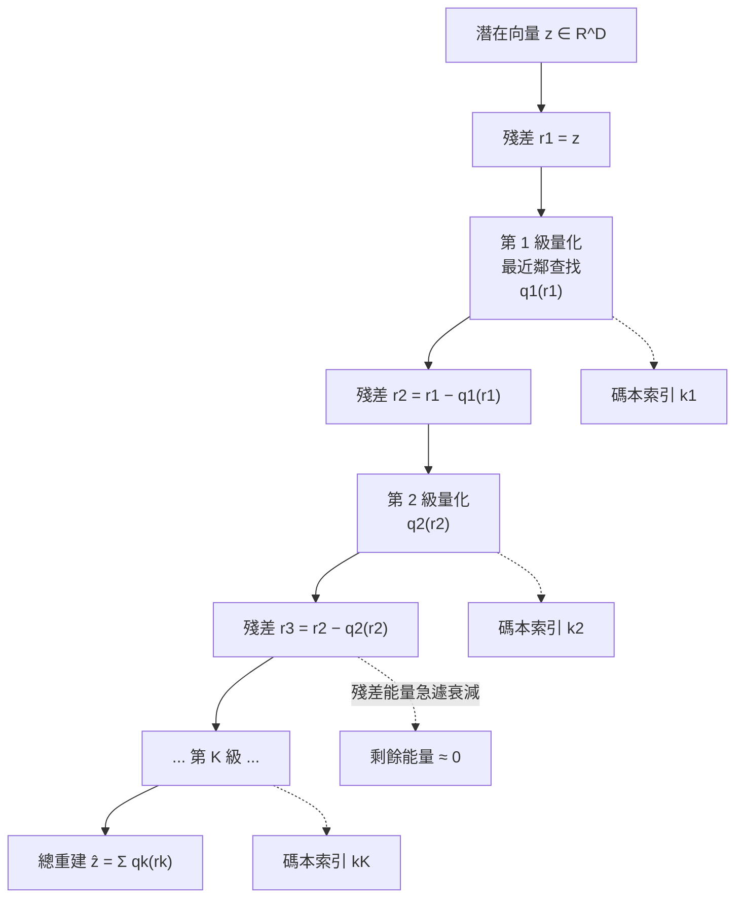
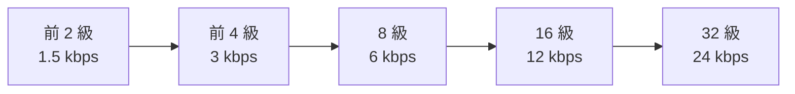
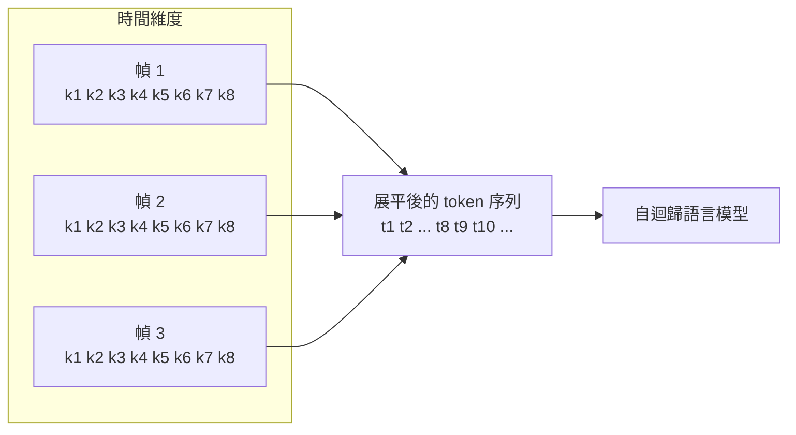

# 9.2 殘差向量量化（RVQ, Residual Vector Quantization）（2018-2023）

## 一、向量量化的基本架構

 向量量化（Vector Quantization, VQ）的想法來自訊號處理與通訊理論：把連續向量空間用有限個「代表點」離散化，再用代表點的索引來代替原始向量。碼本是一個矩陣 $`C \in \mathbb{R}^{K \times D}`$ ，含 $`K`$ 個碼字，每個碼字 $`\mathbf{c}_k \in \mathbb{R}^{D}`$ 與潛在空間同維。給定一個潛在向量 $`\mathbf{z}`$ ，量化就是找最近的碼字：

$$
\mathbf{c} = \arg\min_k \left\| \mathbf{z} - \mathbf{c}_k \right\|_2
$$

這個最近鄰查找（nearest neighbor search, NNS）是整個方案的瓶頸所在：它不可導，因此梯度無法從解碼端流回碼本。求解可以用暴力比對，也可以用乘積量化（Product Quantization）把碼本分解以加速。

最近鄰查找在幾何上等於把潛在空間切成 $`K`$ 個 Voronoi 胞元，每個胞元內的輸入都會被替換成同一個碼字。這個觀點立刻解釋了兩件事。第一，量化誤差的形態是「有界的方向性扭曲」，而不是獨立的隨機噪聲：同一胞元內的所有輸入都被拉向同一個代表點，因此誤差之間高度相關，會形成方向一致的失真。第二，誤差的下界由胞元的直徑決定，而不是由碼字數量決定；只要某個方向上的輸入分佈很寬，即使碼本很大，那個方向上的胞元依然很長。這就是「碼本更大不一定更好、資料分佈的各向異性才是關鍵」的來源。

在聲音領域，向量量化的另一個源頭是說話人聲碼（speech codec）的經典架構。Gray 與 Neuhoff 建立的「先做 LPC 分析，再用向量量化量化 LPC 參數」的兩段式設計，曾是低比特率語音編碼的主流。其教訓是：若第一段分析本身是有損的，第二段量化再精確也救不回來。這條教訓在神經編解碼器裡以更精緻的形式再現——潛在表示的品質決定了量化誤差的動態範圍。

## 二、殘差向量量化

SoundStream（Zeghidour 等人，2021）與 EnCodec（Défossez 等人，2022）採用的殘差向量量化（Residual VQ, RVQ），是把單一巨大碼本拆成多級串聯的量化器。定義殘差序列：

$$
r_1 = z, \quad r_k = r_{k-1} - q_k(r_{k-1})
$$

其中 $`q_k(\cdot)`$ 是第 $`k`$ 級的最近鄰量化器，輸出第 $`k`$ 級選中的碼字。第 $`K`$ 級之後，總量化結果為各級之和：

$$
\hat{z} = \sum_{k=1}^{K} q_k(r_k), \quad r_{K+1} = r_K - q_K(r_K)
$$

 關鍵在於**每一級只負責前一級留下的殘差**。第一級碼本的作用是把 $`\mathbf{z}`$ 拉進它覆蓋的某個粗略區域；第二級碼本在該區域內做精細修正；第三級再修正第二級的誤差。於是每一級的碼本都能用很少的條目覆蓋廣闊的範圍，因為它只需要分辨「差異」而非「絕對值」。

這裡的查找有一個容易被忽略的性質：它是**逐級貪婪**的。第 2 級只能在第 1 級已選定的結果上做修正，不能為了讓整體重建誤差更小而回頭推翻第 1 級的選擇。嚴格而言，全域最優的 RVQ 應該最小化總殘差 $`\left\| \mathbf{z} - \sum_k q_k \right\|`$ ，而貪婪解最小化的是逐級的局部誤差。實測中這個差距通常很小，因為第一級的貢獻佔了總誤差的大部分；但在第一級碼本覆蓋不足時，貪婪策略的次優性就會變得明顯——這也是「第一級碼本務必覆蓋完整分佈」這條經驗法則的來源。

## 三、共享碼本與參數量

 一個自然的問題是：每一級是否該有自己的碼本？如果每級都有獨立的 $`K`$ 個條目，參數量就是 $`K`$ 倍。EnCodec 的做法是**多級共用同一組碼本**：每一級都從同一個大小為 1024 的碼本 $`C \in \mathbb{R}^{1024 \times 128}`$ 中挑選條目，但各級的查找是在不同的殘差空間上進行的。

這個設計的巧妙之處在於碼本條目會被「分層複用」。第 1 級需要覆蓋整個潛在空間的分佈，第 2 級覆蓋的是第 1 級殘差的分佈，而殘差的分佈天然更集中、動態範圍更小。同樣的 1024 個碼字，在殘差空間裡能覆蓋得比在原始空間裡更細密。

把參數量算清楚：單一共享碼本含 $`K D`$ 個參數， $`K = 1024`$ 、 $`D = 128`$ 時是 131072 個，佔 EnCodec 編解碼器總參數的比例只有個位數百分比。若每一級都配獨立碼本，參數量就變成 $`N K D`$ ，8 級時超過一百萬，逼近整個編解碼器的規模，而重建品質的提升遠不足以支撐這份代價。共享的另一個好處是**語意層級的一致性**：因為所有級別共用同一個碼字空間，不同級別選到的「形狀」彼此可比較，模型在第一級學到的粗分類可以直接複用到後續級別的細化上。

從參數效率看，共享碼本的代價幾乎為零：單一碼本只有 13 萬個參數，相比數百萬級的卷積編解碼器可以忽略。真正的成本在於每幀要輸出 $`K`$ 個索引。

## 四、碼本容量與比特率的關係推導

把碼本大小與比特率放在一起算，就能看清 RVQ 的設計意圖。設每一級碼本含 $`K`$ 個條目，則每幀每一級的索引需要 $`\log_2 K`$ 個比特； $`K = 1024`$ 時恰好是 10 個比特。若堆疊 $`N`$ 級，每幀的索引總長度是 $`N \log_2 K`$ 個比特，再乘上幀率 $`f`$ 就得到比特率：

$$
R = f \cdot N \log_2 K
$$

代入 EnCodec 的數字： $`f = 75`$ 幀每秒、 $`N = 8`$ 級、 $`K = 1024`$ ，得到 $`R = 75 \times 8 \times 10 = 6000`$ bps，也就是 6 kbps。若只送前 4 級則是 3 kbps，送滿 16 級就是 12 kbps。

這條公式解釋了為什麼「級數」是比特率最靈敏的旋鈕：每增加一級就線性地多出 $`f \log_2 K`$ 比特，儲存與傳輸成本同步上升，而重建品質的邊際增益卻迅速遞減。它也解釋了為什麼碼本大小很少被大幅調高：把 $`K`$ 從 1024 升到 4096 會讓每幀每級的索引從 10 比特漲到 12 比特，總碼率增加兩成，參數量卻從 13 萬暴增到 52 萬。

反過來說， $`K`$ 與 $`N`$ 的乘積關係還決定了**等效組合數**： $`K^{N}`$ 是理論上可區分的編碼組合數。 $`K = 1024`$ 、 $`N = 8`$ 時是 $`2^{80}`$ ，遠大於一段 10 秒音訊可能的內容數；這正是殘差量化能在如此小的碼本上支撐高碼率的根本原因。

## 五、殘差能量衰減與分層的精細到粗糙分解

殘差量化的分層結構可以用能量來刻畫。定義第 $`k`$ 級殘差的能量佔比：

$$
\rho_k = \frac{ \mathbb{E} \left\| r_k \right\|_2^2 }{ \mathbb{E} \left\| z \right\|_2^2 }
$$

實測中 $`\rho_1`$ 往往落在 0.7 到 0.9 之間，代表第一級碼本單獨就攔下了絕大部分的結構； $`\rho_2`$ 通常掉到 0.05 以下，之後每級的衰減更陡。這條衰減曲線正是「精細到粗糙」分解的定量版本：第一級碼本負責的是頻譜能量的大範圍輪廓——基頻落在哪個區間、哪幾個共振峰突出——它的每個碼字覆蓋一大片區域，因此條目數不多也能定位到正確的鄰域；第二級之後處理的是「相對於該區域的偏移量」，動態範圍小得多，同樣數量的碼字能覆蓋得更細緻。末級殘差幾乎是各向同性的細微噪聲，與錄音的麥克風底噪、量化本身引入的隨機誤差混雜在一起，這部分資訊對聽覺的重要性遠低於前幾級——這正是多級設計能把有限比特花在刀刃上的原因。

換句話說，殘差量化不是把一個整數拆成若干位元，而是把一個**連續的重建誤差**拆成若干個**階層性的近似誤差**。第一級近似的是「結構在哪裡」，第二級近似的是「結構偏了多少」，第三級近似的是「偏得有多不規則」。每一層的問題都比上一層更局部，因此所需的碼本容量也小得多。

## 六、最近鄰查找的實作

最近鄰查找的複雜度是 RVQ 中最容易被低估的成本。每一幀每一級都要在 $`K`$ 個條目中找最近者，暴力比對的代價是 $`O(KD)`$ 次乘加； $`N`$ 級合計就是 $`O(NKD)`$ 。以 $`K = 1024`$ 、 $`D = 128`$ 、 $`N = 8`$ 計，每幀光是查找就要百萬次量級的距離運算，在 75 幀每秒下是每秒數千萬次。因此實務上有兩條路。

第一條是**用矩陣乘積把距離計算批次化**。展開：

$$
\left\| \mathbf{z} - \mathbf{c}_k \right\|_2^2 = \left\| \mathbf{z} \right\|_2^2 - 2 \mathbf{z}^{\top} \mathbf{c}_k + \left\| \mathbf{c}_k \right\|_2^2
$$

其中 $`\left\| \mathbf{z} \right\|_2^2`$ 對所有碼字相同，而 $`\left\| \mathbf{c}_k \right\|_2^2`$ 對每個碼字固定，可以預先算好並快取，於是查找退化為一次矩陣乘法加上一個 argmax，在 GPU 上可以極度有效地平行化。第二條是**用近似搜尋換取速度**：FAISS 風格的 IVF（Inverted File）先把碼本空間切成若干 Voronoi 胞元，推理時只在少數候選胞元內精確比對；PQ（Product Quantization）則把 $`D`$ 維碼字拆成若干子空間各自用小碼本編碼，把比對維數降下來。

還有一個容易被忽略的實作重點：**碼本在推論時是常駐快取的靜態資料**。它的體積是 $`K \times D \times 4`$ 位元組，1024 乘 128 乘 4 只有 512 KB，可以完全放進 GPU 的快取記憶體甚至 SRAM。於是實際瓶頸往往不是算力而是頻寬：每一幀都要從快取讀出 $`N`$ 份碼字矩陣。正是這個特性，讓「所有級別共用同一組碼本」變得格外划算——所有查找都指向同一塊記憶體。

## 七、為什麼殘差量化勝過單一大型碼本

 第一個理由是**容量的指數成長**。若單一碼本要達到同等解析度，需要約 $`K^{N}`$ 個條目（ $`N`$ 為潛在維度），這在實務上完全不可行。RVQ 用 $`K`$ 級串聯、每級 1024 條目，理論等效容量是 $`1024^{K}`$ 的組合數，但只有 $`1024 \times K`$ 個參數。

 第二個理由是**比特率的逐級細化**。單一碼本若要支援 1.5 kbps 與 24 kbps 兩種操作點，就需要兩套不同大小的碼本，或者設計複雜的碼本間距機制。RVQ 則天然支援截斷：只用前 $`k`$ 級，就得到一個較粗糙但合法的重建；用滿 $`K`$ 級，得到高品質重建。這就是「可變比特率」的免費午餐——同一組權重，同一串解碼流程，只是送進解碼器的索引數不同。

第三個理由是**殘差能量的超指數衰減**。實測中第一級殘差的能量往往佔總能量的一大部分，而第二級之後衰減非常快，因為高階殘差接近各向同性的細微噪聲，而碼本只需要分辨它的少數主要方向。

第四個理由是**分層語意**。第一級碼本索引大致對應「聲學事件類型」這種粗略類別，後續級別則越來越像「該類別內的細微變化」。這種結構對後續的 token 建模非常友善：語言模型可以先預測粗類別，再細化。

## 八、Token 序列的形狀

一個 RVQ 編解碼器產生的不是一維 token 串，而是**時間 × 級數的二維矩陣**。以 EnCodec 為例：24 kHz、幀長 32 個樣本，幀率 75 Hz；每幀潛在維度 128；8 級 RVQ，每級碼本 1024。於是每幀輸出 8 個索引，每秒 600 個 token。若每個索引以 10 比特編碼，就是 6 kbps。

這個二維結構在進入語言模型時有兩種處理方式：**展平**（把整個矩陣按時間優先展成單一序列）最簡單，但丟失了「跨級別的依賴」結構；**交錯多碼本預測**（interleaved multi-codebook prediction，MusicGen 採用的方式）則把不同級別交錯排列，並讓後面幾級能條件於前面幾級已預測的結果，藉此壓縮序列長度並提升一致性。

## 九、量化誤差如何傳遞到下游語言模型

量化誤差不僅停留在編解碼器內部，它會以「token 序列上的噪聲」形式傳到語言模型裡，這是神經 codec 與傳統 codec 的一個本質差異。傳統 codec 的比特流裡每一位都承載真實的訊號資訊，錯一位就是錯一位；神經 codec 的 token 則是一個離散化後的近似，其序列滿足某個機率分佈，語言模型學的是這個分佈的轉移。

殘差量化讓這個問題變得可分解：第 1 級 token 若錯了，錯的是「粗結構」，也就是音素類型或基頻區間就選錯了，這類錯誤會沿著時間軸傳播，並且可能被語言模型的上下文修正；第 5 級 token 若錯了，錯的是「細節」，模型即使學得很好，解碼回來也只是高頻略有差異。於是各級 token 在下游的可學性並不相同：越前面的級別資訊量越大，也越需要模型投入容量；後面的級別則接近雜訊，可以用更弱的建模能力處理。這正是交錯多碼本預測在設計上必須小心安排各級上下文的原因。

另一個方向的反應是**讓語言模型學會容忍噪聲**。當量化誤差本身是隨機的，模型在足夠資料量下會把這個噪聲吸收成「背景分佈」的一部分：它學到的不是「沒有噪聲的序列」，而是「帶著這份量化噪聲的序列」。這解釋了一個有趣的現象：若換用另一個碼本（或另一個位元率）的 token 序列去做零樣本轉移，品質會明顯下降，因為模型吸收的是特定噪聲的統計特性，而不是抽象的聲學內容。

## 十、與連續潛在表示的對比

為什麼不能讓自迴歸模型直接建模連續的潛在特徵？三個理由。

其一，**離散化是自迴歸訓練的前提**。交叉熵損失要求每一步的輸出是一個機率分佈；對連續向量做最大概然估計，得到的是高斯混合之類的形式，取樣時又難以保證分佈的一致性與可重現性。離散化成有限符號集之後，這一切自動成立。

其二，**語言模型的容量分配以 token 為單位**。一條十萬 token 的序列可以被任何架構的自迴歸 Transformer 直接消費；一條十萬連續向量序列則需要專門設計的連續潛在變數模型，而那類模型的訓練、取樣與工程複雜度都高得多，也難以沿用文字語言模型的全部成果。

其三，**離散化讓量化誤差變成可控且可治理的**。若直接回歸連續特徵，模型面對的是沒有明確類別邊界的連續目標，細微的量化差異會被回歸誤差吸收；一旦離散化，量化誤差的形態就是明確的離散替換，訓練時可以用承諾損失與 EMA 直接治理。代價則是離散化本身帶來的資訊損失——這是本章整個設計要權衡的核心。

## 十一、SoundStream 與 EnCodec 的設計對照

| 參數 | SoundStream（2021） | EnCodec（2022） |
| --- | --- | --- |
| 取樣率 | 24 kHz | 24 kHz |
| 幀長 | 320 樣本（75 幀/秒） | 32 樣本（75 幀/秒） |
| 潛在維度 | 128 | 128 |
| RVQ 級數 | 8 到 32（可變） | 8（另有 16、32 的擴充） |
| 每級碼本大小 | 1024 | 1024 |
| 碼本共享 | 是 | 是 |
| 碼率區間 | 0.9 ~ 6 kbps | 1.5 ~ 24 kbps |
| 訓練資料 | 約 60 小時多樣音訊 | 320 小時高品質音訊 |

EnCodec 特別值得注意的一點是它使用了**因果分塊**的訓練策略：把長音訊切成 1 秒左右的片段訓練，推理時再以固定大小的滑動視窗處理，這讓它能在流式情境下運作。相較之下 SoundStream 則支援因果與非因果兩種模型。

另一個差異在於 EnCodec 的潛在幀長更短（32 而非 320），意味著它保留了更細的時間解析度，代價是潛在序列更長、運算更重。幀長的選擇，反映了「時間解析度」與「序列長度」之間同樣的取捨。

## 十二、從編解碼器到語言模型的過渡難題

RVQ 把連續音訊變成離散序列，看似打開了大門，但從編解碼器走到語言模型還有兩道牆。

第一道牆是**解碼器的能力邊界**。解碼器只能重建它訓練過的音域：EnCodec 在音樂上表現優異，在演講上則需要另一個模型。而語言模型一旦在 EnCodec token 上訓練，它學到的分布就受限於解碼器能表達的聲音集合。任何它想生成但解碼器未曾學會的特徵，都無法被還原。

第二道牆是**token 序列仍然不是文字**。它是連續的時間序列，長度極大，且相鄰 token 之間沒有顯式的語意邊界。文字有詞根、詞綴、空白邊界這種天然的離散結構；音訊 token 則完全沒有。第 10 章要處理的正是這個問題：如何把一個長而稠密的連續 token 序列，交給自迴歸模型而不在時間與序列長度上爆炸。

這裡也埋下第 9.3 節的伏筆：RVQ 之所以能在碼本只有 1024 條目的情況下支撐 24 kbps 的碼率，完全依賴各級碼本的高利用率。若有大量碼字長期閒置，等效容量會遠低於理論值，語言模型的建模效率也隨之崩潰。
