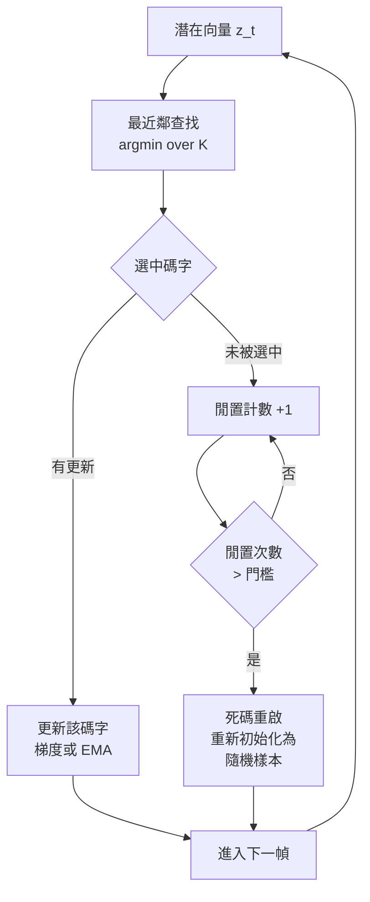
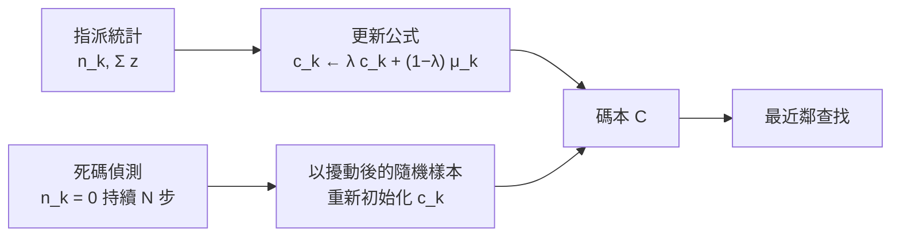
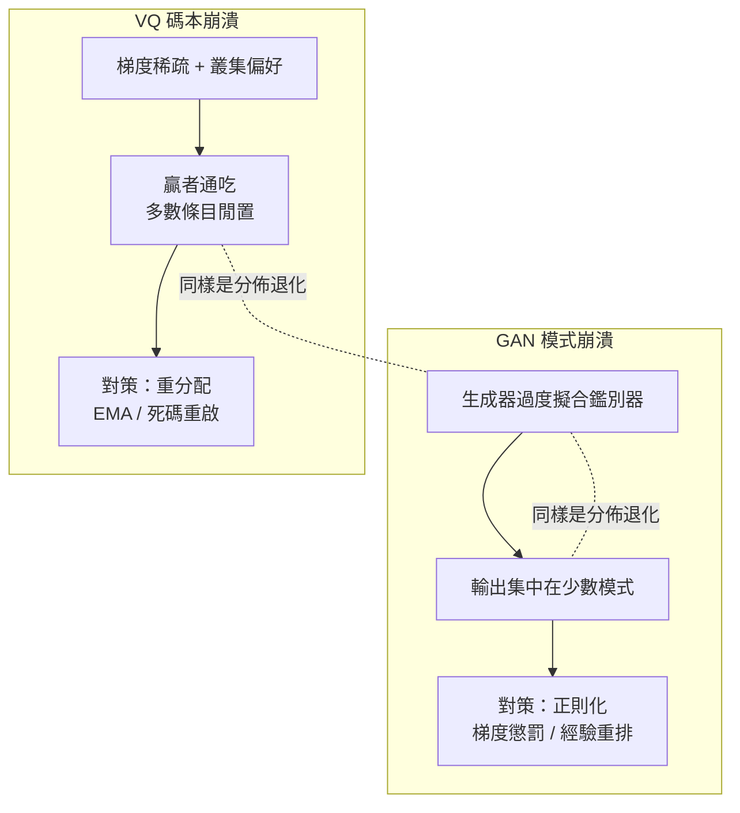

# 9.3 碼本崩潰（Codebook Collapse）與向量量化損失（2018-2023）

## 一、崩塌現象：有效碼本利用率

向量量化的一個隱性假設是：碼本中的每個條目都會在某個時刻被選中。當這個假設失效，就發生**碼本崩潰**（codebook collapse）：少數碼字被大量使用，其餘則長期閒置。

 對一個含 $ K $ 個條目的碼本，可以定義使用率分佈 $ p_k $ 為第 $ k $ 個碼字被選中的頻率比例。若分佈高度集中，則有效碼本大小遠小於 $ K $ ：

$$K_{\text{eff}} = \exp \left( - \sum_{k=1}^{K} p_k \ln p_k \right)$$

 這是個熵的形式； $ K_{\text{eff}} $ 衡量的是「用掉的資訊量」，也就是分佈的香農熵。當分佈完全均勻時 $ K_{\text{eff}} = K $ ，而當所有 token 都落在同一個碼字上時 $ K_{\text{eff}} = 1 $ ——這時量化器等於退化成一個常數。

崩塌的後果是雙重的。編碼端因為實際可用的碼字變少，量化誤差上升，重建品質劣化；解碼端則因為索引的分佈變得高度可預測，語言模型在這個序列上能輕易學到 trivial 的分佈，卻學不到真正的聲學內容。前者是 codecs 的問題，後者是語言模型的問題，而兩者源自同一個病灶。

## 二、碼本利用率的度量：困惑度與死碼比例

碼本利用率可以用幾個互補的指標刻畫。最常用的是**困惑度**（perplexity），即索引分佈的指數熵：

$$\text{PPL} = \exp \left( - \sum_{k=1}^{K} \hat{p}_k \ln \hat{p}_k \right)$$

它與前一節定義的 $ K_{\text{eff}} $ 是同一個量的兩種表達：困惑度就是有效碼本大小。困惑度等於 $ K $ 表示每個條目被使用的頻率完全均等；若困惑度掉到 $ K $ 的百分之一以下，就代表幾乎所有資料都擠在少數幾個條目上。

第二個指標是**死碼比例**：連續 $ N $ 步指派計數為零的條目數佔全部條目的比例。這個指標比困惑度更敏感，因為困惑度反映的是整體分佈，死碼反映的是局部失效——一個碼本可能整體看起來還算均勻，但其中兩成的條目早已徹底失效，只是權重小到不足以影響困惑度。

實測上，神經音訊編解碼器在良好訓練下，1024 條目的碼本困惑度常落在 300 到 800 之間，死碼比例低於百分之一。而一旦退化，困惑度可以在數百步之內從 600 掉到 50，死碼比例同時衝上五成。這種突然的崩落而不是緩慢的下滑，正是碼本崩潰最危險的地方：重建損失曲線看起來還在下降，但語言模型所依賴的 token 統計已經失去多樣性。

## 三、崩塌的成因

 **成因一：梯度的稀疏性。** 最近鄰查找不可導，因此梯度只能透過替代路徑傳給「被選中的那一個碼字」。在一個 mini-batch 含 $ B $ 個樣本、碼本有 $ K $ 個條目的情況下，每一步平均只有 $ B $ 個條目收到梯度。若 $ B \ll K $ ，大部分碼字在很長的訓練期間裡只會被零星地更新，甚至從未被選中過。

**成因二：最小化量化誤差的目標本身有退化傾向。** 訓練的整體目標是把編碼器的輸入拉向碼本，同時把碼本拉向輸入。這個「拉近」的動態有一個穩定態：所有潛在向量聚到少數幾個碼字附近。這不是訓練不夠，而是目標函數在幾何上偏好稠密簇——損失的下降速度在碼字密集處更快。梯度下降在這種地形裡很容易收斂到局部最優：少數碼字贏得競爭，其餘碼字被排除。

**成因三：碼字初始化與資料分佈不匹配。** 隨機初始化的碼字若落在潛在空間的稀薄區域，就永遠等不到匹配的輸入，隨即成為死碼，並且透過成因二加劇叢集化。

 **成因四：高層級 RVQ 中的級別塌縮。** 在 RVQ 架構裡，第 2 級以後的殘差能量本身很小，量化目標的信雜比低得多。此時多個級別可能選到同一個碼字序列，導致實際使用的組合數遠小於 $ 1024^{K} $ 的理論值。

## 四、對策一：直通估計器（Straight-Through Estimator）

第一個必備技術是直通估計器（STE）。Bengio 等人在 2013 年提出的這個技巧，用來處理不可導的量化步驟。其定義是把前向傳播的量化當作恆等映射，反向傳播則直接使用碼本索引的梯度：

$$\frac{\partial \hat{z}}{\partial z} \approx \mathbf{1}$$

 實作上，量化器的前向傳播是 $ \hat{z} = \mathbf{c}_{k^*} $ ，反向傳播則把來自解碼器的梯度 $ \partial \mathcal{L} / \partial \hat{z} $ 原封不動地當成 $ \partial \mathcal{L} / \partial z $ 傳回分析器，並且把同一梯度分給被選中的碼字。

STE 解決的是「梯度斷裂」，但它本身有兩個問題。第一，它是一個偏誤估計：量化操作其實改變了向量方向，STE 卻假裝沒有。第二，只靠 STE，碼本的更新完全依賴解碼端的下游梯度，訓練早期非常不穩定——此時碼本還是隨機的，下游梯度幾乎沒有資訊量。

直通估計器有幾個常見變體。第一是**梯度縮放**：直接使用單位梯度意味著分析器收到的梯度大小與重建損失的尺度脫鉤，訓練早期與後期的波動很大。於是實作上常乘上一個縮放係數：

$$\frac{\partial \hat{z}}{\partial z} \approx \lambda_{\text{ste}} \mathbf{1}$$

$ \lambda_{\text{ste}} $ 通常落在 0.5 到 1 之間，也常見讓它隨訓練線性衰減到 0，讓後期的量化映射逐漸逼近恆等映射。第二是**輸入量化直通**：把 STE 從「編碼器到解碼器」的這一段擴展到量化器自身。對被選中的那個碼字，梯度原封不動地傳回；對未被選中的碼字，則不傳梯度，或傳一個微小的負梯度作為「遠離」的信號。第三是**梯度整形**：因為量化的真正誤差是隨機方向的小擾動，方向資訊其實主要來自梯度中最穩定的低頻成分，因此實作上會對回傳的梯度做低通處理，抑制高頻雜訊對碼本的干擾。

## 五、對策二：承諾損失與碼本損失

第二個必備技術是加入兩個直接作用於量化誤差的輔助損失。承諾損失（commitment loss）拉近編碼器輸出與被選中碼字之間的距離，讓分析器的輸出不會漂移到碼本覆蓋範圍之外；碼本損失（codebook loss）則把碼字拉向被它們解釋的編碼器輸出。兩者合起來是：

$$\mathcal{L}_{\text{VQ}} = \sum_t \left[ \beta \left\| z_t - \operatorname{sg}[q_t] \right\|_2^2 + \gamma \left\| \operatorname{sg}[z_t] - q_t \right\|_2^2 \right]$$

 其中 $ \operatorname{sg}[\cdot] $ 表示停止梯度（stop-gradient）， $ \beta $ 是承諾損失權重， $ \gamma $ 是碼本損失權重。總損失為：

$$\mathcal{L} = \mathcal{L}_{\text{rec}} + \mathcal{L}_{\text{VQ}}$$

| 損失項 | 作用對象 | 梯度流向 | 超參數作用 |
| --- | --- | --- | --- |
| 重建損失 | 解碼器與分析器 | 全網路 | 決定保真度 |
| 承諾損失 | 分析器（輸出） | 僅編碼器 | 過小則編碼器亂跑 |
| 碼本損失 | 碼本（條目） | 僅碼本 | 過小則碼本更新太慢 |

 這裡的設計意圖是**解耦兩個方向的更新速度**。承諾損失的作用是防止編碼器輸出漂移：若某個 $ z_t $ 遠離所有碼字，承諾損失會把它拉向最近的那個，保證分析器的輸出永遠留在碼本的有效範圍裡。碼本損失的作用則是讓碼本追上編碼器，但因為用了停止梯度，兩者不會互相追逐形成震盪。

 常見的權重選擇是 $ \beta = 0.25 $ 、 $ \gamma = 1.0 $ 。有趣的是，承諾損失的權重通常刻意調得比碼本損失小，這暗示了一個經驗事實：讓編碼器適應碼本，比讓碼本追著編碼器跑更容易。

$ \beta $ 與 $ \gamma $ 的取值決定了「誰追誰」的動態。 $ \gamma $ 太小時碼本更新太慢，編碼器的輸出已經漂到碼本覆蓋範圍之外，承諾損失被迫承擔全部修正責任，量化誤差長期居高不下； $ \gamma $ 太大時碼本會被單一批次的雜訊拖著走而來回震盪，量化誤差同樣上升。換言之，兩個係數都存在一個「太小則不動、太大則亂動」的失效區間。

還有一個容易忽略的交互作用：當第 9.2 節的多級 RVQ 與這套損失並用時，高階殘差的信雜比很低， $ \beta $ 對高階的約束反而可能有害——它會強迫分析器去精確對齊那些本來就接近隨機噪聲的方向。實作上因此常對不同級別使用不同權重，或對最高幾級的殘差乾脆不施加承諾損失。

## 六、對策三：EMA 更新與死碼重啟

第三個、也是最有效的對策，是**放棄用梯度更新碼本**，改用指數移動平均（Exponential Moving Average, EMA）。

碼本更新的 EMA 形式為：

$$c_k^{(t)} = \lambda \, c_k^{(t-1)} + (1 - \lambda) \, \mu_k^{(t)}$$

 其中 $ \mu_k^{(t)} $ 是第 $ t $ 步所有被指派到碼字 $ k $ 的編碼器輸出的平均值，而 $ \lambda $ 是衰減係數（常見取值 0.99）。

 EMA 的三個優點很明顯。第一，**更新量與梯度大小脫鉤**：EMA 的步長固定為 $ 1 - \lambda $ ，不會因為下游梯度突然變大而讓碼字劇烈跳動。第二，**更新方向是聚類中心而非單一樣本**：這相當於把碼本當成 K-means 的中心點在線更新，比 SGD 更貼近量化器的真正意圖。第三，**更新量不隨 batch 大小縮放**： $ \mu_k $ 是平均， $ n_k $ 是計數，因此不同頻率的碼字都能以合理的速度移動。

 超參數 $ \lambda $ 控制記憶長度。 $ \lambda = 0.99 $ 表示大約 100 步的指數加權移動平均； $ \lambda = 0.999 $ 則是 1000 步。衰減係數越大，碼本更新越平緩、越穩定，但對資料分佈變化的適應越慢；越小則更新快、容易受離群樣本干擾。

$ \lambda $ 的取值還要與更新的時間尺度對齊。有效記憶長度約為 $ 1 / (1 - \lambda) $ ， $ \lambda = 0.99 $ 時是 100 步。訓練中每一步處理一批音訊，在 24 kHz、75 幀每秒的設定下，一秒的音訊就有 75 幀，因此 100 步的記憶相當於一秒多一點的音訊：時間上足以做平滑，卻不足以跨越說話人輪替這種劇烈的分佈變化。 $ \lambda = 0.999 $ 把記憶拉到 1000 步，代價是碼本對新領域的適應明顯變慢。實務上常見的做法是在預訓練階段用較小的 $ \lambda $ 追求快速適應，微調時再調高以穩定收斂。

 **死碼重啟**是 EMA 的必要補充。當某個碼字的指派計數 $ n_k $ 連續 $ N $ 步（例如 100 或 200 步）為零，就把它重新初始化：一種常見做法是從當前的批次輸入中隨機抽一個 $ z $ 並加上少量隨機噪聲，另一種是從一個小型「候選碼字池」中抽取。這個機制保證碼本的每個條目都有機會重新找到自己的生態區。

 實作上通常還要避免「重啟風暴」：若同一批次有太多碼字被判死，全部重啟會讓碼本瞬間失去結構。因此常見做法是每次重啟的數量上限，例如每 $ N $ 步最多重啟 $ 1/K $ 比例的碼字。

死碼重啟並非無害。它把一個碼字直接搬到資料分佈的某個隨機點上，但這個點未必是「最容易被解釋」的區域——事實上，一個被重啟的碼字若剛好落在某個密集簇內，會立刻與簇內原有的碼字爭奪相同的樣本，兩者很快就分裂出新的分工，等於白白浪費掉一個條目。反過來，若重啟時選到了極度稀疏的位置，它會長期再次死亡，形成重啟循環。因此重啟樣本的選擇策略（取批次中最遠離現有碼字的樣本，或取稀疏度最高的區域）會直接影響恢復效果。

## 七、與權重量化的對照，以及資訊論的視角

這裡有個容易混淆的對比值得說清楚。**神經網路量化**（例如 INT8 權重量化、權重量化的 LLM 推論加速）量化的是「權重」，也就是網路參數本身，目的是在推理時節省記憶體與頻寬。

**語音編解碼器的向量量化**量化的是「訊號」，也就是輸入訊號經分析後得到的潛在表示，目的是把連續訊號壓成可傳輸、可建模的離散符號。兩者的數學工具相似（都是向量量化），但目標函數、失效模式、補償機制完全不同。權重量化失效時會表現為精度下降，通常有 per-channel scale 與 zero-point 來補償；向量量化失效時表現為碼本利用率下降，而且**沒有 per-sample scale 這種簡單的補償手段**，因為縮放會改變最近鄰的選擇結果。

 從資訊論的角度看，編碼的關鍵不在於「量化得多精確」，而在於「符號序列有多可預測」。若一個編碼器產生的 token 序列中，第 $ t $ 個 token 在給定前文後的條件熵是 $ H $ 比特，那麼算術編碼理論上的下界就是 $ H $ 比特每秒。而崩潰的碼本會讓符號分佈退化：序列變得更容易預測，但可還原的資訊量同時減少。真正的壓縮碼率應該是編碼器實際耗用的比特數除以解碼後的重建品質，與任何獨立的分佈指標都不相同。

## 八、與對抗訓練模式崩潰的對比

碼本崩潰與對抗訓練中的**模式崩潰**（mode collapse）在表面現象上非常相似——分佈退化到少數幾個輸出模式——但成因與對策幾乎相反，這種對比值得單獨說明。

GAN 的模式崩潰是**生成器**過度擬合鑑別器分佈的結果。當鑑別器變得容易騙（例如只學會區分「模糊」與「不模糊」），生成器就發現只產出少數幾個高分的樣本最安全，多樣性被放棄。對策是**正則化**：經驗重排、梯度懲罰、批次的混合，以及改變鑑別器的輸入分佈。

VQ 的碼本崩潰則是**碼本**與資料分佈之間的動態失衡。碼本並沒有「選擇安全策略」的動機，它只是因為梯度稀疏與叢集偏好而讓贏者通吃。對策是**重分配**：EMA 更新、死碼重啟，以及提高資料的覆蓋度。

因此兩者的處方剛好相反：GAN 要防止模型過度集中，VQ 要主動打破集中。這也解釋了一個看似反直覺的組合——把神經編解碼器改成對抗式訓練時，必須非常小心鑑別器的權重。過高的對抗權重會讓解碼器傾向於輸出少數「最像真實錄音」的模板，進而讓分析器的輸出分佈收縮，間接誘發碼本崩潰。對抗訓練與離散化之間的耦合，比想像中更緊密。

## 九、容量匹配：碼本大小、級數與資料量

最後是一個純粹的容量匹配問題。 $ K $ 與 $ N $ 決定了可用的組合總數 $ K^{N} $ ，也決定了每幀的比特數 $ N \log_2 K $ 。實務上兩者往往同時調整，理由是它們受同一個約束：資料量。若一個 1024 條目、8 級的碼本對應的資料只有幾百小時，分攤到每個條目上的樣本數就很少，死碼與低利用率幾乎不可避免；此時更好的選擇可能是縮小 $ K $ 、讓每一級的碼本覆蓋更密的區域。反過來，當資料充足時，增大 $ K $ 與 $ N $ 就能帶來實質的品質提升。

另一個常見的實務判準是**看重建誤差隨級數的下降曲線**。若第 3 級之後每一級帶來的失真下降已經不明顯，就應該在那一級截斷，把省下的比特率讓給語言模型去換更大的模型，而不是無謂地堆疊級數。這也說明了為什麼 EnCodec 要提供 16 級與 32 級的擴充版本：它們服務的是不同位元率的操作點，而不是同一個操作點的更好版本。

## 十、與第 8 章的因果連結：連續韻律與高頻細節

回頭看第 8 章的對抗式聲碼器：VITS 與 HiFi-GAN 之所以需要多週期鑑別器與特徵匹配損失，是因為連續韻律帶來的高頻細節無法用梅爾重建損失捕捉。摩擦音的噪聲成分、爆破音的尖銳瞬態，本質上都是**連續分布的細微結構**。

而 RVQ 的存在理由，正是這些細微結構需要被保留。單一粗量化只能給出「這是什麼音」的離散資訊；RVQ 的第 2 級以後量化，恰恰是在記錄「這個音的細微偏差」。沒有 RVQ，語音會變得可以辨識卻機械；有了 RVQ 而碼本又崩潰，則細微偏差會被量化成同樣的碼字，機械感同樣會回來。

這就是為什麼第 9 章三節是一個整體：第 9.1 節建立了讓高保真重建與離散化同時成立的瓶頸架構；第 9.2 節給出了把瓶頸變成 token 序列的具體機制；第 9.3 節處理了讓這個機制在訓練中不失效的工程細節。三者齊備，聲音才能被交給語言模型——而那正是第 10 章 VALL-E 與 MusicGen 的起點。
