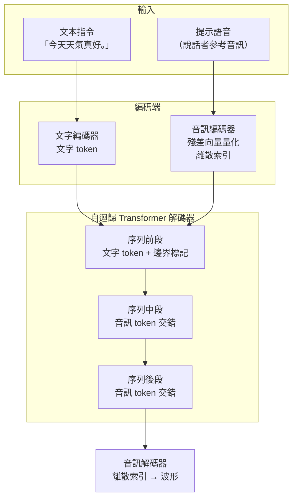

# 10.1 音訊生成作為語言建模任務：VALL-E（2023）

## 一、一個提問方式的轉換

在 2023 年初之前，語音合成的主流心智模型是「專門模型」：Tacotron 這類序列到序列架構、FastSpeech 這類非自迴歸架構、VITS 這類生成對抗架構，它們各自是一個獨立的、神經網路化的聲學模型。訓練資料要標註文字轉音素，音高與時長要另外預測，說話人特徵要另外建模。要做一個新語種或新音色，往往意味著重新準備資料、重新訓練一整套模型。

2023 年初微軟研究院的 Chengzhi Wang 等人發表的 VALL-E，做的事情表面上只是「用文字生出語音」，但它的核心主張是一個提問方式的轉換：文字轉語音不再是一個需要專門設計的聲學建模問題，而是一個大型語言模型的問題。模型接受一段文字作為條件，輸出另一段離散的音訊符號，這與大型語言模型接受前文、輸出下一個詞的結構完全同構。

這個轉換的支撐來自第 9 章。第 9 章描述的神經音訊編解碼器（例如 Meta 的 EnCodec）已經證明，連續波形可以被殘差向量量化成有限碼本中的整數索引序列，且重建品質足以欺騙多數聽眾。既然聲音有了離散的詞彙表，它就可以像文字一樣被 token 化、被拼接、被自迴歸地預測。若記音訊 token 序列為 $`z_{1}, z_{2}, \dots, z_{T}`$ ，文字條件為 $`c`$ ，那麼生成目標可以寫成對整個序列的乘積分解：

$$
p(z_{1:T} \mid c) = \prod_{t=1}^{T} p(z_{t} \mid z_{1:t-1}, c)
$$

這一步形式化，就是把聲學問題一口氣塞進了第 6 章討論過的自迴歸連鎖律框架。VALL-E 並不是第一個做到離散化的工作，但它是第一個把「離散化後的聲音」放進通用 Transformer 自迴歸框架、並以大規模語料展現其泛化力的工作。

## 二、架構：把兩個世界接成一條序列

VALL-E 的整體結構可以拆成四個部分：文字編碼器、音訊編碼器、自迴歸 Transformer 解碼器、以及音訊解碼器。音訊編碼器與解碼器沿用第 9 章的成果——一個以類似 SoundStream 的設計為基礎、內建殘差向量量化的編解碼器，輸出固定速率的離散索引。文字編碼器把輸入的文本轉成文字 token。自迴歸 Transformer 解碼器則是整個系統的心臟。

關鍵在於序列的排布方式。VALL-E 不是先編碼完整句子的文字、再另外生成一整段音訊；它把文字 token 與音訊 token 放在同一條序列中，交錯排列。文字部分放在序列前段，音訊部分接在後段，而中間可以插入一個「文字邊界標記」用來切分。於是模型的注意力可以橫跨兩種符號，音訊 token 的預測條件裡天然包含了文字的全貌，這種交錯讓模型學到的不是「文字到音訊」的單向映射，而是同一個上下文裡兩種符號的共同演進。

一旦兩個模態共用一條序列，「提示」這個概念就自然出現了。如果序列的開頭先放一段由參考音訊編碼而來的音訊 token，模型在後續生成時就會受到這段前綴的制約——這正是第 10.2 節要展開的零樣本聲音複製機制。音訊提示與文字提示在這裡不是兩套機制，而是同一個序列裡的兩種前綴。

## 三、三階段訓練：一條被資料量逼出來的因果鏈

VALL-E 的訓練過程分成三個階段，這個分法不是隨意的，而是被不同資料規模硬性逼出來的。

第一階段是文字轉文字的預訓練。模型只學會語言模型本身：給定一段「文字加標記」序列，預測下一個 token，不涉及任何音訊。這一步的關鍵在於，它讓模型能夠利用海量的純文字語料（第 9 章說過，語言模型的 Scaling Law 只有在文本這種近乎無限量且免費的語料上才最為強大），從而獲得對語法、事實、推理與世界知識的完整建模能力。這也意味著，音訊生成的「語言智慧」其實是從文字預訓練繼承來的，而不是從音訊資料裡學到的。

第二階段是文字轉音訊的訓練。模型開始在序列中插入音訊 token 序列，學習從文字條件生成對應的音訊。這一階段的訓練資料是 700 小時量級的已標註語音。之所以不能把第一階段和第二階段合併，是因為可用的「文字加上對應音訊」配對資料，量級遠小於純文字語料。

第三階段是累積資料上的微調，用的是 60,000 小時量級的語料，並且同時包含文字轉文字與文字轉音訊兩種任務。這個階段把模型從「大致會說話」推到「在多種場景下都能聽懂並回應」。

為什麼需要這樣的分工？理由是容量與資料的不對稱。第一階段的目的是把模型做大、把語言能力做深，這需要配對資料之外的大量純文字。第二階段的目的改為建立跨模態對齊——模型必須學會「這串文字該對應哪串音訊」，而這需要真正帶有音訊的資料。第三階段的微調把兩種能力結合，並且用上更多樣的場景。若把三件事塞進單一階段，模型要同時面對「語言深度」與「模態對齊」兩個彼此競爭的梯度需求，訓練會極不穩定。

## 四、推理時的隨機性與多樣性

VALL-E 的解碼是標準的自迴歸取樣：在已生成的前綴條件下，反覆預測下一個音訊 token 的分佈，再從中取樣。這裡有兩個關於語音的特殊性。

第一，音訊的取樣不是均勻的。語音裡存在大量靜音與低熵區段，若在整個詞彙表上均勻取樣會產生大量雜訊。因此實作上常對分佈做溫度調整，讓高機率的音訊片段被優先選中，同時維持一定機率的隨機性。這種做法讓模型在多次嘗試中能產生不同但都可接受的語音。

第二，同一句文字可以對應多種合理的語音表現——不同的語氣、重音分布、停頓位置，甚至不同的發音習慣。自迴歸取樣天然地保留了這種多樣性，而這正是傳統前饋式 TTS 難以做到的：那些模型通常把隨機性侷限在 durations、pitch、energy 這幾個顯式建模的維度上，語音的主體內容仍是確定性的。VALL-E 把隨機性還給了整段訊號。這也意味著，同一段文字可以在音色不變的前提下反覆生成，用於產生多個版本的朗讀。

## 五、上下文學習的能力與它的意義

把聲音放進自迴歸序列，最直接的技術红利是上下文學習能力也一併被繼承了。所謂上下文學習，就是模型不經過任何參數更新，僅僅靠提示序列中出現的範例，就推斷出任務的規則。

VALL-E 這類模型在推理時只要在序列前端放入一段「示範音訊＋對應文字」，後面再接新的文字，模型就有機會模仿示範中的說話人特徵、語氣與節奏。這不是一個額外訓練出來的模組，而是自迴歸注意力的自然結果——它與大型語言模型「給幾個例子就會了」的能力在機制上是同一件事。

這個機制的兩面性也必須指出：它很強大，但不可控。模型「學會」了什麼，完全取決於提示裡放了什麼。這意味著一段用來示範正確發音的音訊，也同樣可能被模型誤讀成「要重複這段內容」，進而在輸出中產生多餘或缺失的語句。這種失敗模式不是訓練資料不足造成的，而是上下文機制本身的內生歧義。

## 六、從語音到音效：模型邊界的擴張

VALL-E 的一個容易被忽略的示範，是它不只生成語音，也生成非語音的環境音與簡單音效。這在架構上是自然延伸的結果，只要音訊編碼器的碼本能涵蓋訓練資料中出現的各類聲音，模型就不再區分「這串文字是對話還是描述」。

這件事的意義在於，它把「音訊生成」從一個有明確邊界的語音合成問題，變成一個通用的符號序列建模問題。碼本裡的第 47 號索引究竟代表清脆的爆破音、還是一段雨聲，對模型而言並無本質差別——它只是一個可被上下文預測的符號。這種「模態無知」的性質，正是語言模型擅長的事情：只要訓練資料裡某個符號與某種文字脈絡相關聯，模型就能學會在正確的情境下把它生成出來。

也因此，VALL-E 這類模型可以進一步演化出「跨模態指令遵循」的能力，例如接受「用開心的語氣重複這句話」這類指令。第 10.2 節要說的零樣本複製，是這種上下文機制的直接延伸。

## 七、為什麼這一步重要

如果只是把 VALL-E 當成「又多了一個 TTS 模型」，就低估了它的意義。它的真正重要性在於問題的重新定位：在 2023 年之前，語音生成的主要瓶頸被歸咎於「模型太小」與「需要專門設計的聲學架構」；在 VALL-E 之後，人們開始把瓶頸歸咎於「規模不夠」與「資料不夠」。前者是一個需要研究人員投入架構巧思的問題，後者是一個可以靠算力與資料堆疊的問題。

這個定位轉移產生了深遠的後續影響。它讓語音生成進入大型語言模型的世界，可以直接繼承預訓練、指令微調、對齊微調等一整套方法論。它讓「用文字描述想要什麼樣的語音」成為可能——不僅是內容，還包括情緒、音色、年齡、場合。這也讓語音模型第一次能與其他模態在同一個 token 空間裡互動，為第 11 章要談的全模態模型鋪了路。

更值得注意的是工程文化的轉變。過去的 TTS 競賽比的是 WER、MOS 與參數量；而 VALL-E 之後，比的是資料時數、預訓練 token 數與推理成本。聲音研究的一部分從「聲學工程」正式併入了「語言模型工程」的版圖。

這種轉變也重塑了人才與資源的流向。過去做語音合成需要的是訊號處理、聲學模型與對齊演算法的專業积累；新路線需要的是大規模資料管線、分散式訓練與分散式推斷的能力。於是語音生成的研究開始大量吸 linguistics 之外的資源，模型的規模上限被算力而不是架構決定。

另一個被低估的效應是「模型即平台」。當語音生成的路徑與大型語言模型完全一致，語音模型就可以直接沿用既有的推論最佳化技術——量化、批次處理、投機解碼、快取。它們不再需要一個專屬的部署團隊。據公開報導，2023 年之後不少做語音的團隊把主要工程精力花在讓語音模型「跑得起來」而非「更逼真」，這正是這條路線結構性的紅利。

## 八、侷限：誠實面對

VALL-E 的侷限同樣需要被誠實記錄。它沒有以完整形式公開發布，微軟只釋出少量技術細節與示範，這讓外界難以獨立複現其結果，也讓「60,000 小時」這類數字難以被外部檢驗。它生成的語音在經典評測指標上未必超越同期專門架構的系統，許多人類聽眾認為其表現更接近「機器味十足的合成音」，而非以假亂真的真人。訓練資料的組成與授權狀況也未完整公開，而聲音模型的訓練資料必然涉及大量未經當事人同意的錄音，這在當時尚未成為廣泛討論的議題。

評測本身的困難是更深層的問題。語音合成的品質是高度主觀且多維的：自然度、可懂度、音色相似度、語氣韻律各自成維，且相互權重因使用情境而異。主觀 MOS 聽測成本高、樣本數少；客觀指標如 MCD 或聲學嵌入相似度又常與聽感脫鉤。於是「VALL-E 到底比 FastSpeech 2 好在哪」這類問題，在 2023 年並沒有乾淨的答案。

一個更尷尬的問題是模型規模與輸出品質之間的可預測性。自迴歸離散化模型本質上是隨機取樣器，輸出品質與訓練損失的對應關係比確定性的前饋模型更鬆散，因此「把模型再放大十倍會變好多少」這個在語言模型領域已被反覆驗證的直覺，在語音上未必同樣成立。

最後是對話式語音的表現。VALL-E 的示範多為朗讀式一句話或短段落，而非多輪對話中的自然互動。要在對話場景裡表現自然，需要的不只是音色與韻律，還需要正確的輪替時機、恰當的停頓與反應，以及對對方話語內容的語意回應。這些能力牽涉的不只是聲學生成，還有語意理解與對話管理，因此無法僅靠擴大音訊 token 的預測模型來解決。這個缺口一直留到第 11 章的全模態模型才被正面處理。

## 九、與前後章節的銜接

從全書的因果鏈看，第 9 章把聲音變成了 token，第 10.1 節把生成變成了下一 token 預測，第 10.2 節則把提示變成了上下文機制，第 10.3 節把同一套方法搬到音樂這個更難的領域。而第 11 章將要處理的問題——串聯式系統的延遲、情感表達與錯誤傳遞——恰恰是自迴歸離散化路線在工程化時必然遭遇的三個痛點。

VALL-E 留下的最重要遺產不是某一組數字，而是一個判斷框架：當聲音被離散化，它就進入了語言模型的世界，而那個世界的規則是規模、資料與提示。這三個詞，此後兩年所有的語音生成工作都圍繞著它們展開。

| 面向 | FastSpeech 2 | VITS | VALL-E |
| --- | --- | --- | --- |
| 建模對象 | 連續梅爾譜 | 連續波形（隱變數） | 離散音訊 token |
| 生成方式 | 非自迴歸前饋 | 流匹配 + 對抗訓練 | 自迴歸下一 token 預測 |
| 多樣性來源 | 明確建模的時長、音高 | 隨機潛變數 | 全序列自迴歸取樣 |
| 說話人控制 | 外部參考編碼器 | 外部參考編碼器 | 序列前綴提示 |
| 資料需求 | 數十到數百小時 | 數百小時 | 數千到數萬小時 |
| 主要弱點 | 韻律不自然 | 訓練不穩、假象 | 生硬、評測難、資料不透明 |
