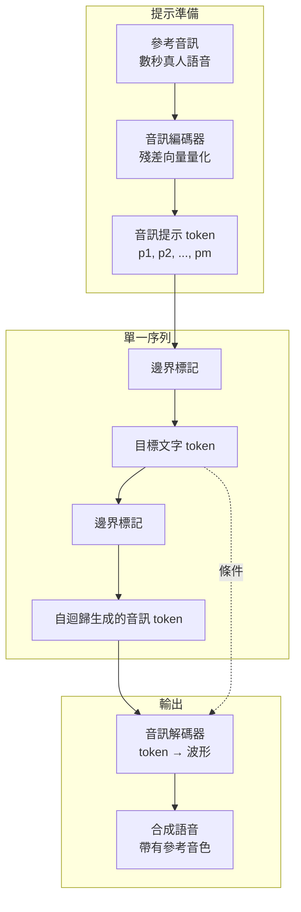

# 10.2 提示式零樣本聲音複製（2023）

## 一、說話人複製的兩條老路

在 2023 年之前，做一個會用某人聲音說話的系統，標準做法是「說話人適配」（speaker adaptation）：先取得目標說話人數分鐘到數小時的錄音，再用這些資料對聲學模型做微調，讓它學會這個人的音色與說話習慣。

這條路徑的代表性工作包括 Google 的 Voicebox、Meta 的 YourTTS、以及開源社群廣泛使用的 GPT-SoVITS 與 RVC 類工具。它們的效果確實不錯，但每一個新說話人都意味著一次新的訓練或微調：需要準備資料、調參、等待收斂，然後重新部署一份模型。對使用者而言，門檻是「我得先錄一段音給你」；對服務端而言，門檻是「我得為每位客戶養一份權重」。

另一條路徑是「說話者嵌入」（speaker embedding）：預先訓練一個編碼器，把參考音訊壓成一個固定長度的向量，再把这个向量作為條件餵進 TTS 模型。這條路徑幾乎不需要額外訓練，但效果的上限受限於那個向量能保留多少資訊——細微的音色特徵、方言腔調、說話節奏通常在壓縮過程中就被抹掉了。

2023 年之後出現的第三條路徑，是把第 10.1 節的自迴歸離散化架構用起來：**提示式零樣本聲音複製**（prompt-based zero-shot voice cloning）。它不需要任何微調，只需要把參考音訊放在提示的位置。

## 二、機制設計：提示即上下文

整個機制的設計非常簡潔，簡潔到值得逐層拆解。

第一步，參考音訊經過音訊編碼器（VALL-E 與同類模型使用的，是第 9 章那套殘差向量量化編解碼器）轉換成一串離散的音訊 token。記這串 token 為 $`p_{1}, p_{2}, \dots, p_{m}`$ 。

第二步，把這串音訊 token 與目標文字組裝成同一條序列。典型排布是「音訊提示 + 文字邊界標記 + 目標文字 + 另一個文字邊界標記」，然後由自迴歸 Transformer 續寫音訊 token。

第三步，模型生成完音訊 token 後，交給音訊解碼器還原成波形。

關鍵在於第三步之前的整件事：**提示音訊與目標文字被放在同一條序列裡，由同一個模型、同一套注意力機制處理**。模型不需要「理解」音色是什麼，它只是在做一件事——把這條序列當成上下文，預測接下來的音訊 token。而在那個上下文裡，已經存在著一段由目標說話人發出的音訊 token。

為什麼這能複製音色？因為同一個編碼器量化的是說話者的全部特徵——音色、音高範圍、共振峰位置、說話速率、聲學信道與房間特性——這些資訊並沒有被特殊處理或分離，而是全部混在同一串符號裡。模型在預測後續 token 時，會把這段前綴所攜帶的統計特徵視為「當前的說話者狀態」，於是自然的延續。

這裡有個漂亮的對稱性：整個機制的本質，是**把音訊生成變成一種模仿式的續寫**。人類的朗讀者聽到一段錄音後繼續朗讀，會自動帶上錄音者的口音與音色；模型做的事在功能上是等價的，只不過它的「朗讀能力」來自在數萬小時語料上訓練出的條件預測能力。

## 三、與 Whisper 提示式零樣本轉寫的平行

這個設計在 2023 年並非憑空出現。第 5 章描述的 Whisper 已經示範過同一個原理在文字模態上的應用：Whisper 是一個多語言的序列到序列模型，它在訓練時被設計成接受「音訊片段 + 文字提示」的輸入，並輸出對應的轉寫文字。這裡的提示可以是語言代碼（前綴為 "Japanese" 之類的標記），也可以是前一句話的上下文。

Whisper 的 zero-shot 能力讓它在**跨語言**轉寫上表現優異：給一段日語音訊加上 "Japanese" 提示，模型就能以日語輸出。這裡的機制正是「提示即上下文」——模型從提示中提取出「接下來該用哪種語言、哪種風格」的隱含狀態。

把兩個案例並排看，會發現它們共用同一個模板：

| 面向 | Whisper 零樣本轉寫 | 零樣本聲音複製 |
| --- | --- | --- |
| 提示內容 | 文字標記（語言、上下文） | 音訊 token（參考語音） |
| 目標輸出 | 對應語言的轉寫文字 | 同音色的合成語音 |
| 學到的隱含狀態 | 目標語言的音韻與拼寫慣例 | 目標說話人的音色與韻律 |
| 訓練條件 | 多語種 ASR 資料 | 文字轉音訊配對資料 |
| 失敗型態 | 語言判斷錯誤、幻覺重複 | 音色漂移、情緒錯配、內容幻覺 |

這個平行說明了一個更一般的命題：**當模型足夠大、訓練資料足夠雜，序列模型的「條件」槽位就是通用的**。同一個槽位，填入文字就控制語言，填入音訊就控制說話人。第 5 章與本章相隔八章，卻是同一個技術思想在兩個模態上的兩次實現。

值得再往前推一步。第 5 章裡那個「用提示來改變輸出風格」的直覺，可以追溯到更早的文字生成史：迴文、押韻、模效續寫，都是人類長期使用「前面放一段，就照那個樣子繼續」的機制。文字生成把這件事外包給了模型，而 VALL-E 這類工作所做的，只是把這個外包的對象從文字換成了一整段帶有物理特徵的聲音。這也解釋了為什麼零樣本複製在技術上不需要新發明——它只需要把模態換掉，機制完全沿用。

另一個平行值得提及的是解碼器的角色。Whisper 用 beam search 在自編碼器架構下做條件生成，而 VALL-E 這類模型用簡單的自迴歸取樣。這個差異不是疏忽，而是模態特性決定的：文字序列的候選空間小、而且通常要求逐字精確；語音的候選空間大、而且容許大量等價表達，因此取樣比 beam search 更合適，也更能帶來多樣性。

## 四、與傳統說話人適配的比較

| 面向 | 說話人適配微調 | 說話者嵌入 | 提示式零樣本複製 |
| --- | --- | --- | --- |
| 目標說話人資料需求 | 數分鐘至數小時 | 數秒 | 數秒 |
| 需要訓練 | 是 | 否（但嵌入器需訓練） | 否 |
| 部署成本 | 每說話人一份權重 | 一個共享編碼器 | 完全共享 |
| 相似度上限 | 高 | 中 | 取決於提示與模型 |
| 韻律保留能力 | 強（可充分微調） | 弱（向量瓶頸） | 中（受上下文長度限制） |
| 能否即時 | 通常需等待微調 | 是 | 是 |

提示式的優勢不在於品質一定更好，而在於**成本結構完全不同**。它的價值是把「取得新音色」從一次工程任務變成一次資料提交動作。

## 五、零樣本的四個挑戰

零樣本複製聽起來很美，但它的四個挑戰在實務上都很具體。

**第一，說話者相似度不穩定**。同一段提示音訊、同一句目標文字，重複生成十次可能得到十個略有不同的音色。這是自迴歸取樣的必然結果——模型每次從分佈中取樣，而分佈的中心並不必然落在參考說話人的音頻上。於是「像不像」變成了一個隨機變數，需要多次嘗試與挑選，也難以在產品中給出穩定的保證。

有一個技術細節值得留意：提示音訊越長、覆蓋的音素越豐富，模型能提取到的說話人統計特徵就越充分，因此相似度的穩定性會提升。但提示越長，留給目標內容的上下文空間就越少，且推理延遲越高。這個取捨沒有免費的解，只能依應用情境調整。實務上常見的折衷，是挑選一段長度適中、音素覆蓋均衡、且在自然情境下錄得的片段作為提示。

**第二，跨內容漂移**。當目標文字的長度、句型或語域與提示音訊差異很大時，模型生成的音色會隨句子而變化。這在技術上可以理解：上下文條件的有效範圍有限，序列越長，開頭提示的影響就被稀釋得越厲害。短句配音常常很像，長段落卻逐漸「變回」一個平均音色——這是使用者最常回報的抱怨。

漂移的本質其實是注意力的分布在「維持音色」與「推進內容」之間做取捨。當目標文字需要模型產生提示中未出現過的音素組合時，模型必須離開參考說話人的音域才能完成，這個離開的動作伴隨著回歸到訓練分布平均音色的趨勢。

**第三，語氣與情緒不匹配**。提示音訊往往是在平靜狀態下錄的，而目標文字可能要求興奮或嚴肅的語氣。此時模型面對一個內在衝突的條件：音色要像某人，語氣卻要另有特徵。實際結果常是音色被稀釋、情緒表達變得平淡，或者情緒表達成為一種失真的誇張。這也是為什麼後續的工作往往要引入顯式的情緒或風格標記作為額外條件，讓模型不必從提示裡猜測情緒。

**第四，生成內容的幻覺**。這是最需要正視的一項。模型有時會在音訊提示之後「插入」一段內容——重複提示音訊的片段、憑空加上的句子、或缺漏應有的部分。在提示式架構裡，模型並不具有明確的「我應該只朗讀這段文字」的硬性約束；它只是在續寫，而「續寫什麼」存在歧義。這與第 4 章 CTC 解碼中的重複刪除問題同源，但在生成端更難用演算法規則處理。

值得對照的是自迴歸文字模型中常見的「重複退化」（repetition loop）現象：模型在某些條件下會陷入相同的 token 迴圈。音訊生成裡的幻覺幾乎是同一個問題的聽覺版本——只不過音訊的語意單位是音素組而不是詞，因此重複往往不是逐字複製，而是節奏與音型的重複。

## 六、評測指標的困境

評測零樣本複製的品質，是這個領域最麻煩的技術問題之一。

主觀路徑是相似度 MOS：由聽眾對「合成音與參考音有多像」打分。問題是這類聽測成本高、樣本數小，且聽眾的判準往往寬鬆——他們能辨認出「是同一個人」與「聽起來像同類音色」之間的差別，但在短樣本下常常把後者也算進前者。

客觀路徑是說話者嵌入相似度：用一個預訓練的說話者辨識模型（例如 ECAPA-TDNN 類架構）把參考音訊與合成音訊都編碼成向量，比較兩者的餘弦相似度。這個指標快速、可自動化，看似理想，但它的度量的是「辨識模型認為是否同一人」，而不是「人耳認為是否同一人」。若合成音恰好落在辨識模型的決策邊界附近，相似度就會劇烈波動。此外，一個明顯不同但音色接近的說話人，可能得到高分；而一個被失真處理的參考音訊，可能得到低分但主觀上其實很像。

於是這條領域出現了一個尷尬的局面：沒有哪個單一指標能穩定地預測使用者是否滿意。實務上的折衷做法是多指標並用，加上人工抽樣，並且把評測單位設在「應用層級的成功率」（例如在下游語音辨識系統中，合成音是否被轉寫成正確句子）而非孤立的相似度分數。

## 七、訓練與資料：零樣本能力的真正來源

零樣本複製的表現，最終還是取決於訓練階段學到了什麼。以 VALL-E 這類模型為例，支撐零樣本複製的訓練資料必須具備三個特徵。

第一，需要足夠的**說話人覆蓋**。若訓練資料集中在少數幾百個說話人身上，模型對陌生音色的泛化能力就會受限。學術語料常見的公開語音庫多為數百到數千說話人，這對語音辨識足夠，但對「複製任意人」而言是明顯的瓶頸。

第二，需要**音訊與文字的嚴格對齊**。模型要學會「這串文字對應這串音訊」，若對齊有噪聲（例如自動轉錄帶來的時間戳誤差），模型學到的對應關係就會模糊，進而影響到複製時的韻律一致性。

第三，需要**同一說話人有多段錄音**。這是零樣本複製相較於純內容生成的額外要求：模型必須有機會看到「這個人的另一段聲音」，才能學會「音色是不隨內容改變的共同特徵」，而不是把音色誤認為內容的一部分。這一點在設計資料集時常被忽略，卻是提示式機制能否泛化的關鍵。

## 八、安全與倫理：進步的代價

任何讓系統能以任意人的聲音說出任意內容的技術，都必然引發深偽與冒用的風險。零樣本複製把這個風險從「需要專家製作」降到「一段音訊加一句話」。

這裡的倫理困境有幾個層次。第一是同意：被複製者的聲音是否被授權使用，在技術上完全無法判斷，責任只能落在服務提供者與使用者身上。第二是濫用門檻：相比需要數分鐘到數小時的微調路線，零樣本複製讓造假的成本降了一到兩個數量級。第三是偵測與標記：合成語音需要被技術手段標示出來，但聲音不像影片有肉眼可辨的框架瑕疵，因此需要依賴特殊的標記機制或水印。

誠實的歷史記錄是：截至 2023 年，業界尚未建立成熟的音訊深偽偵測基準，模型被合成音騙過的案例屢見不鮮；監管層面的規則也遠落後於技術。據公開報導，隨後幾年各國才逐步把語音複製納入明確的授權與標記規範。這不是技術問題的延誤，而是能力擴張與制度反應之間固有時間差的又一次顯現。

值得記錄的是，零樣本複製同時也有明確的正面用途：協助失去說話能力的患者重新發聲、為不會說某種語言的人提供母語配音、讓小眾語言的內容得以被製作。把技術只當作風險來談，同樣是不完整的歷史。

## 九、結語

零樣本聲音複製的重要性在於，它把「每個說話人一份模型」的世界，推向「每個說話人一段提示」的世界。背後是第 10.1 節那個更大的命題：一旦聲音被離散化，它就獲得了上下文學習的能力，而上下文學習是把複雜能力「泛化」到未見個體的最有效手段。

但它同時也把風險從技術層面推到了社會層面。第 11 章將要處理的問題——串聯式架構在延遲、情感與錯誤傳遞上的結構性痛點——與本章的失敗模式其實共享同一個根源：自迴歸離散模型把「內容」與「表徵」分開處理，卻沒有任何機制保證兩者在生成過程中始終保持一致。
