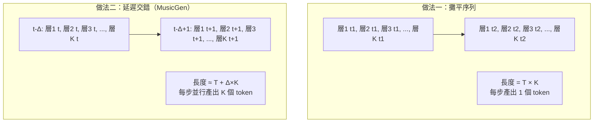
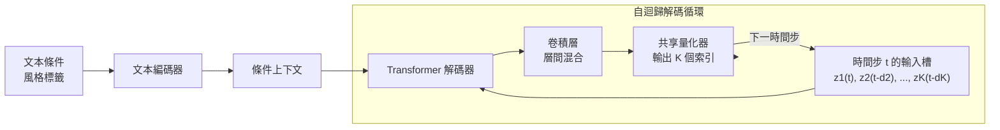

# 10.3 MusicGen 與 AudioCraft 的交錯多碼本預測（2023）

## 一、音樂生成為什麼比語音難

語音生成的本質是「把有限的音素序列，用某個人的音色表現出來」。音樂生成要處理的事情要複雜得多。樂譜結構上是多層次並存的——旋律、和聲、節奏、伴奏編制同時進行；時間尺度上跨越數十秒到數分鐘，遠長於一句話；音色維度上則要涵蓋從獨奏到整個樂團、從古典到爵士到電子音樂的巨大範圍。

更關鍵的是，音樂沒有「文字對應物」。語音可以對應到文字，於是有了第 10.1 節那種「條件生成」的可控性；音樂如果要對應到文字，那份對應本身就是不精確的，需要把節奏、速度、和弦走向、樂器編制這些複雜特徵壓縮成一句話。音樂生成的條件因此天然是模糊的、多義的。

但第 9 章的技術成果在這裡同樣適用。EnCodec 這類神經音訊編解碼器可以用殘差向量量化把音樂也壓成離散 token，而且正是因為音樂的頻寬需求與結構複雜度遠高於語音，量化器需要更多的碼本層級才能維持重建品質。這一點直接決定了 MusicGen 的核心設計。

2023 年，Meta AI 的 Kushal Lakhotia 等人發表了 MusicGen，並將其與 AudioGen 一同納入 AudioCraft 工具集開放發布。MusicGen 的核心貢獻，是提出了一套能讓自迴歸 Transformer 高效處理多層殘差向量量化的訓練與推理方法。

## 二、多碼本的結構問題

第 9 章已經說明，殘差向量量化把一段音訊表示為 $`K`$ 層碼本索引，每一層都在量化前一層的殘差：

$$
z^{(1)} = q^{(1)}(x), \quad z^{(2)} = q^{(2)}\bigl(x - d^{(1)}\bigr), \quad \ldots
$$

第一層承載最粗略的資訊（大致對應頻譜包絡與能量分佈），越往後的層次越是精細的修正。在解碼端，各層的向量依序相加才還原成完整的潛在表示：

$$
\hat{z} = d^{(1)} + d^{(2)} + \cdots + d^{(K)}
$$

這個結構對語音生成而言還好辦，因為第 10.1 節的 VALL-E 只用單層量化或很淺的量化。但對音樂而言， $`K`$ 通常需要做到數十層——因為音樂的高頻細節與諧波結構極為豐富，少數幾層無法重建出可聽的音色。

問題就在這裡出現了。一段三十秒的音樂，若量化幀率為每幀 $`T`$ 個 token、深度為 $`K`$ 層，那麼它的完整離散表示長度就是 $`T \times K`$ 。若把這 $`T \times K`$ 個 token 攤平成一條序列餵給自迴歸 Transformer，會付出三重代價。

第一，**序列長度膨脹 $`K`$ 倍**。三十秒音樂就可能變成數萬甚至更多 token 的序列，訓練與推理成本被數量級放大。

第二，**建模難度被放大**。模型必須在同一條序列裡同時維持 $`K`$ 個層級之間的一致性——第一層要說「這裡有一個小節的鼓」，第十層要說「這裡的鼓是底鼓還是軍鼓」。這些不是同一個時間尺度上的資訊，硬把它們攤平並用同一個自迴歸狀態來預測，會讓注意力機制在互相干擾的資訊之間分配容量。

第三，**推理時的並行性喪失**。傳統自迴歸 Transformer 每一步只能產出一個 token，若序列被拉長 $`K`$ 倍，要生成三十秒音樂就需要 $`K`$ 倍的解碼步數，延遲高得不可接受。

## 三、解法：延遲模式與交錯預測

MusicGen 的解法可以分兩步來看。第一步是**序列排布**：不把 $`K`$ 層攤平，而是讓不同層的 token 在序列上以交錯的方式出現，讓序列長度回到接近 $`T`$ 的量級。

第二步是**並行預測**：在每個時間步，模型不是只預測一個 token，而是一次性預測當前時刻的 $`K`$ 個 token。

更精確地說，MusicGen 使用的是一個**延遲模式**（delay pattern）。在時間步 $`t`$ 上，模型並行輸出一組 token，但它們對應的不是同一幀，而是被刻意錯開的幀：最粗的第 1 層對應幀 $`t`$ ，第 2 層對應幀 $`t - d_2`$ ，第 3 層對應幀 $`t - d_3`$ ，依此類推，其中延遲量 $`d_k`$ 隨層級遞增。

這個設計的直覺來自殘差量化的因果結構。量化層 $`k`$ 依賴層 $`k-1`$ 的殘差，因此在給定幀 $`t`$ 的粗略資訊之前，細緻層的 token 並沒有充足的上下文。延遲模式讓每一層的 token 在序列上「落後」粗層若干幀，等粗層的資訊沿序列自然傳播之後，細層的 token 才需要被預測。

於是序列的排布是這樣的：幀 $`t`$ 的第 1 層 token 出現在位置 $`t`$ ，幀 $`t - d_2`$ 的第 2 層 token 出現在位置 $`t`$ 的同一個時間槽，之後依序類推。

$$
\text{seq}(t) = \bigl(z^{(1)}_t,\; z^{(2)}_{t-d_2},\; z^{(3)}_{t-d_3},\; \dots,\; z^{(K)}_{t-d_K}\bigr)
$$

這樣一來，總序列長度從 $`T \times K`$ 降到約 $`T + d_K \times K`$ ，而每個時間步模型並行輸出 $`K`$ 個 token，總解碼步數大幅下降。

在實作上，MusicGen 讓每個時間步的輸出經過一個卷積層（用來在層間混合資訊），再送入共用的碼本量化器，把連續輸出轉成 $`K`$ 個離散索引。

## 四、延遲模式為什麼有效

延遲模式的設計值得再往下一層追問：為什麼讓細層「落後」粗層，會比讓它們同時刻預測更好？

理由有三個。

**第一是資訊的因果可得性**。第 $`k`$ 層的 token 描述的是前 $`k-1`$ 層殘差的高頻細節，這些細節在時間上並不獨立於粗層所定位的內容。若要求模型在同一時刻同時決定「這裡有個音符」和「這個音符的高頻成分長什麼樣」，後者缺少前者的約束，預測難度顯著上升。延遲讓粗層先在序列上「跑一段」，細層在更靠後的位置才需要被預測，此時它可以參考到已經生成的粗層 token，條件更充分。

**第二是注意力分工**。序列裡每個位置現在承載的是同一幀在不同粒度上的資訊，而不是跨幀資訊的堆疊。注意力模組在序列方向上做的是「往前的上下文」聚合，在通道方向上做的是「跨層的混合」——後者由那個卷積層承擔。這樣的分工比讓模型用同一套權重同時處理兩種粒度要乾淨。

**第三是訓練與推理的一致性**。延遲是模型在訓練時就學到的結構，推理時同樣適用，不需要額外的對齊步驟。相較之下，某些「先產生粗層、展開後再細化」的方案（例如 MusicLM 的兩階段生成）在推理時需要中間步驟的重新排程，複雜度較高。

順帶一提，延遲模式並不是音樂生成的專利。同樣的「分層 token 交錯排布」思路，在文字的多層表示（例如字元、詞、句的多粒度混合）與影像的多尺度 tokenization 中都出現過。MusicGen 的貢獻，是把它在一個公開、可複製的規模上實現並開源。

## 五、與 MusicLM、AudioLDM 的路線比較

2023 年音樂生成領域並非只有離散化一條路。

**MusicLM**（Google，2023）走的是階層式 token 的自迴歸路線，但它與 MusicGen 的差異在於 token 的來源。MusicLM 從**直接的音訊量化**出發，同樣使用類似的分層表示；差別在於它另外訓練了一個**語義 token 模型**，從音訊 token 中抽取更高階的抽象語意單元（例如「小節線、鼓點、和弦變化」這類事件），並讓生成過程分兩階段進行——先在語意 token 空間裡生成高層結構，再展開成具體的音訊 token。這是一種「先寫大綱再填細節」的分層生成策略。

**AudioLDM**（2023）走的則是擴散模型路線，與第 10.1、10.2 節的自迴歸離散化完全平行。它在梅爾頻譜這個連續表示上訓練潛在擴散模型，生成時從高斯雜訊迭代去噪成梅爾譜，再交給第 8 章那樣的聲碼器還原成波形。它的優勢是不需要量化，因此細節保真度較高、訓練與推論都可以並行；劣勢是**無法自迴歸地續寫**——擴散模型的本質是從頭生成一個完整訊號，很難像自迴歸模型那樣「先寫前五秒，再接著寫五秒」。

這個對照揭示了一個核心取捨：**自迴歸帶來續寫能力與可控性，代價是推理的串行性與量化帶來的資訊損失**。MusicGen 與 MusicLM 選了前者，AudioLDM 選了後者。兩條路線隨後在開源社群中都獲得了大量跟隨者。

| 面向 | MusicGen | MusicLM | AudioLDM |
| --- | --- | --- | --- |
| 生成框架 | 自迴歸 Transformer | 分層自迴歸 | 潛在擴散模型 |
| 表示空間 | 離散多碼本 token | 音訊 token + 語意 token | 連續梅爾譜潛在表示 |
| 續寫能力 | 強 | 強 | 弱（難以中途接續） |
| 推理並行性 | 序列步驟決定 | 序列步驟決定 | 可完全並行 |
| 細節保真 | 受量化限制 | 受量化限制 | 較不受限 |
| 文字條件 | 有 | 有 | 有 |
| 公開程度 | 權重開放 | 技術報告 | 權重開放 |

## 六、訓練資料與風格標籤

MusicGen 的訓練資料是約 20,000 小時的授權音樂，其中約 10,000 小時被標註為高品質子集，用於主要的訓練與評測。剩下的部分用於擴充覆蓋面。這個「總量加精選」的結構是當時生成模型的常態做法：先用大範圍資料建立一般能力，再用精選資料收斂到可交付的品質。

授權資料在這裡是刻意的選擇而非巧合。音樂產業的權利結構比語音清楚得多，商業曲庫的授權條款可以被合法取得，這使得 Meta 能夠在協議框架內取得數萬小時的內容——相較之下，語音資料的取得面臨大量未經同意的個人錄音問題，這也是第 10.2 節提到的倫理爭議在語音領域更為尖銳的原因之一。

風格標籤是音樂生成裡特有的條件機制。音樂不像語音有「文字內容」可以直接對應，因此 MusicGen 的文字條件主要描述的是**風格與屬性**——例如「90 年代的搖滾吉他」、「女聲、帶混響的電子流行」、「帶爵士和弦的慢板鋼琴」這類描述。這些標籤來自對音樂庫的人工或半自動標註，本身帶有主觀性與不完整性。

標籤機制的難處在於：風格是很難在文字空間裡精確表達的。同一個標籤「搖滾」在資料庫裡涵蓋了從低保真車庫摇滚到後衛搖滾的廣泛的光譜，同時標註者對邊界案例的判斷也不一致。因此 MusicGen 的文字控制能力，品質高度取決於標籤體系的細緻程度。據公開報導，Meta 後續推出的 MusicGen Stereo 以及開源社群基於 AudioCraft 的各種微調版本，主要的改進方向都是擴充與細化標籤體系，而不是改動骨幹架構。

評測方面，音樂生成的難度比語音更高。語音至少還有轉寫文字可以算 WER 這種明確的客觀指標；音樂則幾乎沒有對應的文字描述，因此主要依賴主觀聽測與 FAD（Fréchet Audio Distance）這類把音訊映射到嵌入空間再比對分佈距離的代理指標。FAD 在音樂領域比在語音領域更常被使用，但它同樣面臨「代理指標與聽感脫鉤」的問題——有時分佈距離極佳的模型，聽起來卻有明顯的機械感。

## 七、文字條件下的音樂生成與開源生態

MusicGen 的一個關鍵設計是**文字作為唯一的控制介面**。使用者不提供樂譜、不提供參考音訊，只給一句文字描述。這使得它比需要音樂家操作 DAW 的傳統工具（例如 MelodyNet 這類需要 MIDI 鋼琴輸入的系統）門檻低了數個數量級。

AudioCraft 工具集的開放發布，構成了 2023 年最重要的生態事件之一。它不只釋出模型權重，還提供了訓練腳本、資料集工具與評測工具，讓研究者與工程師可以在自己的資料上重訓、fine-tune。這種「完整工具鏈」的開放策略影響深遠：它把音樂生成從少數幾家公司的能力變成社群可以共同參與的基礎設施。

後續的生態發展大致沿著三條線。第一是 **AudioGen**，同屬 AudioCraft 系列，處理的是環境音與音效生成而非音樂，把文字條件的音訊生成推向更廣的場景。第二是 **Stable Audio**，Stability AI 在 AudioCraft 的基礎上推出的商用音樂生成產品，把這條路線推向工業化。第三是大量基於 AudioCraft 的社群微調模型，其中不少是針對特定風格、特定遊戲音訊、特定語種的專門化嘗試。

這條生態線的意義在於它印證了一個模式：**當核心架構開源，且架構本身足夠通用，周邊的專門化模型會以數量驚人的速度湧現**。這與第 8 章 HiFi-GAN 成為預設元件時的情況類似——開源帶來的不是單一產品的成功，而是一整個技術族群的形成。

## 八、回到全書主線

把第 10 章的三節放在一起看，會發現一條清晰的主線。

第 9 章完成了最關鍵的一步：把聲音從連續訊號變成離散符號。這個轉換是全書所有後續發展的前提，因為只有離散化，語言模型那套已經高度成熟的技術——自迴歸預測、Scaling Law、上下文學習、指令微調——才能施加到聲音上。第 10.1 節把生成重寫為下一 token 預測，第 10.2 節展示了上下文機制在音色控制上的威力，第 10.3 節則證明同一套方法能處理音樂這種更複雜的結構。

但離散化不是免費的。第 10.3 節的多碼本問題就是代價的第一個面向：量化帶來資訊損失，為了補償就得增加層數，於是模型複雜度與序列長度的管理變成新的工程課題。評測是第二個面向——當品質判斷依賴主觀聽感，領域就難以用數字快速迭代。安全與倫理是第三個面向——當模型能複製任意人的聲音，能力的邊界就從技術問題溢出到社會問題。

而第四個、也是最被低估的面向，是**互動性**。本章的三個模型全都遵循同一個架構：獨立的文字前端、獨立的音訊生成模型、獨立的解碼輸出。它們能聽能說，但彼此之間是串接而非原生耦合。文字到音訊的延遲、音訊到文字的延遲、串接處的錯誤傳遞——這三個痛點正是第 11 章的主題。而那一章要引入的全模態模型，正是企圖把第 9 章的離散化、第 10 章的自迴歸語言建模，與第 6 章的自迴歸傳統重新縫合在一起的嘗試。

換句話說，第 10 章打開了聲音進入語言模型世界的門，但它也讓我們看清：這扇門的框架是拼裝起來的。第 11 章的問題，就是能不能不拼裝。
