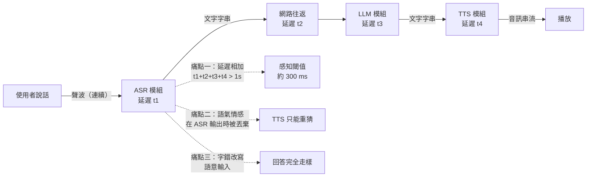
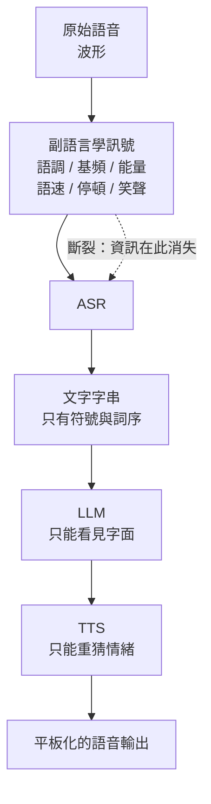
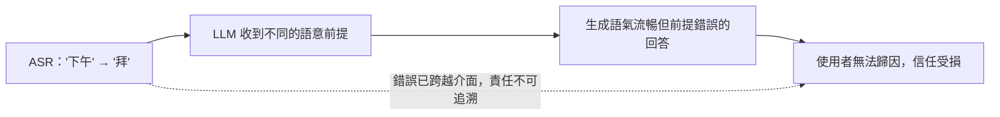

# 11.1 串聯式（Cascade）與原生全模態（Omni-Models）架構的本質差異

## 一、串聯式管線：2023 年以前的主流形態

在 2024 年之前，幾乎所有「會說話的助理」都不是一個模型，而是一條生產線。第一站是自動語音辨識（ASR），把使用者的聲波轉成文字字串；第二站是大型語言模型（LLM），把文字字串當作提示詞，生成回答的文字；第三站是文字轉語音（TTS），把回答的文字轉成可以播放的波形。三個模組各自是一套獨立的權重、獨立的訓練資料、獨立的部署單位，彼此之間的介面只有兩條最窄的管道：一條是文字字串，另一條是音訊樣本。

這個形態並不是工程上的懶惰，而是有充分理由的。ASR 有成熟的公開資料與評測基準，TTS 有近乎無限的供應商，LLM 的擴展紅利又集中在文字上。把它們串起來，可以用各自領域最好的模型快速組出一個「還能聽、還能說」的產品。許多市值數百億美元的語音服務，背後的骨頭就是這三塊磚。

然而串聯式架構的問題不在於某一塊磚不夠好，而在於磚與磚之間的接縫。接縫一旦存在，資訊就會流失，時間就會累積，錯誤就會繁殖。以下三個痛點不是三個獨立缺陷，而是同一個架構事實的三個面向：系統被切成彼此獨立的階段，階段之間只能透過離散的、窄頻寬的符號溝通。

## 二、痛點之一：延遲的相加律

串聯式系統的端到端延遲並非「取決於最慢的模組」，而是各段延遲的總和：

$$
T_{end2end} = T_{asr} + T_{llm} + T_{tts} + T_{network} + T_{buffer}
$$

這裡每一項都無法被其他項補償。若 ASR 需要等使用者把話說完才開始解碼，則這段「尾端靜默」是硬成本：使用者平均說三到五個字就會停頓，系統必須猜測這是不是句尾，猜錯就是一次錯誤的搶答。LLaMA 的網路往返、負載平衡與排隊延遲又疊加上去。TTS 若採非自迴歸架構（如第 7 章的 FastSpeech）可以很快，但串流的語音合成仍需等待第一段音訊緩衝成形才開始播放。



人類對話的感知閾值大約在 300 毫秒左右：超過這個量級，人就會感覺「系統在想事情」而非「在跟我說話」，並傾向於互相補話、打斷或放棄。串聯式管線在良好工程下往往落在數百毫秒到一秒以上，在跨網路、多併發、多語言的實際部署中很容易超過一秒。差距不是最佳化能填平的比例問題，而是結構性問題。

更麻煩的是延遲的非同步性。使用者說話是連續的，但 ASR 的輸出是分段的；LLM 的輸出是全或無的；TTS 的輸出則是句子級的。三種時間粒度接在一起，就產生了無數個「等一下」的縫隙。體驗上最刺目的不是整體慢，而是「停頓位置不對」——回應總是在語意已經結束的空白處才出現。

## 三、痛點之二：副語言學在文字化那一步被蒸發

人類的語意溝通從來不只發生在詞彙層。語調的上揚表示疑問、下降表示確認；基頻的抖動傳達興奮或猶豫；說話速度暴露了緊急或疲憊；停頓的位置標示了段落結構；笑聲、嘆氣、吸氣、喉嚨清嗓，甚至語氣詞拖長的尾巴，都攜帶著情緒與态度的資訊。

串聯式管線的介面是文字字串。ASR 的輸出目標函數是正確轉寫的機率，而正確轉寫的機率與說話者的笑聲無關、與基頻無關、與停頓位置無關。於是所有這些資訊在 ASR 輸出的那一刻被系統性地丟棄：不是模型沒學到，而是它們不在目標函數裡，學了也不被獎勵。

TTS 端拿到的是什麼？只是一串標點與文字。它必須從文字重新猜測語氣：「好。」是贊同、是驚訝、還是無奈？中文的「嗯嗯」、「喔」、「啦吧」幾乎沒有標點可依循。於是 TTS 要嘛輸出一種平板的「機器音」，要嘛依賴有限的標點規則做粗略的情緒切換。資訊在這條管線裡被蒸發了兩次：ASR 端丟一次，TTS 端無法重建。



值得注意的是，人耳判定「這是真人／這是機器」時，最常依據的往往正是這些副語言學線索。因此這個缺陷不只是美學問題，而是直接影響了助理的可信度與陪伴品質。

## 四、痛點之三：錯誤的級聯放大

第三個痛點是錯誤傳遞，而且是雙向的。

第一個方向是輸入端。假設使用者說的是「下週三的會議改到下午」，ASR 誤判成「下週三的會議改到拜」，那麼 LLM 收到的語意輸入就是「拜」而非「下午」——這是一個完全不同的時間點。LLM 會很流暢地針對錯誤前提生成一段完全合理的回答。使用者不會認為這是 ASR 的錯，因為錯誤已經過了一次格式轉換，看起來像是「系統理解錯誤」。錯誤的責任邊界被抹平了。

第二個方向是輸出端。LLM 在不確定時會表現為語氣猶豫、措辭迂迴；TTS 若忠實地重現這種猶豫就會顯得笨拙，若忽略則會把不確定性放大成錯誤的斷言。此外，標點與句長也會影響韻律，TTS 的長句合成策略有時會在句中產生不自然的停頓，把語意切斷。

第三個方向更隱蔽：ASR 的虛幻偏誤。當輸入含噪或音訊品質差時，串聯式系統的 ASR 模組傾向於「猜測出一個合理的句子」而非標記不確定性，這讓後續所有模組都建立在一個自信的錯誤之上。這種自信的錯誤比坦承的錯誤危害更大，因為使用者失去了糾正的機會。



## 五、為什麼「把每個模組做強」無法解決

面對這些痛點，直覺反應是：把 ASR 做更準、把 TTS 做更自然、把 LLM 做更強，串聯式管線不就解決了嗎？答案是不能，因為這三個問題的根源不在模型容量，而在架構本身。

延遲是相加的。把 ASR 的延遲砍掉一半，總延遲只減少了一項的三分之一左右，而且第一段延遲受到資訊論限制：要在使用者說完之前就開始處理，就必須接受「還可能會有後續輸入」的假設，任何串聯式解碼都要為此付出代價。把 TTS 加速也一樣，因為 LLM 那段時間與內容生成的約束仍在。

情感損失是介面窄化的結果。只要 ASR 與 LLM 之間以「正確轉寫的字串」為唯一契約，邊界上就只能通過這條管道。把 TTS 做得極其自然，也只是在用標點猜測情緒——它永遠缺少那個被丟棄的原始訊號。

錯誤傳遞是「階段間隱含假設不一致」的產物。ASR 假設句子是獨立的，LLM 假設輸入是完整的，TTS 假設輸入是乾淨且已定稿的。三個假設互相衝突時，沒有任何單點的強化能修好。

這三點合起來說明：這是架構問題，不是容量問題。而這正是原生全模態模型在 2024 年之後受到重視的原因。

## 六、隱性成本：資料與最佳化的分裂

除了使用者可感知的三大痛點，串聯式架構還承擔著一批隱性成本。

第一是資料無法共享。ASR 受益於數萬小時的標註語音，TTS 受益於數千小時的高品質錄音，LLM 受益於兆級 token 的文字。三套資料的規模、分布與授權條件各不相同，彼此之間沒有梯度可以流通。原生模型則可以在同一個目標函數下共享同一批多模態語料。

第二是無法統一最佳化。串聯式管線的端到端品質是三個局部最佳化的乘積，任何一段的「最佳」都可能與其他段衝突。工程上只能調整介面契約（例如要求 ASR 輸出帶信心權重的中間表示，或讓 LLM 輸出 SSML 標記），這是對架構缺陷的補償性修補，而不是真正的解決。

第三是部署與維運的複雜度。三套模型意味著三套版本、三套監控、三套回滾點，任一環節的版本錯配都會產生難以定位的行為異常。相較之下，單一模型的系統在故障診斷與能力升級上具有根本性的簡化優勢。

## 七、串聯式與原生架構的逐項對照

把前面的分析整理成對照表，可以清楚看到兩種架構的差異不是程度上的，而是結構上的。

| 面向 | 串聯式（Cascade） | 原生全模態（Omni-Model） |
| --- | --- | --- |
| 模組數量 | 三個獨立模型：ASR、LLM、TTS | 單一共享核心，音訊與文字在同一模型內 |
| 模組間介面 | 文字字串（窄頻寬、離散） | 潛在向量序列（連續、寬頻寬） |
| 延遲結構 | 各段相加，且需等待完整輸入 | 可邊聽邊輸出，首字延遲大幅下降 |
| 副語言學資訊 | 在 ASR 輸出時被丟棄，TTS 重猜 | 跨模態保留，語氣可直接遷移 |
| 錯誤傳遞 | 逐級放大，責任邊界不可追溯 | 同一表示空間內可被上下文補償 |
| 訓練方式 | 三套資料獨立訓練，無法共享 | 端到端聯合訓練，梯度可跨模態流通 |
| 最佳化目標 | 各模組局部最佳化 | 單一統一目標，端到端可最佳化 |
| 部署複雜度 | 三套版本、監控與回滾 | 一套模型，診斷與升級大幅簡化 |
| 主要風險 | 接縫處的資訊流失與時間累積 | 訓練資料成本高，評測標準尚未成熟 |

這張表的重點在最後兩列以外的中間四列。它們不是可以靠「多訓練幾個小時」改善的指標，而是「資訊有沒有被允許通過」與「時間有沒有被允許疊加」這類架構層級的取捨。

## 八、把延遲拆開算：一次具體的估算

為了讓「延遲相加」不只是一句口號，我們可以做一次粗略但不算離譜的估算。假設一個中文使用者以每分鐘約 240 字的速度說話，也就是每秒約四個字。若系統必須等待一句話結束才開始處理，一句十個字的短問句約需 2.5 秒。

在此之上，ASR 的解碼本身需要時間。以第 5 章那類 seq2seq 架構為例，即使是非自迴歸解碼，聲學編碼器處理整段音訊並完成交叉注意力的成本，通常也落在數百毫秒的量級。若採用自迴歸 CTC 或注意力解碼，還要乘上輸出步數帶來的額外延遲。取一個保守的中位數，ASR 段約 300 到 500 毫秒。

LLM 段是變動最大的部分。若用大型模型串流生成，首個 token 的到達時間可以很快，但完整回答的長度直接決定了 TTS 何時能開始。以回答約 20 個字計算，在每秒約 15 至 25 個 token 的輸出速率下，生成完畢需要一到兩秒。即使採用最樂觀的串流並行策略——一邊生成一邊合成——網路往返、負載平衡與跨服務的序列化仍然不可避免。

TTS 段雖然可以做到快速，但串流播放需要緩衝。緩衝過小會導致音訊斷裂，過大則直接增加首音延遲。在實務中為了避免斷裂，通常需要數百毫秒的初始緩衝。

三者相加，保守估計在 1.2 到 2 秒之間；最佳化到極致的串聯式系統或許能壓到 700 毫秒上下。而人類對話的自然反應窗口約在 200 到 300 毫秒。差距不是一兩倍，而是三到六倍。

```
mermaid
flowchart TB
    A0["使用者停止說話"] --> A1["等待端點偵測<br/>200 - 800 ms"]
    A1 --> A2["ASR 解碼<br/>300 - 500 ms"]
    A2 --> A3["網路 + 排隊<br/>50 - 300 ms"]
    A3 --> A4["LLM 首 token<br/>200 - 600 ms"]
    A4 --> A5["LLM 生成完整回答<br/>500 - 1500 ms"]
    A5 --> A6["TTS 初始緩衝<br/>200 - 400 ms"]
    A6 --> A7["開始播放"]
    A7 --> SUM["合計 1.2 - 2.0 s"]
```

這張分解圖揭示了一個常被忽略的點：其中沒有任何一段是「特別糟」的。每一段的延遲都落在工程上可接受的範圍內，問題出在它們是串聯的。原生全模態的價值，正是把這條鏈條縮成一條：音訊編碼器滑動處理輸入流，模型持續生成回應 token，音訊解碼器把 token 即時轉成波形，整個鏈條的重疊讓端到端延遲降到數百毫秒量級。

## 九、另一個容易被忽略的代價：資訊帶寬的浪費

除了延遲與語意，還有一個純工程層面的代價常被忽略：資訊帶寬的浪費。

串聯式管線裡，語音的資訊被提取成少數幾百個文字 token。假設一段十秒的語音包含約四十個字，轉錄後的符號量只有幾百個位元組；而原始音訊在 16 kHz、16 bit 的規格下是每秒 32 000 位元組，十秒就是 320 000 位元組。資訊被壓縮了兩個數量級——這對純粹的文字任務是划算的，但對於一個需要「聽出說話方式」的助理而言，卻是把 99% 的表達資訊丟進了垃圾桶。

原生模型保留了這條資訊鏈：音訊編碼器輸出的是與原始時間解析度同階的連續向量序列，每一幀都攜帶基頻軌跡、能量輪廓、時域微結構等資訊。代價是計算量與上下文容量都大幅上升。但這個代價的性質是「資源的代價」，而串聯式的代價是「能力的代價」——前者可以用更多算力與更好的硬體換取，後者只能用架構改變來解決。

這也解釋了為什麼原生模型的算力需求遠高於傳統管線：那不是浪費，而是把被丟棄的資訊重新撿了回來。

## 十、引出原生全模態

原生全模態（Omni-Model）的取向是徹底取消介面。模型的輸入端直接接受音訊，內部用音訊編碼器把波形映射到潛在空間，與文字 token 共享同一個自迴歸語言建模的核心；輸出端則用音訊解碼器從潛在空間直接生成音訊 token 或連續特徵，再由聲碼器還原成波形。文字與聲音在同一個機率模型裡共存，不再是三個獨立模型的接力。

這個改變並非把三個優點相加而已。當聲音不必先變成文字，語氣與情感的資訊就從未被丟棄；當模型不必等待完整辨識結果，延遲就不再是三段相加；當輸入與輸出共享同一個表示空間，錯誤也就失去了在階段之間複製的機會。

本章餘下兩節將深入 11.2 的訓練方法與 11.3 的對齊機制：前者回答「這樣的模型怎麼訓得起來」，後者回答「模型怎麼真的聽懂了情緒與意圖」。但在進入那些技術細節之前，值得先把判準講清楚：全模態模型不是「更好的串聯式管線」，而是另一個物種。它的價值不在於把三個指標各推高一點，而在於把「聽」與「說」之間那條一直存在的接縫徹底拿掉。
