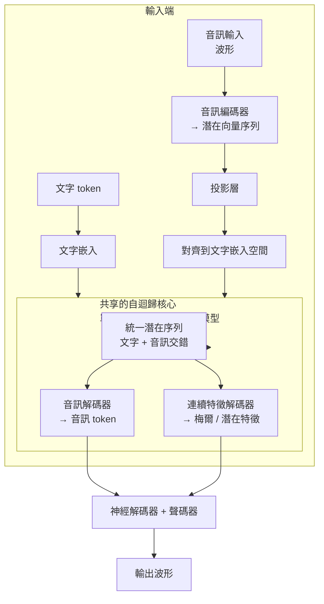
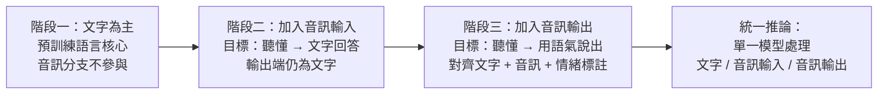

# 11.2 原生全模態（Omni-Model）的端到端聯合訓練（2024-2026）

## 一、2024 年前後的轉向：從「組裝」到「原生」

2024 年起，主流廠商的旗艦模型開始展現出一致的取向：同一個模型同時接受文字與音訊輸入，並能直接輸出音訊。據公開報導，OpenAI 在 2024 年 5 月發表 GPT-4o 時，強調其具備端到端的文字與音訊互動能力，並展示低延遲的「對話式」語音；Google 的 Gemini 系列也陸續推出 Live 類型的即時語音互動功能；Meta 開源的 Llamavoice 系列則把文字到語音的生成與指令遵循合併在同一個模型架構內。Meta 在 2025 年前後發表的 Llama 系列多模態模型同樣把音訊輸入納入統一的多模態編碼框架。

這些系統在工程細節上彼此差異甚大，但共享同一個哲學轉向：不再把「聽」與「說」當成兩個模型的能力，而是當成同一個模型的兩種介面。這就是本章所稱的原生全模態（Omni-Model）。要理解它為何可行，必須回到本書前九章累積的技術資產。

## 二、架構探討：音訊如何接入語言模型

一個原生模型要在同一個機率模型內處理三種東西：文字 token、音訊輸入、音訊輸出。核心的設計選擇只有兩個。

第一個選擇是「音訊編碼器接入潛在空間」。語音編碼器（形式上與第 5 章的聲學前端同源，但規模與訓練方式完全不同）把波形壓縮成一串連續向量，再由一個投影層對齊到文字 token 的表示空間。這個投影層是整個系統的關鍵樞紐：它決定了「聽到的內容」與「讀到的內容」在同一個表示空間裡如何交會。若編碼器輸出的是梅爾譜，模型就只拿到第 2 章那套 80 通道的聽覺刻度；若輸出的是神經編碼器的離散 token，模型就直接沿用了第 9 章的離散化成果。

第二個選擇是「音訊解碼器從潛在空間生成」。輸出端有兩條路線。一條是生成音訊 token：模型在自迴歸解碼時直接產出神經編解碼器的碼本索引，再交由解碼器與聲碼器（第 8 章的 HiFi-GAN 一類）還原波形；這條路線把聲音生成完全變成語言建模，架構最統一，但離散化必然帶來量化誤差。另一條是生成連續特徵：模型產出梅爾譜或更細緻的連續特徵序列，由外部聲碼器負責波形合成；這條路線保留了第 7、8 章對抗與流動模型的成果，聽感較自然，但把「生成節奏」這件事重新推回外部模組。



值得強調的是「共用核心」這件事的重量。如果輸入與輸出走的是不同的骨幹、不同的訓練目標、不同的資料，那麼這只是把串聯式管線塞進一個更複雜的容器裡，並不構成原生。真正的原生意味著文字 token 與音訊 token 在同一個 softmax 的下一 token 預測中被同等對待。

## 三、訓練三階段：從文字到聲音的退火

由於端到端多模態訓練的資料量遠高於純文字訓練，直接混合訓練並不現實。業界廣泛採用的是一種退火式的三階段策略（據公開報導，多數系統的細節未完整公開，但整體輪廓高度一致）。

第一階段是文字為主。模型先以純文字語料完成大部分預訓練，確立語言知識、世界知識與基本的自迴歸建模能力。這一階段的音訊分支可以完全不參與，訓練成本與一般文字模型相當。

第二階段加入音訊輸入。此時音訊編碼器被接入，但輸出端仍是文字。訓練目標是「聽懂並回答」，對齊的是語音輸入到文字輸出的配對資料。這一階段解決的是「輸入端的語音理解」，並且可以在較短的音訊片段（如十幾秒）上進行，成本仍然可控。

第三階段加入音訊輸出。解碼器與聲碼器被接入，訓練目標擴充為「聽懂並用匹配的語氣說出來」。此時標配資料需要同時含有音訊與文字，並且最好含有情緒、韻律等副語言學標註。訓練中通常會凍結或部分凍結編碼器，只調整解碼端與核心的較上層，以避免災難性遺忘。



三階段的優點是工程風險可控：每一階段的失敗都可以歸因，不必在一個龐大的混合目標中除錯。缺點則是階段邊界本身帶來偏見——在第三階段才學會「用聲音回答」的模型，其語言能力可能已被第二階段的語音配對資料分布所侷限。

## 四、端到端聯合訓練的三項優勢

第一項優勢是延遲結構的改變。串聯式管線的延遲是三段相加，而原生模型在理想情況下可以做到「邊聽邊想邊說」：音訊編碼器以固定幀長滑動處理輸入流，模型在收到前若干幀後即可開始產生回應 token，音訊解碼器再把 token 即時轉成波形串流。首字延遲不再需要等完整句子結束。這裡有個重要的取捨：模型若要在未確定語意時搶先回應，就必須接受可能猜錯，因此實務上通常仍設有「語意確認點」——例如偵測到明顯句末時才提交回答，其餘時間則產生等待或確認類的填充發聲。這是一個語意與速度的取捨，而非純粹的工程最佳化。

第二項優勢是情感與語氣的跨模態保留。因為音訊從未被還原成純文字再丟棄，說話者的情緒、語速與停頓可以一路存活到輸出端，並且模型能學到「以困惑的語氣回答困惑的提問」這類跨模態映射。換句話說，語氣不再是被「重猜」的東西，而是被「轉移」的東西。

第三項優勢是錯誤不再級聯。在串聯式管線裡，ASR 的字錯會改寫語意輸入，形成看不見的責任轉移；在原生模型裡，輸入與輸出共享同一個表示空間，模型有機會用整體上下文來補償局部的聽辨瑕疵——這在原理上是可能的，因為它不必把中間結果「提交」成一串不可回溯的字元。當然這不保證更高的字準確率，但保證了錯誤有更大的機率被上下文稀釋。

## 五、技術挑戰：四道牆

**第一道牆是算力。** 音訊 token 序列的長度相對文字 token 呈數十倍甚至更高的膨脹：以每秒數十幀的編碼速率計，一分鐘音訊會展開成數千個向量，而同等語意的文字轉錄可能只有數百個 token。這意味著在上下文視窗固定的模型裡，音訊佔據的容量遠高於文字，訓練與推論成本都隨之放大。

**第二道牆是對齊與節奏控制。** 文字生成沒有節奏問題，音訊生成有。模型必須決定每個音素持續多久、停頓在哪裡、語速多快、如何在句末收束。若音訊 token 序列與文字 token 序列之間沒有明確的對齊關係，模型很容易產生語速失控、長度失調、停頓位置錯誤等問題。第 7 章的長度調節器與音素對齊、第 8 章的單調對齊搜尋，都是在解同一類問題；原生模型要把它們重新整合進一個統一的訓練框架。

**第三道牆是資料成本。** 高品質的多模態配對資料需要真實的語音、可信的文字轉錄，以及更難取得的副語言學標註。標註員標註一條語氣標籤的成本遠高於標註一段文字，意味著這類資料在規模上難以與文字語料相比。許多團隊因此大量使用模型生成的合成語音與自動情緒標註來擴充，代价是合成資料的分布偏差會被模型學進去。

**第四道牆是串流與可打斷性。** 真正的對話體驗要求使用者能在助理說到一半時打斷它。這意味著模型不只要能生成，還要能在生成中途偵測到新的輸入並立即中止，同時處理被打斷後的上下文續接。串流生成的延遲抖動、被切斷的音訊邊界、以及「我先說完」的決策策略，都是比單向問答複雜得多的工程問題。

## 七、訓練目標的數學形式：統一序列上的下一 token 預測

原生全模態的訓練目標可以用一個統一的形式表述。把文字 token 與音訊 token 都視為同一個離散序列上的元素，序列記為 $s_1, s_2, \dots, s_N$ ，其中每個 $s_i$ 可能是文字 token，也可能是音訊碼本索引。模型學的就是標準的自迴歸語言建模目標：

$$
\mathcal{L} = - \sum_{i=1}^{N} \log p_\theta \left( s_i \mid s_{<i} \right)
$$

這個式子看似平淡，但它正是第 10 章那條路線的延伸：第 10 章證明了音訊生成可以用這個式子來做，而原生全模態只不過是把式子裡的 $s_i$ 從「只有音訊」擴展到「文字與音訊交錯」。

關鍵在於交錯的方式。若音訊輸入與文字輸出被視為兩個獨立的序列（例如分別用不同的解碼頭、不同的注意力遮罩），模型實際上學到的仍是兩個任務的聯集，而非真正的聯合建模。只有當它們共享同一個上下文、同一組注意力權重、同一個 softmax 時，「聽到的語氣影響說出的語氣」這種跨模態耦合才可能自發地學到。

這帶出一個實際的架構選擇：音訊輸入是「併入上下文」還是「作為條件輸入」。前者（把音訊 token 直接排進序列）最統一，但序列長度會急遽膨脹；後者（用交叉注意力把音訊表示餵進核心）保留了序列的緊湊性，代價是模型必須學會在兩種資訊流之間做融合。兩種做法在工程上都有實作，取捨點在於上下文容量與融合複雜度之間。

## 八、訓練三階段的資料配比與課程設計

三階段退火的想法雖簡單，但其中的配比設計決定了最終模型的性格。

第一階段的資料是純文字。規模可以很大，因為文字語料的取得成本最低而品質最可控。但有一個容易被忽略的細節：如果這階段完全沒有碰觸音訊，音訊編碼器的權將是隨機初始化的，而隨機初始化的編碼器在第二階段剛接上時會輸出大量雜訊特徵，嚴重干擾文字模型的既有能力。實務上的做法通常是在第一階段就讓音訊分支以「不影響主路徑」的方式存在，例如給音訊分支一個獨立的投影且以極小權重參與損失。

第二階段加入音訊輸入時，資料的關鍵屬性是「音訊 + 對應文字」的配對，而不是孤立的音訊。配對品質決定了模型學到的是「理解」還是「聲學風格轉移」。這一階段的樣本長度通常較短，因為完整的會話級對齊資料極為稀缺。

第三階段加入音訊輸出時，難度陡升。模型不只要產生正確的內容，還要產生與情境匹配的韻律。這一階段的資料若嚴重偏向「平穩中性」的語音，模型會學成一個語氣單調的說話者；若偏向表演性的語音，模型又可能過度情緒化。語氣的多樣性分布因此成為比資料總量更關鍵的變數。

```
mermaid
flowchart LR
    subgraph P1["階段一：文字為主"]
        A1["大量文字語料<br/>佔比 90%+"] --> A2["語言核心成形<br/>音訊分支微弱參與"]
    end
    subgraph P2["階段二：音訊輸入"]
        B1["語音-文字配對<br/>時長數秒到數十秒"] --> B2["學會聽懂<br/>輸出仍為文字"]
    end
    subgraph P3["階段三：音訊輸出"]
        C1["含語氣與情緒標註<br/>或示範資料"] --> C2["學會匹配語氣說話"]
    end
    A2 --> B1
    B2 --> C1
    C2 --> D["統一推論模型"]
```

這三階段與傳統的課程學習（curriculum learning）共享同一個直覺：先學簡單且密集的關聯，再學稀疏且精細的關聯。差別在於傳統課程只換資料，這裡換的是資料與模型結構的組合。

## 九、與串聯式架構的訓練成本對照

| 面向 | 串聯式（Cascade） | 原生全模態（Omni-Model） |
| --- | --- | --- |
| 訓練單位 | 三次彼此獨立的訓練 | 一次端到端聯合訓練 |
| 資料需求 | 各模組各取所需，互不要求配對 | 需要音訊、文字、語氣的多模態配對 |
| 資料取得成本 | 低（可用公開單模態資料） | 高（高質配對稀缺且昂貴） |
| 梯度流通 | 不跨模組 | 在音訊與文字之間自由流通 |
| 最佳化目標 | 各自局部最佳 | 端到端統一最佳 |
| 推論延遲 | 各段相加 | 高度重疊，可大幅壓縮 |
| 失敗模式 | 錯誤逐級放大 | 錯誤在統一空間內被稀釋 |
| 評測方式 | 可分別評測各模組 | 需跨模態整體評測，標準未定 |

這張表的核心對比是最後三列。串聯式的優點是「每一段都能獨立考核」，代價是「每一段都無法為最終結果負責」；原生全模態恰好相反。

## 十、與本書前文的因果扣合

回頭看，本書的章節順序其實就是原生全模態的技術前提表。

第 6 章的自迴歸波形生成（WaveNet 的因果擴張卷積與門控單元）確立了「逐樣本生成是可行但緩慢」這個認知，逼出了第 7 章的非自迴歸革命。第 8 章的 VITS 與 HiFi-GAN 解決了「生成的音訊要像真的」這個問題，把梅爾譜還原的品質推到了可用線上。第 9 章的神經音訊編解碼器與殘差向量量化，則是最關鍵的一步：它把連續聲音離散成可預測的 token，讓聲音正式進入語言建模的地盤。

到了第 10 章，VALL-E、MusicGen 這類模型證明了「音訊生成作為語言建模任務」是成立的。但那時的模型仍是專門的音訊語言模型，不是能同時聽、能讀、能說的全能模型。

原生全模態做的事情，正是在同一個自迴歸核心裡把這些技術棧層層疊放：第 9 章的離散化成了音訊分支的編解碼介面，第 6 章的因果性成了串流生成的基礎，第 7、8 章的韻律與對抗經驗成了輸出端的訓練技巧，第 5 章的聲學編解碼器成了輸入端的前端。過去九章各自解決的問題，在 2024 年之後終於被收攝進同一個模型裡。

## 七、尚未落地的部分

儘管進展迅速，據公開報導，業界在低延遲互動、多方參與的即時對話、以及完全可控的副語言學生成上仍有明顯距離。原生模型的「原生」描述的是架構形態，不等於所有能力都已經到位。評測體系的落後尤其明顯：當語氣與停頓也算「正確答案」的一部分時，「文字轉錄完全正確」這個傳統指標就不足以衡量系統好壞。

下一節將深入這個尚未解決的核心：原生模型究竟如何「直接」理解語氣、意圖與情緒，以及在訓練時需要設計哪些跨模態對齊損失，才能讓這種理解真正發生，而不是停留在似是而非的模仿。
