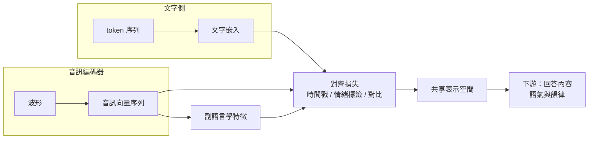
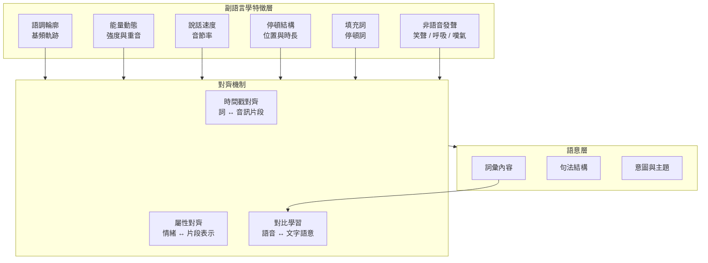

# 11.3 跨模態對齊損失與直接語音原生理解（2025-2026）

## 一、從「先轉文字再猜測」到「直接讀懂音色與語氣」

串聯式系統處理情緒的唯一途徑，是把它降級成一串文字裡的標點與假設。本章要處理的是相反的問題：在原生全模態架構下，模型如何從聲音波形本身讀出意圖、情緒與態度，而不必先把它轉成文字再回頭猜測。

要做到這件事，僅僅「把音訊編碼器接進來」是不夠的。模型必須被明確地訓練成「音訊表示與其語意／情感解釋在同一空間中對齊」。這就是跨模態對齊損失（cross-modal alignment loss）的角色。



## 二、對齊損失的三種設計

**第一種是時間戳對齊。** 假設一段語音的逐字轉錄與音訊幀都有標註，就可以要求某個詞的表示與對應時間區間的音訊表示靠近。最直接的形式是交叉注意力對齊：讓文字側的表示作為查詢、音訊側的表示作為鍵值，計算注意力權重，並以已知的時間戳作為目標。這與第 5 章的交叉注意力 Transformer 是同一套機制，但在原生模型裡，對齊的對象從「文字生成文字」變成「音訊理解文字」。

 **第二種是屬性標籤對齊。** 若資料帶有情緒、意圖或說話狀態的標註，可以要求在特定音訊片段上的表示能夠對齊到相應標籤的嵌入。假設片段 $`s_i`$ 的情緒標籤為 $`c_i`$ ，標籤嵌入為 $`e_{c_i}`$ ，可以最小化片段表示 $`h_i`$ 與其標籤嵌入之間的距離：

$$
\mathcal{L}_{align} = \frac{1}{N} \sum_{i=1}^{N} \| h_i - e_{c_i} \|_2^2
$$

這類損失的作用是把「這段音訊聽起來很煩躁」這件事，從後期的隱式推測，提前到表示層就被顯式地綁定。

 **第三種是對比學習。** 對比學習要解決的是「讓語音與它真正對應的文字語意靠近，把不相關的配對推遠」。取一批配對（語音 $`a_i`$ 與其文字 $`b_i`$ ）與若干負樣本，最基本的 InfoNCE 形式為：

$$
\mathcal{L}_{contrast} = - \frac{1}{N} \sum_{i=1}^{N} \log \frac{ \exp( \text{sim}( a_i, b_i ) / \tau ) }{ \sum_{j} \exp( \text{ sim}( a_i, b_j ) / \tau ) }
$$

其中 $`\text{sim}`$ 是餘弦相似度， $`\tau`$ 是溫度參數。這個目標的好處是它不需要精細的時間戳標註，只需要「哪段音訊對應哪段文字」的粗略配對，因此在規模上遠比逐字對齊可行。

在實務上，這三種損失通常是混合使用的：對比損失提供大尺度的語意骨架，時間戳對齊提供細部的時序結構，屬性對齊則負責把副語言學訊號綁進來。

## 三、副語言學訊號的具體內容

要理解對齊損失到底在對齊什麼，需要先列清楚「副語言學」究竟包含哪些東西。以下清單大致沿用語音學與情感語音學的傳統分類。

**語調輪廓（intonation contour）** 是基頻隨時間的軌跡，它承載疑問、陳述、驚訝與確認的區別。同樣一句「你來了」，音調上揚與下沉在意義上幾乎相反。**基頻與能量的動態** 則提供更細的情緒資訊：說話人是否緊張、疲憊、興奮，可以從基頻的穩定性與動態範圍看出端倪。

**說話速度**（articulation rate）是情緒的直覺線索：急促通常意味著焦慮或興奮，緩慢可能意味著謹慎、疲憊或思考。**停頓與填充詞** 的位置與長度標示了語意結構與猶豫：句中的長停頓是思考，句末的停頓是等待回應，而「呃」「那個」「就是說」這類填充詞往往出現在高不確定性的位置。

**笑聲、吸氣、嘆氣與其他非語音發聲** 則是明確的情緒標記，有時直接構成回應本身——一個被聽到並正確反應的笑聲，往往比任何文字都更能建立親密感。



## 四、從對齊到生成：副語言學資訊如何跨過橋樑

理解了輸入端的對齊機制之後，有一個自然的追問：既然音訊表示裡保有語調與停頓，這些資訊是怎麼「傳到」輸出的？

在串聯式架構裡，這條路徑是不存在的：情緒在 ASR 端被丟掉，TTS 端只能靠標點去猜。原生架構裡則存在一條真實的資訊通道，但它並非自動開通。模型要學會「聽到停頓，就生成相應的停頓」，需要訓練過程中反覆出現「輸入端的停頓」與「輸出端的停頓」配對。

最直接的做法是把副語言學事件本身也當作一種標註來對齊。若輸入音訊在位置 $`p`$ 處有一個長停頓，而輸出音訊在對應位置也有一個長停頓，就可以要求兩者的表示靠近。這類「事件級對齊」的思路與第 5 章交叉注意力的機制相通，但對齊的對象從詞換成了韻律事件。

更進階的做法是讓模型在生成時同時產出「內容」與「表達」兩種輸出。內容是文字或音訊 token，表達則是一組控制量，例如語速、停頓插入位置、情緒標籤。這種分工在工程上非常實用：它讓產品團隊可以用明確的控制介面調整助理的語氣，而不必重新訓練模型。

```
mermaid
flowchart LR
    subgraph IN["輸入端副語言學事件"]
        E1["停頓"]
        E2["語調改變"]
        E3["笑聲"]
        E4["語速變化"]
    end
    subgraph ALIGN["對齊橋樑<br/>事件級對齊 + 對比學習"]
        E1 --> M1["匹配輸出端的停頓模式"]
        E2 --> M2["匹配輸出端的語調輪廓"]
        E3 --> M3["匹配輸出端的笑聲或語氣反應"]
        E4 --> M4["匹配輸出端的語速"]
    end
    subgraph OUT["生成端"]
        M1 --> O1["含停頓的音訊"]
        M2 --> O2["含語調輪廓的音訊"]
        M3 --> O3["含笑聲或語氣的音訊"]
        M4 --> O4["含語速變化的音訊"]
    end
```

這條橋樑的建立，是本章標題所稱「直接語音原生理解」的實質內容。理解不是單向的：輸入端被理解，輸出端被對齊，中間由同一個模型的核心共享。

## 五、副語言學訊號為何是語言模型「看」不到的

關鍵在於 ASR 的目標函數裡根本沒有這些項。識別的目標是找出正確的字串序列，而「這個字串是用平緩的語調、帶著停頓、還是笑出來說的」，對這個目標而言全部等價。於是模型的最優解就是把這些維度壓縮掉——不是模型偷懶，而是最佳化目標要求如此。

這可以用資訊論的語言來描述：一個 30 毫秒的取樣率很高的語音片段，其實包含了大量與語意無關、與表達方式高度相關的資訊；轉錄成字串是一次巨大的資訊瓶頸，而這個瓶頸是「有意為之」的，因為下游的語言模型只需要語意。

但對語音助理而言，下游恰恰需要表達方式。於是串聯式管線陷入一個兩難：ASR 要丟棄這些資訊才能做好 ASR 的工作，而 TTS 要找回這些資訊才能做好 TTS 的工作，中間沒有任何一段程式碼被允許持有它們。

原生模型改變了這個結構。在端到端聯合訓練下，音訊表示不必先被投影成字串才進入核心，語意與副語言學資訊可以在同一個向量空間裡並行存在。模型可以同時學到「這句話在說什麼」與「這句話怎麼說的」，因為它們從來沒有被要求二選一。這也是為什麼本章把原生理解稱為「直接」的：直接，指的就是不再經過那個必然丟失資訊的文字中繼站。

## 六、生成端：可控副語言學與輪流管理

理解了輸入端之後，生成端的難題會顯得更加尖銳。如果模型能聽出停頓與語氣，那麼它的輸出也應該能帶上這些東西；否則互動是不對稱的：使用者用低沉的語氣提問，助理卻用制式的語氣回答，體感上仍然是「沒聽懂」。

可控副語言學的技術路徑之一，是在文字生成時攜帶韻律標記。也就是讓模型的輸出不是純字串，而是字串加上某種標記序列（例如情緒類別、停頓插入點、語速倍率），再由解碼端依這些標記決定生成的音訊表現。這個設計的優點是可控性與可解釋性；缺點是它把原本應該學到的東西重新變成了人手標註的規則，有點把架構問題換成工程問題。

更原生的做法是讓副語言學資訊直接滲入生成過程：模型在解碼音訊 token 的同時，自然地決定停頓、抖動與節奏。這要求訓練資料本身帶有這些資訊，而現實是標註遠比語音本身稀缺。

第二個難題是對話中的輪流管理與打斷。這需要模型判斷三件事：使用者是在停頓思考還是已經講完、自己正在生成的回答是否該繼續、以及被突然打斷時如何優雅收尾。這類決策在串流條件下必須在極短的時間內完成，因為等待太久本身就是錯。解法上，模型通常需要在音訊輸入與音訊輸出之間做即時的仲裁，例如偵測到輸入端的能量上升與基頻變化就判定為打斷訊號。

## 七、副語言學的直接理解：與傳統方法的對照

為了確認「直接原生理解」這個說法不是行話，我們可以把它與傳統做法做一次結構性的對照。

| 面向 | 串聯式（先轉文字再生成） | 原生全模態（直接對齊語音） |
| --- | --- | --- |
| 情緒取得路徑 | ASR 輸出文字 → 標點與假設 → TTS 重猜 | 音訊編碼器直接讀取語調與能量動態 |
| 意圖判斷依據 | 已轉錄的字面內容 | 字面內容加上韻律、停頓、填充詞 |
| 訓練標註需求 | 只需文字轉錄，標註便宜 | 需要時間戳與副語言學標註，成本高 |
| 對齊機制 | 隱式，跨模態資訊無法回傳 | 顯式對齊損失，音訊與文字共享空間 |
| 停頓的可控性 | 只能靠標點與句子切分 | 可在音訊層直接控制停頓位置與長度 |
| 錯誤來源 | ASR 字誤改寫語意，無處追溯 | 同一表示空間內可被上下文補償 |
| 對方言與口音 | 取決於 ASR 的文字層泛化 | 有機會利用副語言學線索補救 |
| 文化差異風險 | 較低（文字是較中性的管道） | 較高（情緒表達高度文化相關） |

最後一列值得特別強調。傳統架構的「缺點」有時反而是它的優點：文字作為中介管道，雖然丟棄了資訊，卻也把文化相關的表達規範化掉了。原生模型打開了這條通道，就必須同時承擔通道裡的偏見。這是本章第八節安全討論的核心。

## 八、安全與倫理：理解越深，風險越大

能直接判讀情緒與意圖的能力，是一把雙刃劍。

第一類風險是情緒誤讀。模型可能把平靜語氣讀成冷漠，把文化背景下的禮貌性壓低音調讀成不滿。聲音的情緒表達具有強烈的文化與個體差異，一個在標準中文情境訓練的模型，在面對方言、母語者或口音明顯的說話人時，情緒判讀的可靠性會顯著下降——而使用者不會知道模型「聽錯了」，他們只會覺得「這系統不懂我」。

第二類風險是聲音冒用與深度偽造。原生全模態把聲音合成能力從「需要專用 TTS 模型」變成「任何能接文字輸入的多模態模型都具備」，這大幅降低了偽造的門檻。而一旦合成音訊能帶上自然的停頓與笑聲，其可信度遠高於過去明顯機械化的合成語音，欺詐成本隨之下降。

第三類風險是治理成本。傳統的合成語音可以用譜域特徵或水印來辨識，但在原生模型下，音訊是自迴歸生成的連續產物，傳統偵測器的適用性下降。儘管聲音區塊鏈技術在近年的研究中已有實質進展，但整體生態尚未成熟。

設計上的緩解手段大致有三類。第一是**溯源標記**：在合成音訊中嵌入不可感知的浮水印，使接收端可驗證來源；研究上已有基於相位編碼與神經特徵的浮水印方案。第二是**生成側標記**：在模型層面強制合成音訊帶有可偵測的統計特徵，例如在音訊 token 生成時加入對抗性的擾動。第三是**策略側防禦**：在應用層建立拒答與升級策略——當偵測到高風險情境（如涉及緊急醫療、法律或財務的語音請求）時，系統主動轉為文字確認或拒絕提供具體指示，並在偵測到疑似被誘導時標記而非順從。

這三者都需要標準化與生態配合，單靠模型開發者無法解決。

## 九、結語：回到全書主線

《聲波的迴響》的主線只有一句話：聲音 AI 的每一次躍升，都是「先解決特徵表示，再解決對齊，再解決生成效率，最後將離散化讓渡給語言模型」的循環。第 1、2 章解決特徵表示（梅爾刻度、MFCC）；第 3、4 與 5 章解決對齊（CTC 的外狀態對齊、注意力機制）；第 6、7、8 章解決生成效率（自迴歸到非自迴歸再到對抗生成）；第 9、10 章完成離散化，讓聲音用語言建模的方式被生成。

而原生全模態，是這個循環第一次閉合成環：特徵表示、對齊、生成效率、離散化這四件事，不再分屬於不同的模型，而是被收攝在同一個模型的不同分支裡，各自繼承了前面章節的成果。

但閉環不等於終點。截至 2026 年，聲音 AI 仍有四個未解的難題。

**極低延遲** 尚未真正實現。要達到人類對話的流暢感，完整的輸入理解與輸出開啟之間需要極短的時間窗口，而這與語意判斷上的冒險直接衝突。

**可控生成** 仍不夠精細。語氣、停頓、節奏的控制介面多數停留在標記與提示的層次，難以做到像真人導演那樣精準。

**評測** 框架落後於能力。當「說得對不對」已經不能完全代表「說得好不好」，業界仍缺乏穩定、公認、能量化情緒與韻律品質的基準。

**跨語言公平** 是最容易被忽略、也最緊迫的一項。副語言學訊號的解讀高度依賴文化與語言背景，若原生模型只在少數語言的資料上訓練，它將把「理解語氣」的能力變成一種特權，進而在服務品質上形成新的不平等。

這四個問題沒有捷徑。它們都需要更多的資料、更精準的對齊設計、更誠實的評測，以及把「聲音」當成一種有尊嚴的表達形式而非可任意合成的素材。技術的終點或許不是模型更像人，而是模型在不確定時知道自己不確定，並且在聽不懂時願意承認聽不懂——這恰恰是文字模態教給聲音模態的最後一課，也是第 11 章真正要說完的最後一句話。
