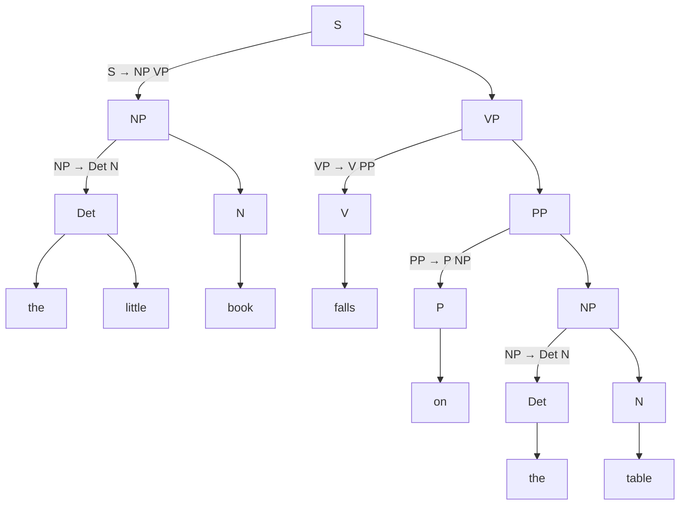
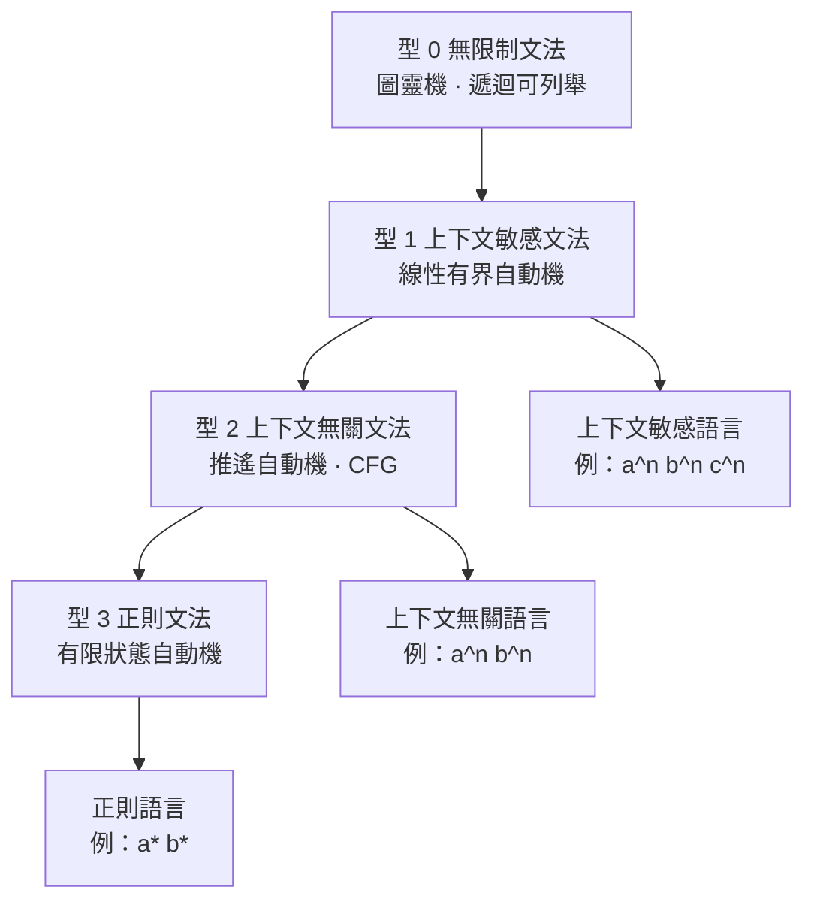

# 1.1 1957 年：喬姆斯基生成語法與句法結構理論

## 一本不到百頁的書，改變了問題的問法

1957 年，海牙的 Mouton 出版社出版了一本不到一百頁的小冊子：《Syntactic Structures》。書中沒有實驗數據、沒有計算機程式，甚至沒有統計，只有一連串定義、符號與簡短的推論，但這本書重新定義了「語言是什麼」這個問題的問法。在它之前，人類語言的處理方式主要沿著統計學的路徑：香農在一九四八年把語言看成資訊源，語言模型是具有有限記憶的馬可夫過程，語言學家的工作是估計轉移機率。喬姆斯基挑戰的正是這個直覺。他主張語言的關鍵性質不是「統計上常見」，而是「系統性地合乎文法」，而前者的任何有限狀態模型都不足以承載後者。

問題的提出有一個非常具體的工程背景。戰後美國的資訊科學界瀰漫著這樣的信念：翻譯不過是一個詞對詞的替換問題，只要建構足夠大的詞典並調整文法規則，機器翻譯就會自然發生。這一信念在喬姆斯基看來是徹底錯誤的，因為它把語言的生成機制誤認為「頻率統計加上替換」。他與 Miller 在一九五七年前後拿到經費，正要開始建構一個機器翻譯系統；但在動手之前，他先需要一個正確的語言理論，用以說明「一個句子是怎樣被『生成』出來的，而不是被『拼湊』出來的」。

他的第一個打擊對象是有限狀態語言（finite-state language）。有限狀態機只有記憶當前狀態的能力，於是它無法分辨兩個在字母層面完全相同、只在分詞位置上不同的句子序列。喬姆斯基用簡單的例子說明這個缺陷：如果把 "the man who ... " 與 "the man ... " 這類結構當成同一串字母看待，機器無法分辨 "the man who is tall ..." 與 "the man who tall is ..." 這類結構的合法性差異。要處理這類嵌套結構，語言必須記住比「上一個詞」更多的东西，而這正是他導入「短語結構」（phrase structure）的理由：語言的最小單位不是單詞，而是短語；短語是由短語組成的階層性結構。

## 形式化：四元組與產生式

於是《Syntactic Structures》給出了自然語言處理史上第一個真正嚴謹的形式化對象。喬姆斯基定義的文法（grammar）是一套有限的規則系統，它能生成無限多個句子，且生成的句子全部合乎文法。

一套上下文無關文法（Context-Free Grammar, CFG）可以寫成四元組：

$$
G = (V_N, V_T, P, S) \, .
$$

其中 $`V_N`$ 是非終端符號集（nonterminals），代表語法類別，如句子、名詞短語、動詞短語； $`V_T`$ 是終端符號集（terminals），代表實際出現在句子中的詞或符號。 $`P`$ 是產生式集合（productions），每條產生式形如 $`A \to \alpha`$ ，讀作「非終端符號 $`A`$ 可以被符號串 $`\alpha`$ 取代」。 $`S`$ 是起始符號（start symbol），代表整個句子的類別。 $`V_N`$ 與 $`V_T`$ 必須不相交， $`S \in V_N`$ ，而每條產生式的左側必須是 $`V_N`$ 中的元素。

「上下文無關」這個名字精確地指出了規則的性質： $`A \to \alpha`$ 這條規則在任何位置上都可以使用，不受左右鄰符號的限制，這一點與自然語言中某些真實的語境敏感現象（如英語中 "provided (that)" 的從屬連接詞只在特定前置結構後合法）形成對照，後者需要更強的文法類別才能捕捉。上下文無關文法的決定性優點在於其可操作性：它只做一件事，把一個非終端符號「展開」成一串符號，而展開的方向永遠是從少數抽象類別走向多數具體詞語。

讓我們用一個玩具文法說明整個機制。文法設定為： $`V_N = \{ S, NP, VP, PP, N, V, P \}`$ ， $`V_T = \{ \text{the}, \text{little}, \text{book}, \text{on}, \text{table}, \text{falls} \}`$ ，起始符號 $`S`$ 。幾條關鍵的產生式如下：

$$
S \to NP \, VP
$$

$$
NP \to \text{Det} \, N
$$

$$
VP \to V \, PP
$$

$$
NP \to PN
$$

$$
PP \to P \, NP
$$

這個文法不只「接受」句子，它是「生成」句子：從 $`S`$ 出發，反覆把某個非終端符號替換成它的右側，最終得到一個只含終端符號的句子串。這種逐步替換的過程稱為推導（derivation），而把所有推導步驟記錄成一棵樹，就得到推導樹（derivation tree）。

這張樹裡值得注意的是，它不是句子的「線性拆解」，而是句子的**階層結構**。動詞短語之所以能帶著一個介詞短語，是因為 $`VP \to V \, PP`$ 這條規則允許它；名詞短語之所以能出現在介詞後面，是因為 $`PP \to P \, NP`$ 允許了遞迴。這種階層性正是有限狀態機做不到的事：有限狀態機必須在讀完 "book" 之後立刻決定自己處於什麼狀態，而階層結構說明「決定」其實發生在多個抽象層級上。

## 喬姆斯基階層：四類文法的包含關係

《Syntactic Structures》最著名的遺產不是單一 CFG，而是**語法類別的階層**。喬姆斯基把所有形式語言按其生成能力分為四類，稱為喬姆斯基階層（Chomsky hierarchy）。他原本在 1956 年的論文中使用 type 1 表示正則文法、type 2 表示上下文敏感文法，1957 年之後這套編號被重新整理為今天通行的版本，因此文獻中偶爾會看到編號不一致的情形。

| 類別 | 名稱 | 對應的自動機 | 規則形式 | 典型自然語言現象 | 包含關係 |
|---|---|---|---|---|---|
| 型 0 | 無限制／遞迴可列舉文法 | 圖靈機 | $`\alpha A \beta \to \alpha \gamma \beta`$ | 極少數僅靠上下文限制的邊界現象 | 包含所有其他類別 |
| 型 1 | 上下文敏感文法 | 線性有界自動機 | $`\alpha A \beta \to \alpha \gamma \beta`$ ，但 $`\gamma`$ 長度受限 | 語境敏感的詞形變化與形態的一致性 | 包含型 2 |
| 型 2 | 上下文無關文法 | 推遙自動機 | $`A \to \alpha`$ | 幾乎所有一般句子結構 | 包含型 3 |
| 型 3 | 正則文法 | 有限狀態自動機 | $`A \to aB`$ 或 $`A \to a`$ | 有限狀態的片段結構 | 最受限 |

這張圖表達了一個關鍵的效率事實：**文法類別越往下，推論所需的資源越少，但表達力也越弱**。有限狀態自動機的推論時間是與輸入長度成線性的；推遙自動機在一般情形下是平方級別；線性有界自動機則可達到指數級別。於是「表達力」與「可計算性」之間存在一條取捨線，而喬姆斯基的工作正是精確地量出了這條線的位置。這個取捨結構，後來在機器翻譯與語音辨識的每一次工程選擇中都被重新發現。

需要補充一點常被誤解的地方：喬姆斯基階層是對**形式語言**的分類，不是對**自然語言**的分類。英文的語法在形式上並不完全屬於型 2，但它的絕大多數句法現象確實落在型 2 之内，這正是喬姆斯基選擇 CFG 作為自然語言近似模型的歷史理由。

## 能力與表現：一個哲學性的分家

《Syntactic Structures》另一項影響遠超工程界的貢獻，是把語言學的研究對象拆成兩層。喬姆斯基在 1965 年的《Aspects of the Theory of Syntax》中把這區分正式化為**語言能力**（competence）與**語言表現**（performance）。能力屬於理想化的說話者與聽者，是一套內在的、無限的、遵循規則的系統；表現則是這個能力在時間、記憶、注意力等嚴格限制下的實際投射，是有噪聲的、有遺漏的、會猶豫的。

這個區分的深意在於它重新界定了「完美的語法」這個目標。既然表現層必然混入了偶然性，那麼用「人們實際怎麼說」這種觀測資料去衡量語法理論，就永遠會得到一套被機率稀釋過的版本。真正的語法必須是一個獨立於機率的對象，它決定什麼是合乎文法（grammatical），而不僅僅決定什麼是常見（common）。因此，喬姆斯基主張語法學的原理應當**獨立於**語義與機率考慮之外，這句話在《Syntactic Structures》裡佔據了專門的一節，是全書最容易被忽略、卻最具爆炸性的一條宣言。

## 工程動機：句法分析與機器翻譯

為什麼一個語言學家要關心機器翻譯？因為在 1950 年代中期，句法分析（syntactic parsing）與機器翻譯是同一個技術計畫的兩面。既然語言是由規則生成的，那麼把機器翻譯拆成「先分析、再轉換、再生成」三個階段就變成顯然而必要的設計：源語句先被解析成一棵對應原文的句法樹，翻譯系統再根據這棵樹的結構產出目標語的樹，最後由文法把樹展開成句子。

這個「樹到樹」的轉換架構，正是喬姆斯基在 1957 年就主張翻譯應當採用的形式，也是後來 1960 年代機器翻譯研究的主流骨架。但同一個架構也立刻暴露了它的代價：整套系統的表現取決於最脆弱的一環——句法分析的正確性。一個解析錯誤會沿著樹的傳遞被放大，最終變成整句的離譜譯文。這種誤差累積的脆弱性，是第 1.2 節的主題，也是整個符號主義時代共有的體質弱點。

另一方面，「句法分析」這件事本身也受益於形式化。人類語言學家幾千年的直覺分析，在此第一次被轉換成可執行的演算法：推導、剖析（parsing）、樹的建構都有精確定義。許多 1950 至 1960 年代的語言學家正是藉著這套形式化，第一次真正「看見」了句子的樹狀結構，而這種看見，後來成了所有統計方法也必須處理的對象。

## 天生的缺口：語義與機率都不在體系內

然而，這套理論先天缺少兩樣東西，而且不是偶然的疏漏，而是它的哲學立場直接導致的後果。值得強調的是，這兩個缺口在當時並未被視為致命問題；語言學家在意的是描述語言的內在結構，統計學家在意的是預測文本的出現，而「語言」這個詞在兩邊指向的其實是兩個不同的物件。

另外還有一項實用層面的缺失常被忽略：整套體系沒有任何關於**歧義消解**的機制。同一串詞可以對應多棵合法的推導樹，而文法本身對這些樹的取捨一無所知。工程上若要選出正確的一棵，就必須在文法之外再引入某種排序機制——而這一步，等於是把機率重新請回來。

第一個缺口是**語義**。整個《Syntactic Structures》幾乎不談詞義。"book" 與 "table" 在文法裡只是終端符號，沒有任何機制說明它們指涉桌面上的一個物件，也沒有機制說明它們的「相似性」可以被推論。因此這套系統只能回答「這串詞能不能由文法生成」，卻完全無法回答「這個句子說了些什麼」。更麻煩的是，語義常常是判斷句法歧義的必要條件：英文的 "I saw the man with a telescope" 到底是「我看見那個拿望遠鏡的人」還是「我用望遠鏡看見那個人」，句法規則本身無法裁決，必須依賴世界知識與語用考量。

第二個缺口是**機率**。文法只給出二元答案：合法或不合法。它無法表達「這兩句都合法，但第一句在實際語料中常見一萬倍」。所有關於頻率、典型性、可接受性高低的資訊都被刻意排除在體系之外。對一個要處理真實世界的系統而言，這種「只判合法性」的觀點過於粗糙：機器翻譯需要挑選最好的候選譯文，而「最好」在幾何上正是「最可能」；語音辨識需要在一堆發音近似的詞中做出選擇，同樣需要排序而非裁決。喬姆斯基把這件事看得非常清楚，他甚至在書中指出，統計方法在處理「非文法的隨機字串」時是多餘的，因為那種序列在語境中本來就不會出現——但統計方法對於**在文法之內**比較句子好壞，仍然是有價值的。統計學派正是從這個縫隙裡切了進去。

## 統計學派的反擊

就在生成語法奠基的同時，機率方法並沒有停止前進。一九五〇年代後半，語音學與資訊理論的交界處出現了幾條平行發展的路線：香農在一九五〇年估計英文文本的熵約為每個字母一點一個位元左右，並明確指出語言的冗餘度來自語法；哈里斯（Zellig Harris）在 1955 年主張語言分布的基本單位是「片語的機率分布」，並提出可以從文本本身估計這種分布而無須參照語義；喬姆斯基則在 1959 年的一篇評論中對哈里斯的做法提出了尖銳反駁，認為單靠分布無法重建句法。

值得注意的是，這場論戰裡雙方的立場並非「有文法」與「無文法」的二選一。哈里斯與後來的研究者，事實上提出了**機率文法**（probabilistic grammar）這個關鍵概念：文法不只是一組產生式，而是每條產生式都附帶一個機率，句子由文法生成的同時也被賦予一個機率。這樣一來，語法與機率不再是互斥的兩種世界觀，而是可以在同一個形式框架裡共存。約翰·惠特（John McCarthy）在同一時期把這類想法用於 LISP 語言的處理，直接催生了後來 Lisp 式的條件求值實作。

於是 1950 年代末的圖景變得清楚：生成語法定義了語言的**可能空間**，機率文法試圖在這個空間中定義**偏好次序**。兩者的融合在理論上是自然的，但融合在工程上極不順利——這正是本章下一節的主題。

## 伏筆：記憶的存放位置

本章結束時，值得把本書的主線先行點破。生成語法把「語法規則」安置在人的心智之中，它給出的是一個理想化的、無限的、確定的規則系統。機器從這套理論繼承的，僅僅是一種**合法性判斷**的能力：它能說「這句話合乎文法」，卻不能說「下一句話最可能是什麼」。這正是全書因果主線的第一站：規則存在於人的心智中，而機器只學會判斷句子是否合法，卻不會生成。

要讓機器從判斷者變成生成者，就必須回答一個生成語法刻意迴避的問題：規則之外，還能從哪裡取得語言的知識？三個選項在 1960 年代陸續被提出並實踐——把所有規則寫成人可閱讀的產生式、把所有語言現象壓縮成有限狀態的轉移、或把語言知識外包給專家。第一章的後兩節，將依次檢驗這三條路徑為何在 1980 年代末同時撞牆。

## 本節小結

《Syntactic Structures》留下的不是一台機器，而是一種提問方式：語言必須是一套能生成無限句子的有限系統。這個提問方式在形式上極為成功——上下文無關文法至今仍是句法分析、語法錯誤檢查、編譯器前端與形式語言理論的基礎教材；在工程上卻極為受限——它給出合法性，卻給不出可能性；給出結構，卻給不出意義。承認這個限制、並把語言學的主流重新推向機率，正是 1960 至 1980 年代符號主義接下來要處理的處境。
