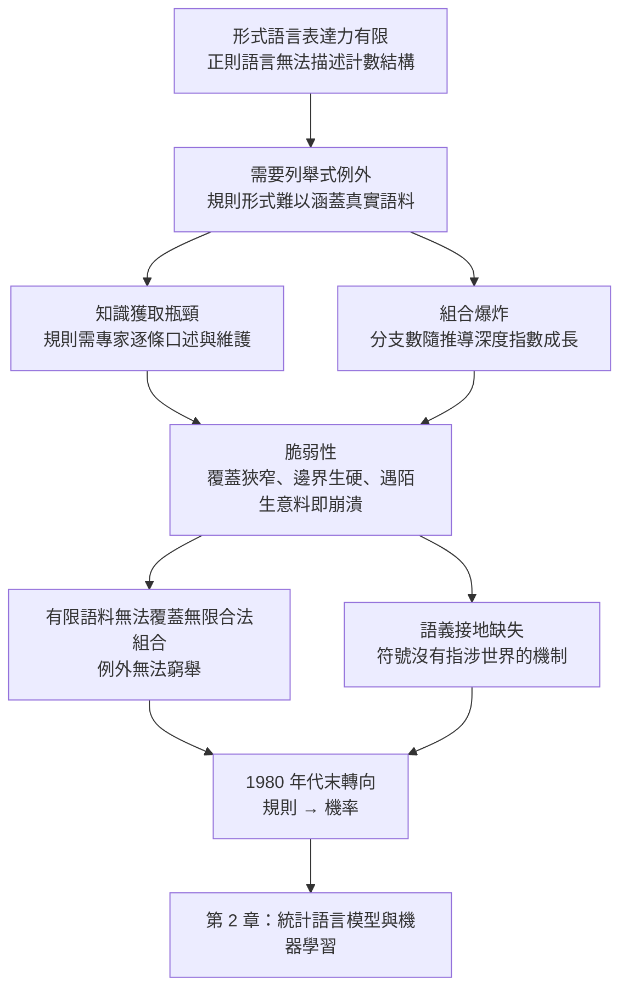
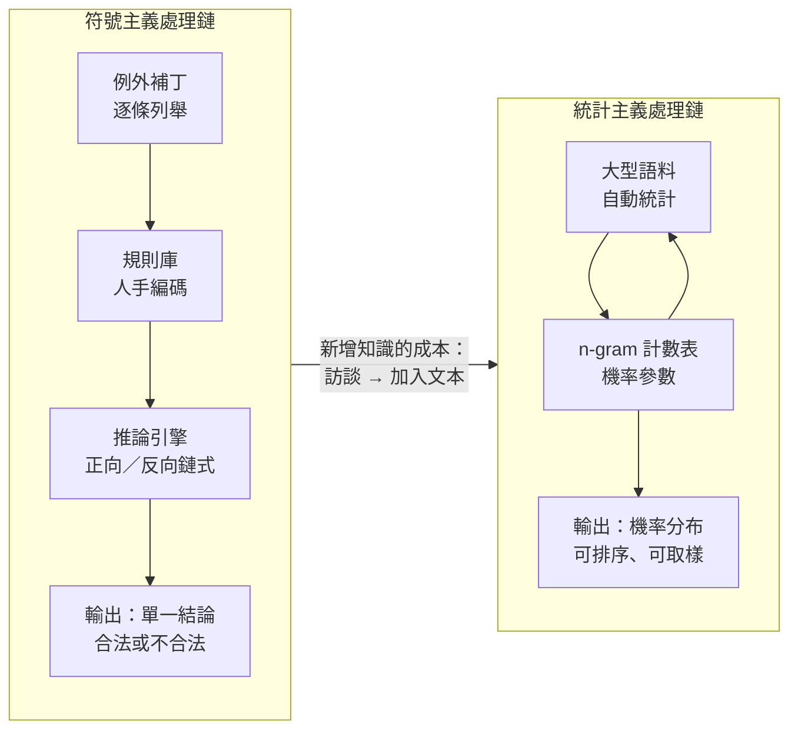

# 1.3 1980 年代末：符號主義的困境與組合爆炸瓶頸

## 三個病灶

1980 年代末，當第一代專家系統的商業化嘗試陸續失敗，當機器翻譯的資助計畫被大幅削減，當一整套建立在「知識可以被窮舉地寫成規則」這個假設之上的研究議程開始退潮時，學界開始用一個總稱來指稱這整段歷史：**知識系統的脆弱性**（brittleness of knowledge systems）。這個詞出自語言學家海爾（John McCarthy）在一九八〇年代中期的演講，它精確地概括了符號主義的三個互相糾纏的病灶。

第一個病灶是**組合爆炸**（combinatorial explosion）：語法規則的展開方式決定了合法句子的數量隨長度指數成長，因此任何以列舉句子來覆蓋語言的企圖都注定失敗。第二個病灶是**脆弱性**：規則系統在熟悉情境之外劇烈失效，既無法優雅處理陌生意料，也無法從個案提煉通則。第三個病灶是**知識獲取瓶頸**：規則必須由專家逐條口述、逐條編碼、逐條維護，知識的成長速度被人的時間鎖死。

這三個病灶並非彼此獨立的工程難題，而是同一枚硬幣的三個面。下面的因果圖把它們串成一條鏈：規則形式的表達力不足，迫使系統採用列舉式的例外補丁；列舉式補丁帶來知識獲取瓶頸；而任何試圖完整列舉的做法，又不可避免地落入組合爆炸。

## 組合爆炸：一個數學直觀

組合爆炸的本質在句法層級最好看清。考慮一個文法，其中每個非終端符號都可以展開成兩種不同的產生式，且每個展開後的子節點仍可繼續展開。若推導深度為 $ d $ ，則樹狀展開的葉節點數為

$$
2^d \, .
$$

取一個在自然語言中完全正常的例子：主詞帶有由三個修飾語組成的複合名詞短語，動詞帶有由兩個介詞短語組成的複合動詞短語，每一個修飾語又有兩種可選形式。僅僅三層展開，候選句子的數量就已經是 $ 2^3 $ 的數量級；把深度推到十層，就是上千個候選；若允許每一層有五種選擇而深度是十層，就是近一千萬。機器的時間與記憶都是有限的，因此**推導空間的規模與語言的創造力成正比地爆炸**。

更麻煩的是，這個爆炸不是單一的樹形展開，而是疊加在多個維度上的：句法樹的分支、詞形變化、詞典選擇、詞序排列，每一個維度都是一個獨立的乘法因子。 $ 2^d $ 只描述了其中最簡單的一個。當語境敏感規則加入之後，情況進一步惡化：語境敏感規則的本質是「根據左右鄰的內容決定當前符號的處理」，這使得規則無法在文法層級預先枚舉，而必須在推導進行時才決定是否適用。於是規則的數量不再是常數，而要乘上所有可能觸發它的上下文的數量。

再從另一個角度來看這件事：語言的句子集合是**可數無限**的，而任何有限狀態的規則系統只能覆蓋其中有限的一個片段。要讓一個句子集合被完整覆蓋，所需的規則數量就必須是無限的。這不是工程瑕疵，而是可計算性上的硬性約束。

## 有限的語料無法覆蓋無限的合法句子組合

於是出現了一個極為尷尬的實證困境：任何聲稱「學會了自然語言」的系統，它實際覆蓋的句子集合都是有限的；而自然語言的合法句子集合是無限的。有限與無限之間的差距，只能靠抽象來填補——但抽象正是規則系統最不擅長的事情。

這裡有一個更深的版本，值得單獨說明。假設我們放棄列舉規則、改為列舉句子，把十萬條真實語料句當作「規則」來存。這個做法在工程上看起來很有吸引力：查詢快，不需要推導，直接比對即可。但它立刻會被兩個問題擊穿。

第一個問題是**覆蓋率**：十萬條句子相對於無限語言，等於零。每一個使用者輸入的句子，只要不在這十萬條裡，系統就無話可說。這正是「脆弱性」最尖銳的表現形式：系統的能力邊界不隨經驗增長而平滑擴展，而是以離散的方式停在某處。

第二個問題是**類推的缺席**：人類讀者看到「王大爺把孫子送到幼稚園去了」這個句子時，能立刻推斷「王大爺把孫子送到機場去了」也大致成立，因為兩個句子共享同一個深層結構。列舉式的句子庫無法做出這種推斷——它沒有辦法知道哪兩句話「結構相似」，因為「相似」本身就是一個需要被推論的屬性。

## 為什麼例外必須逐一列舉，而例外無法窮舉

以上是量級的直觀；真正的哲學困境在下一層：**符號主義的系統在遇到規則無法涵蓋的現象時，唯一合法的補救方式就是新增一條例外規則**。

這個補救方式有三個性質，使得它必然走向崩潰。第一，例外不是獨立的，它是上下文相依的。「除非某個主詞是特定的一批地名，否則前置時間副詞必須後置」——這條規則看起來只加了一條，但它必須與原有規則的每種組合交叉檢查，於是規則集合的有效複雜度不是線性而是乘性增長。第二，例外層會反過來改變原規則的適用性，因此每加一條例外，既有推論的正確性都必須重新驗證。第三，例外本身不具備任何可推廣的結構：語言中的例外是「隨機分佈」的——今天遇到的例外與明天遇到的例外之間沒有必然的相似性，所以沒有任何機制能預測下一個例外落在哪裡。

這就解釋了一個在當時看來極其困擾的現象：系統的改進是**非線性的**。新增十條規則可能讓系統在某些輸入上表現奇佳，但同時在別的輸入上悄悄退步；每一次修改都需要完整的回歸測試，而回歸測試的成本隨著修改次數累積。於是維護成本隨著能力呈超線性成長，邊際收益遞減。這是一個結構性的失敗模式，不是努力程度不足的問題。

## 有限狀態語言作為一個更好的對照

上一節提到的組合爆炸，其實是規則系統「過於強大」所帶來的困擾；而正則語言給出了相反方向的困擾：它「過於弱小」。有限狀態自動機的狀態數必須是常數才能覆蓋整個語言，然而真實語言裡任何一個合法句子的長度都是無界的，因此要讓有限狀態機接受所有合法句子，就必須把整個語言記成一個狀態——這在工程上等於什麼都沒做。

這裡有個更直觀的量化視角。假設一個句法規則系統用有限狀態機來實作詞性標記，它必須記住多少上下文才能判斷一個詞的正確標籤？英文中「沒有」的標籤取決於它後面接的是名詞還是動詞，而這需要往前回溯相當距離；若再考慮「關係子句是否結束」這類範疇歧義，回溯範圍理論上是無界的。於是狀態數隨之膨脹，最終回到組合爆炸。

這個對照說明了一個更根本的教訓：**語言的複雜度不會因為你選擇了更弱的或更強的形式主義而消失，它只會被轉移到別處**。選正則語言，複雜度轉移到狀態數；選 CFG，複雜度轉移到推導樹的分支；選上下文無關的語境敏感規則，複雜度轉移到規則數的乘積組合。三條路都通向同一面牆。這是第 1.2 節的有限狀態理論與本章的規則系統困境交會的地方，也是統計方法能脫穎而出的根本原因：機率模型並不追求覆蓋整個語言空間，它接受**近似**。

## 語義接地：符號沒有指涉世界的機制

第三個病灶在 1980 年代末被哲學與人工智慧兩邊同時命名：**符號接地問題**（symbol grounding problem）。哈紐曼（Terry Harnad）在 1990 年的論文中把它表述得最為尖銳：一個系統內部的符號只是符號，它們與世界的連結必須從外部建立，否則整個符號系統就只是一個自我指涉的空殼。

在語言處理的具體脈絡裡，這意味著生成語法的文法根本無法解釋「book」這個終端符號為何與紙製品相關。CFG 中的終端符號只是抽象的原子，它們不指涉任何物件、事件或關係。整套形式體系都在「句子之間」運作，卻對「句子與世界之間」一無所知。ATN 與後來的語義網嘗試補上這塊，但結果是知識庫的規模與維護成本同樣爆炸，而且沒有任何機制保證這些事實是對的。

更深一層的困難是：如果沒有接地，語言系統就無法從經驗中學習——因為它沒有辦法把符號與觀測連結起來，因此「更多資料」對它而言不帶來任何資訊上的更新。這一點預告了後來整個機器學習路線的爆發性：只有在語言與世界（或至少語言與另一批語言）之間建立起可統計的關聯，資料才開始具有價值。

## 統計學派的接管

正是在這個節點上，統計方法完成了它的接管。轉向的推力來自好幾個方向，但共同的前提是同一個：既然語言的規律性部分是分布的規律性，那麼規律性就能從資料中估計，無需人手寫下。

在語音辨識領域，這條路徑的轉向最為徹底。Jelinek 等人在 1970 年代末把隱馬可夫模型引入語音辨識，取代了規則式的音素分類器；其核心是透過前向演算法計算觀測序列與隱藏狀態序列的聯合機率，並以 Baum-Welch 演算法從無標註資料中反覆估計參數。這套框架的成功極為關鍵，因為它第一次讓語言處理的主要難題變成了一個**有明確目標函數、可由資料自動優化**的問題。

在自然語言處理領域，IBM 在 1980 年代末到 1990 年代初建立的混淆網（confusion network）與 n-gram 語言模型是同樣的轉向。n-gram 模型的做法非常簡單：把句子切成 n 個詞的連續片段，統計每種片段在大型語料中出現的次數，然後用鏈式法則把整句的機率分解成這些片段機率的乘積。整個模型沒有任何一條規則描述「主語之後應該是動詞」，它只是把觀察到的頻率保存下來。

| 面向 | 符號主義（1960–1980年代） | 統計主義（1980年代末起） |
|---|---|---|
| 知識來源 | 專家口述、逐條編碼 | 大型語料，自動統計 |
| 核心對象 | 規則、產生式、樹 | 機率、參數、向量 |
| 推論模式 | 確定性匹配與推導 | 機率加總與排序 |
| 輸出語義 | 合法或不合法 | 排名、分數、相對機率 |
| 資料需求 | 少而精，難以擴充 | 多而雜，量變引起質變 |
| 主要瓶頸 | 知識獲取、組合爆炸、脆弱性 | 資料稀疏、計算量、模型容量 |
| 新增知識的成本 | 高：需重新訪談、編碼、驗證 | 低：加入語料後重新統計 |

這個對照表的關鍵在於最後一行。當「新增知識」的成本從「找人開會」降到「加入更多文本」，整個領域的擴展速度就從人的速度變成了機器的速度。這是本書主線的第二個轉折點：**機率存在於計數表中**，而計數表的稀疏性又將逼出平滑技術與向量表示，把記憶繼續往下搬遷。

## 一個更深的診斷

回頭看，符號主義的失敗可以被診斷為一個更根本的錯誤——**把「解釋」當成了「產生」的前置條件**。規則系統的哲學隱含一個主張：只有先說清楚規則是什麼，才可能談得上處理語言。這一主張在科學的描述性用途上無可挑剔，但在工程上卻是一個陷阱：規則是可被人完整陳述的，而語言不是。

統計方法的轉向則採取相反的立場：不必先說清楚規則，只須估計哪個句子更可能。前者尋找的是能被人類完整表述的隱含因果結構，後者估計的是分布本身。代價是後者放棄了可解釋性與歸納能力，收益是它終於能夠利用資料本身提供的、超越任何單個人類專家所能表述的規律性。

這兩條路線並非非此即彼。今天所有的語言模型架構——從 n-gram 到 RNN 再到 Transformer——都可以看作把統計方法與某種結構性偏置的結合：Transformer 的注意力機制在形式上就是一組可微分的軟性規則匹配，而它的位置編碼則是把有限的狀態機重新引入循環網路中失去的部分。但在 1980 年代末的時間點上，方向已經明確。

## 本節小結

組合爆炸、脆弱性與知識獲取瓶頸，這三個病灶共同說明了同一件事：符號主義的方法與語言的性質不匹配。規則的形式太弱，必須靠例外補丁；例外的維護太貴，只能靠人手；整體的覆蓋太窄，只能靠資料之外的形式化。而所有這一切，最終都被同一個問題卡住——符號沒有指涉世界的機制，也沒有一個能從資料中自行長大的機制。

因此 1980 年代末的轉向，在形式上是一次簡單的替換：把「規則」換成「機率」，把「確定性推論」換成「最大後驗」，把「寫下的知識」換成「數出來的知識」。這正是第 2 章《統計語言模型與機器學習的興起》的起點。當語言模型第一次能夠對任意一句給出機率而非僅僅是合法／非法的判斷時，它才真正開始承擔「生成」的責任——而這份責任，也正是六十年後超大語言模型的核心能力。
