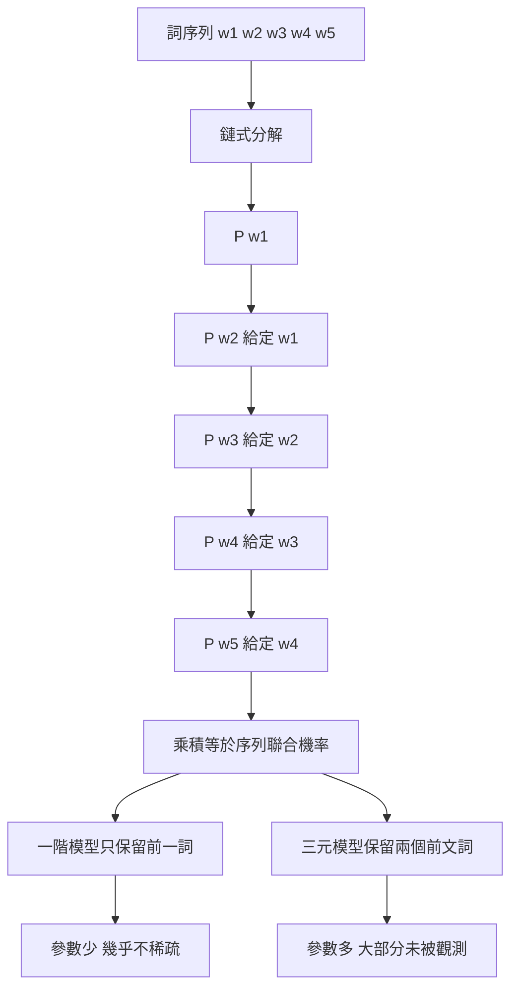

# 2.1 1980 至 1990 年代：馬可夫假設與 n-gram 語言模型

## 從規則轉向計數：一次方法論的靜悄悄革命

1970 年代末至 1980 年代初，自然語言處理領域正在經歷一場沒有宣言的轉向。轉向之前，主導路線是手寫規則：一套由語法學家構思、由程式設計師編碼、由不斷追加的例外條目維持的產生式系統。這套系統在面對結構清晰的任務時表現不錯，一旦要求它判斷任意自然句子是否合乎文法，規則的數量便會以令人絕望的速度膨脹。第 1 章末尾描述的組合爆炸瓶頸，本質上不是工程能力不足的問題，而是「以例外修補系統」這種策略本身的侷限。

規則路線的致命弱點在於其成本結構無法改善。每一條規則都必須由人憑直覺寫下，既不能從資料中自動獲得，也無法隨著語料增加而自動精確。相反地，計數路線具有三項規則路線完全不具备的性質。第一是資料可以累積：每多讀一篇文本，就多出一批可用的計數觀測，而這些觀測不需要任何人理解它們。第二是機率可以估計：只要定義清楚一個機率模型，就能用最大似然等統計方法從資料中把參數推導出來，過程完全機械化。第三是錯誤可以量化：模型給出一個句子一個分數，分數可以用來比較不同假設，也能用來決定下一個詞該選什麼。

這第三點尤其關鍵。若一個模型只能回答「合法或不合法」，它就是無法被優化的黑箱；若一個模型能對每個候選字串給出可比較的機率，它就能被拿來搜尋、被拿來排序、被拿來與其他模型對抗。整個現代語言模型傳統，無論後來是 n-gram、神經網路還是自注意力架構，其核心介面都是同一個：一個針對候選序列的機率分數。這個介面是 1980 年代定下來的，之後四十年只是不斷替換背後的參數化方式。

還有一項常被低估的好處：計數模型讓跨領域的知識累積成為可能。規則必須被寫在某個特定領域的語法書或對話系統裡，其效力止於該領域；計數卻天然是通用的，只要把不同領域的語料混在同一個訓練集中，所有領域都能從共享的樣本中受益，即使它們的主題毫不相關。這一點在後續的網路語言模型時代被放大到極端：模型規模之所以能帶來通用能力，前提正是語料可以無成本地累積。

## 語料的單位選擇：字、詞與詞組

在討論 n-gram 之前，還有一個必須先做的決定：模型的基本單位是什麼。早期實驗曾使用字元作為單位，這種做法的好處是幾乎不會遇到未知詞與斷詞錯誤，代價是序列長度膨脹，使得有效的上下文視窗很快被填滿，句法資訊難以浮現。另一條路線是以詞為單位，句子被切分成詞序列後再建模，此時斷詞本身的正確率成為新的誤差來源。

以詞為單位在 1980 至 1990 年代迅速成為主流，理由除了語法訊號更完整之外，還有一個更實際的原因：詞袋化與頻率統計只有在詞層級才有意義。以字元為單位時，「高」與「高興」的關係被抹平；以詞為單位時，模型能夠直接學到「很高」與「高興」是兩個不同的詞型，而它們各自的搭配偏好則被完整記錄下來。

詞組單位則出現在 1990 年代的翻譯與語音辨識系統中，作為 n-gram 的延伸。所謂詞組基礎方法，就是先從語料中歸納出高頻的相鄰詞組合，把它們視為不可分割的單位再以 n-gram 建模。這樣做的目的是避免一個高頻詞被錯誤地拆開，例如「紐約時報」若被切開成「紐」與「約時報」，其統計性質將徹底走樣。詞組方法把組合性的一部分提前固化在分詞階段，用工程手段換取模型層面的簡化。

| 單位 | 未知詞問題 | 序列長度 | 句法訊號 | 主要用途 |
| --- | --- | --- | --- | --- |
| 字元 | 幾乎不存在 | 最長 | 弱 | 早期實驗、拼字檢查 |
| 詞 | 需詞表與切詞 | 中等 | 中等 | 通用 n-gram 語言模型 |
| 詞組 | 需歸納詞表 | 較短 | 較強 | 1990 年代統計翻譯 |
| 句 | 無 | 最短 | 最強 | 檢索式模型，非本章範圍 |

## 馬可夫假設的嚴格陳述

把句子視為詞序列 $w_1, w_2, \dots, w_n$ ，並假設它由一個有限的過程依序生成。第 $i$ 個詞的產生只取決於前 $m$ 個詞，這個限制稱為 $m$ 階馬可夫假設。在這個假設下，序列的聯合機率分解為一串條件機率的乘積：

$$
P(w_1, \dots, w_n) = \prod_{i=1}^{n} P(w_i \mid w_{i-m+1}, \dots, w_{i-1})
$$

這個乘積分解在數學上是平凡的鏈式法則恆等式，任何聯合分布都能寫成同樣的形式；真正的內容全部集中在每個條件機率項上。鏈式法則告訴我們如何分解，馬可夫假設則告訴我們分解之後可以忽略多少：當 $m = 1$ 時，第 $i$ 個詞完全不記得三個詞以前說過什麼；當 $m = 2$ 時，它只記得前一個詞。而真實語言顯然違反這個假設。人類讀到「我把書放在桌上，因為它很重」之後，再讀「它很輕」會產生語意矛盾，也就是說「它」的解讀取決於遠在數十個詞之前的「它」。

因此我們必須把馬可夫假設理解為一個明確的近似，而不是一個真實語言的描述。它的實用價值來自一個經驗事實：在真實句子中，多數位置的局部上下文已經攜帶了足夠的判斷資訊，而少數位置的長距離依賴被系統性地忽略。這種忽略是有價的，因為它把一個難以處理的無限維問題變成有限個低維表格的填充工作。

## 一階與高階的取捨

最簡單的情形是 $m = 1$ 的一元語言模型，它只記錄每個詞出現的頻率，可用來做文字加密與簡易的句子生成。 $m = 2$ 的二元模型捕捉「前一個詞是什麼」對下一個詞的影響，這已足以支撐有意義的連續文本，例如「人工智慧」之後的詞幾乎不會是「牛排」。 $m = 3$ 的三元模型進一步考慮兩個前文詞，這類模型在拼字檢查、斷詞與語音辨識中的實用性顯著提升。

$n$ 的選擇構成一個典型的偏差與變異權衡。 $n$ 越大，條件機率的估計越貼近真實的長距離結構，也就是說偏差越小；但同時，需要估計的參數數量隨 $n$ 以指數速度膨脹，在固定語料下的每個參數所分攤到的觀測數急遽下降，估計的變異隨之爆炸。這條界線在實務上很快就被撞到：對一個一千萬詞的語料庫，五元組的絕大多數類型只出現過零次或一次。

這就是所有 n-gram 系統的設計難題所在。模型必須在兩個極端之間找位置：一端是過度簡化的二元模型，它幾乎不稀疏，但預測能力平庸；另一端是高階模型，它預測能力出眾，卻對大多數詞彙組合一無所知。選擇 $n$ 的過程，本質上是在決定要為多大的建模精度支付多大的資料代價。

## 計數式模型與參數式模型

在 n-gram 的實現上，存在兩種本質不同的風格。計數式模型直接儲存每個 n-gram 的出現次數，並以某種方式把次數轉換成機率。參數式模型則假定某個低維的參數化形式，例如以某個向量 $v_{w_i}$ 表示詞 $w_i$ 的特徵，然後假設機率是這些向量內積的某個函數。參數式模型能以相對少的參數涵蓋大得多的組合空間，但它的形式必須事先由人設定。

這裡出現一個在日後反覆重現的歷史巧合。計數式 n-gram 的最大似然估計，恰好就是最樸素的頻率估計：在給定上下文 $h$ 下，最大似然給出的條件機率等於該上下文在語料中出現次數除以所有 $h + w$ 組合的總次數。也就是說，統計直覺上的最佳估計器，恰好退化成了「數一下」的行為。這使得 n-gram 模型在工程上極為簡潔，在概念上卻也極為貧乏。

另一個值得記住的細節是平滑化永遠是被迫而非自願的。若某個三元組在語料中出現零次，最大似然估計就會給它零機率，等於宣判該組合在語言中不可能出現。這在數學上荒謬，在實務上致命，因為語料中出現零次的組合在真實語言中出現機率並非零。第 2.2 節將專門處理這個由稀疏性引發的危機。

## 為什麼這仍然是記憶而非理解

n-gram 模型的參數可以完整地列舉出來：每一項就是一個 n-gram 及其次數。它們彼此之間毫無關係，一個三元組的統計強度不會因為另一個三元組而改變，也不存在任何機制讓模型從「蘋果很甜」推導出「香蕉也很甜」。用一個技術性的說法，每個 n-gram 都是參數空間中一個孤立的事實，彼此之間的相似性完全未被捕捉。

這種孤立性帶來一個極其實際的後果：模型無法共享統計強度。當我們在一部小說的語料庫中讀到某個罕見的詞組搭配時，不論這個搭配多麼罕見，只要它出現過一次，模型就給它一個正機率，無論多小；反過來，同樣只出現一次的搭配若出現在另一個完全不同的領域語料中，也不會從那個領域的經驗中得到任何好處。詞語之間沒有任何機制被建立關聯，語義不存在於模型之內。

從人類的角度看，這種行為模式更接近一本索引而非一位讀者。索引能夠告訴你某個搭配出現過多少次，卻無法告訴你這個搭配為什麼出現、它與其他搭配在意義上有什麼關係。所謂「理解」，在機器學習的意義上至少要求參數之間存在某種共享結構，能讓低頻事件借用高頻事件的證據。而 n-gram 在這方面一無所有，它把整個語言現象學壓縮成一張互不相干的計數表。

## 詞彙表之外的難題：詞與形態

在以詞為單位的模型裡，還有一個技術問題必須處理：同一個詞形有時代表不同的詞義，有時同一個詞義卻有多種詞形。「走」的過去式與進行式在統計上是完全不同的符號，但它們在語意上的關聯顯而易見。若把它們當作兩個互不相干的詞型，模型就無法把「走了」與「走過」的證據互相借貸，稀疏性問題會因此加倍嚴重。

工程上的解法是形態學切分：把詞型拆解為詞根與詞綴，並讓切分後的片段共享統計強度。這一步在語言學上已有充分研究，但其統計版本直到 1990 年代中期才被系統化地引入 n-gram 框架，成為所謂的「念想型別化」方法。它的重要性在於，第一次讓 n-gram 參數之間建立了結構性的關係：同一詞根在不同詞綴下的分布被視為相關的觀測，而不只是兩個獨立的計數事件。

這仍然只是很粗糙的共享。它沒有告訴模型「蘋果」與「香蕉」在語意上可比，也無法解釋「醫生」與「醫院」之間的關係究竟來自何種世界知識。形態共享處理的是符號層面的衍生關係，而非語意層面的相似性。真正的語意共享，要等到第 3 章的分散式表示才會出現。

## 語音辨識中的角色：分數到機率的轉身

n-gram 模型在 1980 至 1990 年代最成熟的應用場景，是連續語音辨識。在那個年代的辨識系統中，整體架構由兩個模型組成。聲學模型負責從音訊特徵推算候選字串的發音相似程度，語言模型則負責推算該字串在語言上出現的機率。兩者的機率或分數相乘，再由搜尋演算法尋找最有可能的整條路徑。

這個架構中語言模型扮演的角色非常明確：它是那個把聲學分數轉換成文字序列機率的元件。僅靠聲學資訊，辨識器在遇到同音詞與連讀時幾乎無法收斂，因為聲音本身並不包含詞彙選擇的證據。是語言模型提供了「昨天我們在討論什麼樣的問題」這類上下文訊息，讓候選序列的分數產生實質差異。這種組合作為 ARPA 計畫的產物在 1970 年代末就已成形，並在 1980 年代的商用連續語音辨識系統中發揮核心作用。

值得注意的是，這種組合方式讓語言模型第一次明確地成為一個可獨立替換的模組。聲學模型與語言模型之間以機率的形式介面，因此語言模型可以被單獨訓練、單獨評估、單獨替換。整個統計自然語言處理傳統的技術結構，就是從這個介面生長出來的。

## 通往稀疏性危機

當我們在 1990 年代把 n-gram 模型的規模往上推時，一個無法迴避的問題浮現：模型在訓練語料上表現良好，一旦遇到未見過的組合便立刻崩潰，而這類崩潰在開放式的句子生成中不是偶發事件而是必然事件。在固定大小的詞彙表與有限長度的語料之間，存在一種殘酷的供需關係。參數的數量以 $n$ 的次方成長，觀測的數量卻只以線性速度成長，兩條曲線必然在某個點交會，而交會之後模型大部分的參數將沒有任何資料支持。

這個交會點就是稀疏性危機，它是 n-gram 方法的結構性上限，不是實作瑕疵。要處理它，就必須承認未見事件的機率不能直接設為零，並設計某種機制把已見事件的機率「借」給未見事件。這正是第 2.2 節的主題，也是統計語言模型從簡單計數走向精密估計的第一步。
