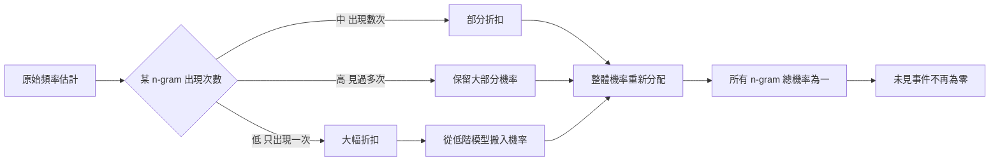

# 2.2 1990 年代：資料稀疏性、平滑化技術與困惑度評估

## 稀疏性的量化：Voronoi 單元與經驗分布的塌陷

任何 n-gram 語言模型的訓練，都面對同一個結構性難題：模型參數的數量遠超於能夠支持它們的觀測數量。這件事實常被描述為「資料稀疏」，但稀疏本身不是最精確的說法。更精確的描述是，當語料的規模固定時，參數空間中的大多數區域只有零星或完全沒有觀測落入其中，而模型卻被要求在這些區域上給出非零且合理的機率。

可以用 Voronoi 單元的佔比來量化這件事。想像把參數空間劃分為 Voronoi 單元，每個單元對應一個可區分的參數組合，那麼一個單元獲得的資料量就決定了它能被估計得多好。在任何固定規模的語料下，參數數量隨 $`n`$ 的次方增長而觀測數量只隨線性增長，因此絕大多數 Voronoi 單元所佔的比例會隨著 $`n`$ 上升而急遽逼近零。模型於是變成由少數資料豐富的區域與大量資料貧乏的區域拼湊而成。

這個量化視角帶來一個殘酷的直覺：模型大部分的「容量」其實是空的。參數越多，模型在理論上能表達的函數族越大，但每個參數分到的資料越少，於是每個參數的估計誤差越大。稀疏性因此不是一個可以用更多資料「一直解決」的問題，它的本質是資料需求增長速率與容量增長速率之間的結構性落差。

還有一個角度值得補充：稀疏性不只是「很多參數沒資料」，它還意味著模型的有效容量遠小於宣稱的容量。一個十萬個參數的三元模型，其中真正能夠被可靠估計的參數可能只有數千個，也就是說它的實際表現更接近於一個小型模型加上大量雜訊。這個事實在 1990 年代常被用來解釋高階模型為何不如預期，也預告了後來「模型大小不等於模型能力」的整體研究方向。

## Good-Turing 估計：讓低頻事件向高頻事件借貸

Good-Turing 方法給出了第一個系統性的回應。它的核心觀察是：對於一個出現了 $`r`$ 次的 n-gram，它在更大的語料中出現的總次數（包含一次、二次、三次等所有次數）估計為：

$$
N_r \approx \frac{N_{r+1}}{T_r}
$$

其中 $`N_{r+1}`$ 是恰好出現 $`r+1`$ 次的 n-gram 數量， $`T_r`$ 是這些出現次數的總和。這個公式的直覺十分清楚：只出現過一次的罕見事件，其未來出現的機率，大致等於「出現兩次的那些事件」的數量與其總次數之比。換句話說，一次性事件的數量若足夠多，就說明未見的組合在總體中並不罕見。

Good-Turing 估計的核心洞見，是低頻事件的機率不應從它自己身上估計，而應由更高階的計數來修正。當某個三元組只出現一次時，它的條件機率應該被調高，讓位給那些出現兩次、三次甚至更多的三元組所反映的整體趨勢。這是一種把機率從稀疏區域向稠密區域重新分配的機制，也是統計平滑化的第一代形式。

Good-Turing 估計的侷限同樣清楚。它需要足夠大的語料才能穩定估計 $`N_{r+1}`$ 與 $`T_r`$ ，在小型語料上會產生極大的方差；而且它把所有低頻事件視為同質的一類，無法區分「這是我們語料選樣的偶然」與「這確實是罕見」。儘管如此，它的數學結構在後續方法中不斷以變體形式出現。

## 折扣與插值：兩種平滑化的基本策略

1990 年代浮現的平滑化方法可以歸為兩大類：折扣類與插值類，兩者處理同一個問題但哲學不同。

折扣類方法的代表是 back-off 與 Katz 平滑。back-off 策略的想法是：若高階模型給某個 n-gram 分配了零機率或極低機率，就退回去使用低階模型的估計。它的問題在於機率質量的分配必須保證總和不超過一，因此 Katz 平滑引入了折扣因子 $`D`$ 的概念，把高階模型分配到的機率總量按比例打折，再把省下的機率重新分配給低階模型：

$$
P_{\text{Katz}}(w \mid h) = \max\left( \left[ C(hw) - D(h) \right] / C(h),\; \lambda(h) P_{\text{lower}}(w \mid h) \right)
$$

折扣因子的作用是控制「有多少機率應被保留下來給高階模型」這個策略性判斷。折扣過小，高階模型失去動力而退化成低階模型；折扣過大，未見事件會得到過高機率而破壞整體分布。折扣因子因此把一個原本純粹的估計問題，轉換成一個需要經驗校準的工程超參數。

插值類方法的代表是 Witten-Bell 與 Church-Kenny 的平滑。插值把不同階數的模型用線性組合混合：

$$
P_{\text{interp}}(w \mid h) = \lambda P_{\text{high}}(w \mid h) + (1 - \lambda) P_{\text{low}}(w \mid h)
$$

Witten-Bell 的貢獻是給出了折扣因子的一個自動推導公式，它依據「未見過的上下文」在語料中的總數決定折扣量，因此不需人工調參。Church-Kenny 的方法則把插值係數視為一個待估計的參數，用最大似然或引數法從資料中求出，並且在實驗中顯示高階模型在插值中應佔的權重往往高於直覺預期。

| 方法 | 類別 | 核心機制 | 是否需人工調參 | 代表文獻 |
| --- | --- | --- | --- | --- |
| Good-Turing | 折扣類 | 由高階計數修正低頻事件 | 否 | 1990 年 |
| Katz | 折扣類 | 對高階機率施加折扣因子 | 是 | 1990 年 |
| Witten-Bell | 插值類 | 線性插值，折扣自動推導 | 否 | 1992 年 |
| Church-Kenny | 插值類 | 線性插值，權重由資料估計 | 部分 | 1990 年 |
| Absolute Discounting | 插值類 | 以固定常數作為折扣 | 是 | 1990 年代中期 |
| Kneser-Ney | 插值類 | 以延續計數修正低階機率 | 否 | 1995 年 |

## 靜態插值與動態插值

插值方法還有一個重要的分岔：係數是固定不變的，還是隨上下文變化的。靜態插值使用一組全局固定的權重，例如所有上下文都用同一個 $`\lambda`$ ，實作簡單且成本低。動態插值則讓權重成為上下文的函數：當上下文本身罕見時，低階模型應當承擔更多比重；當上下文常見時，高階模型可以更有信心。

這個區別反映了稀疏性的一個細微面向：稀疏性不是全域均勻的。某些上下文出現在語料中數千次，其高階估計完全可靠；另一些上下文只出現過兩三次，此時任何高階機率都不可信。靜態插值無法區分這兩種情況，因而在常見上下文上浪費了機率質量，在罕見上下文上又給了不可靠的估計過多權重。

值得注意的是，動態插值把平滑化從一個全局的靜態設定變成了一個依輸入而變的推斷過程。同一個詞在不同的句子裡會得到不同的機率，因為平滑所參照的上下文不同。這個觀念在後來的神經語言模型中以完全不同的形式再現：softmax 的溫度、注意力分布的銳利程度，本質上都是讓機率分配隨輸入動態調整。第 4 章的自注意力機制可以說是把這種「依上下文決定權重」的做法推到極致的架構。

Kneser-Ney 方法在這條線上又推進了一步。它的洞見是：低階模型的機率不應由高階模型的殘餘直接決定，因為那會把「這個上下文很少見」誤判為「這個詞在此上下文中不受歡迎」。Kneser-Ney 改用「延續計數」，也就是計算該 n-gram 作為前一個 n-gram 的後繼出現了多少次，這種做法在句子開頭這種低階模型幾乎無用的位置尤其有效，成為 1990 年代末事實上的標準配置。

## 困惑度：把模型壓縮成一個數字

評估語言模型需要一個能夠跨模型比較的指標。最常用的就是困惑度（perplexity），它是平均負對數機率的指數：

$$
\mathrm{PPL} = \exp\left(-\frac{1}{N}\sum_i \log P(w_i \mid w_{<i})\right)
$$

困惑度的直覺可以用「有效分支數」來理解。一個只有 $`V`$ 個等可能選項的模型，其困惑度恰好是 $`V`$ ；因此困惑度可以讀成「模型在每個位置平均而言等價於在多少個選項之間做選擇」。困惑度 100 意味著模型平均在相當於 100 個候選詞的不確定性之間徘徊，而困惑度 10 則代表模型已經相當確信下一個詞。

這個指標的優點是無與倫比的簡潔：單一數字、與詞彙表大小無關、可以跨語料與跨模型直接比較。代價同樣明顯：它把整個機率分布壓扁成一個總和，無法顯示模型在哪一類輸入上表現良好、在哪一類上表現糟糕。兩個困惑度相同的模型可能在完全不同的條件下達成，後來的評估研究因此發展出以句為單位的指標，試圖在彙總與可解釋之間取得平衡。

## 困惑度的一個反直覺特性

困惑度在不同模型類別之間的行為方向是相反的，這是本章最值得留意的一個現象。對 n-gram 而言，增加 $`n`$ 通常會降低困惑度：模型從二元升到三元時，因為它獲得了額外的上下文資訊而變得更敏銳，雖然它面對的稀疏性也更嚴重。

但對神經網路模型而言，方向是反的。現代大型語言模型的困惑度在訓練過程中持續下降，但隨著模型規模擴大，困惑度反而趨於飽和甚至略微上升。原因是語料中本來就存在大量本質不可預測的內容，模型再大也無法預測下一個句子會討論哪個具體主題。

更精確地說，困惑度的下界由語料本身的熵所決定。一個模型可以逼近這個下界，卻無法突破它。這解釋了為何當 n-gram 升到五元組、六元組時困惑度不再改善甚至惡化：增加上下文帶來的資訊增量已不足以抵銷稀疏性所帶來的估計誤差；而在神經模型上，模型容量早已足夠，限制完全落在資料的內在本質上。困惑度下降的空間有限，而規模收益遞減同樣是有限資源問題的另一種表現。

還有一個技術細節值得提及：困惑度依賴分詞方式。同一段文字用不同的分詞器或不同的詞表切割，會得到不同的困惑度數值，不同系統之間的數字因此不可直接比較。這個困擾在 2016 年後的評估研究中被特別強調，也催生了以字元為單位或以子詞為單位的評估嘗試。指標的表面簡潔之下，藏著測量尺度的模糊性。

## 語料規模、覆蓋率與 Heaps 法則

語料規模與模型覆蓋率之間存在一種單調但緩慢的關係。某個 n-gram 類型是否被觀測到，取決於它在真實語言中的出現機率乘以語料的總詞數；當這個乘積達到某個門檻時，該類型才會第一次出現。這種「某個事件在累積資料量達到其期望倒數時首次出現」的性質，就是 Heaps 法則的直覺。

對實務的啟示是明確的：要讓某個罕見搭配被模型看見，語料必須大到足以讓它出現過一次；而要讓它的機率估計變得可靠，還需要更多。這意味著提升資料量對長尾現象的幫助是超線性的——每增加一個數量級的語料，會有一批此前完全未見的組合首次進入可估計的區域。相對地，佔據頻譜前端的常見組合早已被充分觀測，再多的資料對它們幾乎沒有增益。

這個觀察解釋了為什麼 1990 年代的語料庫建設是一場以數量取勝的競賽，也預告了後來「模型參數的增長需要資料的增長來配合」的論述。稀疏性不是靠更聰明的公式就能徹底解決的，它最終是一個資源問題。

語料規模的另一個效應是詞彙本身的成長。隨著語料增加，新詞、新搭配、新事件不斷湧入詞表，詞彙表的大小本身成為一個需要估計的參數。詞彙表越大，未登錄詞的比例越低，但每個詞的出現次數也越少，稀疏性於是在詞內部與詞間兩個層面上同時惡化。1990 年代末的研究曾主張在訓練語料中對罕見詞進行人工合併或刪除，這類看似粗糙的做法，恰恰是稀疏性壓力下的理性妥協。

從這個角度回看本章的方法譜系，可以發現一條貫穿的主線：所有平滑化技術都在做同一件事，即在參數空間中重新分配有限的機率質量，讓稀薄的區域獲得一份來自稠密區域的信用。Good-Turing 用高階計數修正低頻事件，Katz 用折扣因子守住高階模型的份額並把餘量下放，插值類方法則直接把低階與高階的機率按權重混合，Kneser-Ney 進一步指出這筆帳不該只從高階模型出。

這條主線的終點卻是一個無法迴避的認知：只要語言的基本單位是不可分割的原子詞，機率的共享就只能發生在完全相同或形式相近的詞形之間，而語意上的相似性永遠無法被納入。要真正解決稀疏性，就必須讓不同的詞能夠參與同一份統計，也就是引入某種能把符號轉換為可共享特徵的機制。第 3 章的分散式表示正是沿著這條思路展開的。

但在此之前，還有另一條更為務實的出路：放棄把語言視為單一序列，改為引入不可見的中間層，讓詞的歧義可以被同一個底層結構解釋。

## 轉折：把詞串換成隱變數

所有 n-gram 平滑方法都在同一個框架內打轉：假設詞本身就是可觀測的狀態，而狀態之間的轉移機率可以從計數估計。但人類語言中的許多歧義使這個假設站不住腳。「我去 saw a saw」這類句子中，同一個詞形對應到不同的詞義與不同的詞性角色，詞串本身不足以確定哪一種讀法才是正確的。

解決的方向是把不可觀測的語意層引入模型，作為一個隱變數，並允許多個不同的詞串路徑對應到同一個隱狀態。這樣一來，機率的分配不再是簡單的詞到詞轉移，而是詞到狀態、狀態到詞的兩段結構，中間夾著一個不可見的層。這個改動把語言模型從單純的計數表，轉變成真正的機率圖模型。

第 2.3 節將敘述這條轉折在統計機器翻譯領域的完整實現，以及它為何在 1990 年代末至 2000 年代初成為整個領域的主軸。
