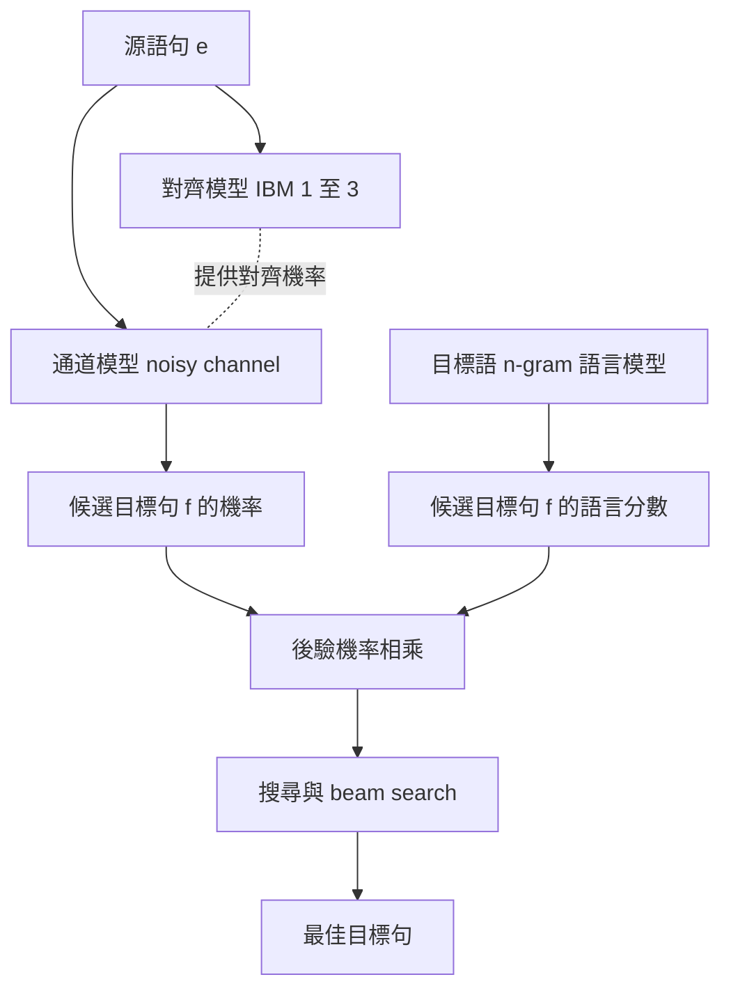

# 2.3 2000 年代：隱馬可夫模型與統計機器翻譯的黃金時代

## 領域的成熟：統計方法登堂入室

1990 年代末，統計機器翻譯完成了一次徹底的典範轉移。此前的主流是規則式的對譯系統：專家撰寫對應表與重寫規則，系統在規則之間做比對與套用。這類系統在特定領域與特定句型上表現良好，一旦面對開放領域的多樣句式，規則的維護成本便急遽上升，覆蓋率卻停滯不前。

統計方法的轉向並非源自語言學上的新洞見，而是來自三個務實的理由。第一是對齊語料的取得成本大幅下降，平行文本可以從網際網路與多國籍組織的文件中大量取得，統計量因而具備了規模。第二是運算資源的成長讓原本不可行的參數估計變得可行。第三是自動評估技術的出現，讓研究者不必依賴少數專家的主觀判斷就能比較系統。

2002 年在美國NIST舉辦的機器翻譯評測，是這個轉折最具體的象徵。在那次評測中，統計系統全面超越規則系統，結果清楚到不容置疑。此後數年，整個領域的工作重心都圍繞著如何把統計模型做得更準確而展開，規則式方法迅速退場。

## 兩條技術路線的分工

統計機器翻譯在 2000 年代發展出兩條並行的技術路線，它們對語言結構的假設截然不同，但在實務中卻可以組合成同一套系統。

第一條路線是 IBM 對齊模型系列，由 IBM 研究院在 1990 年代末提出。其基本想法是把翻譯視為一個對齊問題：源語句中的每個詞，對應到目標語句中的某個位置，而這個對應關係允許空缺、允許一對多、允許多對一。整個模型的核心物件不是句子，而是詞與詞之間的對齊關係。

第二條路線是基於隱馬可夫模型的生成式方法，也就是所謂的 noisy channel 架構。它假設存在一個不可觀測的「翻譯過程」，觀察到的目標語句是這個過程經過某種通道後的產物，而通道本身會引入錯譯與失真。在這個架構下，翻譯不再是直接從源語生成目標語，而是從候選句子中挑選出最可能是由某個源語經過通道產生的那一個。

這兩條路線在實務中是互補的：IBM 模型提供對齊機率作為通道模型的核心，而目標語言的 n-gram 模型作為語言模型提供另一部分的分數。兩者相乘後在候選句空間中搜尋最佳解，即構成完整的解碼程序。

隱馬可夫模型在這裡的職責需要說得更清楚一些。所謂隱狀態，可以被理解為「在每個位置上真正被說出的那個詞」，而觀測到的則是經過某種替換、插入或刪除之後的詞。詞形相近的兩個詞（例如「臺」與「台」）在隱狀態層面幾乎無區別，但它們在目標語中的出現機率卻大不相同。這個分離讓模型可以在字面層面做寬鬆的匹配，同時在隱狀態層面做嚴格的語法與搭配檢查，這正是它在詞形變化豐富的語言中特別有效的原因。

| 方法 | 建模對象 | 參數數量 | 訓練方式 | 主要限制 |
| --- | --- | --- | --- | --- |
| 規則式對譯 | 對應表與重寫規則 | 人工撰寫 | 專家編寫 | 覆蓋率低 維護昂貴 |
| IBM 模型 1 | 詞對對齊 | 詞對機率矩陣 | EM 迭代 | 忽略位置與鄰接 |
| IBM 模型 3 | 對齊加詞的繁殖數 | 對齊加插入機率 | EM 迭代 | 假設過於理想化 |
| 隱馬可夫通道模型 | 隱狀態與觀測序列 | 狀態轉移與產出機率 | 向前向向後演算法 | 狀態空間受限 |
| 短語表方法 | 短語對短語的對應 | 短語辭典 | 貪婪式對齊 | 短語邊界不精確 |
| 最大邊際重排 | 候選排序特徵組合 | 数十項特徵權重 | 在候選集上訓練 | 複雜度隨特徵數增長 |

上表的最後兩列代表 2000 年代中期的技術水準，也代表這條路徑的終點：模型不再是單一機率分布，而是由數十個可獨立調校的元件組裝而成。

## 對齊機率的數學：IBM 模型 1 與 EM 訓練

IBM 模型 1 是整套對齊機制中最簡潔也最奠基的一個。它假設一個目標詞的產生，只取決於它對應到哪個源語詞，而不取決於對齊的相對位置與方向。更精確地說，在給定源語句長度為 $`m`$ 的條件下，目標句中第 $`j`$ 個詞對應到源語第 $`i`$ 個詞的機率是一個常數 $`p`$ ，而與 $`i`$ 、 $`j`$ 皆無關：

$$
P(f_j \mid e, a_j = i) = \frac{1}{m}
$$

這個極簡假設是刻意為的：它讓模型只需要估計一個參數，也就是某個目標詞在給定源語詞時的生成機率矩陣。這種把語法與位置資訊全部捨棄、只保留詞對關係的設計，使得模型能夠用 EM 演算法在平行語料上進行參數估計。

EM 演算法在這裡扮演的角色值得細說。模型的完整資料 likelihood 在給定對齊時是可分解的，但對齊本身是隱變數，無法直接觀測。EM 演算法因此採用交替最佳化：E 步驟在當前參數下計算每個詞對作為對齊的後驗機率，M 步驟則用這些後驗作為加權次數重新估計參數矩陣。這套程序反覆迭代直到收斂，是整個統計自然語言處理領域中最常用的訓練骨架之一。

IBM 模型 2 加入了相鄰詞的對齊關聯，允許目標詞對應到源語詞或源語詞的二元組。IBM 模型 3 則進一步引入fertility（詞的繁殖數），用來解釋一個源語詞可能生成零個、一個或多個目標詞的情形，並加入了對虛詞插入位置的機率描述。三者的關係是逐層增加結構複雜度，每一層都在解決前一層無法解釋的現象。

## Noisy channel 形式與最大後驗解碼

noisy channel 模型的數學骨架非常簡潔。給定一個可能的源語句 $`e`$ 與一個目標句 $`f`$ ，模型假設 $`f`$ 是由 $`e`$ 經過通道產生的，而機率分解為兩部分：通道模型給出「由 $`e`$ 產生 $`f`$ 的機率」，語言模型給出「 $`f`$ 本身像不像合法的目標語句子」。於是：

$$
P(f \mid e) \propto P(f \mid e, \text{channel}) \times P_{\text{LM}}(f)
$$

解碼的目標不是找出最大的 $`P(f \mid e)`$ ，而是在所有候選中找到使後驗機率最大的那一個。這個區別在實務上相當重要：模型其實並沒有建模「 $`e`$ 是什麼」，它只是把 $`e`$ 當作一個用來生成候選的線索，真正的排序依據來自語言模型的自然度。

這就是為什麼目標語言模型在統計翻譯中扮演如此核心的角色。IBM 對齊模型能保證譯文在詞彙層面對應得上源語，但它完全無法保證譯文的句子結構自然。一個把所有源語詞依序直譯過來的譯文，詞對應近乎完美，讀起來卻像一份逐字翻譯稿，正是因為語言模型的權重被對齊模型壓過了。

實務上，解碼採用的是近似演算法而非窮舉。先用較弱的啟發式方法（例如直接以二元語言模型解碼）產生大量候選，再以更強的模型重新評分並保留最好的若干條，這個方法稱為 beam search。在 2000 年代中期，開源框架 Moses 把搜尋範圍擴展到數千條候選，並透過更精細的搜尋與重排把品質推上新高。

## 2005 年評測的轉折：自動評估的誕生

2005 年，NIST再次舉辦機器翻譯評測，但這一次的意義不在於冠軍歸屬，而在於兩套自動評估指標的正式登場：BLEU 與 NIST。BLEU 從譯文與參考譯文的 n-gram 重疊計算幾何平均，再乘上一個 brevity penalty 懲罰長度不足的譯文；NIST 則在此基礎上給不同的 n-gram 不同的權重，讓高資訊量的短語匹配佔更大比重。

自動評估的出現改變了整個領域的研究生態。在此之前，評估翻譯品質需要數名專家逐句比對，不僅緩慢、昂貴，而且難以重現。有了自動指標，研究者可以在數千個實驗設定上快速比較，於是各種技術細節如重排權重、插值比例、詞彙限制策略都能被系統性地優化。

自動評估也帶來了方法論上的警訊。BLEU 之類的指標與人工評價之間存在可觀察的偏差，它獎勵那些在參考譯文中出現過的字串組合，因而對輸出措辭與參考譯文相似的系統有利，對輸出更流暢但用詞不同的系統不利。整個 2000 年代後期，領域內對此有大量討論，最終催生了直接以人類評分為目標的評估研究。

## 統計方法贏了，為什麼仍不是「理解語言」

到 2006 年，統計方法在公開評測中的優勢已經毫無疑問，但幾乎沒有人會說統計翻譯系統「理解了語言」。這個反差值得細究。

一個明顯的證據是詞序錯誤與代名詞指涉的處理。統計模型在詞彙層面的對齊相當可靠，但在需要跨越數個子句的結構上表現薄弱。「昨天我買了一本書並且讀完了它」這類句子中的「它」指涉哪個名詞，取決於語義角色與篇章結構，而非任何 n-gram 模式能可靠捕捉的東西。系統常常能產出語法大致正確卻在指涉上出錯的譯文。

更根本的問題在於目標語言模型的本質。它只衡量「這串詞是否像某種常見的樣式」，完全不知道句子在談什麼。若把譯文交給一個不看原文的語言模型，它對譯文的評分與對任何其他自然句子的評分並無差別。這意味著統計翻譯系統的品質上限，並不取決於它對原文的處理有多細緻，而取決於它的語言模型有多強，以及搜尋空間有多寬。

這裡出現了一個在整個學科史上反覆出現的模式：外部證據越充分，內部語義模型越薄弱。統計翻譯把大量計算力投入於對齊與檢索，卻幾乎沒有投入於建立語言的語意表示。第 3 章的分散式表示，正是針對這個缺口而來的。

## 2006 至 2016 年：統計時代的頂峰

2006 年 Moses 開源框架的釋出，是統計翻譯從研究原型走向可用工具的分水嶺。它的重要性不只在於整合了各種模型，更在於把一套成熟的訓練與解碼流程封裝成任何人都能使用的工具鏈，社群得以在上面快速實驗各種改進。

短語表方法是這一時期最具影響力的技術改進之一。其想法是：既然整句對齊難以處理，則退而求其次，把句子切成短語並建立短語到短語的對應，短語內部的詞序與結構直接沿用對齊模型或語言模型的既有能力。這個折衷大幅提升了對齊的可靠性，因為短語比整句容易對齊得多。搭配最大邊際重排，系統從大量候選中挑出在多個特徵上總分最高的組合，涵蓋語言模型分數、對齊分數與短語邊界特徵。

從 2006 到 2016 年這十年間，統計翻譯的品質提升是穩定而可量化的。同一套公開評測基準上的分數逐年刷新，大型科技公司把這套系統推入線上服務，翻譯品質從「大致能讀」進化到「商業可用」。這是自然語言處理史上少數能夠在長達十年間持續、單調進步的子領域。

然而到了 2016 年，這條路徑走到了盡頭。當時的主流做法已經是一個組裝了數十個獨立元件的複雜系統：詞彙過濾、短語表建構、重排特徵工程、插值權重調參。每一個元件都經過手工調校，系統的複雜度遠超於任何單一模型所能解釋的範圍，而每一個元件的貢獻又都難以獨立歸因。這種複雜度本身就是一個訊號：它說明當前的問題已經沒有更聰明的統計估計方法可以解決。

## 統計極限：長距離依賴、組合性與世界知識

要說明統計方法的邊界，可以列出三個結構性的限制。

長距離依賴是第一個。n-gram 的上下文視窗是固定的，而語言中真正影響句意的資訊常常出現在數十個詞之前。代名詞的指涉、主題的延續、邏輯連接詞所建立的因果鏈，都超出了任何有限 n 的捕捉能力。隱馬可夫模型同樣受限於其狀態結構，儘管狀態數可以很大，但狀態序列仍受限於一階的馬可夫結構。

組合性是第二個限制。語言能夠以有限的規則產生無限多樣的句子，而這正是語言的核心能力之一。一個 n-gram 模型對「蘋果掉下來」和「法律掉下來」這類組合並沒有任何區別對待，它們在模型眼中只是同樣長度的字串序列，各自的機率由各自的計數決定，兩者之間沒有共享任何結構。模型無法把「蘋果會掉落」這個世界知識推廣到「杯子也會掉落」。

沒有世界知識是第三個限制，也是最根本的一個。n-gram 模型完全不知道「華盛頓是美國首都」這類事實，它知道的是「在包含『華盛頓』的語境之後，某些詞串更常出現」。事實被還原成了共現模式，一旦上下文改變，模式便失效。這種知識的本質是關係性的、需要被檢索與推理的，而不是可以被直接計數的。

這三個限制共同指向同一個診斷：統計語言模型缺乏一個能夠承載長距離依賴、支援組合性泛化、並容納事實性知識的內部表示。第 3 章將引入分散式表示這個概念：把每個詞映射到一個高維連續向量，使不同詞之間可以依據共現模式共享相似性。這正是彌補上述三項缺口的第一個技術方案。

值得補充的是，這些限制並非統計方法本身的缺陷，而是「以詞形作為唯一基本單位」這個設計選擇的後果。只要語言模型的基本單位是不可分割的原子符號，它就只能觀察到符號之間的共現，而無法觀察到符號所指的對象。把詞從符號變成向量，等於為模型補上了一層可以進行比較、組合與推理的結構，語言模型才第一次有可能處理長距離依賴與事實性知識。第 4 章的自注意力機制則補上另一塊拼圖：讓模型能夠依內容動態地決定檢索哪些上下文。

從這個角度回望整個第 2 章，會發現一條清楚的主線。n-gram 提供了可估計的機率介面，稀疏性逼出了精密的估計技術，平滑化把語言模型的數學推到成熟，困惑度提供了可比較的度量，而隱馬可夫模型與 noisy channel 則把這套工具武裝成一個能夠在真實任務上運作的系統。到了 2000 年代末，語言模型已經是一個定義明確、工程成熟、評估完善的技術方案。然而它所解決的問題，與人類所理解的「理解語言」之間，始終隔著一道由表示方式決定的鴻溝。第 3 章的工作，正是要跨過這道鴻溝。
