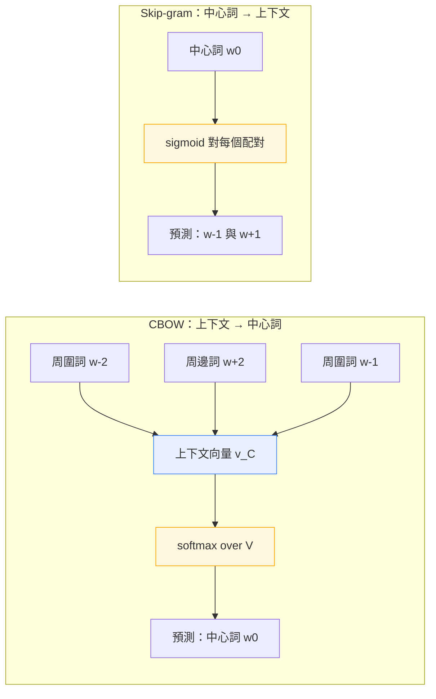

# 3.1 2013 年：分散式假設與 Word2Vec 詞向量空間

## 一、語義的來源：分布語義與情境語義

1954 年，語言學家 Zellig Harris 在〈Distributional Structure〉一文中提出一個後來被稱為「分布語義假說」的直覺：詞語的意義不必從詞典的定義中取得，而可以從它在語料中出現的上下文裡取得。他觀察到，"carrot" 與 "cabbage" 在句子中往往共享相似的鄰居，因此它們在語料裡的可預測性模式彼此接近，而這種接近本身就承載了語義資訊。這篇短文沒有提出任何演算法，卻為半個世紀後的向量模型提供了哲學地基。

五年後，J. R. Firth 在 1957 年《Studies in Linguistic Theory》中給出了更為激進的表述：語言的意義取決於它在特定環境中的用法，「You shall know a word by the company it keeps」。Firth 強調的不是靜態的詞典定義，而是詞語在具體情境中與其他詞語共現的樣式。他所描述的「情境語義」意味著，詞義是一個動態的、依賴使用場合而浮動的現象。Harris 說的是統計上的鄰近，Firth 說的是功能上的作用，兩者共同構成了向量模型的直覺基礎。

這兩個想法在 1990 年由 Deerwester、Smolensky、Dumais 與 Hauchenbach 等人《Indexing by latent semantic analysis》正式轉化為可計算的模型。他們把語料裡每個詞語表示成高維的共現向量，詞語 $w$ 的第 $j$ 個特徵是它與第 $j$ 個上下文詞語共同出現的次數。接著他們以奇異值分解（singular value decomposition, SVD）把這個稀疏矩陣壓縮到低維空間。降維的直覺是：若兩個詞總是出現在相似的文件脈絡中，那麼它們在降維後的座標必然靠近。

潛在語義分析（latent semantic analysis, LSA）在資訊檢索上立刻獲得成功，它可以讓查詢「如何降低模型誤差」找到含有「減少預測錯誤」的文件，即使兩者沒有任何共同詞彙。但它有兩個明顯的缺陷。第一，矩陣分解的計算成本高，難以跟上網路規模的語料。第二，也是更根本的問題，它把每個詞語固定成單一的靜態向量。LSA 的座標軸代表「文件主題」，而不是詞語的可預測性，這使得它的向量很難直接用於語言模型或類比推理的任務。

## 二、靜態向量模型的困境

「分散式表示」這個名稱本身也值得說明。它指的不是把詞語分散到許多個維度上，而是指詞語的意義被**分散**到整個表示向量之中，每個維度只承載語義的一小部分，任何單一維度都無法解讀，但全體維度共同決定了詞語的位置。這與傳統的離散特徵形成對比：在離散特徵中，「是否為動詞」是一個明確的位元；在分散式表示中，「動詞性」是許多軸上的一個微弱模式。這種「意義不可逐維分解、卻可整體比較」的性質，是後來注意力機制也同樣繼承的。

隨後的分散式表示研究逐漸把焦點從文件主題轉回詞語本身。1995 年之後，1990 年代末到 2000 年代初的一系列共現矩陣方法都沿著同一條路徑前進：先定義詞語的上下文特徵，再用矩陣分解取得稠密向量。這些模型共享一個結構性假設：詞語 $w$ 的表示 $v_w$ 只由 $w$ 自身決定，與它此刻出現在哪個句子無關。

這個假設立刻與語言的實況衝突。英文的 "bank" 在 "river bank" 與 "bank account" 中義項完全不同，但在同一個模型裡只會有一個向量 $v_{bank}$ ，於是「存款帳戶」與「河岸」被強迫在向量空間中共享鄰域。同樣地，"apple" 在水果與公司之間、"bat" 在動物與球棒之間都無法區分。統計上這類歧義詞佔比不低，在自然語言中更佔多數，任何以單一向量處理歧義的模型在原理上都無法完全正確。

還有一個更隱蔽的問題關係到向量的可用性。在共現矩陣方法中，詞語的座標是文件主題的投影，因此兩個詞的相似度取決於它們「出現在哪些文件裡」；這對檢索有效，對推理卻幫不上忙。人類在比較兩個詞時，其實比較的是它們的**用法**而非它們的**出處**。把參照系從「文件」換成「上下文詞語」，是 2010 年代初最重要的概念位移，而 Mikolov 的模型正是把這件事做得既快又直接。

另一個缺陷是：一個固定向量無法回答「這句話裡的這個詞是什麼意思」這個問題。當我們說「他在河岸邊的帳戶被盜用」時，理想表示應當是同一個詞在兩個位置給出兩個不同的向量。要做到這件事，就必須讓向量成為上下文的函數，而這正是序列模型的任務。

## 三、2013 年：Word2Vec 與可高效訓練的副產品

2013 年 1 月與 9 月，Tomas Mikolov、Kai Chen、Greg Corrado 與 Jeffrey Dean 先後發表〈Efficient Estimation of Word Representations in Vector Space〉與〈Distributed Representations of Words and Phrases and their Compositionality〉。第一篇提出 CBOW 與 Skip-gram 兩種架構，第二篇加入負取樣（negative sampling）與詞組模型。真正讓這兩篇論文改變領域的關鍵，是它們拒絕了「先建共現矩陣、再做分解」的傳統路線。

傳統路線的邏輯是：語料的統計結構決定向量，因此必須先統計完整個語料才能開始分解。Mikolov 等人提出的邏輯則相反：把詞向量當作模型的主動參數，直接用 SGD 從原始語料中逐句訓練；詞向量於是成為語料統計的**副產品**，而不是預先計算的對象。這個立場的交換意味著，向量品質不再受限於矩陣分解的秩與代價，而是受限於優化過程本身能走多遠。

這裡還有一個容易被忽略的歷史背景。Word2Vec 出現在 Google 的內部研究環境中，能夠使用大規模的匿名化語料與多台機器做非同步訓練，這使它得以在幾天之內把十億詞的訓練跑完。這種「工程規模上的可行性」與「演算法上的簡潔性」的結合，才是它能夠在短時間內被整個社群接受的真正原因；同一時期也有其他分散式模型（例如 GloVe）走的是「先統計再分解」的路線，但在訓練速度上無法與之匹敵。

更關鍵的是「高效」這個詞。在 Mikolov 之前，用神經網路訓練詞向量並非沒有嘗試，但每一步更新都要觸及整個詞彙表，訓練一億個詞需要數週。Mikolov 等人把目標函數重新寫成一個局部化的形式，讓每個詞語只牽涉少數幾個參數組，於是訓練成本從「與詞彙表大小成正比的每步代價」變成「與負取樣數成正比的每步代價」。這正是 Word2Vec 能在一台筆記型電腦上跑完十億詞語料、並在 2013 到 2014 年間被大量研究者拿來做預訓練的原因。工具的易用性往往比方法的精巧更能改變研究社群的方向。

## 四、兩種架構的數學

在細節上，這兩種架構有共同的設計選擇值得注意。輸出層在 CBOW 中是對詞彙表的完整 softmax，在 Skip-gram 中則是對每個上下文位置各做一次預測；兩者的輸入與輸出都共用同一套向量，這意味著「作為上下文被觀察」與「作為目標被預測」使用的是同一個參數。這種參數共享是模型能從單一語料中同時學到輸入側與輸出側分布的原因，也是它能以極少的參數量覆蓋整個詞彙表的原因。

CBOW（continuous bag-of-words）把句子 $w_1, w_2, \dots, w_T$ 中的一個位置 $t$ 視為目標，其左右各 $c$ 個詞構成上下文集合 $\mathcal{C}$ 。模型先假設上下文彼此可交換，把上下文向量相加或平均後送入一個隱藏層，再由此預測中心詞：

$$
p(w_t \mid \mathcal{C}) =
\frac{\exp\left( v_{w_t}^{\top} v_{\mathcal{C}} \right)}
{\sum_{w' \in V} \exp\left( v_{w'}^{\top} v_{\mathcal{C}} \right)}
$$

其中 $v_{\mathcal{C}} = \frac{1}{2c} \sum_{w \in \mathcal{C}} v_w$ ， $V$ 是詞彙表。CBOW 的優點是每個詞提供多個訓練樣本，收斂快；缺點是稀有詞因為上下文稀少而學不到好向量。

Skip-gram 把因果關係反過來：給定中心詞，預測它左邊或右邊的每個上下文詞。令 $c$ 為上下文位置偏移集合，Skip-gram 的目標為

$$
J = \frac{1}{T} \sum_{t=1}^{T} \sum_{c \in \mathcal{C}}
\log p(w_{t+c} \mid w_t)
$$

$$
p(w_{t+c} \mid w_t) =
\frac{\exp\left( v_{w_t}^{\top} v_{w_{t+c}} \right)}
{\sum_{w' \in V} \exp\left( v_{w_t}^{\top} v_{w'} \right)}
$$

這個看似對稱的改寫，實際上改變了資料分布的權重：一個高頻詞會在語料中擔任無數個中心詞，因而被給予更多次「預測別人」的機會；稀有詞則常常是別人的上下文而較少當中心。Skip-gram 因此對低頻詞更友善，也更常被用於產生精細的詞向量。

兩者的對比可以整理成一張表。它們共享同一個向量表作為參數，差別只在於「誰去預測誰」以及資訊流的方向。

| 面向 | CBOW | Skip-gram |
| --- | --- | --- |
| 預測方向 | 上下文預測中心詞 | 中心詞預測上下文 |
| 訓練樣本數 | 每個中心詞一筆 | 每個位置多筆 |
| 高頻詞效果 | 佳，向量收斂快 | 佳，但更新次數過多 |
| 低頻詞效果 | 弱，上下文太稀疏 | 佳，稀有詞常當上下文 |
| 訓練耗時 | 較短 | 較長但品質較好 |
| 典型用途 | 詞彙級任務、快速原型 | 預訓練向量、相似詞查詢 |

## 五、負取樣：把 $O(V)$ 變成 $O(k)$ 

兩個架構若照字面實作，分母的求和都要遍歷整個詞彙表 $V$ 。詞彙表規模在 2013 年已達百萬量級，每一個訓練實例都做一次全域 softmax，總計算量隨 $V$ 線性成長。負取樣的做法是放棄正規化的完整機率，改為把每個訓練實例視為一組二元分類題：正例是真正出現的詞對，負例則從一個依頻率採樣出來的分布中抽取 $k$ 個詞。由於每個詞被選為負例的機率正比於其頻率的四分之三次方，常見詞被當作負例的機率較高，這讓模型學會更有效地分辨常見與罕見的混淆。

$$
J = \log \sigma\left( v_{w_t}^{\top} v_{w_{t+c}} \right)
+ \sum_{i=1}^{k} \log \sigma\left( - v_{w_t}^{\top} v_{w_i} \right)
$$

這裡 $\sigma(x) = \frac{1}{1 + e^{-x}}$ 是 sigmoid 函數。關鍵在於計算量：原本每個訓練實例需計算 $V$ 個分數並做一次 softmax 正規化，現在只需計算 $k+1$ 個分數並各自做一次 sigmoid，且 $k$ 通常取 5 到 20 之間。當 $V = 10^{6}$ 而 $k = 10$ 時，每步的計算量下降約五個數量級。這也解釋了為何負取樣版本比原始版本受歡迎得多。

負取樣還帶來一個副作用：模型學到的不只是「哪些詞常共現」，還包括「哪些詞在語義上容易被誤判」。因為負樣本的抽取刻意偏向高頻詞，模型必須反覆面對「蘋果公司」與「水果蘋果」這類容易混淆的區分，於是被迫把向量空間中容易混淆的區域推開。這正是把 softmax 分母的「所有詞」替換成「抽樣的少數詞」之後，分布估計依然能收斂的統計學理由：抽樣估計的期望仍等於完整期望，變異則隨樣本數線性下降。

Word2Vec 論文另外提供 hierarchical softmax 作為另一條路徑。它用一棵哈夫曼樹把詞彙表的 $V$ 個詞放在葉子上，softmax 分母被分解成從根到葉的路徑上 $O(\log V)$ 個二元決策的乘積。同樣地把每步成本從 $O(V)$ 降到 $O(\log V)$ ，但代價是必須先統計詞頻並建樹，且樹結構固定後無法體現語境上的細微差異。實務上，負取樣因為實作簡單、無需預處理而更常被採用。

## 六、向量空間的後驗語義

訓練完成的向量空間具有一些驚人的性質。最基本的是餘弦相似度：

$$
\cos(v_a, v_b) = \frac{v_a^{\top} v_b}{\| v_a \| \| v_b \|}
$$

它衡量兩個詞的上下文分布是否相近，這意味著「語義相近的詞在向量空間中彼此靠近」這個假設，直接被模型的訓練目標所保證。

更引人注目的是 Mikolov 等人在 2013 年提出的類比題測試：對任意詞對 $(a, b)$ 與 $(c, d)$ ，模型應該能找到使 $v_b - v_a$ 與 $v_d - v_c$ 最接近的詞 $d$ 。最著名的例子是 king 與 queen 的關係對應 man 與 woman：

$$
v_{king} - v_{man} + v_{woman} \approx v_{queen}
$$

這意味著性別這個「特徵方向」在向量空間中被近似地表達為一個方向性的位移。類比題的實驗結果顯示，在 King–Queen–Man–Woman 與一些類型的首都問題上，語料僅有十億詞的 Skip-gram 模型就能達到相當高的準確率，且遠勝 LSA 這類共現矩陣方法。

除了類比，向量空間還支援大量下游任務。最早的例子是用向量做最近鄰查詢來找同義詞與相關詞，以及用向量平均值把一句話表示成一個「句子向量」，再以餘弦相似度做語意檢索。2013 年之後，出現了把詞向量接到情感分析、文本分類與機器翻譯翻譯候選選擇上的做法。當然，這些做法也立刻暴露了靜態向量的弱點：一段文字裡若有 "bank" 這個詞，句向量就會把它拉向「河岸」與「帳戶」之間的平均位置，語意訊號被稀釋。

然而，這些性質都是**後驗的**，是從模型行為中觀察到的，而不是從設計中推導出的。研究者事後才逐漸理解，嵌入向量之所以能捕捉類比，是因為向量空間的各軸承載了可解釋的語義特徵，而加法恰好對應於關係的平移。這也提醒我們，模型的數學目標非常簡單，但它的表徵能力可以遠超目標的表面敘述。

## 七、靜態向量的致命缺陷與序列模型的到來

Word2Vec 改變了自然語言處理的工程生態：幾乎每一個 NLP 系統都改以詞向量作為輸入表示，預訓練向量在社群中被廣泛共享。它確立了「把詞語嵌入稠密向量空間」這個至今仍不可取代的基礎架構。

但它留下了一個清晰的缺口。向量 $v_{bat}$ 必須同時承擔「動物」與「球棒」兩種義項，它等於把兩個相距甚遠的點做平均，結果是那個位置既不靠近任何一類的相關詞，也不特別遠離。靜態向量更根本的問題是，它無法分辨「這句話裡的這個詞」，因為它的定義裡根本沒有「這句話」這個參數。也正因為如此，Word2Vec 的向量在多義詞比例高的中文與日文上尤其吃虧：漢語詞語不分寫形式，多義更依賴語境，而靜態模型完全無法回應這類需求。

| 面向 | 靜態向量（Word2Vec） | 上下文向量（LSTM 與 Transformer） |
| --- | --- | --- |
| 一詞的表示數 | 每個詞一個固定向量 | 每個詞在每個位置各一個向量 |
| 多義詞處理 | 取平均，語義混淆 | 依位置自動分化 |
| 序列順序 | 完全忽略 | 完整保留 |
| 遠距離依賴 | 無法表達 | 以注意力或門控路徑表達 |
| 平行訓練 | 可以 | LSTM 有限，Transformer 完全可以 |

要讓表示成為上下文的函數，就必須讓模型記住序列。要記住序列，就必須處理梯度沿時間反向傳遞時的衰減問題，而這正是 1990 年代以來反覆出現的核心難題。下一節我們回到那個起點：從神經概率語言模型到 LSTM，看語言模型如何為了「記住序列」而付出二十年的努力代價。
