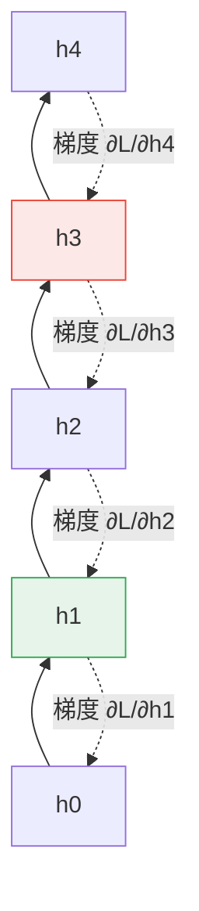

# 3.2 1990 至 2010 年代：迴圈神經網路、LSTM 與梯度消失瓶頸

## 一、從 n-gram 到神經概率語言模型

第 2 章的主線是計數：n-gram 語言模型把每個 n 元的出現次數存進一個計數表，用最大似然估計條件機率，用平滑化技術填補未見過的 n-gram。這套方法在 1990 年代達到頂峰，但它有兩個結構性限制。第一是維度災難：參數量隨 $`n`$ 指數成長，資料量卻只能線性成長，於是絕大多數 n-gram 的估計都建立在極少數觀測上。第二是記憶的組織方式：計數表把每個 n-gram 當成互不相干的條目，模型無法回答「這兩種說法有多相似」。

1990 年代的另一條路線是最大熵語言模型。它以線性加權特徵函數取代計數表，用條件熵的原理推導出平滑的機率分布，特別適合把豐富的語法與詞彙特徵直接納入模型。這條路線在統計上是乾淨的，但它的最佳化問題是凸的、線性的，只能處理人工設計的特徵，無法像神經網路那樣學出分散式表示。

1990 年代末到 2000 年代初，轉折發生在加拿大蒙特婁大學的三位研究者 Yoshua Bengio、Réjean Ducharme、Pascal Vincent 與 Christian Jauvin 所發表的〈A Neural Probabilistic Language Model〉之中。他們提出一個大膽的做法：既然 n-gram 問題的根源是「高維稀疏的離散特徵」，那就先把每個詞映射到一個低維稠密的連續向量，再用一個共享參數的神經網路去預測下一個詞。關鍵在於，共享參數意味著每個詞的向量都會從所有出現過它的語境中獲得梯度，於是稀疏性被稠密化解決了。

模型的形式可以寫成一個簡單的堆疊。設詞彙表為 $`V`$ ，詞嵌入維度為 $`m`$ ，輸入前 $`n`$ 個詞經過共享的嵌入層得到矩陣 $`X`$ ，再送入一個具有隱藏層的前饋網路，最後經過 softmax 層給出下一個詞的機率：

$$
P(w_t \mid w_{t-1}, \dots, w_{t-n+1}) = \frac{\exp\left( a_{w_t} \right)}{\sum_{i=1}^{|V|} \exp\left( a_i \right)}
$$

$$
a = \mathbf{W} h + \mathbf{b}
$$

$$
h = \tanh\left( \mathbf{W}_x X + \mathbf{b}_x \right)
$$

這個模型在 2003 年的一篇重要論文中證明了它的價值。研究者用 Penn Treebank 與比較兩百萬詞的語料訓練模型，困惑度（perplexity）明顯優於同時代的 n-gram 與最大熵模型，而且更重要的是：模型學到的詞向量本身就能分出詞類，語義相近的詞在向量空間中彼此靠近。這是在 Word2Vec 出現之前，「分散式表示」第一次在語言模型內部被自然地學出來。

## 二、RNN 的展開與 BPTT

Bengio 等人的貢獻不只是一個架構，更是把「神經網路能學出好的詞表示」這個主張確立在語言建模的場域裡。他們在論文裡明確討論了模型在「每個詞都見過很多次」與「稀有詞」的表現差異，並指出共享的嵌入層正是讓稀有詞受益於整個語料的機制。這裡有一個耐人尋味的歷史回聲：Word2Vec 走的正是同一條道路，只是把視窗大小與計算效率推到了極致。

然而，神經概率語言模型有一個明顯的缺陷：它只有固定的上下文窗口 $`n`$ 。要處理更長的依賴，理論上可以把 $`n`$ 加大，但參數量會再次爆炸。自然的解法是把「上下文窗口」本身做成可學習的，這正是迴圈神經網路（recurrent neural network, RNN）所做的。2010 年前後，Tomas Mikolov 等人把這個想法系統化為 RNN 語言模型（RNNLM），用 Mikolov 的基於計數的平滑化技巧處理高頻詞與低頻詞的機率銜接，把模型困惑度推到新的水準，並在 2013 年前後發展出下一節提到的分散式表示訓練方法。同一時期 Tomas Mikolov、Kai Chen、Greg Corrado 與 Jeffrey Dean 在 Google 建立的語言模型基礎設施，讓「把語言模型訓練成常規模型」這件事在幾年後變得極為便宜。

事後看，這條線索是理解 2013 年 Word2Vec 的關鍵：RNNLM 證明了帶有迴圈的神經語言模型能夠學出高質量的詞向量，而 Word2Vec 則證明了在把計算效率推到極致之後，詞向量本身就可以獨立成為下游任務的基礎設施。

RNN 的遞迴定義為

$$
h_t = \tanh\left( \mathbf{W}_{xh} x_t + \mathbf{W}_{hh} h_{t-1} + \mathbf{b}_h \right)
$$

$$
y_t = \mathbf{W}_{hy} h_t + \mathbf{b}_y
$$

其中 $`h_t`$ 是第 $`t`$ 步的隱層狀態， $`x_t`$ 是當前輸入（例如上一個詞的嵌入）， $`y_t`$ 是輸出。關鍵在於 $`h_t`$ 同時依賴當前輸入與前一步的狀態，因此理論上 $`h_t`$ 編碼了從序列開頭到 $`t`$ 的全部歷史。訓練時，我們把這條遞迴關係沿時間軸展開成一個深度為 $`T`$ 的網路，這個技巧稱為按時間反向傳播（backpropagation through time, BPTT）。



圖中的實線是前向遞迴，虛線是反向的梯度路徑。梯度必須沿著這條鏈式路徑一步一步往回走，每一步都乘上一個雅可比矩陣。BPTT 這個技巧本身並不新，它是「把循環當作展開」這個想法的標準應用；新的地方在於，循環的深度 $`T`$ 會隨序列長度增長，而不像前饋網路的深度是設計時固定的。也就是說，RNN 把「深度」從靜態的架構參數變成了動態的資料長度，這正是後續所有梯度問題的根源。

## 三、梯度消失與梯度爆炸

BPTT 的梯度計算可以逐層展開。對任意兩個時間步 $`k > t`$ ，梯度中有這一段乘積：

$$
\frac{\partial h_t}{\partial h_k} = \prod_{j=k+1}^{t} \mathbf{W}_{hh} \operatorname{diag}\left( 1 - \tanh^2(h_{j-1}) \right)
$$

這是一個連乘。每個因子都是一個矩陣乘上一個對角矩陣，其奇異值被限制在 $`\tanh`$ 的導數所給出的範圍內，也就是說每個因子的最大特徵值不會超過 1 ，而且在隱層狀態飽和時遠小於 1 。當連乘的因子數很多時，這個乘積的量級會以指數速度趨近於零，於是**梯度消失**發生：遠端的時間步幾乎收不到任何學習訊號。

相反的現象是**梯度爆炸**：若某些因子的特徵值大於 1 ，連乘就會以指數速度放大，參數更新時被推到極大的數值，網路在幾次迭代內就發散。1990 年時 Hochreiter 與 Schmidhuber 的分析已經指出，問題的根源在於遞迴權重矩陣 $`\mathbf{W}_{hh}`$ 自身的譜半徑超過 1 時，連乘必然發散。

幾個常見的緩解手段在 1990 年代末陸續出現。梯度截斷（gradient clipping）直接限制梯度的範數，簡單而有效，但只處理症狀。更根本的方案是改變遞迴結構本身，讓每一步的雅可比接近單位矩陣。1997 年 Hochreiter 與 Schmidhuber 提出的長短期記憶網路（long short-term memory, LSTM）正是這樣的產物，而 1995 年 Cho 等人提出的門控循環單元（gated recurrent unit, GRU）則是較為簡化的版本。

## 四、LSTM 的細胞狀態與門控結構

LSTM 的核心洞見是：把「狀態」分成兩條通道。一條是原有的隱層狀態 $`h_t`$ ，負責短期輸出；另一條是細胞狀態 $`c_t`$ ，負責長期記憶。細胞狀態以加性方式更新，這使得它的雅可比矩陣接近單位矩陣，梯度可以沿著一條「高速公路」直接傳遞，而不必每一步都經過 tanh 的飽和壓縮。

LSTM 在時間步 $`t`$ 有三個門控。遺忘門 $`f_t`$ 決定細胞狀態中哪些舊內容要被抹去，輸入門 $`i_t`$ 決定哪些新內容要寫入，輸出門 $`o_t`$ 決定細胞狀態的哪些部分被暴露到隱層：

$$
f_t = \sigma\left( \mathbf{W}_{xf} x_t + \mathbf{W}_{hf} h_{t-1} + b_f \right)
$$

$$
i_t = \sigma\left( \mathbf{W}_{xi} x_t + \mathbf{W}_{hi} h_{t-1} + b_i \right)
$$

$$
\tilde{c}_t = \tanh\left( \mathbf{W}_{xc} x_t + \mathbf{W}_{hc} h_{t-1} + b_c \right)
$$

$$
c_t = f_t \odot c_{t-1} + i_t \odot \tilde{c}_t
$$

$$
o_t = \sigma\left( \mathbf{W}_{xo} x_t + \mathbf{W}_{ho} h_{t-1} + b_o \right)
$$

$$
h_t = o_t \odot \tanh\left( c_t \right)
$$

其中 $`\odot`$ 是逐元素乘積， $`\sigma`$ 是 sigmoid 函數。細胞狀態的更新式是整個 LSTM 的關鍵：它是一個加性的殘差連接，也就是說，如果遺忘門開啟、輸入門關閉， $`c_t`$ 就等於 $`c_{t-1}`$ ，而此時 $`\partial c_t / \partial c_{t-1} = f_t`$ 近似等於 1 。梯度因此可以跨越數十上百個時間步而不衰減。

門控的直覺可以用「讀寫記憶體」來理解。遺忘門是刪除鈕，輸入門是寫入鈕，輸出門是讀取鈕；三個門的取值都在零到一之間，意味著它們不是二元開關，而是連續的調節器。三個門都以 $`h_{t-1}`$ 與 $`x_t`$ 為輸入，因此門本身是由當前情境決定的：模型在每一步都要自己判斷，此刻該忘掉哪些舊資訊、寫入哪些新資訊、以及從長期記憶裡取出哪一部分對外輸出。這種「讓模型學會何時使用記憶」的機制，是 LSTM 與單純加深網路最大的差別。

```mermaid
graph LR
    C1["c_{t-1}"] --> MUL1(("×"))
    F["遺忘門 f_t"] --> MUL1
    MUL1 --> ADD(("+"))
    IT["輸入門 i_t"] --> MUL2(("×"))]
    CT["候選值 c̃_t"] --> MUL2
    MUL2 --> ADD
    ADD --> C2["c_t"]
    C2 --> TAH(["tanh"])
    TAH --> MUL3(("×"))
    O["輸出門 o_t"] --> MUL3
    MUL3 --> H["h_t"]
    style ADD fill:#e6f4ea,stroke:#34a853
    style C2 fill:#e8f0fe,stroke:#4285f4
```

三種結構的差異可以用一張表整理：

| 面向 | 簡單 RNN | LSTM | GRU |
| --- | --- | --- | --- |
| 狀態通道數 | 一條隱狀態 | 細胞狀態加隱狀態 | 單一隱狀態 |
| 門控數量 | 無 | 三個門 | 兩個門 |
| 梯度路徑 | 每步經過 tanh | 加性細胞路徑，近似恆等 | 加性更新路徑，近似恆等 |
| 參數量（同一隱層寬度） | 基準 | 約為基準四倍 | 約為基準三倍 |
| 序列長度敏感度 | 高 | 低 | 低 |
| 代表年份 | 1986 起的 RNNLM | 1997 | 1995 提出的 GRU，2014 普及 |

GRU 簡化了 LSTM：它合併了細胞狀態與隱層狀態，只保留一個更新門與一個重置門，因此在參數效率上往往優於 LSTM，而在多數基準任務上的表現相當。

## 五、語言模型作為序列標註器與 2015 至 2017 年的翻譯革命

RNNLM 在 2010 年前後的一項關鍵改進，是把模型從「預測下一個詞」擴充為「對每個位置輸出一個標籤」，也就是序列標註（sequence labeling）。透過在每個時間步都計算 softmax 分佈，並以 CRF 層把整條序列的標籤聯合起來，RNN 就同時處理了分詞、詞性標註與命名實體辨識。這種「以語言模型為骨幹、再加上任務特定結構」的設計，在 2010 年代初主導了自然語言處理的多個任務。

在機器翻譯之外，序列標註的示範應用也在同一時期湧現。以 BiLSTM 為例，它在正向與反向各跑一條 LSTM，把兩個方向的隱層狀態在每個位置拼接，再送入分類層。這種雙向結構後來成為命名實體辨識與序列標註的主流做法，直到 BERT 等遮罩語言模型出現才被取代。

2014 年到 2015 年，Sutskever、Cho 等人把編碼器–解碼器（encoder–decoder）架構引入機器翻譯，並在 2015 年由 Bahdanau、Cho 與 Bengio 加入了注意力機制，2016 年 Sutskever 等人更以帶有殘差連接的深層 LSTM 與更強的解碼策略，在公開基準上超越了基於短語的統計翻譯系統。至此，統計機器翻譯在主流語言對上的優勢被全面取代，神經機器翻譯成為主流。這是 LSTM 時代最大的歷史成果：它證明一個可微的、能用 GPU 大規模訓練的序列模型，可以取代整個建立在短語表與線性特徵之上的統計系統。

這條勝利的時間線值得停下來細看。2013 年之前，最好的英法翻譯系統仍仰賴短語表與語法化模板，需要巨大的工程投入來維護詞典與調變規則。2015 年之後，一個端到端訓練的 seq2seq 模型在若干語言對上超越了整套統計系統，而且新增語言的邊際成本大幅下降。這是深度學習第一次在自然語言的旗艦任務上取得全面而不可逆的勝利，其社會後果遠大於當時多數研究者預期。

Seq2Seq 的基本形式是：編碼器 RNN 把源句讀成一個狀態序列，解碼器 RNN 以此為條件逐步生成目標句。注意力機制則補上了解碼器「只能看見一個固定摘要」的缺陷：解碼時每一個時間步都對編碼器的所有狀態計算權重，讓模型能依需求取得源句的任意部分。這個機制的數學推導將是第 4 章的主題。

## 六、訓練與推論的不對稱性

Seq2Seq 的訓練採用**教師強制**（teacher forcing）：解碼第 $`t`$ 步時，直接把正確的前一個詞餵進去，而不依賴模型自己先前的輸出。這讓整個序列的訓練可以完全並行，也讓損失函數是所有時間步的總和。

但推論時沒有正確答案可用，模型必須用它自己產生的詞作為下一步的輸入。訓練與推論的這個落差造成**曝光偏差**（exposure bias）：模型在訓練時見過的是「真實歷史」，在推論時見到的是「自己的歷史」，而後者可能包含錯誤，一旦錯誤產生，後續步驟就會落入訓練中從未出現過的狀態分布。

早期對策是beam search 與取樣解碼這類推論期技巧，它們只能部分緩解，無法從根本上消除落差。學界曾提出許多種解法，例如 Scheduled Sampling 把真實與模型生成的歷史以遞增機率混合，以及 DAgger 式的聚合資料集方法。真正解決問題的是 2017 年之後的機制：在解碼的每一步，模型都直接對整段已知上下文重新計算表示，而不是依賴已經生成並回饋進去的隱狀態。這個想法就是自注意力機制，它把「記憶」從一個必須被序列化攜帶的狀態，變成一個可以被直接查詢的矩陣運算。

值得強調的是，教師強制的另一個好處是計算效率。在教師強制下，解碼器第 $`t`$ 步的輸入是已知的正確詞，因此所有時間步的計算彼此獨立，訓練可以在 GPU 上大眾化並行完成。這一點對深度學習的興起至關重要：正是因為訓練能夠如此高效地進行，Seq2Seq 這類模型才能在幾年內把機器翻譯的整個產業版圖翻轉過來。

## 七、LSTM 的瓶頸與「任意兩位置直接互動」的必要性

即便 LSTM 大幅緩解了梯度消失，它在 2016 年前後仍被公認為存在結構性瓶頸。

第一是路徑長度問題。即使細胞狀態提供了一條近似恆等的梯度路徑，資訊本身仍須一步一步沿時間軸前傳。第 $`t`$ 步要取得第 1 步的資訊，必須走過 $`t-1`$ 次狀態轉移，每一次轉移都會與新的輸入競爭、遺忘與稀釋。當序列長度從數百增加到數萬，這條路徑的損耗就變得不可忽略。

第二是平行性問題。由於 $`h_t`$ 依賴 $`h_{t-1}`$ ，計算在時間軸上是嚴格串行的。雖然 GPU 擅長處理龐大的資料並行，卻不擅長處理這種具有長距離依賴的串行鏈。訓練一個 LSTM 就是把數千個時間步攤在一條鏈上逐步前傳、再逐步反向，資料並行度受限於批次大小，裝置利用率因此偏低。這一點在模型規模需要不斷擴張的 2010 年代後期，成為越來越嚴重的工程障礙。

第三是狀態表示的固定容量。LSTM 的記憶全部壓在維度固定的隱層狀態與細胞狀態裡，它無法像注意力那樣「按需求」取用遠端資訊，所有資訊競爭著有限的通道容量。

還有一個常被低估的問題是位置資訊。LSTM 的狀態是「記憶體內容」，不是「記憶體位址」：模型很難明確地表達「第 37 個詞是什麼」，而人類在閱讀時對順序的依賴相當強。這個缺陷直到 2017 年位置編碼出現才被徹底解決，它也說明序列模型的能力上限往往不在梯度，而在**資訊檢索的方式**。

這三點共同指向一個明確的要求：需要一個機制，讓序列中任意兩個位置能夠在一步之內直接互動，而不必依賴中間的狀態傳遞。這正是注意力機制的出發點。第 4 章將從加性注意力的數學開始，說明這個「直接互動」如何被形式化、如何計算、以及如何成為 2017 年 Transformer 架構的骨架。
