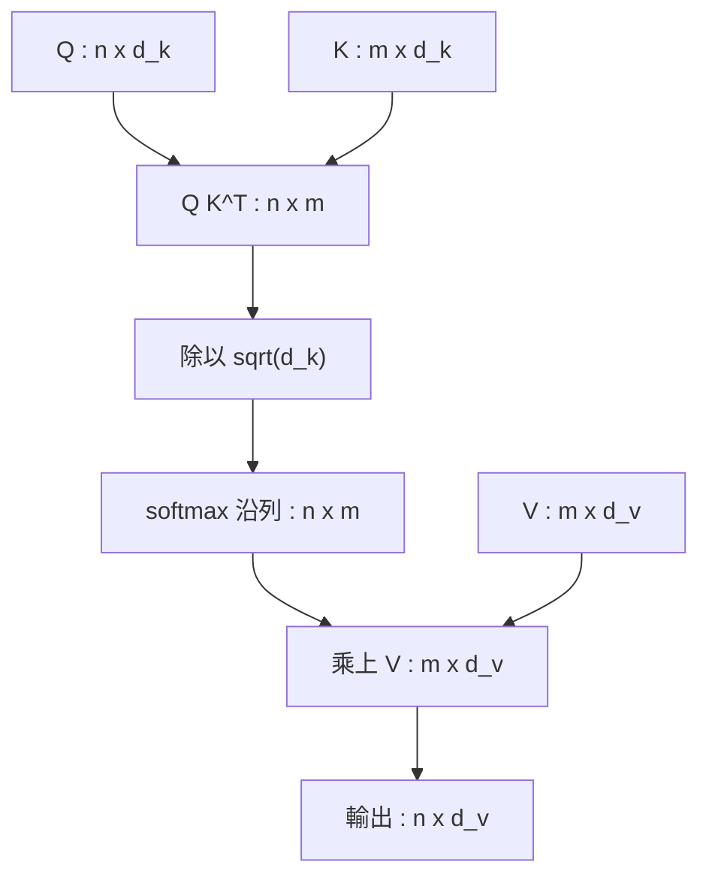

# 4.1 2017 年：注意力機制的數學推導與矩陣運算

2017 年之前，序列建模的宇宙由遞迴網路主宰。Bahdanau 等人在 2014 年的機器翻譯工作中提出的加性注意力（additive attention），第一次讓「譯碼器可以只挑選編碼器輸出中與當前步驟相關的片段」這件事變成可學習的運算。隔年同一批研究者改用乘性注意力（multiplicative attention），把比對的計算從一個小型前饋網路簡化為兩個向量的內積。到了 2016 年，Luong 等人又把乘性注意力整理成通用的點積形式，並提出多頭（multi-head）與幾種位置感知的變體。三年之間的演進看似只是工程上的簡化，實際上卻逐步鬆動了一個更深的前提：注意力究竟應該「怎麼算」，而不是「該不該算」。

加性注意力的形式寫作 $ e_{ij} = v^{\top} \tanh ( W_{h} [ h_{i} ; \bar{h}_{j} ] + b_{h} ) $ ，其中 $ h_{i} $ 是編碼器第 $ i $ 步的隱層狀態， $ \bar{h}_{j} $ 是解碼器第 $ j $ 步的狀態。這個式子很直觀，也很好教學：把兩個向量拼接、投影、非線性化、再壓成一個分數。但它的代價是每一個「查詢對每一個鍵」的配對都要跑一次小型網路，計算量隨著序列長度與隱層寬度雙重膨脹。乘性注意力則直接寫成 $ e_{ij} = h_{i}^{\top} W_{h} \bar{h}_{j} $ ，把所有配對的計算合併成一次矩陣乘法。當 $ W_{h} $ 退化成單位矩陣時，這就是我們今天最熟悉的點積相似度。

這個演進並非只是為了省算力。乘性注意力假設「相關性」可以用內積這樣的雙線性形式表達，而雙線性形式恰好可以用矩陣乘法一次算完整張相關性表；加性形式則是一個任意函數逼近器，能表達更複雜的關聯，卻無法被高效地批次化。換言之，加性與乘性之別本質上是「表達能力」與「可批次化」之別。Transformer 最終選擇了可批次化，並且證明在夠大的資料量下，雙線性形式所遺漏的那點表達能力並不關鍵。這個取捨是理解深度學習「等變性優先」思維的典型樣本：把計算重排成既有的硬體友善形狀，比追求最一般的表達式更划算。

另一個被繼承下來但常被忽略的設計，是加性注意力中「先算分數、再做 softmax」的兩段式結構。這個結構在 Transformer 中被完整保留：注意力不是一個融合了比對與歸一化的黑箱，而是一個明確的兩階段程序，先算未正規化的相容性，再把它轉成機率分佈。診斷模型時這兩段可以分開觀察，是很有價值的設計。

注意力機制的第一個關鍵特性，是它把「關聯」與「傳遞」解耦了。遞迴網路中，第 $ j $ 步要看到第 $ i $ 步的資訊，必須由 $ i $ 一路帶著訊號走到 $ j $ ，中間每一小步都可能衰減或扭曲。注意力則直接為每一對 $ (i, j) $ 建立一條長度為一的邊，權重由內容決定。這就是為什麼 Bahdanau 等人在 2014 年會說，注意力是「一句話的短版記憶體」，也是為什麼後來研究者會把注意力稱為「記憶的讀取機制」：它不是把資訊存在某個地方，而是每次查詢時現場把整個記憶體攤開來比對。

2017 年 Vaswani 等人在 *Attention Is All You Need* 中做的事情，是把乘性注意力再推一步，整理成今日的標準形式：

$$
\text{Attention}(Q, K, V) = \operatorname{softmax}\left(\frac{QK^{\top}}{\sqrt{d_k}}\right) V
$$

這個式子的四個部分，每一個都有來歷。 $ Q $ 是查詢矩陣（query），代表「我現在想知道什麼」； $ K $ 是鍵矩陣（key），代表「每一個位置能被什麼樣的問題找到」； $ V $ 是值矩陣（value），代表「找到之後真正取回的內容」。查詢與鍵之間的相容性決定權重，權重再決定從值中取回多少資訊。這套「以查詢找鍵、以鍵取值」的三段式，後來幾乎所有檢索增強、多模態與長上下文模型都沿用至今。

那個 $ \sqrt{d_k} $ 究竟解決了什麼問題？假設 $ q $ 與 $ k $ 的各維分量彼此獨立、平均為零、變異數為一，那麼它們內積的期望值是零，而變異數是 $ d_k $ 。也就是說，點積的量級會隨著維度線性成長。當 $ d_k = 64 $ 時，某些配對的分數可能高達 $ \pm 8 $ 以上；送進 softmax 之後，分布會急劇集中到最大值附近，其餘位置的機率幾乎為零。這就是所謂的 softmax 飽和：一旦飽和，梯度幾乎全部流向最大那一項，其餘鍵的表示在這一步之後就不再更新。

除以 $ \sqrt{d_k} $ 之後，分數的變異數回到常數，softmax 保持在溫和的區間裡，梯度得以均勻地流向每一個鍵。作者在原文中並未展開機率論的細節，只以一句「假設 $ q $ 與 $ k $ 的分量平均為零、變異數為一」帶過，但這個縮放因子在實務上的重要性不亞於任何一個架構元件。此後幾乎所有注意力實作都把 $ \sqrt{d_k} $ 視為不可省的常數，FlashAttention 之類的融合算子甚至把它直接燒進硬體迴圈以省去額外除法。

還有一層工程上的理由常被忽略：把縮放因子寫成 $ \sqrt{d_k} $ 而非 $ d_k $ ，是為了讓它可以用平方根乘法指令一次算完。同樣重要的是，這個因子是「逐層可調」的旋鈕——理論上若把注意力分數再乘上一個可學習的溫度參數，模型就能自己在某幾層把分布調得更尖銳或更平坦。原始 Transformer 沒有這麼做，但後續工作顯示這種可學習溫度在實務上偶爾能帶來小幅但穩定的增益。

也要指出縮放的另一個副作用：它讓分數的動態範圍受到控制，等於把「相似度」壓縮到一個固定的尺度上，這使得不同層、不同頭之間的分數可以互相比較。當分數動態範圍失控時，某些頭會變成只看自己附近的局部注意力（本質上是滑動視窗），某些頭則變成均勻分佈（等同於無資訊），而縮放把這兩種極端都拉回來。

接下來把矩陣維度推演清楚。設輸入序列有 $ n $ 個位置，鍵值序列有 $ m $ 個位置，則 $ Q \in \mathbb{R}^{n \times d_k} $ 、 $ K \in \mathbb{R}^{m \times d_k} $ 、 $ V \in \mathbb{R}^{m \times d_v} $ 。因為 $ Q K^{\top} $ 的內積是在 $ d_k $ 維上做的，而 $ Q $ 的列數必須等於 $ K $ 的列數，因此結果落在 $ \mathbb{R}^{n \times m} $ 的長方形矩陣裡；再除以 $ \sqrt{d_k} $ 、送進 softmax，得到一個每列和為一 的權重矩陣。權重矩陣右乘 $ V $ ，輸出即為 $ \mathbb{R}^{n \times d_v} $ 。整個流程是「先算所有配對分數、再依分數加權取值」，其視覺化如下。

把注意力理解成一個可微分的資料庫查詢是很有用的。傳統檢索是先給定查詢字串、算出一個固定的相關度分數；注意力的差別在於查詢本身就是向量，而且每一步解碼都會產生新的查詢向量，因此「檢索」是隨著生成過程持續重寫的。softmax 既是加權也是保證凸組合的機率化操作，它把未正規化的分數映射到單純形（simplex）上，讓每一個位置對最終表示的貢獻加總為一。這個「凸組合」性質有一個實際意義：輸出永遠落在 $ V $ 各行張成的凸包之內，因此不會因為加權而產生訓練初期常見的數值爆炸。

還有一個容易被忽略的細節是權重的可解釋性。當某個查詢在某一個鍵上取得極高權重時，人類可以檢視該處的原文，直接說出「模型正在看這裡」。這種內部對齊在機器翻譯與文件摘要的早期研究中已經被大量用來診斷模型行為，也構成注意力被視為「部分可解釋」的來源。不過後來的研究也提醒，權重的可視化很容易產生過度解讀的風險：注意力權重高不等於因果重要，這一點在解釋性章節會再回到。

可微性這件事值得單獨說明。softmax 的雅可比矩陣是 $ J = \operatorname{diag}(p) - pp^{\top} $ ，其中 $ p $ 為softmax 輸出向量。當分布夠平坦時， $ p $ 分佈在多個位置，對角項佔主導，梯度可以沿多個鍵回傳；當分布尖銳時， $ p $ 退化成接近 one-hot 的向量， $ J $ 的秩降至一，除最大鍵外的所有鍵都收不到梯度。前面討論的縮放因子，正是為了讓 $ J $ 不要過早退化。這也說明「注意力矩陣」不只是一個權重表，它同時是儲存位置之間資訊流向的路由圖，也是回傳時的信用分配表。

複雜度上的革命才是注意力真正改寫歷史的地點。RNN 處理長度為 $ n $ 的序列，需要沿時間軸逐步前傳，計算量是 $ O(n) $ ，但路徑長度也是 $ O(n) $ ，這使得梯度必須穿越 $ n $ 個時間步，這就是梯度消失在深層序列上的根源。Transformer 的注意力層則是 $ O(n^2 d) $ ，其中 $ d $ 是模型寬度。對短序列來說，注意力顯然更貴；對長序列來說，情況相反：注意力把所有位置兩兩配對一次就完成，路徑長度是常數的 $ O(1) $ 。所謂「注意力的瓶頸是二次方」這句話，必須放進對比裡才成立。

| 面向 | 遞迴網路（LSTM / GRU） | Transformer 注意力 |
| --- | --- | --- |
| 單層時間複雜度 | $ O(n \cdot d^2) $ | $ O(n^2 \cdot d) $ |
| 路徑長度（最遠依賴） | $ O(n) $ | $ O(1) $ |
| 訓練可否高度平行 | 不可，同一序列內順序相依 | 可，整個注意力矩陣一次算完 |
| 序列長度成長的瓶頸 | 記憶容量有限，非計算量 | 注意力矩陣記憶體平方成長 |
| 長距離梯度傳遞 | 需靠 gates 維持，常有衰減 | 直接相連，無衰減 |

平行性這一項在 2017 年之後被嚴重低估。當時的主流共識是「注意力更貴，所以更慢」，但真正決定訓練速度的是能否把整個序列丟給 GPU 同時計算。RNN 的時間步必須依序執行，同樣的硬體利用率卻只用上一小部分；注意力的 $ n \times n $ 矩陣乘法則是大型矩陣乘的標配工作負載，充分利用了平行算力。這一點讓 Transformer 在同等時間內吃下遠多於前人的訓練資料量，也讓「資料規模決定能力」的規模定律敘事有了基礎。

注意力有三種典型用法，構成 4.2 要描述的完整架構。第一種是編碼器自注意力： $ Q $ 、 $ K $ 、 $ V $ 全部來自同一段輸入的表示，每個位置可以同時看到整段序列的所有位置。第二種是解碼器自注意力，同樣源自解碼端，但必須遮住未來。第三種是編碼器－解碼器交叉注意力， $ Q $ 來自解碼器、 $ K $ 與 $ V $ 來自編碼器輸出，這正是 Bahdanau 等人 2014 年提出的那個「譯碼時挑選編碼片段」的形式。

三種用法在數學形式上只差一個投影的來源。編碼器自注意力是 $ Q = K = V = X W $ ；解碼器自注意力是 $ Q = K = V = Y W $ 再加上遮罩；交叉注意力則是 $ Q = Y W^{Q} $ 、 $ K = V = X W^{K} $ 、 $ X W^{V} $ 。注意前兩者的 $ Q $ 、 $ K $ 、 $ V $ 來自同一個矩陣，這就是「自」注意力的來源，也是它能直接建模序列內部關係的原因。第三種則是「異」注意力，它把兩段序列接起來，正是注意力最初被用於機器翻譯時的模樣。

遮罩的數學很簡單。在計算注意力分數之後、進入 softmax 之前，把不允許被看到的位置的分數設為負無窮：

$$
S_{ij} = \frac{q_i k_j^{\top}}{\sqrt{d_k}}, \qquad \tilde{S}_{ij} = \begin{cases} S_{ij} & j \le i \\ -\infty & j > i \end{cases}
$$

因為 $ \operatorname{softmax}(-\infty) = 0 $ ，被遮罩位置的權重嚴格為零，其值向量對輸出一點貢獻都沒有。這不是近似，是精確的零，訓練與推論完全一致，因而可以用矩陣乘法一次完成，不需要任何迴圈或資料分支。代價是它製造了一個階梯狀的權重結構，使得權重矩陣不再是低秩的隨機量，這在後續章節的稀疏化改造中會成為工程難題。

遮罩還帶來一個漂亮的副產品：它讓注意力矩陣成為下三角結構，而下三角矩陣在硬體上可以拆成多個小塊矩陣乘，顯著改善快取命中率。這個觀察在多年後被 FlashAttention 發揚光大，把「避免把整個 $ n \times n $ 矩陣寫回記憶體」變成一整套演算法設計的出发点。也就是說，遮罩在 2017 年只是正確性的手段，在 2023 年卻成了效率的最佳化對象。

在實作層面， $ QK^{\top} $ 的計算被稱為批次矩陣乘（batched matrix multiply）中的 GEMM， $ V $ 的加權聚合則是另一個 GEMM，中間夾著一個列方向的 softmax。整個注意力的算術強度極高，操作數與記憶體搬運量的比值大到可以吃滿 GPU 的算力管線。這是為什麼 FlashAttention 這類「不物化中間矩陣」的融合算子能帶來數倍加速：它用分塊技巧讓每一次加載的資料被重複使用數十次，把原本受限於記憶體頻寬的運算變成受限於算力。

正是因為注意力把「記憶」變成了一次性的全量比對，人們才會說它是「記憶的讀取機制」而不是「記憶的存放機制」。RNN 把記憶放在狀態向量裡，靠不斷更新來維持；Transformer 把記憶放在輸入序列本身，靠注意力矩陣把需要的部分拉取到當前位置。這個取捨在 2017 年看來顯然划算：讀取是平行的、可微的、不受梯度消失困擾的。但它也帶來兩個尚未解決的問題，一個是記憶體佔用的二次方膨脹，一個是序列順序資訊的缺失。前者需要新的注意力實作來處理，後者需要位置編碼來補救。

這兩個瓶頸在本質上是同一個取捨的兩面。RNN 的記憶是壓縮過的：固定的狀態向量必須承載所有歷史資訊，因此容量有限但長度無上限。Transformer 的記憶是不壓縮的：整段序列原封不動地保留在序列中，因此容量近乎無限但讀取成本隨長度平方成長。往後所有關於長上下文的研究，都可以歸結為「如何把記憶體從平方降下來，同時保住讀取的平行性」這個題目的變體。

值得補充的是，這個「記憶外置」的比喻後來被推得更遠。整個 Transformer 家族可以被理解成一把固定容量的硬碟加上三種讀取機制：自注意力在同一段序列內讀取、交叉注意力向另一段序列讀取、外部工具呼叫向模型之外讀取。當語言模型在 2020 年代開始使用檢索增強與工具呼叫時，結構上等於是在同一個框架裡再加入一種讀取機制。這個統一 viewpoint 是理解第 8 章與第 9 章的前提。

至此，注意力在數學上已經完備：它是一個可微分的、以內容定址的加權檢索。但要成為一個可堆疊、可訓練的深層網路，它還缺少三樣東西——如何把單一注意力擴展成多個並行子空間、如何在注意力之外加入非線性容量、以及如何在缺乏順序內建的前提下重建位置。這正是下一節要處理的內容。

這兩件事剛好構成本章下一節的主題。下一節將把注意力放回它的完整居所：在六層編碼器與六層解碼器之間，注意力如何與位置前饋網路、残差連接、層正規化、多頭並列與遮罩共同組成一個可堆疊、可訓練的整體架構，以及位置資訊必須如何被重新引入到一個本質上對順序無感的模型之中。
