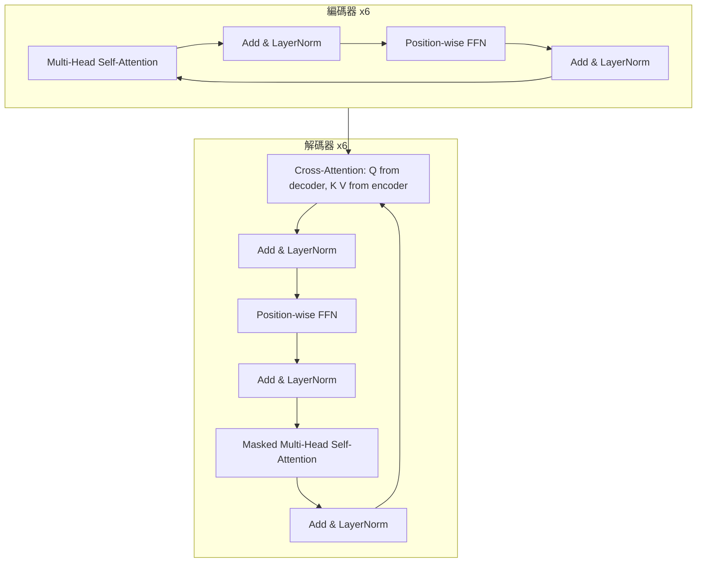
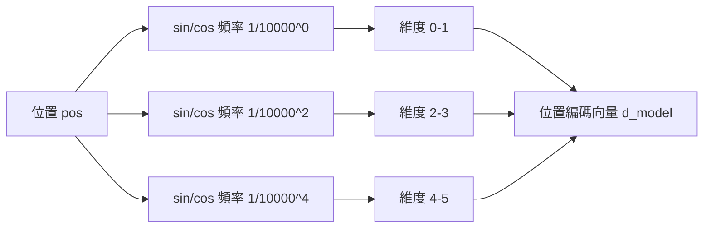

# 4.2 2017 年：Transformer 完整架構與位置編碼

前一節把注意力拆到只剩公式，這一節要把它放回它的完整居所。Vaswani 等人在 2017 年的原論文中提出的 Transformer，是一個刻意「薄」的設計：整個模型除了注意力、位置前饋網路與幾個正規化層之外，幾乎沒有其他元件。沒有限制捲積，沒有循環連接，沒有對齊機制。這種極簡不是美學偏好，而是工程判斷——每一個額外元件都意味著更多的訓練不穩定與更難的平行化。

編碼器由 $`N = 6`$ 個相同結構的層堆疊而成，每一層包含兩個子層。第一個子層是多頭自注意力；第二個子層是位置前饋網路。每個子層外都套上殘差連接與層正規化，且順序是「先殘差相加、後正規化」（post-layernorm）：

$$
y = \operatorname{LayerNorm}\left(x + \operatorname{Sublayer}(x)\right)
$$

殘差連接解決的是深度帶來的訓練難題。 $`N = 6`$ 層在當時並不算深，但注意力加前饋網路的組合使有效梯度路徑變長，而殘差讓每個子層只需學「相對於輸入做多少修正」而非「重建整個表示」，梯度因而可以直接跨越任意層數回傳。更細緻地說，若把每個子層視為對恆等映射的擾動，那麼堆疊 $`N`$ 層之後的輸出可以寫成輸入加上各層增量之和，梯度便沿著這個加法結構毫無衰減地回傳。殘差還有第二個副作用：它讓子層的輸出分佈天然維持在輸入附近，有助於抑制深層模型常見的激活值爆炸。層正規化（layer normalization）則是針對每一個位置的特徵維度做標準化，把均值與變異數調整到可控範圍，使得深層訓練時的激活值不會逐層膨脹或衰減。

解碼器同樣是 $`N = 6`$ 層，但每層有三個子層：先是帶遮罩的多頭自注意力，然後是編碼器－解碼器交叉注意力，最後是位置前饋網路。三個子層同樣各有殘差與層正規化。遮罩保證解碼器在位置 $`i`$ 只能看到 $`0`$ 到 $`i`$ 的目標序列，交叉注意力則讓它同時檢索整段源序列。

多頭注意力的動機來自一個簡單的觀察：單一注意力分數只能給出一個標量，而語言中的關係遠不止一種。句法依存、指代消解、主題與述語的關係、詞彙的字面重合，各自需要不同的度量方式。若強迫所有這些關係共用同一組投影參數，模型就必須在單一子空間中把它們混在一起，實際上不可能兼顧。多頭的解法是乾脆分開：每個頭擁有自己的 $`W^{Q}`$ 、 $`W^{K}`$ 、 $`W^{V}`$ ，在自己的子空間裡做一次完整的注意力，最後把結果串接並投影回去。

多頭注意力的數學形式，是把同一組輸入投影到多個子空間各自計算，再串接回來：

$$
\text{MultiHead}(Q, K, V) = \operatorname{Concat}(\text{head}_1, \dots, \text{head}_h) W^{O}, \quad \text{head}_i = \text{Attention}(Q W_i^{Q}, K W_i^{K}, V W_i^{V})
$$

其中每個 $`W_i`$ 為 $`d_{\text{model}} \times d_k`$ 的投影矩陣， $`h`$ 個頭各自持有獨立的參數，總計算量與單頭 $`d_k = d_{\text{model}}`$ 的情形相當。原文使用 $`h = 8`$ 、 $`d_{\text{model}} = 512`$ 、 $`d_k = d_v = 64`$ 。為什麼要這樣切分？因為單一注意力分數是查詢與鍵的整體相似度，它只能為每一對位置給出一個數字，而多頭可以讓模型同時用不同「投影後的語意度量」去比對。句法依存、指代關係、字面相似、位置鄰近，各自可以在不同的子空間裡被獨立地表達出來。

一個更技術性的說法是：頭與頭之間的參數不共享，因此它們的注意力矩陣在數學上互相獨立；這讓模型能在不同的隨機投影子空間中構造關聯，等價於同時做多組關聯並把結果融合。實驗上常觀察到不同頭會分化出諸如「指涉核心標題」「關注句法依存項」「看前一個詞」等特化模式。多頭不是為了增加容量而存在的技巧，它是把一個受限的關聯機制擴展成多個並行機制的結構。

前饋網路的位置也值得說明。每一層的注意力之後，都接一個逐位置（position-wise）的前饋網路：

$$
\text{FFN}(x) = \max(0, x W_1 + b_1) W_2 + b_2, \qquad W_1 \in \mathbb{R}^{d_{\text{model}} \times d_{ff}}, \quad W_2 \in \mathbb{R}^{d_{ff} \times d_{\text{model}}}
$$

原文取 $`d_{ff} = 2048`$ ，也就是擴展比例為 $`4`$ 倍。這個 MLP 對每個位置獨立作用，參數在所有位置間共享。它在架構中的角色是「注意力負責跨位置交換資訊，前饋網路負責在每個位置內做非線性特徵轉換」，兩者職責分明。擴展比例為 4 這個數字後來幾乎被整個領域沿用，成為標準配備。

把注意力與前饋網路並排放在一起看，會發現它們構成了 Transformer 的全部運算骨架，可以用一句話概括：注意力是跨位置、加權求和的線性聚合，前饋網路是位置內、帶激活函數的非線性變換。注意力裡沒有非線性（softmax 除外），前饋網路裡沒有跨位置資訊。這樣的分工解釋了為什麼加深加寬這兩者能帶來穩定收益，也解釋了為什麼後來的模型即使換掉其中一者（例如以混合專家取代前饋網路、或以狀態空間模型取代注意力）仍能維持整體架構的可讀性。

另一個容易被忽略的細節是：注意力是「加權平均」，這讓它天然具有對輸入的微小擾動連續的性質。前饋網路的 ReLU 則提供真正的非線性切割能力。沒有 ReLU，多層注意力的堆疊仍將坍縮成單一的線性聚合，深度將毫無意義。這是為什麼殘差串接加 ReLU 這個組合在 2017 年之後幾乎沒有被質疑過。

接下來是本章最容易被低估的問題：注意力本身沒有順序概念。因為無論輸入順序為何， $`Q K^{\top}`$ 的結果都只是「內容之間的關聯強度」，把序列打亂不會讓注意力運算本身報錯，只會讓語義全毀。RNN 的順序是由它的遞迴結構保證的；Transformer 拿掉了遞迴，就必須用別的方式把位置資訊塞回去。

原始論文提出的是正弦位置編碼：

$$
PE_{(pos, 2i)} = \sin\left(\frac{pos}{10000^{2i/d_{\text{model}}}\right)
$$

PE_{(pos, 2i+1)} = \cos\left(\frac{pos}{10000^{2i/d_{\text{model}}}\right)

$$
其直覺是讓每個位置對應到一個由不同頻率正弦波組成的向量：低維度對應高頻（相鄰位置變化劇烈），高維度對應低頻（跨越極長距離仍保持可分辨）。原文給出的一個漂亮性質是，相對位置可以由絕對位置編碼線性推導：
$$

PE_{pos + k} = PE_{pos} \text{ 的某個旋轉，旋轉角度只依賴 } k
$$

這個性質暗示模型理論上能學會處理相對位移，也讓推論時超出訓練長度的外推在數學上變得可能。此外正弦編碼不需要任何參數，也不佔用嵌入表，因此天然支援任意長度序列。

另一種方案是可學習的絕對位置嵌入：把位置編碼視為一張 $`n_{\max} \times d_{\text{model}}`$ 的查詢表，與詞嵌入相加後一起訓練。它實作簡單、效果良好，代價是模型被硬性綁定在  $`n_{\max}`$ 之內，超出即無定義。原文的實驗顯示兩者效果相當，作者因此保留正弦方案作為能外推的選項。

兩種方案的根本分歧，在於位置是一個「需要被模型記住的具體座標」，還是一個「可以被運算推導的連續參數」。可學習方案回答前者：它為每個位置學一個專屬向量，代價是參數量隨序列長度線性成長，且無法外推。正弦方案回答後者：它用一組不同頻率的三角函數把位置映射到高維圓環上，使得任意兩點之間的角度只依賴它們的距離差。這使得「相對位置」不再是需要學會的概念，而是內建在編碼幾何裡的。

這個幾何直覺可以再推一步。注意到頻率的選擇 $`10000^{2i/d_{\text{model}}}`$ 是一個等比數列，其含義是不同維度涵蓋的波長從  $`2\pi`$ 一路延伸到數萬個位置。正因為最高頻分量能分辨相鄰位置、最低頻分量能在極長距離上保持區分，整個編碼向量才能同時支援「局部相鄰」與「遠距離相對」兩種查詢。這種「多尺度」的想法，後來在相對位置偏置、可學習相對位置偏置以及旋轉位置編碼中不斷以不同形式重現。

實務上還有一個第三種常見變體：在原輸入嵌入上乘以一個與位置相關的頻率遮罩，讓高頻分量在短序列被抑制。這種做法同樣源自正弦編碼的直覺，並說明位置編碼的思想並非只有公式那麼單薄。

解碼器輸出經過一層線性層與 softmax，得到下一個 token 的機率分佈，與嵌入層共享權重（weight tying）。這套「編碼器－解碼器 + 自迴歸語言建模」在 2017 年只被用來做機器翻譯與英語德語間的構析任務，規模小到幾乎無人注意；但架構本身的可塑性極高：拿掉整個編碼器就得到純解碼器模型，拿掉交叉注意力就得到純編碼器模型，而只改變遮罩的方向就能決定模型是理解型還是生成型。整個 2018 年之後的語言模型版圖，幾乎都是這張架構表的填法。

遮罩自注意力的訓練機制，是解碼器能學會語言學的技術前提。在訓練時，整段目標序列同時送入解碼器，遮罩保證位置 $`i`$ 的表示只由前  $`i`$ 個位置決定，因此一次前向就能算出所有位置的預測分佈，損失是所有位置交叉熵的平均。這與 RNN 解碼器必須逐步生成、只能用 teacher forcing 串接的方式相比，訓練效率提升了一個數量級。同時，因為遮罩是嚴格因果的，訓練時看到的前文與推論時的前文分佈完全一致，不存在曝光偏差之外的人造落差。

訓練與複雜度方面，Transformer Base 有 6500 萬參數（編碼器與解碼器各約 3000 萬），Large 版本有 6500 萬的八倍、即約 5.3 億參數。整體序列的注意力計算是 $`O(n^2 d)`$ ，前饋網路部分是  $`O(n d^2)`$ 。在  $`n`$ 遠小於  $`d`$ 的常見設定下，前饋網路是主要開銷；但當序列變長，注意力矩陣的  $`n \times n`$ 記憶體需求就會線性主導一切。這是 2017 年之後整個領域持續面對的結構性瓶頸。

值得記錄的還有正則化策略：原文對每個子層的輸出施加 dropout（比率 0.1），並且對每個位置獨立丟棄。這個看似普通的決定，在注意力上有特別的意義：丟棄某個位置的值向量，會讓其他位置的注意力權重重新分配，實際上扮演了對注意力分佈做隨機平滑的正則作用，可以抑制某些頭過早鎖定在單一位置上。

原文在優化上也留下了兩個至今仍被沿用的細節。第一個是「預熱」（warmup），learning rate 在前 4000 步由線性上升到目標值，再依平方根衰減；這是因為 Adam 的更新量在初期若太大，容易把注意力矩陣推入 softmax 飽和區，一去不返。第二個是對殘差輸出施加 $`1 / \sqrt{N}`$ 的縮放，理由與前一節的  $`\sqrt{d_k}`$ 相同：把累積的方差控制在穩定範圍內。

這兩點構成一個有趣的呼應：Transformer 之所以能訓練得穩定，很大程度上仰賴它能在每一個子層入口把數值重新正規化，而不必依賴資料本身的分佈。正因為如此，後來的研究發現，Pre-LN（在子層之前正規化）在超深模型中比 Post-LN 更穩定。2017 年的原始設計選擇了 Post-LN，而這個選擇在幾年後被深度擴張的實踐所修正。

再看輸入端。原文使用正弦位置編碼與詞嵌入相加之後，再乘上 $`\sqrt{d_{\text{model}}}`$ 才送進第一層，這個縮放的目的是讓嵌入的方差與位置編碼的取值範圍相當，避免其中一個訊號壓過另一個。至此 Transformer 的輸入端並沒有任何卷積或循環結構，僅僅是一個相加加上縮放，模型從第一層開始就完全工作在「注意力加前饋」這一個運算骨架之上。

2017 年之後的影響，可以用兩條路線概括。一條是編碼器路線：把雙向、非因果的自注意力與遮罩語言建模結合，得出 2018 年的 BERT，目標是理解。另一條是解碼器路線：保留因果遮罩並擴大參數規模，得出 2018 年的 GPT，目標是生成。兩者的分歧並非出自架構的新意，而是出自遮罩方向這個看似微小的開關——雙向表示利於理解，因果表示利於生成。這個分歧的細節，留待第 5 章展開。

在蓋棺定論之前，必須明確指出 Transformer 的兩大瓶頸。第一是注意力複雜度的二次方膨脹：序列長度增加十倍，注意力矩陣記憶體增加一百倍，計算也增加一百倍；這使得極長上下文在 2017 年的架構下直接不可行。第二是位置編碼的長距離外推問題：正弦編碼在訓練範圍內外推能力有限，可學習編碼則乾脆無法外推，兩者都無法保證模型在遠超訓練長度的序列上仍能保持正確的相對位置判斷。

與遞迴網路的對照，可以把 2017 年的取捨看得很清楚。

| 面向 | 遞迴網路 | Transformer |
| --- | --- | --- |
| 資訊流 | 逐步由前一步傳到下一步 | 任意兩位置直接相連 |
| 訓練平行性 | 受限於時間步順序 | 全序列一次前向 |
| 單層計算量 | $`O(n \cdot d^2)`$ |  $`O(n^2 \cdot d)`$ |
| 路徑長度 | $`O(n)`$ |  $`O(1)`$ |
| 記憶體隨長度 | 線性（狀態） | 平方（注意力矩陣） |
| 位置資訊 | 內建於結構 | 必須外加編碼 |
| 適配長序列 | 容量受限但長度無上限 | 成本平方成長 |

正是這兩點，構成了第 6 章的動機。FlashAttention 針對的是第一點，用分塊與重計算把二次方的記憶體需求降回線性量級；RoPE 針對的是第二點，用旋轉位置編碼把相對位置直接寫進注意力分數之中，使長距離外推成為可能；稀疏注意力則企圖在兩者之間取得更細緻的取捨。理解 2017 年架構留下的這兩道缺口，才能明白後續七年的工程努力究竟在解決什麼問題。

值得強調的是，這兩道缺口並不是設計者的疏忽，而是架構取捨的必然後果。二次方複雜度源自「每對位置都可能相關」這個假設本身——若放棄任意兩位置可互動，就必須引入結構假設來還原效率。而位置編碼的問題則源自「把順序當成附加資訊貼上去」這個思路：一旦順序不參與運算本身，它就無法在運算中泛化。正因如此，RoPE 的核心洞見是讓位置直接進入 $`Q`$ 與  $`K`$ 的運算本身，而不是作為偏移量加在表示上。

換句話說，2017 年的 Transformer 是一個「架構正確但實現待補」的設計。它的每一個環節都經得起後來七年的檢驗並被保留，但它留下的兩個洞，正是接下來六章故事的主要動力來源。
