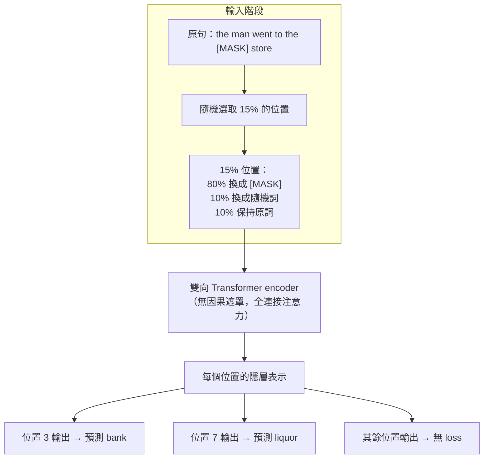

# 5.1 2018 年：掩碼語言建模與雙向理解先驅 BERT

## 一、雙向性的難題：2018 年以前的兩條死路

在 Transformer 問世的第二年，語言模型的領域還被一條看不見的線索切成了兩半。這條線索不是架構，而是**資訊流的方向**。人類閱讀一句話時，「蘋果」這個詞的意義取決於前後文：前面的「吃掉」與後面的「核」共同決定了它的指涉。但 2017 年之前的模型幾乎都只能從左往右讀，於是它們被迫在「看得見左右」與「能說話」之間二選一。

ELMo（Embeddings from Language Models，Peters 等人於 2018 年提出）試圖兩者兼得。它的做法是把句子正著讀一遍、再倒著讀一遍，各用一支雙向 LSTM 編碼，然後把兩個方向的隱層狀態拼接起來作為詞向量。ELMo 在下游任務上確實大幅進步，但它的代價是結構性的：左向 LSTM 與右向 LSTM 是在**兩個互不知情的句子**上分別訓練的，模型從未真正學到「左右兩側同時可見」是什麼樣的機率分布。人類在朗讀一句話時的語意理解並不是兩段獨立的閱讀，而是整句同時映入眼簾。

另一條路徑放棄了雙向，走向自迴歸。2018 年 6 月，Radford 等人發表的 GPT-1 是一支 decoder-only 的 Transformer，它在每個位置只允許看見左邊，訓練目標是預測下一個詞。它能寫出流暢的句子，卻在「理解」類任務上表現平庸。原因是可計算的：單向模型在計算「這段話是合法的英文」時，必須為整句的**所有位置**各算一次條件機率，而且它看到的永遠只是半個世界。

> **難題的本質**：若要一個表示同時含有左右兩側資訊（雙向），它的訓練目標就無法是「一個接一個地產生完整句子」（自對稱）；若要一個模型能直接產生完整句子（自迴歸），它的每一步條件分布就只能依賴前文。

這兩難在此之前一直沒有被打破，是因為大家都預設「預訓練目標必須等於最終任務形式」。2018 年的兩篇論文幾乎同時問出同一個問題：能不能讓**預訓練的目標與下游任務脫鉤**？

這個脫鉤的想法，其實是把機器學習中的一個老概念重新引入語言領域：先用大量無標註資料學好一個通用表示，再用少量標註資料調整它。這樣的分工之所以在 2018 年才可行，前提是 Transformer 的訓練效率高到可以承受這樣的雙階段流程——早期以 LSTM 為骨幹時，光是「跑完一遍語料做預訓練」的成本就足以讓多數研究團隊望而卻步。因此本章要特別點出：BERT 的出現不只是目標函數的巧思，也是**架構換代紅利的兌現**。

## 二、BERT 的三個設計

Devlin 等人於 2018 年 10 月發表的 BERT，答案不是換掉目標，而是把「理解」重新定義成一類可以用自監督學習的任務。整個設計可以拆成三個互相配合的零件。

**第一個設計：把 Transformer encoder 用作骨幹。** BERT 放棄 decoder-only 的因果遮罩，改用雙向 Transformer encoder。每一層的自注意力都是全連接的，也就是說位置 $`i`$ 的一次注意力運算可以同時看到序列的所有位置，沒有任何方向性限制。這正是 ELMo 做不到的事：ELMo 的兩個方向永遠是分開的，而 BERT 的每一層都是真正的全上下文聚合。

**第二個設計：掩碼語言建模（Masked Language Modeling, MLM）作為主要目標。** 訓練時，隨機選取輸入序列中約 15% 的位置，把那個詞換成特殊的 `[MASK]` 符號，再要求模型根據「被破壞之後」的句子，把原始的詞猜回來。於是每一個位置都有機會成為被預測的目標，模型被迫在每一處都建立雙向的上下文表示。

**第三個設計：下一句預測（Next Sentence Prediction, NSP）作為輔助任務。** 許多下游任務（問答、自然語言推論、句子對分類）本質上是判斷兩段文字之間的關係。於是 BERT 把輸入組織成句對 $`(A, B)`$ ，另外訓練模型判斷 $`B`$ 是不是 $`A`$ 的真實下一句。這個雙分類任務與 MLM 一起構成總 loss。

## 三、掩碼語言建模的數學與它的非自對稱性

MLM 的目標函數寫成一個帶求和的負對數概似：

$$
\mathcal{L}_{\mathrm{MLM}} = - \sum_{i \in \mathcal{M}} \log P_{\theta}(w_i \mid \tilde{w}_{\setminus i})
$$

其中 $`\mathcal{M}`$ 是被選中的掩碼位置集合， $`w_i`$ 是該位置的真實詞， $`\tilde{w}_{\setminus i}`$ 是把第 $`i`$ 個位置遮蔽之後、其餘位置保持不動的輸入序列。這個式子有兩個關鍵特徵，和 GPT 的自迴歸目標形成尖銳對照。

**其一是求和只在被掩碼的位置上。** GPT 的目標是每一個位置都要算一次損失，而 MLM 只在被破壞的那 15% 位置計算。這意味著模型的計算容量被集中在少量「有難度」的資訊缺口上，而不是平均分攤到整句。

**其二是明顯的非自對稱性。** 輸入端與輸出端並不承擔同一份資訊：輸入是被破壞的，輸出是真實的。這正是 MLM 能學到雙向表示的機制所在——輸入端丟掉了被掩碼的那個詞，模型只能靠左右兩側的殘餘上下文去重建它，因此左右兩側都必須被充分利用。反過來說，如果輸入端保留了完整的句子、輸出端再去預測同一個句子，模型就會退化為抄寫，梯度訊號近乎為零。

15% 這個數字不是拍腦袋決定的：太低則每個 batch 的有效監督太少，太高則句子被破壞得太嚴重，剩下的上下文不足以推斷。BERT 對這 15% 又做了一次三向分流：

$$
\begin{aligned}
P(\text{以 } \texttt{[MASK]} \text{ 取代}) &= 0.15 \times 0.80 = 0.12 \\
P(\text{以隨機詞取代}) &= 0.15 \times 0.10 = 0.015 \\
P(\text{保持原詞不變}) &= 0.15 \times 0.10 = 0.015
\end{aligned}
$$

保留一部分原詞不變，是為了避免模型在預訓練時過度依賴 `[MASK]` 這個標記；混入少量隨機詞，則是為了讓模型在下游微調時能處理真正被破壞或拼寫錯誤的輸入。三者的總和剛好回到 15%。

總 loss 把兩個任務加起來：

$$
\mathcal{L} = \mathcal{L}_{\mathrm{MLM}} + \mathcal{L}_{\mathrm{NSP}}
$$

值得注意的是，NSP 在後續研究中被證明貢獻有限，甚至有害（因為負例可以靠主題差異被輕易辨識），但它在 2018 年的原始論文中確實帶來了報告分數上的提升。

## 四、雙向表示為何適合理解，卻不適合生成

BERT 開啟的這條路徑有一個明確的適用邊界，值得在教科書的層次講清楚。

對於**理解類任務**，雙向性帶來的是實質的優勢。句子分類、命名實體辨識、抽取式問答、句子對蘊涵，這些任務的本質是「給定一段已經完成的文本，判斷它的意思」。既然文本是完整給定的，模型為什麼不應該同時看見左右？更關鍵的是，理解往往需要跨時間步的推理：判斷「他帶著傘，因為天空是陰的」中前因後果的關係，需要同時整合兩個分句的資訊。單向模型只能把這種整合壓縮進右向的壓縮狀態，雙向模型則可以在每一層都做全序列的聚合。實驗也支持這一點：同一個預訓練模型，換成雙向 encoder 後在多數理解基準上的分數普遍高於對應的單向版本。

但對於**生成類任務**，雙向性直接構成阻礙。生成的定義是：給定前綴 $`x_{<t}`$ ，產出下一個符號 $`x_t`$ ，並且在給定前綴的條件下， $`x_t`$ 必須是一個**可採樣的機率變數**。而 MLM 的輸出根本不是這樣的分布——它的 $`P(w_i \mid \tilde{w})`$ 是在「句子的第 $`i`$ 個位置被挖空、其他位置已給定」的條件下定義的，這個條件與「前綴已知、後綴未知」完全不同。你無法從 MLM 的輸出頭裡抽樣出一個接續的句子，因為它的每一個位置都想同時看到後面的字。

更根本的問題在機率層次：MLM 的各個掩碼位置在給定輸入時被視為條件獨立，因此它無法給出一整句的聯合機率 $`P(w_1, \dots, w_n)`$ ，也就沒有困惑度、沒有序列的機率正規化、沒有「以文字為介面」的統一介面。理解類模型缺乏這三樣東西，正是 2019 年之後業界幾乎一致轉向自迴歸架構的技術原因。

| 面向 | BERT（雙向 encoder） | GPT（自迴歸 decoder） |
| --- | --- | --- |
| 注意力遮罩 | 全連接，無方向限制 | 下三角因果遮罩 |
| 訓練目標 | 掩碼語言建模（輸入被破壞） | 下一詞預測（輸入保持完整） |
| 輸出語義 | 各位置獨立給出條件分布 | 全序列的正規化聯合分布 |
| 能否給出困惑度 | 不能（位置間條件獨立） | 能，且是模型內生的評估指標 |
| 能否直接生成文字 | 不能 | 能，這是模型的主要用途 |
| 典型下游 | 分類、標註、問答、檢索 | 續寫、對話、摘要、程式生成 |

## 五、規模與資料

BERT 不是架構上的奇蹟，而是**規模加上正確的目標函數**。原始論文的 BASE 版本有 1.1 億參數、LARGE 版本有 3.4 億參數，訓練資料是 BooksCorpus（約 800 萬句書籍文本）加上英文 Wikipedia（2012 年轉储，約 250 萬條目），合計約 33 億詞。訓練時使用 40 萬步、batch 大小 256、序列長度 512。

這裡有個容易被低估的工程事實：BooksCorpus 這個名字聽起來像「書」，但它其實是未經審核的散文小說集。研究者刻意選擇小說而非新聞或百科，因為小說裡有對話、敘事、間接引語這些在自然語料中罕見的語言樣式。代價是資料品質粗糙，而這恰恰需要更大量的資料與更強的模型容量來壓過雜訊。從後來 Chinchilla 的縮放定律回頭看，3.4 億參數對 330 億詞的組合，明顯是「資料遠多於模型所需」的狀態。

## 六、結果

BERT 在 11 個自然語言處理基準上全面刷新當時的最好成績，其中九項是當時的 state of the art。具體來說，多項任務的提升幅度相當可觀：在 SQuAD 1.1 上，BERT LARGE 的準確率超過先前最佳系統約六個百分點；在 GLUE 基準上平均分大幅領先，特別是在被認為最難的 RTE（推理蘊涵）與 CoLA（語法 acceptability）上提升最為顯著；在語意相似度、情感分析、问答等各類任務上全面改善。消融實驗同時證實了三個設計的必要性：移除雙向性會顯著掉分，MLM 加上 NSP 都保留的模型優於只用其中一項，而模型規模越大效果越好。

這組數字的意義不在絕對分數，而在於它論證了一件事：**監督式標註資料的極限，可以被自監督的預訓練大幅突破**。此後幾乎每一個自然語言處理領域的重要進步，都遵循「預訓練 + 微調」或「預訓練 + 提示」的模板。

值得補充的是 BERT 所帶來的工作流程上的變化。過去，一個自然語言處理團隊的主要人力成本往往花在特徵工程上——怎麼把一句話變成模型能吃的向量。BERT 把這件事整個抹掉：下遊工程師只需要在預訓練權重之上接一個極小的任務頭（通常是一層線性映射），用自己領域的數千筆標註資料微調十幾個 epoch，就能得到一個打敗傳統方法的系統。這種「一個預訓練模型、多個任務頭」的模式，把自然語言處理的入門門檻從「需要語言學博士」降到「會寫 Python 即可」。

同樣重要的是訓練範式的轉向。在 BERT 之前，語言模型的訓練語料是 Wikipedia 與電子郵件，新聞與書籍比較少，程式碼幾乎沒有。GPT 引入了一個更為激進的做法：把整個網路文本當成可用的訓練材料，只做人工過濾。這種「無差別地吞下一切文本」的資料策略，在 BERT 時代尚未普及，但卻是 5.2 那條自迴歸路線日後的燃料。

## 七、席捲與它留下的兩難

BERT 在學界與工業界的席捲速度極快。Google 內部大量搜尋相關功能改用 BERT，社群在數月內湧現數千篇以 BERT 為骨幹的應用論文，微調同一份預訓練權重再套上輕量任務頭，幾乎成為預設做法。社群也迅速發展出 RoBERTa、ALBERT、XLNet 等改良版本，其中 RoBERTa 乾脆把 NSP 拿掉、擴大資料與訓練批次，反向印證了 NSP 的可疑地位。

但 BERT 也留下了一個結構性的兩難，而且這個兩難正是下一節 5.2 那一整條自迴歸路線的動因。

**預訓練目標與微調目標不一致。** 預訓練時，模型學的是「把句子挖空再補回來」；微調時，模型學的是「給一個標籤」。中間存在一個鴻溝：模型在預訓練期間可能從未真正練習過「從頭產生一個連續句子」這件事，因此它的表示在分類頭後面很好用，在生成頭後面卻笨拙。更根本的是，MLM 在數學上不提供序列的正規化聯合分布，因此它無法被拿來做貝葉斯式的條件採樣，也無法支援「用一句自然語言當作任務描述」這種介面。

另一個兩難是**權重與架構的綁定**。BERT 的每一層都依賴雙向性，而雙向性排除了自迴歸採樣。於是同一組預訓練權重不能同時服務理解與生成，工程上要嘛訓練兩套模型，要嘛像 BERT 系列的「生成式 BERT」那樣在掩碼位置做迭代解碼——後者速度慢、誤差累積，始終不是主流解法。

產業對此的實際反應是明確的：理解型模型退居檢索與排序的前置環節，而對外提供「能聊天、能寫程式」的通用能力，幾乎全面交給自迴歸架構。BERT 把「預訓練」這個觀念推到了極致，也同時暴露了「理解模型」與「生成模型」分家的代價——這個代價要等到下一節，才會被 GPT 系列一一償還。

## 八、兩條路線的正式分流

若把 2018 年到 2020 年間的文獻攤開來看，兩條技術路線的分界線非常清楚，而且不只是架構上的，還包括產業定位上的。

BERT 路線的假設是：**語言理解的本質是表示學習**。既然人類理解一段文本時可以同時運用左右資訊，那麼機器也應該如此；既然下游任務的形式千變萬化，那麼預訓練就應該提供一個通用的、可微調的表示基礎。這個假設後來在檢索增強生成、序列標註、跨語言遷移等領域持續發揮作用。

GPT 路線的假設則是：**語言理解的基礎是生成**。只要模型能以足夠高的機率生成自然文本，它就必然內含了足夠豐富的語言知識；而各種下游任務，可以靠「在提示中描述任務」來召喚，不必為每個任務訓練專門的頭。這條路線的理論優勢在於，自迴歸模型給出的 $`P(w_1, \dots, w_n)`$ 是一個真正的、可正規化的聯合分布，任何以文字為介面的任務都能被統一表達成「求條件機率」或「求邊緣機率」。

兩者的第一次交鋒，發生在 2019 年。GPT-2 的出現讓研究者重新檢視上一節那個「雙向不適合生成」的論斷，答案令人意外：**只要模型夠大、序列夠長，雙向遮罩並非唯一的生成方式，但自迴歸確實是唯一能「自然地逐字產出」的方式**。而 GPT-2 釋放模型的過程，同時把「生成模型可以被濫用」這個問題從理論推到現實，拉開了下一節要描述的倫理與資訊安全討論。理解與生成的架構之爭，就此正式展開。
