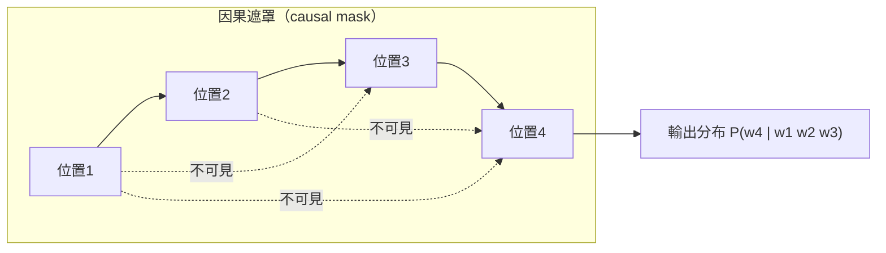
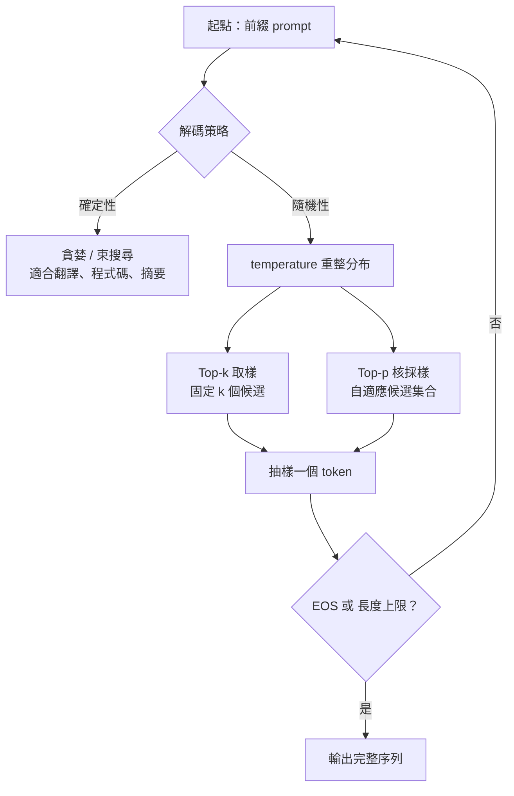

# 5.2 2018 至 2020 年代：自迴歸語言模型與因果解碼器架構演進

## 一、GPT-1：把生成放回學習的中心

2018 年 6 月，Radford 與其他六位共同作者發表了一篇題為《 Improving Language Understanding by Generative Pre-Training 》的論文。這篇論文後來被追認為 GPT-1，而它的架構選擇卻來自一個非常樸素的推理。

上一章描述的 BERT 路線指出，掩碼語言建模是極佳的**理解**目標。但它無法回答一個自然的追問：那麼**生成**該怎麼預訓練？答案其實早就存在於 2017 年 Transformer 論文的附錄裡：只要在解碼器上套用一個**下三角遮罩**，強迫每個位置只能看到自己與左邊，那麼「預測下一個詞」就成了一個完全自洽的訓練目標。GPT-1 做的，就是把 Transformer 原論文那個用於機器翻譯的解碼器單獨抽出來當成語言模型。

這個遮罩設計有兩層意義。工程上，它讓一個位置的所有注意力權重只分配給前文的「三角形」區域，因而完全平行化訓練：整個序列的所有位置可以同時計算，訓練時不需要像循環網路那樣逐步等待。而統計上，它確立了一條貫穿整個大型語言模型時代的基本等式：**模型內部計算的就是序列的正規化條件分布**。所謂「訓練」，就是把這個分布的參數估計出來；所謂「推論」，就是從中採樣。

值得留意的是，因果遮罩並不是自迴歸架構發明的。2017 年 Transformer 原始論文裡，解碼器為了避免訓練時看到未來 token，本來就必須套用下三角遮罩。GPT-1 的貢獻，是把這個原本只是「機器翻譯訓練技巧」的機制，**重新詮釋為一個語言建模的訓練目標**：把遮罩造成的「只能看左邊」從一個缺陷變成一種力量。這個重新詮釋是整個 GPT 血統的起點，因為它意味著任何具備因果遮罩的架構——不限於 Transformer，甚至不限於解碼器——都能直接承載語言建模。

GPT-1 的訓練資料是 BooksCorpus 加上 Wikipedia 的串接文字，與 BERT 幾乎是同一份語料，這說明當時的研究者已經認識到「預訓練資料」是關鍵資產。模型規模為 1.17 億參數，架構是 12 層解碼器、12 個注意力頭、768 維隱層。

## 二、上下文預測作為無監督學習目標

GPT-1 的核心貢獻不在架構，而在於把「無監督學習」這個概念重新定義得足夠有生產力。

傳統的統計語言模型早就知道分解聯合機率這件事。鏈式法則是概率論的基本定理，對任意序列都有：

$$
P(w_1, w_2, \dots, w_n) = \prod_{i=1}^{n} P(w_i \mid w_{<i})
$$

其中 $`w_{<i}`$ 表示位置 $`i`$ 之前的所有詞。這個式子本身沒有用；有用的是它在**深度神經網路**裡的具體實現：每一個因子 $`P(w_i \mid w_{<i})`$ 都由同一組共享權重的 Transformer 層計算出來，而訓練目標就是讓這整條對數機率的總和盡可能大：

$$
\mathcal{L}_{\mathrm{LM}} = - \sum_{i=1}^{n} \log P_{\theta}(w_i \mid w_{<i})
$$

這就是所謂的**上下文預測**（context prediction）。它的力量在於「自監督」這個詞最徹底的意義：訓練資料完全不需要人工標註，只要是一段連貫的自然文本，每一個位置就自動成為一筆標註——標註是「這裡本來應該是什麼詞」。資料規模的限制被一舉解除，人類標註的瓶頸從此不再是進化的天花板。

這也解釋了為什麼「下一詞預測」這件事能在 2018 年被重新發現並火起來。表面上看，它只是回到 n-gram 語言模型的舊把戲；但 n-gram 的瓶頸在於上下文窗口固定且統計量稀疏，而神經網路的版本把上下文變成整個前綴、把稀疏計數變成連續的嵌入分布。這是一次「用舊目標配上新表達能力」的典範。

GPT-1 的第二個貢獻是**分階段的任務遷移**。論文提出的做法是：先在無標註語料上做語言模型預訓練，再把序列預測的任務（下一句、下一詞）換成目標任務（分類、蘊涵），最後微調。也就是說，下游任務並不是預訓練的目標，預訓練只是提供一個通用的語法與語意先驗。

## 三、GPT-2：規模效應與「語言模型開始像文本預測器」

2019 年 2 月，GPT-2 發表。模型有 1.5 億參數，是 GPT-1 的十倍以上，訓練資料擴展到 WebText——約 40 億 token 的網頁文本，來自 Reddit 的高分連結。

規模擴大帶來的第一個現象，是困惑度繼續隨著對數尺度下的參數量、資料量與計算量下降。這是一條此後被正式命名為「縮放定律」的曲線的早期片段。更重要的是第二個現象，它是本章要記錄的第一個關鍵歷史轉折。

GPT-2 在零樣本設定下的表現出現了質變：直接給它一段提示，它能完成摘要、翻譯、問答、填空。特別值得一提的是它學會了**格式**：給它「文章標題：」這樣的前綴，它會生成風格一致的標題列表；給它「問：……答：」的格式，它會生成問答對。這意味著模型不只是學會了局部語法，而是學會了**任務的格式**，並且在沒有任何標註樣本的情況下把它們歸納成了同一件事——文本預測。

這個觀察在學術史上留下一句名言：**「語言模型開始像文本預測器。」** 它把 GPT-2 從一個模型變成了一個方法論宣言。任何一段文本，只要給它足夠長的前綴，模型都會給出某個合理的後續。於是「理解」與「生成」的邊界被溶解了——理解一個問題，就是預測它的答案；翻譯，就是預測譯文；寫程式，就是預測下一行程式碼。

然而，GPT-2 也帶來了整個領域最著名的倫理與資訊安全事件。OpenAI 在發表論文的同時釋出了 124M 與 355M 兩個較小模型，並宣布**基於擔憂濫用的理由，不釋出 1.5B 的完整模型**。理由是該模型已能生成有說服力的假新聞、以假亂真的垃圾郵件、以及可以自動產生大量仇恨言論的文本。社群與研究者隨即在社群媒體上發動「#OpenAI_please_release_GPT_2」的活動，論壇上甚至有人公開索取 800M 與 1.5B 的權重下載連結。

這場小小的公開抗議，成為大型語言模型倫理討論的起點。它確立了幾件事：其一，生成式模型的滥用風險隨著規模而急遽上升，使得「發布」本身成為一個需要論證的決策；其二，開放權重與安全之間存在真實取捨，而非可以兩全；其三，也是最耐人尋味的一點——**風險的來源不是模型内部的機制，而是模型學到了什麼**。這也預告了 5.2 後半段的主題：隨著規模繼續上升，社群需要的不是更嚴的護欄，而是一套能夠約束輸出的機制，那要等到第 8 章。

## 四、GPT-3：175 億參數與 in-context 能力的浮現

2020 年 5 月，Brown 等人發表《 Language Models are Few-Shot Learners 》，這就是 GPT-3。模型規模跨越到 1750 億參數，訓練資料擴展到 Common Crawl 等網路語料、Books、Wikipedia 與人工策劃的資料集，總量約 3000 億 token。

GPT-3 的歷史地位主要來自一個現象，論文稱之為**湧現能力**：某些能力在參數量達到某個門檻後會突然出現，而不是隨著規模平緩改善。論文中最著名的案例是 in-context learning——**不更新任何權重**，只在提示中給出幾個範例，模型就能學會新的任務形式。

在 GPT-3 之前，做到這件事需要微調：一個範例要變成一筆梯度更新。GPT-3 證明了一件更強的事：模型可以在**推論時**的上下文裡，把「輸入-輸出配對」當作資料來學習。也就是說，序列模型內部的機制本身，就是一個可以執行學習演算法的一般計算過程。

這個發現有幾個深遠的後果。第一，它把「任務」從模型外部移到了模型內部：同一組權重可以執行無限多種任務，任務的定義只是一段文本。第二，它讓**上下文**成為一種與權重並列的資源：上下文視窗裡裝什麼，等於臨時改變了模型的能力。第三，它意味著章前所述的自迴歸架構不只是「可以生成」，而是**可以通用地承載任務**——這是自迴歸路線在工程與商業上獲勝的根本原因。

GPT-3 也把參數量的規模效應推到了一個新層級：從 1.17 億到 17.5 億是一個數量級，從 17.5 億到 1750 億是兩個數量級。代價是訓練需要數千張 GPU 與數週的時間，單次訓練成本進入百萬美元量級。此時「訓練一個自己的模型」已經不再是多數研究團隊負擔得起的選擇，這個門檻效應最終把整個生態系推向閉源 API。

GPT-3 論文裡有個容易被略過的細節值得記錄：作者系統地比較了零樣本、few-shot 與微調三種設定，發現幾乎所有任務上微調仍然最好，few-shot 遠優於零樣本但仍不及微調。這個結果在當時並不令人振奮——它意味著 in-context learning 是「逼近」微調而非取代它。但它留下了一個極有價值的線索：只要把參數從 175 億再往上推，few-shot 與微調之間的差距是有可能被持續壓縮的，而這種壓縮不需要任何新架構，只需要更多算力。這個推論在 2022 年之後被大量驗證，成為整個領域最重要的工程直覺之一：**模型規模不只帶來更好的平均表現，也帶來更強的任務通用性。**

## 五、為什麼自迴歸是生成類任務的必然選擇

現在可以回到上一章留下的那個問題，給出完整的回答。生成一個序列 $`y = (y_1, \dots, y_T)`$ 的本質是：反覆地從當前的條件分布中抽樣一個符號，並把它接在已有的前綴後面。在第 $`t`$ 步，必須有一個**已經被完整正規化的機率分布** $`q(y_t \mid y_{<t})`$ 滿足 $`\sum_{v} q(v \mid y_{<t}) = 1`$ ，才能从中合法地抽樣。

雙向遮罩做不到這件事。在 MLM 中，位置 $`i`$ 的輸出分布條件於「位置 $`i`$ 被挖空、其餘位置已知」的輸入。這與「前綴已知、後文未知」是兩種不同的條件事件，前者無法被重新排列成後者——你不能把序列裡所有位置同時挖空，也不會有任何一個位置處在「前面全滿、後面全空」的狀態。更直覺地說，MLM 的每個位置都想看見右邊，它沒有辦法「停下來」。

自迴歸則完美契合：因果遮罩確保位置 $`t`$ 的分布只依賴前綴，這正是採樣程序所需要的條件形式。而鏈式法則讓整句的機率是各步條件機率的乘積，於是困惑度這個指標有了明確意義：

$$
\mathrm{PPL} = \exp\left( -\frac{1}{n} \sum_{i=1}^{n} \log P(w_i \mid w_{<i}) \right)
$$

困惑度可以解讀為「模型對每個位置的實際答案平均有多意外」，也讓不同模型在同一份測試集上的比較成為可能。更重要的是，這個量可以在**測試時被直接測量**。這就是為什麼大型語言模型有一個長久以來屬於語言學家的指標，而理解型模型卻沒有：它們的訓練目標不給出序列的正規化分布。

## 六、解碼策略的數學

有了正確的條件分布，實際生成文字還需要一個從分布中抽取序列的策略。這個策略的選擇，在實務上對輸出品質的影響之大，常常超過模型本身的差異。

**貪婪解碼（greedy）** 每一步都取機率最大的詞：

$$
w_t = \arg\max_{v} P(v \mid w_{<t})
$$

它簡單、可重現，但已知會陷入退化重複：模型進入一個高機率的循環後，每一步都在複用同一個 n-gram。

**束搜尋（beam search）** 保留機率最高的 $`k`$ 條候選假設，逐層擴展並按累積對數機率排序。它比貪婪好，但有著名的**長度偏置**：束搜尋偏好較短的句子，因為每一個 token 都再乘上一個小於 1 的機率因子，句子越長累積值越容易被壓低。標準做法是引入長度歸一化 $`\frac{1}{|y|^{\alpha}}`$ 來修正，但 $`\alpha`$ 的選擇又成了新的調參負擔。

**取樣（sampling）** 則是從分布中隨機抽樣。它保留了多樣性，但原始分布往往過於尖峰，於是抽到低機率卻語法錯誤的詞。需要兩種截斷來控制。

Top- $`k`$ 取樣把分布限制在機率最高的 $`k`$ 個詞上再重新正規化：

$$
q(v) = \frac{P(v) \cdot \mathbb{1}[v \in \text{Top-}k]}{\sum_{u \in \text{Top-}k} P(u)}
$$

Top- $`p`$ （核採樣）則是取累積機率剛好超過門檻 $`p`$ 的最小集合：

$$
S = \min \left\{ S' \text{ 為有序前綴} : \sum_{v \in S'} P(v) \ge p \right\}
$$

它的優點是集合大小隨分布的形狀自適應：分布尖峰時集合小，分布平坦時集合大，比 top- $`k`$ 更不容易切掉多樣性。

**溫度（temperature）** 則是對分布本身做重整：

$$
q(v) = \frac{P(v)^{\frac{1}{\tau}}}{\sum_{u} P(u)^{\frac{1}{\tau}}}
$$

$`\tau < 1`$ 讓分布更尖銳、輸出更保守確定； $`\tau > 1`$ 讓分布更平坦、輸出更發散有創意； $`\tau \to 0`$ 極限就是貪婪解碼。

| 解碼策略 | 分布處理 | 優點 | 缺點 | 典型用途 |
| --- | --- | --- | --- | --- |
| 貪婪 | 取最大機率 | 快、確定 | 退化重複 | 分類式輸出 |
| 束搜尋 | 保留前 $`k`$ 條路徑 | 品質穩定 | 長度偏置、速度慢 | 翻譯、摘要 |
| Top- $`k`$ | 固定大小截斷 | 簡單 | $`k`$ 難調、多樣性固定 | 開放式生成 |
| Top- $`p`$ | 依累積機率截斷 | 自適應 | 門檻影響明顯 | 對話、創意寫作 |
| 溫度縮放 | 分布冪次重整 | 可調確定性 | 過高會產生亂碼 | 上述所有策略之上層 |

## 七、兩條路線的分歧與工程前提

回到 5.1 末尾留下的那條分界線。BERT 與 GPT 的分歧，表面上是架構（encoder 對 decoder）、遮罩方式（雙向對因果）、目標函數（MLM 對下一詞），更深一層是對「理解」這件事的定義分歧：BERT 認為理解是一個**表示的性質**，所以要為它設計專門的雙向機制；GPT 認為理解是一個**生成的副產品**，所以只要把生成做到極致，各種理解任務自然會從中浮現。

這場之爭在 2020 年之後基本有了結論。GPT-3 的 in-context learning 讓「一組權重處理萬千任務」成為可能，隨後的指令微調（見第 7 章）與對齊技術（見第 8 章）進一步把通用生成模型變成可用的產品。而 BERT 路線並未消失，它退守到生成模型的前置環節：在檢索增強生成（見第 9 章）架構裡，負責從千萬候選中挑出正確片段的常是一個雙向重排器；在需要確定性、可解釋輸出、極低延遲的場景，雙向模型仍是最合適的選擇。

但這兩條路線有一個共同前提，是本章最後要交代的工程基礎：**它們處理的都不是字，而是一串從有限詞表抽出的符號**。整個自迴歸分解 $`P(w_1, \dots, w_n) = \prod_i P(w_i \mid w_{<i})`$ 裡的每一個 $`w_i`$ ，都是詞表中的一個整數索引。而詞表是怎麼來的、該多大、該按什麼單位切分、嵌入矩陣要吃多少參數——這些看似低階的問題，卻直接決定了序列長度、訓練效率、與跨語言的公平性。

更麻煩的是，在自然語言裡「詞」本身沒有自然的邊界。英文尚可用空白切分，中文的詞界是模糊的，純文字在網路上的形態更是不受控制的。下一節 5.3 就來處理這個問題：分詞器技術如何從字、詞一路演進到子詞，以及詞表大小的平方級參數成本如何與注意力機制的二次方複雜度正面交鋒。
