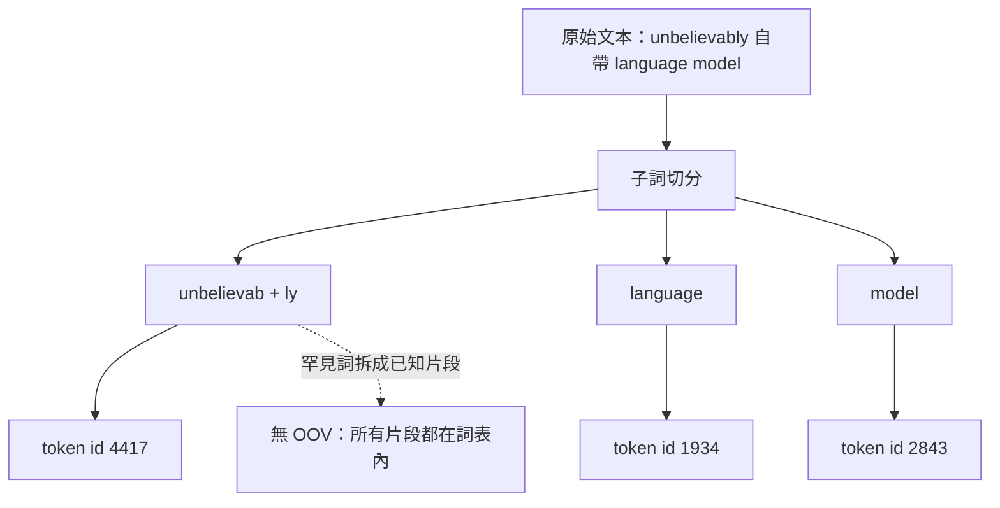
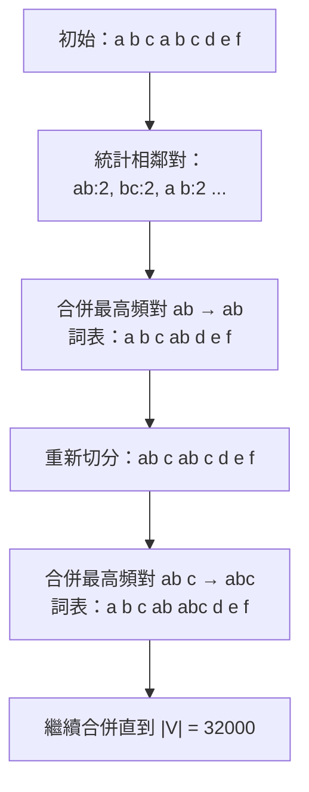

# 5.3 2022 年代：分詞器技術（BPE/SentencePiece）與詞表嵌入空間優化

## 一、為什麼需要分詞：兩道硬約束

在討論分詞器之前，必須先把它在系統中的位置講清楚。大型語言模型並不直接處理人類書寫的字元，而是處理一串從**有限詞表**中抽出的整數索引。這串索引的產生，就是分詞器的工作。它位於整個管線的最前端，卻決定了後面每一層的所有成本。

第一道約束是**參數成本**。若詞表大小為 $`V`$ 、嵌入維度為 $`d`$ ，則嵌入矩陣 $`E \in \mathbb{R}^{V \times d}`$ 本身就佔用 $`V d`$ 個參數，並且為了讓每個 token 都有獨立的表示，輸出層還需要另一組尺寸相近的權重。詞表的邊際成本是**平方級**的，不是線性的：

$$
\text{參數量} \approx 2 V d + \text{其餘層參數}
$$

第二道約束是**序列長度**。同一段文字，切成多少個 token，就等於要跑多少層注意力的計算。注意力對序列長度是二次方複雜度，因此 token 數直接決定了訓練與推論的時間、以及上下文視窗能塞多少資訊。

第三道、也是最古老的一道約束，是**未登錄詞（OOV）問題**。任何一個基於封閉詞表的模型，都無法表示訓練時從未出現過的字詞。名字、術語、拼字錯誤、表情符號、程式碼標識符——這些在開放網路文本中無處不在的內容，如果無法被切分，就只能被丟棄或替換成一個無意義的符號。

## 二、從字、詞到子詞的三個層級

面對 OOV 問題，歷史上大致有三種切分策略。

**字級（character-level）** 把每個字元當作一個 token。它的最大優點是零 OOV——所有字元都在詞表裡；最大缺點是序列長度暴增，一個中文句子若有 300 個字就變成 300 個 token，是詞級的三到五倍，而注意力成本又跟著平方上去。此外，單一字元幾乎沒有語意資訊，模型必須從零學會組合，這對資料效率是災難性的打擊。

**詞級（word-level）** 直接以語言學的詞為單位。它的序列最短、語意密度最高，但詞表爆炸：英語常見詞加上 30 萬種專有名詞仍覆蓋不了真實文本；中文若用詞典切分，常用詞表要有數十萬條。更麻煩的是詞表是語言特定的，中文詞表不能用於英文，分詞器成了跨語言遷移的天然障礙。

**子詞（subword）** 是兩者之間的折衷，也是 2016 年之後事實上的標準答案。它的想法是：把罕見的詞切成常見的片段，把常見的詞保留為單一 token。這樣詞表是封閉的（沒有 OOV），但序列長度只略大於詞級。

## 三、BPE：從字元組開始的合併演算法

Byte Pair Encoding 最初是 1994 年提出的資料壓縮演算法，Sennrich 等人在 2016 年把它改造成子詞切分方法，此後成為 GPT 系列的分詞基礎。

演算法極為簡單：先從一個很小的初始詞表出發（通常是全部可見字元），接著反覆執行合併操作。每一輪掃描所有相鄰符號對，統計各對的出現次數，把**頻率最高的那一對**合併成一個新符號，加進詞表，然後對整個語料重新切分。這個過程重複，直到詞表達到預設大小 $`V`$ 為止。

它的直覺是這樣的：語料中最常見的符號對，往往就是語言裡最常見的字素組合。先學會最常見的組合，再學會由組合構成的更長片段——這是一種由下而上的頻率驅動學習。整個詞表的構成完全由資料決定，不需要任何語言學規則，這是它能跨越語言的關鍵。

BPE 的一個重要工程性質是**貪婪性與確定性**：對同一個字串，切分結果是唯一的，編碼與解碼都只是查表與貪婪合併。這讓訓練與推論的切分一致性毫無風險，也是它比 Unigram 更容易被工程接受的根本原因——在一个分詞器會被訓練多個下游模型、並且在不同版本間被來回替換的生態系裡，「唯一解」是一個極有價值的性質。

**位元組級 BPE（byte-level BPE）** 是 2019 年之後的關鍵改進。GPT-2 引入的做法是：不再以字元作為最小單位，而是以**位元組**作為最小單位，任何文字在 UTF-8 編碼下都能分解成最多 256 個位元組符號。由於初始詞表就涵蓋了全部 256 個位元組，**任何輸入字串都可以被完整表示，OOV 在數學上被徹底消除**。

這個改進還附帶解決了另一個長期麻煩：**Unicode 的等價形式問題**。同一個字元可能有不同的編碼序列，如果直接用字元切分，模型會把視覺相同的字當成不同的 token。位元級別的做法強制所有輸入走同樣的位元組路徑，人為地把這個問題規範化了。

位元組級別還有一個不太顯著但影響深遠的副作用：當某個詞從未在訓練中出現過時，模型不會只看到一個「未登錄」標記，而是看到一串它至少在字元層面見過的碎片。這些碎片在預訓練中會得到梯度，於是罕見詞的表示不是隨機初始化，而是從常見字素的組合中「拼」出來的。這對形態豐富的語言（德語、土耳其語、芬蘭語等屈折密集的語言）尤其重要，因為它們的意義大量承載在詞綴上。

另一個實踐上的細節是 GPT-2 引入的**預分詞正則表達式**：先用一個 regex 把輸入切成詞塊（例如把引號、縮排、多個空白合併），再對每個詞塊獨立套用 BPE。這大幅降低了合併過程跨詞邊界的混亂，也讓切分結果更符合直覺。代價是這個正則表達式本身帶有語言假設，對中文等無空白分界的語言需要另外設計。

## 四、SentencePiece：語言無關的訓練框架

SentencePiece 是 Google 在 2018 年開源的子詞切分工具，它不是一個新的演算法，而是一個**工程框架**：它把 BPE 與 Unigram 兩種演算法都納入，並且提供統一的訓練與編碼介面。

它的關鍵設計是**直接作用於原始字串**。傳統的 BPE 需要先做空白分詞（pre-tokenization），這一步本身就依賴語言特性。SentencePiece 把空格視為一個特殊符號（通常寫成 `▁`）並與其他字元一併納入合併過程，因此**空白分隔這個動作也變成模型學出來的**，而不是工程師預設的。這對中文、泰文、寮國文、日文等不使用空格的文字是決定性的。

SentencePiece 還內建了字元覆蓋率檢查、數字切分、標點分離、與使用者定義符號（special tokens）的處理，讓它能直接接入 Transformers 這類框架的訓練流程。在實務上，它成了 LLaMA、T5、PaLM 等主流開源模型的預設選擇。

「語言無關」這個詞需要一點保留。SentencePiece 的框架確實不依賴空白分詞，但訓練出來的詞表仍然是**由資料決定的**——用英文語料訓練出的模型，同樣無法有效切分中文或阿拉伯文。這裡真正的改變是：把「如何切分一個詞」這個決定權從語言學家手中，交給了從目標語料中統計出來的機制。於是多語模型的做法通常是混合多語語料訓練出單一詞表，或者為不同語言訓練各自的詞表再拼接。前者能讓相近語言共享片段，後者能讓各語言各自最佳化，兩者的取捨是本章第七節的主題。

## 五、Unigram 模型與 BPE 的取捨

與 BPE 並列的另一條技術路線是**Unigram language model**（源自 SentencePiece 與 subword-nmt）。它採用相反的思路：不從字元開始合併，而是從一個**很大的候選詞表**出發，然後**逐步刪除**。

具體做法是先用 EM 演算法訓練出每個候選詞的機率分佈，再依據一個目標機率分數決定刪除順序，逐步把詞表修剪到目標大小。關鍵在於它給出了一個真正的機率模型：

$$
P(s) = \prod_{i=1}^{n} P(u_i)
$$

其中每個片段 $`u_i`$ 的機率來自對數正態分佈類的參數化， $`P(u) = \frac{1}{Z} \exp(\sigma(u))`$ ，這裡 $`\sigma(u)`$ 是片段 $`u`$ 的自由參數、 $`Z`$ 是正規化常數。

這個機率模型帶來了 BPE 沒有的能力：**概率式切分**。對於一個字串，可以有多種切分方式，而模型可以求最大機率的那一種：

$$
\text{切分}^* = \arg\max_{\text{切分方案}} P(s)
$$

這意味著 Unigram 分詞器**不需要確定性的貪婪合併**，而是做動態規劃搜尋出最佳切分。代價是切分速度較慢（需要在多個候選切分之間搜尋），而且訓練過程更複雜。

兩者的取捨可以這樣總結：

| 面向 | BPE（合併式） | Unigram（刪除式） |
| --- | --- | --- |
| 起點 | 小的初始詞表 | 大的候選詞表 |
| 方向 | 反覆合併最高頻對 | 反覆刪除機率最低者 |
| 切分方式 | 確定性貪婪 | 機率式最佳切分 |
| 速度 | 快 | 較慢（需搜尋） |
| 片段邊界 | 剛性，常有非自然切分 | 柔性，可避開非自然切分 |
| 常見代表 | GPT-2 起的 GPT 系列、RoBERTa | SentencePiece、T5、LLaMA |

一個實務上常被強調的差別是：Unigram 因為能做整體最優切分，產生的片段邊界更貼近自然語言的詞界，代價是同一個詞可能有不同切分方式（這在訓練與推論一致使用同一分詞器時不是問題）。BPE 則可能切出「語法上尷尬」的片段，但它保證了每個字串只有唯一的確定性切分。

## 六、詞表大小的工程權衡

把上述機制放到整體系統裡，詞表大小的選擇就成了一個多目標的最佳化問題，而它的關鍵在於**平方級的參數成本**。

若模型總參數量固定，增大詞表 $`V`$ 會直接吃掉 Transformer 層的參數份額。以一個隱層維度 $`d = 4096`$ 的模型為例，詞表從 32K 增加到 128K，嵌入與輸出層的參數量就從約 2.7 億暴增到 10.5 億，佔整體模型的比例大幅上升。

另一方面，較大的詞表意味著**同樣的文本被切成更少的 token**，序列變短。這帶來三個好處：注意力計算量按平方下降、訓練時每個 token 承載的資訊量上升（同等資料量下有效訓練樣本更多）、推論時上下文視窗能裝更多實際內容。代價則是長尾詞更難被記憶、每個 token 的分攤容量變大導致對罕見概念的表達力下降、以及嵌入表佔用大量寶貴的模型容量。

實測的取捨結果呈現出一個相當一致的結論：**當序列長度是瓶頸時（例如長文件問答、程式碼補全），擴大詞表是划算的；當模型容量是瓶頸時，過大的詞表反而有害。** 這個結論的物理直覺是，token 是資訊的打包單位，而注意力機制對打包單位的數量是平方敏感的。

| 詞表大小 | 典型序列長度（相同文本） | 嵌入參數佔比（ $`d = 4096`$ ） | 注意力計算量（相對） |
| --- | --- | --- | --- |
| 8K（近詞級） | 最長 | 約 6% | 1.00（基準） |
| 32K（主流） | 中等 | 約 25% | 約 0.44 |
| 128K（Llama-3 量級） | 最短 | 約 65% | 約 0.16 |
| 256K（極限） | 極短 | 約 90% | 約 0.08 |

## 七、中文與多語系的困境

分詞問題在多語世界裡顯得格外尖銳，因為不同語言的詞彙統計性質差異極大。

英文屬於低屈折語（low-compression）代表：常用子詞能覆蓋大量文本，詞表效率良好。中文則是高屈折的反例：中文的詞節與詞的邊界模糊，一個兩千字的段落若用字級切分會得到兩千個 token，是英文同等資訊量的兩到三倍。中文的詞表若要做到與英文同等效率，必須建到數十萬詞條，其中包含大量罕見組合，直接推高參數成本。

另一端是**跨語言的公平性問題**。當一個模型共用單一詞表時，高資源語言（如英語）佔據了多數的合併機會——BPE 的合併是按頻率進行的，頻率高的自然贏得更多 token，而這直接導致高資源語言的序列更短、每個 token 承載更多資訊，模型在這些語言上的表現也更好。低資源語言則被擠壓到更長的序列、更少的訓練梯度。這個「語言與 token 預算不成正比」的現象，是多語模型最核心的不公平來源之一。

解決方向包括各語言獨立的詞表與比例採樣、跨語言的子詞切分（如切分邊界依語言族共享）、以及在多語覆蓋與各語言表現之間取得平衡的混合方案。但截至 2020 年代中期，這仍是一個沒有被徹底解決的問題——它本質上是資料分布的不平等，被技術手段部分緩解卻無法根除。

中文還有一個特別的問題值得單獨提出：**分詞的歧義性本身就是語言現象**。中文的「研究生命的起源」與「研究生 命」的邊界，在語義層面是真實存在的差異，而不是可以被演算法消解的技術瑕疵。這意味著任何把中文切成固定片段的嘗試，都不可避免地在「保留歧義」與「消除歧義」之間做取捨。中文分詞的傳統演算法（如最短路、統計模型）在 2010 年代之後被神經模型大幅超越，但在多語預訓練的語境下，人們反而更傾向於讓模型自己從字元層學起，用大一點的詞表和足夠的語料去承載這種歧義。

## 八、序列長度作為整個系統的瓶頸

回頭看 5.2 的自迴歸分解： $`P(w_1, \dots, w_n) = \prod_i P(w_i \mid w_{<i})`$ ，這裡的每一個 $`i`$ 都代表一次完整的 Transformer 前向傳播。也就是說，**生成一個 token 的成本，等於對整個前綴做一次注意力的成本**，而注意力對前綴長度是二次方複雜度。

$$
\text{單 token 生成成本} \propto O\!\left(n^2 d\right) + O(n d^2), \qquad \text{生成 } n \text{ 個 token 的總成本} \propto O\!\left(n^3\right)
$$

這就是「序列長度是瓶頸」的數學表達：即使模型的參數量停在原地，長度 $`n`$ 的增長也會讓成本以三次方膨脹。而分詞器正是這個瓶頸的第一個槓桿——詞表越大、token 越少、序列越短。

但槓桿終究有極限。當分詞已經做到位元級、序列長度仍是瓶頸時，就必須從架構層面出手：稀疏注意力、FlashAttention 這類對注意力核心的 IO 優化、RoPE 位置編碼的外推技術、以及更根本的混合專家架構（見 6.2 節）。分詞器把序列壓短，注意力工程再把注意力算快，兩者共同決定了模型能看見多長的世界。

這正是第 6 章的主題。從 5.1 的雙向掩碼、到 5.2 的因果解碼、到 5.3 的詞表與切分，第三章一路走來的所有「工程地基」至此都已鋪好：目標函數決定模型學什麼，架構決定模型怎麼看，詞表決定模型看得見多細。接下來的問題是——如何讓這三者共同撐起遠超單機記憶體的上下文與參數規模。
