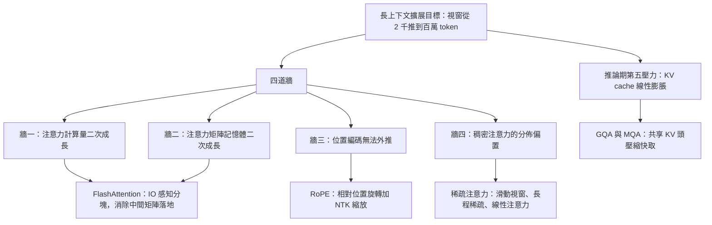
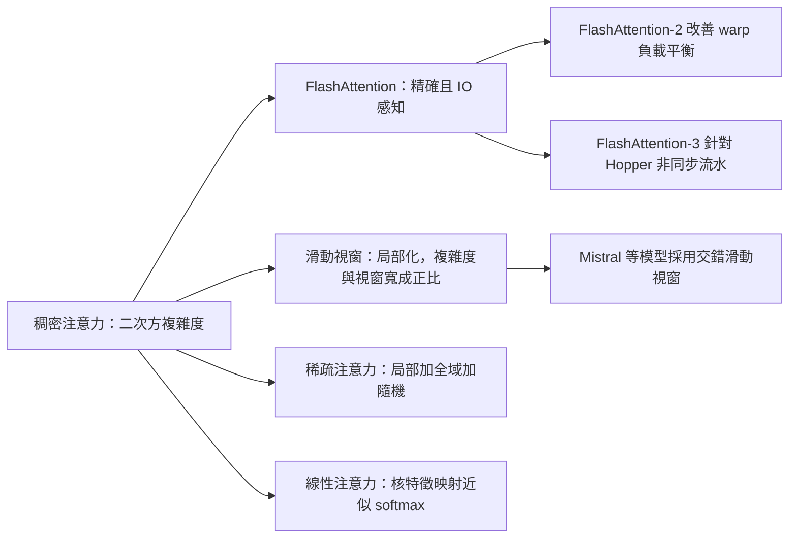

# 6.1 2023 年代：長上下文擴展技術：FlashAttention、RoPE 與稀疏注意力

## 一、長上下文：從「能塞多少」變成「能用多少」

2023 年之後，「上下文視窗長度」取代「參數量」成為語言模型發表會上最常被拿來比較的數字。GPT-4 的 8 千 token、Claude 2 的 100 千 token、Gemini 1.5 的 100 萬 token，這些數字背後是一整年的工程累積。然而把上下文從 2 千拉到 100 萬，並不是單純地「買更多顯卡」就能解決的事。在 2023 年之前，長上下文面對的是**四道彼此獨立的牆**：每一道牆的成因不同、對應的解法不同，有的方法是硬體 kernels，有的是數學改寫，有的則是從根本上改變模型要學的東西。

### 1.1 第一道牆： $`O(n^2)`$ 的計算量

標準的自注意力分數矩陣是 $`Q K^{\top}`$ ，其中 $`Q, K \in \mathbb{R}^{n \times d}`$ ，所以計算量為 $`O(n^2 d)`$ 。對 $`d`$ 固定而言，這是序列長度 $`n`$ 的**平方**。把視窗從 4 千拉到 128 千，序列長度變成 32 倍，注意力算力變成 1024 倍。這個平方關係意味著長上下文的成本不是「稍微貴一點」，而是「跨過一個數量級的牆」。

更麻煩的是，softmax 的第二個維度是 $`n`$ ，所以它必須**橫向**對一整行做歸一化，這意味著注意力天然帶有「全序列耦合」的性質，無法像前饋層那樣沿序列維度完全切開並行。這對第 6.3 節的分散式訓練是壞消息：管線並行需要把序列切到不同裝置，但注意力層天然不願被這樣切開。整個序列必須在少數幾張卡上完成注意力，這成為流水線中的一個關鍵瓶頸。

更麻煩的是， $`O(n^2)`$ 的計算量與**有效資訊量並不成正比**。一段一百萬 token 的對話裡，真正需要跨距引用的句子可能只有十幾句。若硬體必須為每一對 token 位置都做一次內積，等於把九成九的算力花在確定「不重要的位置不重要」上面。這種浪費正是稀疏注意力試圖解決的問題。

### 1.2 第二道牆： $`O(n^2)`$ 的記憶體

即便只算分數、拋棄結果，中間的 $`n \times n`$ 注意力矩陣仍然必須被實體化。單是這一項，在 $`n = 128`$ 千、 $`d = 128`$ 、 $`\text{fp16}`$ 下的記憶體就達到數十 GB。訓練時為了反向傳播還要保存注意力權重，記憶體需求再乘以常數倍；推論時若使用傳統的 naïve 實作，中間矩陣的峰值分配會直接壓垮顯存。

這道牆有個容易被忽略的特性：它是**硬牆而非軟牆**。計算量超出預算只是慢，記憶體超出就是崩潰。在同一張顯存有限的卡上，只要少了一塊注意力矩陣的分配，其他所有工程最佳化都會被連帶拖累。因此 2023 年之後，「能否支援長上下文」的先決條件往往是「能否避免把注意力矩陣寫進記憶體」。

### 1.3 第三道牆：位置編碼的外推失效

Transformer 本身沒有任何位置感知能力，位置資訊必須由外部注入。第 4 章提到的正弦位置編碼與可學習的絕對位置嵌入，在訓練長度之外都無法直接外推：可學習嵌入根本没有對應的槽位，正弦編碼則在訓練時未見過那麼大的相位。模型一旦遇到超出訓練長度的位置，注意力分佈會迅速崩壞，生成內容退化為無意義的重複。

### 1.4 第四道牆：注意力分佈的偏置

即使位置編碼能外推，模型在訓練時形成的注意力分佈仍然帶有結構性偏置。真實的語言依賴是**稀疏且偏向局部**的：一個詞往往只需要看它前後幾個詞，以及少數幾個很遠的關鍵錨點。然而預訓練的主流做法是對整個序列做稠密注意力，這讓模型學到了「被迫均勻掃視」的行為。直接拉長序列到百萬級，等於把這種偏置放大到難以承受的程度。

### 1.5 推論期：KV cache 的記憶體

生成階段每一個 token 都要用到先前所有 token 的鍵與值。KV cache 的記憶體隨著序列長度**線性**增長，其規模為 $`2 \cdot L \cdot n \cdot h \cdot d_{head}`$ 個元素。這是長上下文在服務階段最直接的瓶頸：它不影響平行度，卻直接決定了單一請求能佔用多少顯存，進而決定了批次大小與服務成本。

KV cache 問題與前四道牆有一個本質差異：它不是「效率」問題而是「容量」問題。訓練時把注意力矩陣省下來就夠了，但在推論時，使用者要求的是「一次送出很長的提示並等待回應」，這個提示本身必須被完整保留。工程上的解法主要有兩條路：一是**縮減每個 token 的快取體積**，例如多查詢注意力與分組查詢注意力讓多個查詢頭共用同一組鍵與值頭，把快取從 $`2 h d_{head}`$ 壓到 $`2 g d_{head}`$ （ $`g \ll h`$ ）；二是**把快取分頁並在多卡之間共享**，使長序列請求可以被多張卡共同承載。

| 牆 | 症狀 | 對應技術 | 生效階段 |
| --- | --- | --- | --- |
| 計算量 $`O(n^2 d)`$ | 長序列訓練天數爆炸 | FlashAttention 分塊與重計算 | 訓練與推論 |
| 注意力矩陣記憶體 $`O(n^2)`$ | 中間矩陣佔滿顯存 | FlashAttention 不落地中間結果 | 訓練與推論 |
| 位置編碼外推 | 超長位置輸出退化 | RoPE 與 NTK-aware 縮放 | 訓練與推論 |
| 分佈偏置 | 模型被迫稠密掃視 | 滑動視窗與稀疏注意力 | 訓練 |
| KV cache 膨脹 | 服務成本隨長度線性上升 | GQA 與分頁式 KV 管理 | 推論 |

## 二、FlashAttention：把注意力從「算題」改寫成「搬資料」

### 2.1 一個被忽略的硬體事實

Dao 等人在 2022 年發表的 *FlashAttention: Fast and Memory-Efficient Exact Attention with IO-Awareness* 提出了一個極具影響力的觀察。現代 GPU 的算力與記憶體頻寬之間存在數十倍的差距：一顆 A100 的理論浮點算力約 312 TFLOPs，但 HBM 記憶體頻寬只有約 2 TB/s。傳統注意力的瓶頸不在於乘加次數太多，而在於**資料搬不動**。

標準實作要寫入 $`n \times n`$ 的注意力矩陣到 HBM，再讀回來做 softmax，再寫回來做加權求和。以 $`n = 8192`$ 、 $`d = 128`$ 為例，光是矩陣往返的讀寫量就遠大於有效計算量。GPU 的 tensor core 在絕大多數時間裡是閒置的。

### 2.2 分塊與重計算

FlashAttention 的解法是把問題從「算完 softmax 再用」改為「分塊地算、分塊地用」。它把 $`Q`$ 、 $`K`$ 、 $`V`$ 切成小塊（tiling），在 SRAM（on-chip scratchpad）中維持一個**行統計量**，讓每個 query 塊的分數矩陣在寄存器內完成「打分 → 更新最大值 → 累加指數和 → 累加加權 $`V`$ 」四步，中間的 $`n \times n`$ 矩陣**從來不寫入 HBM**。

結合反向傳播時的**重計算**（recomputation）策略，前向只保存每個區塊的輸出與 log-sum-exp 統計量，反向時再重新計算區塊內的分數。因為重計算的代價只是多算一次乘法，而省下的是一次完整的 HBM 往返，這筆交易在幾乎所有情況下都是划算的。

### 2.3 對數時間複雜度的 IO 感知注意力

更一般地說，FlashAttention 系列的貢獻是確立了「**IO 感知**」的演算法設計範式。對任意的 softmax 型運算，可以證明：只要存在一種只對某個維度（例如 log-sum-exp 統計量）可分解的結合律形式，就能構造出 IO 量為 $`O(n^2 d^2 / M)`$ 而非 $`O(n^2 d)`$ 的演算法，其中 $`M`$ 是 SRAM 容量。也就是說，**計算量仍是 $`O(n^2)`$ ，但 IO 複雜度被 SRAM 容量所決定**，這是一種「以記憶體換頻寬」而不是「以計算換記憶體」的取捨。

這個結論的意義遠大於單一 kernel 的改進。它確立了一個新的演算法設計範式：當硬體的算力與頻寬比例持續惡化、每代 GPU 的算力成長快於頻寬成長時，凡是 IO 量與計算量同階的演算法都會逐漸淪為瓶頸，凡是能讓 IO 量降到較低階的演算法則能持續獲得額外加速比。FlashAttention-2 進一步改善了工作切分與 warp 之間的負載平衡，FlashAttention-3 則針對 Hopper 架構引入非同步的流水線與低位元路徑。

重要的是，FlashAttention 是**精確**演算法，不是近似。它的輸出與標準 softmax 注意力在數學上完全相同，只是不再把中間矩陣顯式物化。這一點使它可以直接取代任何 Transformer 的注意力層，沒有精度風險。

這種「精確且更快」的特性，使它在學術與工業上都被迅速採用，到 2023 年為止，主流框架的預設注意力路徑幾乎全面換成了 FlashAttention 家族的實作。它也讓一種原本被視為不切實際的訓練配方重新變得可行：在更長的序列上訓練，模型能學到的依賴關係類型更多，長上下文能力不再只是推論時的技巧，而是被真正地訓練進權重裡。

重要的是，FlashAttention 是**精確**演算法，不是近似。輸出與標準 softmax 注意力在數學上完全相同，只是不再把中間矩陣顯式物化。這一點使它可以直接取代任何 Transformer 的注意力層，沒有精度風險。

## 三、RoPE：把位置編碼變成旋轉

### 3.1 從絕對位置到相對位置

Su 等人 2021 年的 *RoFormer* 提出了一個極為優雅的方案：不對輸入做加法，而是對 $`q`$ 與 $`k`$ 做**旋轉**。令 $`\theta_i = 10000^{-2i/d}`$ ，則位置 $`m`$ 的查詢向量被旋轉為

$$
q_m^{(i)} = q_m^{(i)} \cos(m \theta_i) - q_m^{(i+1)} \sin(m \theta_i)
$$

鍵向量則以相反方向旋轉

$$
k_n^{(i)} = k_n^{(i)} \cos(n \theta_i) + k_n^{(i+1)} \sin(n \theta_i)
$$

其中 $`i`$ 是特徵維度的配對索引， $`\theta_i`$ 隨維度遞減，使得低維度以高頻率（短波長）編碼近距離、高維度以低頻率（長波長）編碼遠距離。

### 3.2 相對位置性質

這組旋轉的關性質，是內積只依賴位置差：

$$
q_m^{\top} k_n = f(m, n) = g(m - n)
$$

也就是說，注意力分數自動成為**相對位置**的函數。這解釋了 RoPE 為何能在旋轉外推時保持一致性：模型在訓練期間見過 $`\Delta = m - n`$ 的各種取值，只要旋轉的角度與訓練時的分佈相近，注意力機制就「以為」自己在處理熟悉的相對距離。

### 3.3 外推的侷限與 NTK-aware 縮放

然而相對位置性質並不保證無限外推。訓練長度為 $`L`$ 時，模型見過的最大相對距離是 $`L`$ ；若推論時的 $`\Delta`$ 遠大於 $`L`$ ，高頻維度的旋轉相位會完全對不上訓練分佈，注意力退化成雜訊。

常見的解法是調整基頻。**位置插值**把旋轉頻率線性壓縮為 $`\theta_i' = \theta_i \cdot (L / L')`$ ，其中 $`L'`$ 是目標長度，代價是近距離的解析度被犧牲。**NTK-aware 縮放**則不同：它不均勻地縮放所有頻率，而是讓高頻維度維持原頻率、僅縮放低頻維度，並對高頻部分做非線性拉伸，好讓局部的相對位置仍然銳利、遠端則獲得足夠的旋轉圈數。

這裡有一個值得體會的取捨：**上下文長度的宣稱數字與真正「有效」的上下文長度不是同一件事**。模型可以在宣稱的長度上不崩潰，但只有在宣稱長度內部存在某個特定位置的資訊時，它才真的「看得到」那個位置。有效長度的測量需要以「大海撈針」式的任務來驗證。

## 四、稀疏注意力與線性注意力

當 $`n`$ 持續增大，把 $`O(n^2)`$ 降到 $`O(n \log n)`$ 或 $`O(n)`$ 就不再是可選項。稀疏注意力家族的基本假設是：**每個 query 真正需要關注的 key 只有少數幾個**。

**滑動視窗注意力**（sliding window attention）是最簡單的形式：每個 query 只看前後固定數量的 token，複雜度降為 $`O(n w)`$ 。代價是跨視窗的資訊無法直接流通，因此通常需要每隔幾層插入一層全域注意力作為橋樑。

**稀疏注意力**的進階形式（如 Longformer 的擴張式局部窗口、BigBird 的隨機注意力加全域 token）嘗試在稀疏結構中保留一個小的全域通道，使得任意兩點之間仍有可達路徑。核心的理論問題是：所謂的「資訊理論上的最小連通結構」有多稀疏，同時又足以支撐語言模型所需的依賴關係。

**線性注意力**走的是另一條路。它把 softmax 替換為核函數特徵映射，即利用

$$
\exp(q \cdot k) \approx \phi(q)^{\top} \phi(k)
$$

把注意力重寫為兩個低秩矩陣的乘積，從而把複雜度降到 $`O(n d^2)`$ 。關鍵難題在於如何選擇特徵映射 $`\phi`$ 使得近似品質與序列長度無關——這也是 Performer、Linear Transformer 等一系列工作的著力點。

這條路線的代價常被低估。softmax 的指數形式會把「極度相似的兩個位置」轉化為近乎 one-hot 的分佈，這種銳利度是語言模型處理指代與對齊時的重要機制；用核函數近似之後，分佈會變得平滑許多。換言之，線性注意力在**效率上**取勝，卻在**表達能力**上付出了代價，兩者之間的取捨需要用任務表現來衡量，而不能只看困惑度。

實務上的折衷往往是**混合**：在多數層使用線性或稀疏注意力以控制成本，只在少數層保留精確的稠密注意力作為資訊的全局匯聚點。這樣的配置可以在成本與能力之間取得比「全稀疏」或「全稠密」更好的平衡。

## 五、長度、記憶體與成本的三角取捨

長上下文從來不是免費的。在訓練端，序列長度拉長意味著每個裝置的激活值記憶體上升，為了在固定顯存下容納更多裝置，就必須依賴第 6.3 節將要介紹的張量並行與流水並行。在推論端，KV cache 的線性膨脹迫使服務系統引入分頁式 KV 管理與分組查詢注意力（GQA）來壓縮每 token 的快取體積。

更根本的問題是**價性比**。上下文長度從 128 千提升到 512 千，服務成本增加四倍，但多數任務的效益並非線性。若模型的主觀任務是回答一個需要跨段落推理的問題，那麼與其把整本手冊塞進視窗，不如用第 9 章的檢索增強生成，只取回最相關的十幾個段落。

### 與後續章節的關係

這裡有一個貫穿全書的教訓：**更長的上下文不等於更好的記憶**。上下文長度改變的是資訊的**輸入通道**，而不是模型的**儲存與檢索能力**。事實上，過長的無關內容會佔據注意力的softmax 質量，反而損害相關資訊的權重。這也是為什麼第 7 章的上下文學習與第 9 章的檢索增強不是被長上下文淘汰的舊技術，而是與之互補的三個層次：上下文學習讓模型學會**如何閱讀**被給定的指示，檢索增強讓模型**去找**需要的知識，而長上下文技術讓這些機制得以在合理的成本下運作。

## 六、小結

2023 年的長上下文突破，本質上是一場**硬體感知的演算法設計**運動。FlashAttention 用分塊與重計算讓精確注意力的 IO 量被 SRAM 容量而非序列長度決定；RoPE 用旋轉把位置編碼變成相對位置性質的表達，並藉由頻率調整取得有限的外推能力；稀疏注意力與線性注意力則從資訊結構出發，直接挑戰 $`O(n^2)`$ 這個平方牆。三者共同構成了一個可操作的取捨框架：上下文長度、記憶體佔用、推論成本與任務效益之間，必須逐案權衡。
