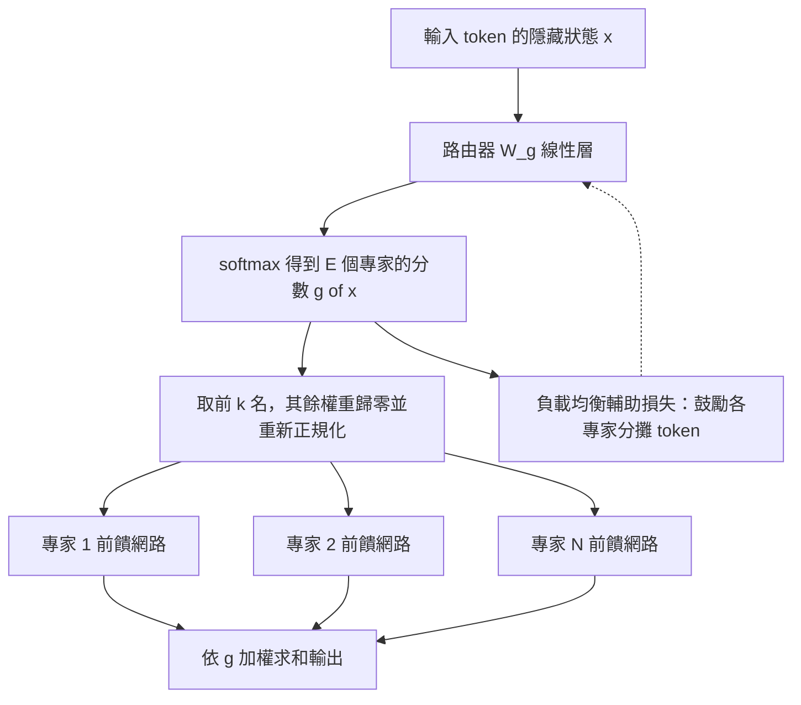
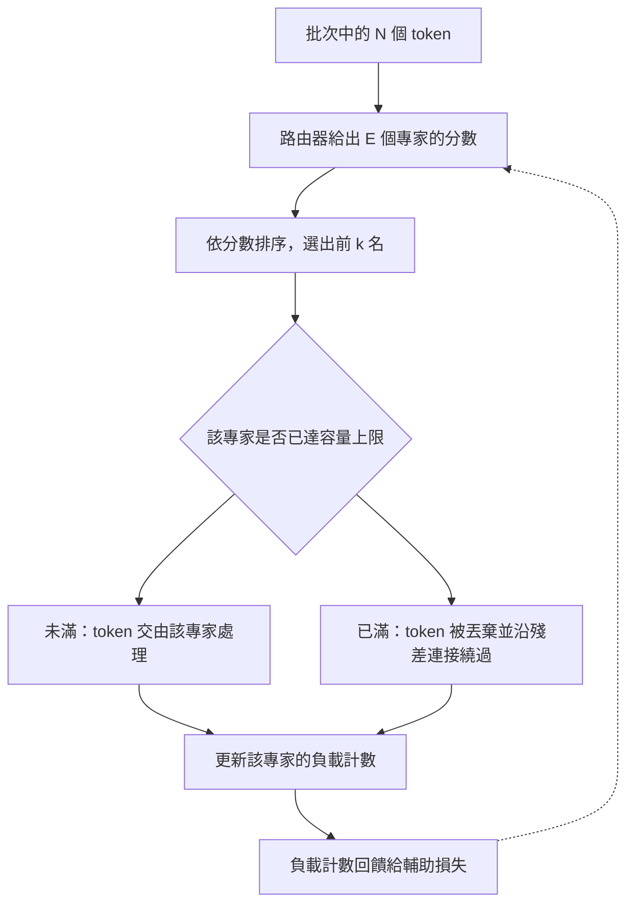

# 6.2 2023 年代：混合專家模型（MoE）與稀疏化路由

## 一、稠密模型的浪費

到 2023 年，主流語言模型的規模停留在 700 億至數千億參數之間，訓練成本動輒數百萬美元。但在這些參數之中，只有一部分在每一步前向計算中被真正啟用。這種「參數很多、計算只用一部分」的現象不是偶然，而是深層網路的普遍性質：模型學到的許多知識彼此重疊且冗餘，例如不同語域的文法規則、不同的格式樣式、編程語言的特有慣例。

**混合專家模型**（Mixture of Experts, MoE）的想法正是把這種冗餘「結構化」：把前饋網路替換為許多並行的專家網路，並讓一個輕量的**路由器**（router）在每個 token 上決定哪些專家參與計算。這是一種把「容量」與「計算量」解耦的架構：參數量決定模型能記住多少東西，激活參數量決定每一步實際花多少算力。

Shazeer 等人 2017 年的稀疏門控混合專家模型是這一思路的第一次系統化嘗試，但當時的訓練規模不足以證明它的優勢。轉捩點出現在 2023 年，當硬體條件終於足以訓練 MoE 模型，而 GShard、Switch Transformer 等先行工作也已經把訓練的穩定性問題大致解決。

MoE 的歷史其實比想像中長。1990 年代初，Jacobs 等人提出的「adaptive mixtures of local experts」就已經是同一個想法；條件路由（mixture of experts）一詞在語音辨識中流行一時，用來讓多個聲學模型分工處理不同特徵區間。當時的做法多半是**硬路由**加**手工設計的特徵**，例如依共振峰頻率選擇專家。Transformer 時代的 MoE 把這套機制升級為**學得**的軟路由，由一個可訓練的線性層決定去向，因此稱為「稀疏門控」。

這個歷史對照說明了一件事：MoE 的核心不是稀疏本身，而是**把選擇機制放進梯度下降的作用範圍之內**。稀疏化在神經網路中有著悠久的傳統——稀疏卷積、稀疏矩陣乘法、低秩分解——但只有當選擇機制可微分時，模型才能自己演化出有用的分工。

## 二、MoE 的結構與路由機制

### 2.1 稀疏門控

典型的 MoE 層把原本的一個前饋網路替換為 $`E`$ 個專家，每個專家都是一個標準的前饋網路，並在它們之前加上路由器。令 $`x`$ 為輸入向量，路由器網路計算出分數

$$
g(x) = \mathrm{softmax}\!\left( W_g x \right) \in \mathbb{R}^{E}
$$

接著只保留前 $`k`$ 個分量，其餘權重歸零並重新正規化

$$
y = \sum_{i \in \mathrm{Top}\text{-}k(g(x))} g_i(x) \cdot \mathrm{FFN}_i(x)
$$

這裡 $`k`$ 通常取 1 或 2。當 $`k = 1`$ 時，每個 token 只喚醒一個專家，計算量最省；當 $`k = 2`$ 時，容量利用率較高、訓練較穩定，但計算量也翻倍。值得注意的是，歸零並重新正規化這一步是稀疏性的來源：**被選中的專家之間仍然存在競爭**，這使得路由決策具有離散的、類似於分類的性質。

### 2.2 為什麼只用 top-1 會導致專家塌縮

如果只依據訓練損失的訊號來選擇專家，會出現一個嚴重的退化模式，稱為**專家塌縮**（expert collapse）。設想某個專家在訓練早期因為隨機初始化的幸運而略微擅長某些 token，它就會被更多地路由到，獲得更多梯度更新，於是變得更擅長，收到更多路由——這是一個正回饋迴圈。最終少數專家壟斷了絕大多數的 token，其餘專家因為幾乎沒有訓練訊號而停留在隨機初始化狀態。

結果是：模型的有效參數量遠小於宣稱的參數量，稀疏化的所有好處都被浪費掉了。這個現象說明**路由本身必須被顯式地介入**，而不能完全交由損失函數的梯度決定。

### 2.3 負載均衡的輔助損失

主流做法是加入一個**輔助損失**（auxiliary loss）來鼓勵均衡分配。最常見的形式是

$$
\mathcal{L}_{\mathrm{aux}} = \alpha \cdot E \cdot \sum_{i=1}^{E} f_i \cdot P_i
$$

其中 $`f_i`$ 是批次中路由到第 $`i`$ 個專家的 token 比例， $`P_i`$ 是路由器給第 $`i`$ 個專家的平均機率， $`\alpha`$ 是平衡係數。這個乘積在完全均衡時取最小值：當所有 $`f_i`$ 都等於 $`1/E`$ 且所有 $`P_i`$ 也都等於 $`1/E`$ 時，總和最小。訓練時的總目標是

$$
\mathcal{L} = \mathcal{L}_{\mathrm{task}} + \mathcal{L}_{\mathrm{aux}}
$$

Switch Transformer 使用 $`\alpha = 0.01`$ ，並引入負載均衡因子 $`z`$ 來進一步鼓勵那些被路由得太多的裝置自我降權。

### 2.4 容量因子與 token dropping

即使有輔助損失，路由器在單一批次內仍可能出現分佈不均。為了解決這個問題，MoE 引入了**容量因子**（capacity factor）的概念：每個專家在一個批次中被分配的最大 token 數被設為

$$
\text{capacity} = \left\lceil \frac{C \cdot T}{E} \right\rceil
$$

其中 $`T`$ 是批次的 token 總數， $`C`$ 是容量因子，通常取 1.0 到 1.25 之間。當某個專家收到的 token 超過容量時，多餘的 token 會被**丟棄**（token dropping），其輸出由殘差連接直接繞過。

容量因子的取捨是明確的： $`C`$ 越大，token dropping 越少，模型品質越好，但每個專家實際計算的 token 數越多，等於削弱了稀疏化帶來的算力節省。 $`C = 1.0`$ 意味著完全沒有餘裕，任何輕微的不均都會導致丟棄； $`C = 2.0`$ 則安全但昂貴。在實務中，團隊常選擇 $`C`$ 略大於 1 並配合 token 的重要性排序策略來丟棄。

另一種取而代之的方案是**不丟棄 token**，而是把超容量的 token 路由到負載較輕的專家。這保留了全部資訊，但需要等待負載統計，會引入排程複雜度與延遲。

容量因子之所以值得單獨一提，是因為它把一個本來看不見的品質問題變成了可調的旋鈕。在稠密模型裡，每個 token 都經過完全相同的計算路徑，沒有任何 token 會因為「運氣不好」而被犧牲。在 MoE 裡，被丟棄的 token 實際上是以殘差連接的形式繞過了整個前饋層，等於那一層的計算沒有發生。當丟棄率上升時，模型不是漸漸變差，而是會在某一個臨界點之後**急劇劣化**，因為被丟棄的往往正是那些路由器最不確定、資訊量最高的 token。

實務上團隊通常會監控丟棄率這個指標，把它當成一個硬性約束而非事後檢查。GShard 提出的做法是把容量因子設定為一個保守值，再配合輔助損失把路由偏離度控制在一定範圍內，確保丟棄率維持在極低水準。

## 三、參數量與計算量的分離

MoE 最吸引人的性質，是它打破了稠密模型中「參數多則計算多」的綁定。若一個模型有 $`E`$ 個專家、每個專家參數量為 $`P_e`$ 、共享部分參數量為 $`P_s`$ ，則總參數量為 $`P = E P_e + P_s`$ ，而每個 token 的激活參數量只有

$$
P_{\mathrm{act}} = k P_e + P_s
$$

當 $`E = 8`$ 、 $`k = 2`$ 時，總參數是激活參數的四倍以上。這意味著在**相同的訓練算力預算**下，MoE 模型可以攜帶更多的總參數，因此被認為能學到更多東西。

這裡有一個重要的量詞區分：規模定律所說的「算力」通常指浮點運算次數，而 MoE 的收益正是體現在**在固定 FLOPs 下增加參數量**。2023 至 2024 年間的開放權重模型顯示，在相近的訓練算力下，MoE 的困惑度表現優於同規模的稠密模型；但若在**固定參數量**下比較，差距會大幅縮小。這說明 MoE 的優勢本質上是「參數效率」，而不是「計算效率」。

| 比較面向 | 稠密 Transformer | 混合專家模型 |
| --- | --- | --- |
| 每 token 計算量 | 與總參數量成正比 | 僅與激活專家數有關 |
| 訓練算力與參數量 | 強綁定 | 可解耦 |
| 顯存需求 | 與總參數量成正比 | 仍與總參數量成正比 |
| 通訊負擔 | 張量並行為主 | 增加專家間 all-to-all |
| 訓練穩定性 | 相對容易 | 需輔助損失與容量因子 |
| 推論批次策略 | 批次內所有請求同構 | 需依 token 分組以合併通訊 |

## 四、訓練的不穩定性

MoE 的訓練過程比稠密模型更容易出現問題，主要來自三個方面。

**第一，路由器與專家的共適應。** 路由器根據專家當前的表現來分配 token，而專家的表現又受到路由器分配的影響。這個閉環會產生滯後效應：在某一步看起來最合適的專家分配，可能會把梯度推向一個在數步之後才顯現的壞解。這種非平穩性使得某些訓練配方需要特殊的初始化或學習率預熱。

**第二，梯度尺度失衡。** 被路由到某個專家的 token 數會影響該專家參數更新的大小。一個專家若在某段時間內接受了大量 token，它的梯度噪聲會更大，參數更新也更劇烈。解釋變數化（normalization）與專家級別的學習率調整，都是為了緩解這個問題。

**第三，負載均衡的張力。** 輔助損失本身是一個需要被平衡的目標：它壓抑了「自然分化」的可能。權重太小，路由不均、浪費算力；權重太大，專家被強制平均分配、喪失分化能力。這個係數通常需要隨訓練階段調整，早期偏重均衡，後期偏重任務表現。

還有一個容易被忽略的問題是**專家之間的資訊不對稱**。在 $`k = 1`$ 的設定下，被路由到不同專家的 token 完全不會在這個層產生交互；如果某個專家是明顯的弱項，那麼被送到它那裡的 token 就不會從其他專家那裡得到補償，因為它們根本沒被計算。 $`k > 1`$ 的設計部分緩解了這個問題，但也把計算量翻倍。此外，路由器的梯度來自一個**離散選擇**的加權和，標準的反向傳播在此並不適用，必須使用所謂的直通估計器（straight-through estimator）把選擇決策的梯度近似為身份映射，這個近似本身就引入了偏差。

## 五、先驗路由與專家的隱式分工

隨著 MoE 模型被廣泛訓練，一個有趣的觀察浮現出來：**專家會自發形成某種分工**。路由器沒有被給予任何語言或領域的標籤，但分析路由器在實際資料上的分佈，可以觀察到某些專家偏好程式碼、某些偏好數學式、某些偏好自然語言敘述、某些偏好特定格式（如表格、標記語言）。

這種分工的機制是可解釋的：路由器是一個線性層加 softmax，而 softmax 天然傾向於把相似的輸入分配到同一個專家。由於語言、領域、格式在特徵空間中本來就聚集成簇，路由器的這種「以相似性為基礎」的機制會自動把它們分開。專業化不僅是副作用，它還帶來效率紅利：路由決策變得更容易預測，允許在推論時做批次最佳化。

研究者也會主動使用**先驗路由**，例如依據語言標籤或任務類型指派專家，以獲得更穩定、可解釋、且在特定場景下更有效的分工。代價是模型失去了自發分化的彈性，且在語料分佈變動時需要重新調整。

然而專業化並不必然等於語義可解。路由決策發生在深層隱藏狀態上，這些向量已經過多層非線性變換，與其對應的輸入語義之間不再是簡單的一一映射。因此「某個專家專精數學」這類說法，嚴格而言是研究者依據**輸出分佈的統計特徵**所做的事後歸因，而不是模型內部存在一個明確的「數學模組」這樣的實體。這個方法論上的保留十分重要，因為一旦過度相信專業化的可解釋性，就會對模型的能力邊界做出錯誤的推論。

## 六、Mixtral 與開放權重 MoE 的意義

2023 年底發布的 **Mixtral 8x7B** 是這個時期最重要的公開里程碑。它是一個稀疏 MoE 模型，包含八個專家、每個專家約七十億參數，總參數量約四百七十億，而每個 token 僅激活約一百三十億參數。該模型在同期的評測上展現出接近或超越更大稠密模型的能力，同時因為啟用的計算量較小，推論速度明顯較快。

它在社群中引發的廣泛關注，關鍵不在於「更大」，而在於**它把 MoE 從少數實驗室的黑箱變成了任何團隊都能下載、微調、部署的資產**。這帶來三個後果：一是推論服務的工程模式被重新檢視，越來越多人必須真正理解 MoE 的批次策略；二是研究社群得以在 MoE 上做廣泛的實驗，累積出可重現的經驗；三是市場上開始出現「稠密模型與 MoE 模型在不同工作負載下各有優勢」的分工共識。

## 七、MoE 對記憶體的新壓力

MoE 常被誤認為能省記憶體。事實恰好相反。**所有專家的權重都必須常駐在記憶體中**，因為路由器可能把下一個 token 送到任何一個專家，任何專家都不能缺席。MoE 減少的是**計算量**，不是**儲存量**。

這一點在推論服務中尤其關鍵。一個總參數四百七十億的 MoE 模型，其權重佔用的記憶體與同尺寸的稠密模型完全相同，但它的服務效率取決於**批次策略**：如果批次中的所有 token 恰好被路由到同一組專家，通訊量可以降到最低；如果每個 token 觸發不同的專家組合，就會產生大量跨裝置的 all-to-all 通訊。因此現代推論系統會對請求做**專家感知的分組**（expert-aware batching），把路由模式相近的請求排在同一批次，牺牲一些排隊延遲以換取通訊量的大幅下降。

## 八、與 6.3 節的工程交叉

MoE 把分散式訓練的難度提升了一個層級。在傳統的資料並行、張量並行與流水並行之外，MoE 引入了**專家並行**：不同的專家被放在不同裝置上，每個 token 的前向都需要根據路由結果把它的隱藏狀態送到對應的裝置，計算完成後再把結果收回。這就是 all-to-all 通訊，它在拓撲上是**不規則**的，不像張量並行那樣是固定的層內複製。

| 維度 | 切分對象 | 通訊量（每層每 token） | 頻率 | 對齊需求 |
| --- | --- | --- | --- | --- |
| 資料並行 | 批次 | $`O(1)`$ 量級的梯度同步 | 每一步 | 硬體平均梯度 |
| 張量並行 | 隱藏維度 | $`O(n d)`$ 啟發式通訊 | 每層 | 每次通訊 |
| 流水並行 | 層 | 僅邊界點傳遞啟動值 | 每微批次 | 啟動值轉移 |
| 專家並行 | 專家 | $`O(n d)`$ 的 all-to-all | 每 MoE 層 | 不規則路由 |

專家通訊帶來了幾個新問題：路由結果在資料並行的副本之間可能不一致（需要在裝置間同步路由決策），以及裝置間負載不均（某些裝置被路由的 token 更多，形成排隊）。此外，權重載入也是一個問題：稀疏模型在推論時需要把所有專家權重放入記憶體，這使得記憶體碎片化與延遲載入的管理變得更加重要。

總結而言，MoE 是「以通訊與記憶體換算力」的典型代表。它並非免費的優化，而是一整套需要路由器穩定性、負載均衡、容量管理、批次最佳化與專家感知通訊共同支撐的系統工程。

## 九、小結

MoE 把「模型有多少參數」與「模型每步花多少算力」這兩件原本綁定的事情分開了。為了讓這個分離真正生效，工程上必須付出三類代價：訓練期的負載均衡與容量管理、推論期的記憶體與批次最佳化、以及分散式部署時額外的專家通訊。2023 年之後 Mixtral 一類開放權重模型的出現，讓這套取捨從少數團隊的專利技術變成了一個公開可複現的工程選擇。
