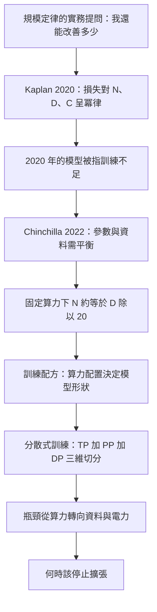
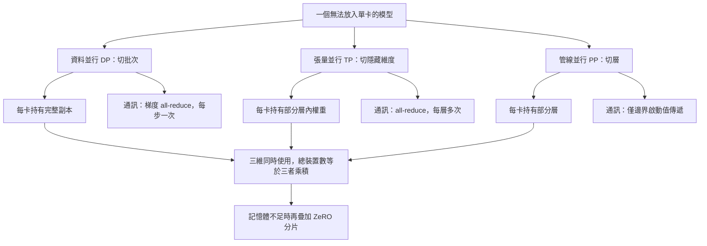

# 6.3 2020 年代：大規模分散式訓練工程（TP/PP/DP）與規模定律

## 一、規模定律：把「訓練更大的模型」變成一道數學題

在 2018 年之前，訓練語言模型的規模上限主要由三個模糊因素決定：可用資料量、機房電力、以及研究團隊的資金與耐心。人們知道「更大的模型通常更好」，但無法回答「好多少」、「該用多少資料」、「什麼時候停止」。

Kaplan 等人 2020 年發表的 *Scaling Laws for Neural Language Models* 首次把這些問題量化。他們對數百個不同規模的 Transformer 進行實驗，發現損失與模型規模、資料量、算力之間存在相當穩定的**冪律關係**。若以 $ N $ 表示模型參數量、 $ D $ 表示訓練 token 數、 $ C $ 表示訓練算力，則模型損失可寫成

$$
L(N, D) \approx \left( \frac{N_c}{N} \right)^{\alpha_N} + \left( \frac{D_c}{D} \right)^{\alpha_D}
$$

其中 $ N_c $ 與 $ D_c $ 是與資料集相關的特徵常數， $ \alpha_N $ 與 $ \alpha_D $ 是無量綱的指數。實驗顯示這兩個指數約為 0.05 到 0.35 這一量級，代表**冪律相當平緩**——把參數或資料增加十倍，損失只會下降一個常數因子。

更重要的是，總算力與最小損失之間也呈冪律關係：

$$
L_{\min}(C) \approx \left( \frac{C_c}{C} \right)^{\alpha_C}
$$

這個公式有極大的實務意義：它把「我的模型還能改善多少」變成了一個只需三個數字就能估算的問題。也正是因為如此，2020 年之後的每一次模型發表，人們都會先問同一個問題：**這個模型是否達到了其算力預算下的最優狀態？**

### 1.1 Chinchilla 的修正

然而 Kaplan 等人的結論在 2022 年被 Hoffmann 等人的 Chinchilla 研究挑戰。他們指出，2020 年那批實驗中最大的那些模型**訓練不足**：它們使用的資料量，相對於其龐大的參數量太少。定律的「 $ N $ 項」在參數過多時反而會變差，意味著把算力全部砸在放大參數上並不划算。

Chinchilla 的做法是訓練一個**刻意平衡**的模型：70 億參數，訓練了 1.4 兆 token，在相同的算力預算下明顯優於當時最大的 Gopher 模型。修正後的結論是：對固定的算力預算 $ C \approx 6 N D $ ，參數與資料應當以大致的比例同時增長，即 $ N \approx D / 20 $ （以 token 計），此時損失才達到最小。

這個修正帶來一個戲劇性的後果：2023 年之後的模型訓練，資料量的重要性大幅上升。過去的直覺是「參數越多越強」，修正後的直覺變成「**在算力固定時，參數與資料必須同步放大**」，否則額外的參數只是浪費。

## 二、三種並行維度

要訓練一個無法放入單一裝置的模型，必須把計算切分到多顆 GPU 上。切分的方式有三種，彼此正交，且在三個維度上同時使用。

### 2.1 資料並行（Data Parallelism, DP）

最簡單也最成熟的方式。每個裝置都持有**完整的模型副本**，但處理批次中不同的資料分片；每一步計算完梯度後，把所有副本的梯度取平均，使每個副本的參數保持同步。

若使用梯度累積來模擬大批次，單步的通訊量只與模型大小成正比：

$$
\text{通訊量} \approx 4 \cdot P \cdot \frac{1}{B}
$$

其中 $ P $ 是參數數量， $ B $ 是裝置數量。每個參數在 fp32 下需要 4 位元組（若使用 bf16 的梯度轉換為 fp32 累加則更多）。768 個參數的模型在 1024 張卡上做一步更新，通訊量達到數 TB 級別——這就是大模型訓練中最主要的頻寬瓶頸。

解決方向是把梯度**同步與反向傳播重疊**，也就是把同步梯度分成若干微塊，在反向傳播計算到某個微塊時就立刻發送該微塊的梯度。ZeRO 系列的技術正是沿著這條路，把同步量繼續壓縮。

### 2.2 張量並行（Tensor Parallelism, TP）

把單一層內的矩陣運算沿著某個維度切分到多張卡。假設一個權重矩陣為 $ W \in \mathbb{R}^{m \times n} $ ，切成兩份 $ W_1 \in \mathbb{R}^{m \times n/2} $ 與 $ W_2 \in \mathbb{R}^{m \times n/2} $ 沿著列拼接，則可以寫成

$$
Y = X W = \left[ X_1 \, X_2 \right] \begin{bmatrix} W_1 \\ W_2 \end{bmatrix} = X_1 W_1 + X_2 W_2
$$

每張卡各自計算一部分，再把結果相加。這種「列切」的方案在反向傳播時需要對輸入梯度做**全歸約**（all-reduce），因為每一列切分區塊都需要完整的 $ X $ 來計算自己的梯度。

Megatron-LM 提出的核心改進，是把每層的前饋網路切成兩段：第一段的列平行、第二段的行平行，兩段各自只需一次 all-reduce 而非兩次。這個技巧把每層的通訊次數從四次降到兩次，是張量並行能夠在高速網路環境下接近理想效率的關鍵。

TP 的通訊量在**每層**都會發生，且必須在層的邊界同步。這決定了 TP 只能用在節機內（同一台機器的高頻寬互連），跨越機房等級別的網路時，延遲會完全淹沒收益。

另一個限制來自**注意力的耦合性**。前饋層與線性層都可以沿著隱藏維度任意切分，但注意力層的分數矩陣是跨序列維度耦合的，它天然抗拒橫向切分。在實作上，人們通常只在**投影層**做張量並行（ 把 $ Q $ 、 $ K $ 、 $ V $ 的投影矩陣切開，各卡各自計算完整的注意力），而把注意力的核心運算交給一張卡或以序列維度切分後用環狀通訊交換結果。這種混合策略說明：並行的切分點應當選在**耦合最弱**的位置，而不是任意維度。

### 2.4 三種維度的組裝

三種並行並非互斥，而是組合成一個三維的叢集拓撲。最常見的組裝順序是：先在節點內用 TP 把模型切到最小可通訊的單位，再用 DP 把這些單位複製到各節點以填滿節點數，最後用 PP 把那些無法塞進單節點的層攤平到多個節點。若某個模型大到單個節點的記憶體仍不足，才會再加上 ZeRO 做更細的分片。

這個組裝順序反映了一個核心原則：**先用成本最低的通訊把問題解決到最大程度**。TP 的通訊最頻繁但頻寬要求最高，只在最緊密互連的範圍內使用；PP 的通訊量最小，最適合跨越機房的慢速網路；DP 在副本之間只需要梯度，是最省頻寬的擴展方式。

### 2.3 管線並行（Pipeline Parallelism, PP）

把不同**層**分配到不同裝置。假設有 $ P $ 個管線階段，第 $ i $ 個階段執行連續的若干層，前向傳播時啟動值從階段 1 依次流向階段 $ P $ ，反向則反向流回。

管線的效率受制於**氣泡**（bubble）。若管線中有 $ M $ 個微批次，每個階段的計算時間為 $ t $ ，理想情況下總時間是

$$
T = (M + P - 1) \cdot t
$$

而無氣泡的理想時間是 $ M \cdot t $ ，因此氣泡比例為

$$
\text{bubble ratio} = \frac{P - 1}{M}
$$

要讓氣泡比例小於百分之十，就需要 $ M \geq 9 P $ 。在 $ P = 8 $ 的情況下，需要至少 72 個微批次。這意味著**批次被切得很小**，而每個微批次又必須大到能讓 GPU 吃飽，這兩者互相牴觸。

緩解氣泡的技術包括：把反向傳播的微批次順序交錯以填補空隙（1F1B 排程）、把注意力層在各階段間均勻分配以平衡耗時、以及**微批次數隨梯度累積步數變動**的權重版本。Megatron-LM 提出的交錯式管線並行讓一個裝置同時持有不連續的多個層，進一步縮小了啟動點數量。

管線並行還有一個容易被忽略的好處：**它讓每個裝置的權重副本變小**。當模型大到單卡放不下時，把層分散到不同卡上，每張卡就只需要負擔自己那幾層的權重與最佳化器狀態。這使得管線並行成為「把超大模型塞進既有叢集」最直接的手段。

代價則是**排程的脆弱性**。管線的每一個階段都可能成為瓶頸：任何一個階段的裝置故障都會讓整條管線停擺，等待重新排程；此外，前向的最後一個微批次與反向的最後一個微批次之間存在一段「管線尾端」時間，此時大量裝置處於閒置。這使得管線的實際吞吐率往往明顯低於理論上限。

## 三、記憶體與通訊的取捨：ZeRO

傳統的資料並行在三個地方都浪費了記憶體：參數、梯度、以及**最佳化器狀態**。以 Adam 為例，每個參數需要保存 fp32 的參數副本、fp32 的一階動量與二階動量，再加上 fp32 的主權重副本，共計 16 位元組；加上 fp16 的參數與梯度，一個參數總共佔用約 18 位元組。模型在 700 億參數時，僅最佳化器狀態就超過 1 TB。

**ZeRO** 的核心洞見是：資料並行中的這些狀態，本質上在所有副本之間是**重複的**，因此可以分片。

| 並行方式 | 切分對象 | 通訊量級 | 通訊頻率 | 適用範圍 |
| --- | --- | --- | --- | --- |
| 資料並行 DP | 批次維度 | $ O(P) $ 梯度同步 | 每個優化器步 | 跨節點皆可 |
| 張量並行 TP | 隱藏維度 | $ O(n d) $ all-reduce | 每層兩次 | 僅節點內 |
| 管線並行 PP | 層維度 | $ O(n d) $ 啟動值 | 每微批次 | 跨節點適用 |
| 專家並行 EP | 專家維度 | $ O(n d) $ all-to-all | 每個 MoE 層 | 節點內或節點間 |

| ZeRO 階段 | 分片內容 | 額外通訊量 | 記憶體節省 | 典型適用 |
| --- | --- | --- | --- | --- |
| 原始 DP | 無 | 基準 | 無 | 小模型 |
| ZeRO-1 | 最佳化器狀態 | 基準 | 約 4 倍 | 通用 |
| ZeRO-2 | 加上梯度 | 基準 | 約 8 倍 | 通用 |
| ZeRO-3 | 加上參數 | 每層前向後各一次 | 接近 $ O(1) $ | 超大模型 |

ZeRO-3 透過**逐層蒐集**來實現：每一層的參數在需要時才被聚合到需要的裝置上，計算完立即釋放，之後再重新分片。這使記憶體使用不再隨模型大小線性成長，但代價是每一層的前向與反向都需要額外的聚合通訊，把 TP 原本的負擔疊加了上去。

這個取捨的本質是：**記憶體與頻寬是可以互換的資源**。當硬體發展到記憶體不再是最稀缺資源時，團隊會傾向於更多使用資料並行以降低通訊；當模型大到記憶體成為瓶頸時，就必須用 ZeRO-3 這類方案以通訊換記憶體。

## 四、容錯與檢查點

一次大規模訓練可能運行數週，跨越數千個 GPU 小時。在如此長的時間尺度上，硬體故障不是例外而是必然：顯卡掛掉、記憶體錯誤、網路抖動都可能發生。

傳統的做法是**定期檢查點**：每隔若干步把完整的模型狀態（參數、最佳化器狀態、資料載入進度）寫入磁碟。這有兩個明顯的問題：寫入本身很昂貴，若每分鐘寫一次一次十幾 GB 的狀態，會佔用大量 I/O；恢復時必須從某個舊檢查點開始，重算這段期間的全部步驟。

**分層檢查點**採用分層頻率：底層的檢查點保存在本地高速磁碟，寫入較頻繁；上層的檢查點保存在較慢但更可靠的儲存，寫入較稀疏。於是故障恢復時，先從最近的本地檢查點恢復，損失有限。

**隨機同步層**提供了另一個角度的解法：在網路層面引入冗餘路由，讓任意兩台機器之間有多條獨立路徑，單一網路故障不會導致全局中斷。這把容錯的責任從應用層下推到網路層，對大規模叢集特別有效。

另一個現代的做法是**非同步檢查點**與**弹性副本**的結合：把檢查點寫入分散式的物件儲存系統，同時讓不同副本的訓練可以各自獨立地從檢查點恢復並重新同步。目標不再是把故障完全避免，而是**把故障的恢復成本壓到可接受範圍**，這與第 6.1 節的長上下文技術在精神上一致：都是在承認物理限制的前提下重新設計工作流程。

還有一個容易被低估的問題是**數據管線的可靠性**。在數千張卡的規模上，單次訓練會讀取數十兆位元組的語料，任何一個檔案的損毀都可能讓整次訓練在數小時後失敗。因此嚴謹的團隊會在訓練過程中對資料做校驗與雜湊驗證，把資料層的容錯視為與 GPU 層同等重要的工作。

## 五、瓶頸的轉移

過去十年裡，訓練瓶頸的位置一直在移動。

**第一階段（2012 至 2017）：受算力限制。** 單卡顯存的容量決定了模型能有多大，資料量因為資料集本身有限而不成問題。

**第二階段（2018 至 2021）：受資料與演算法限制。** 資料從網際網路文本擴展到 Books3、Wikipedia、程式碼庫；此時更值得注意的是演算法進步帶來的等效算力增益——更好的最佳化器、更好的初始化、深度可穩定化、混合精度訓練，這些都讓同樣硬體能訓練更大的模型。

**第三階段（2022 至 2024）：受資料與電力限制。** Chinchilla 的修正指出了資料的重要性，而高品質人類文本的邊際供給開始成為硬約束。同時，機房的電力開始成為真正的瓶頸：單一叢集的用電需求從幾兆瓦上升到數十兆瓦，而電網接入的審批往往需要數年。這使得**「能不能買到足夠的卡」這個問題，逐漸被「能不能拿到足夠的電」所取代。

這個轉移有重要的策略含意。當算力是瓶頸時，最有效的手段是找到更好的演算法與硬體；當資料是瓶頸時，最有效的手段是合成資料、資料去重、與資料配比的研究；而當電力是瓶頸時，改善的手段變成提高每瓦電力的 token 產出，也就是能效比。

## 六、成本的意義與「何時該停止擴張」

規模定律最容易被誤用的方式，是被當成一個**保證繼續投入的正當性理由**。它其實是一個**決策工具**，而且是一個可以回答「何時該停止」的工具。

從 $ L_{\min}(C) \approx (C_c / C)^{\alpha_C} $ 出發，計算每單位算力的邊際效益（loss 的下降量對成本的微分）會隨著 $ C $ 增大而**遞減**。當邊際效益低到某個臨界點——例如再花一倍成本只換來百分之一以下的損失下降——就應該停止擴張，把資源轉向資料品質、演算法、後訓練或產品。

一個更務實的判準來自實際的商業模型：算力成本佔總成本的比例、以及新增能力是否能轉化為產品價值。對於大量重複性的查詢，一個更大但更慢的模型可能比更小的模型更划算，因為成本攤平在了更多次呼叫上。

## 七、對數據本身的質疑

冪律關係在觀測範圍內極為穩定，但「穩定」不等於「無限延續」。存在幾個合理的疑慮。

第一，**資料上限**。人類產生的高品質文本總量是有限的，即使把整個網際網路去重後的可用文字也只有數十兆 token 級別。當逼近這個上限時，繼續增加資料帶來的邊際收益會快速衰減，冪律必須讓位給某種飽和曲線。

第二，**合成資料的自我消耗**。用模型產生的資料去訓練更大的模型，若沒有外部的真實資訊注入，模型可能只是反覆強化自己的偏誤，這個過程被稱為**模型崩塌**。合成資料因此更適合用於「補上真實資料稀缺的特定能力」，而非無限制擴張。

第三，**任務能力的非冪律性**。困惑度是語言模型的平均測度，但真正的能力（例如多步推理、程式除錯）往往在某一個臨界點突然湧現，而非隨著算力平滑提升。冪律描述的是「語言建模的流暢度」，卻可能對「能力的出現時機」給出錯誤的預測。

這些疑慮不否定規模定律在現有範圍內的有效性，但它們意味著：**「只要繼續擴大就會持續變強」不是一條可以無限延伸的推論，而是一個需要不斷重新檢驗的經驗假設。**

## 八、小結

2020 年代的訓練工程是一門關於**在有限資源下如何逼近最優配置**的學問。規模定律給出了目標，ZeRO 與三種並行給出了資源切分的方法，容錯技術給出了長時間運行的可靠性，瓶頸分析給出了下一個投資方向。而在所有這些工程技術之上，第 7 章將要處理的問題已經悄悄浮現：**模型已經能說話、能推理、能生成很長的內容，但它還不知道要聽你的話。** 能力的擴張解決了「能不能」，接下來的問題是「該不該照你说的做」。
