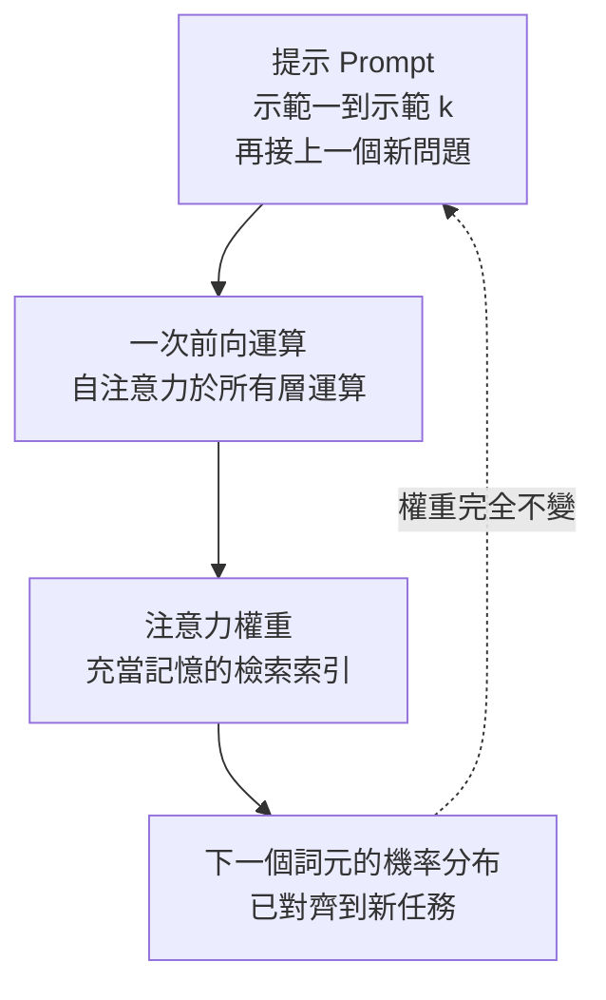
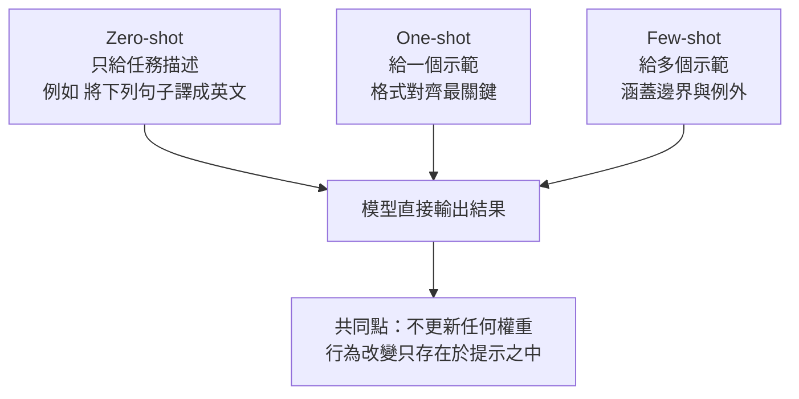

# 7.1 2020 年代：指令微調與上下文學習（In-Context Learning）機制

## 一、預訓練模型的三大侷限

第 5 章描述過預訓練的核心機制：模型在海量無標註語料上反覆預測下一個詞元，把語言的統計結構壓縮進數十億個參數之中。這套機制造就了令人震驚的語言能力，也留下三個結構性的空白，而這三個空白正是 2020 年之後整個「指令微調」研究計畫的出發點。

第一個侷限是**不聽指令**。預訓練只學會「文字如何延續」，並沒有學會「人類的請求與合乎期待的回應之間是什麼關係」。當使用者問「請用三句話介紹光合作用」時，模型並不必然理解「請用三句話」是一項格式約束，它很可能只是把這段文字當成語料的一部分，續寫出一段無關的文章。這不是語法錯誤，而是行為錯誤：模型具備產生正確內容的能力，卻缺乏「在指示條件下產生正確內容」的行為模式。

第二個侷限是**無法對話**。真正的對話需要模型記住上文、辨識提問者的意圖、維持角色一致性，甚至在資訊不足時追問。這些能力要求模型把「上一輪的對話內容」當成必須遵守的約束，而單純的自迴歸語言模型只會把對話視為一條需要延續的語料串。

第三個侷限是**輸出格式不可控**。當應用程式需要 JSON、需要固定欄位、需要逐項編號的清單時，預訓練模型幾乎必然失敗。它擅長的是「像人類文章那樣地說話」，而不是「精確地產生指定結構」。這使得預訓練模型無法直接嵌入任何嚴謹的軟體系統之中。

三者的共同根源可以歸結為一句話：預訓練優化的是**語言的似然**，而應用程式需要的是**行為的正確性**。從語言似然到行為正確性之間，必須插入一層新的訓練。

## 二、指令微調的三個階段

指令微調（Instruction Tuning）的核心思想是：把「指令」與「回應」組成資料對，用交叉熵損失繼續訓練模型，使模型學會把「指令」映射為「合乎期待的回應」。一個成熟的做法通常包含三個階段，彼此串接成一條資料與資訊的流水線。


**階段一：示範資料建構。** 這一步的目標是定義「什麼樣的行為算合格」。研究者會寫出數百到數千個真實或半真實的使用情境，每個情境配上一個理想回應，藉此明確模型的性格：該用正式還是非正式語氣、何時該承認不知道、何時該主動提出澄清問題。此階段的產出不是模型，而是一份行為規格書。

**階段二：監督微調（SFT）。** 把示範資料與指令資料混在一起，用標準的自迴歸交叉熵損失繼續訓練。形式上仍是第 5 章那個負對數似然目標，只不過資料從「自然文章」換成「指令與回應」：

$$
\mathcal{L}_{\text{SFT}}(\theta) = -\sum_{i=1}^{N} \sum_{t=1}^{T_i} \log p_\theta(y_{i,t} \mid x_i, y_{i,1}, \dots, y_{i,t-1})
$$

其中 $ x_i $ 是第 $ i $ 筆指令， $ y_{i,1}, \dots, y_{i,T_i} $ 是該筆示範的目標回應。注意損失只加在回應部分，指令本身不計入損失，這正是「教模型學會回應」而非「學會發問」的原因。

**階段三：偏好對齊。** 僅靠 SFT 會得到「能聽話但品味不佳」的模型，因為示範資料只能表達一個正解，無法表達「兩個都對但這個更好」。因此需要人類成對偏好的資料，讓模型學會排序而非模仿。這個階段的完整數學與演算法留待第 8 章討論，本章只指出它在整體圖景中的位置：它是把「行為模式」升級為「行為偏好」的最後一道工序。



## 三、為什麼「指令」必須成對

一個常見的誤解是：只要讓模型在預訓練時偶爾看到「問句」，它自然就會回答。事實並非如此。指令微調的資料必須是**成對的輸入與輸出**，這是語言學習與行為學習的根本差異所在。

語言能力可以被單一的、無標註的文本承載，因為語言的規律存在於詞與詞的共現之中；一句話語料同時「展示了問題」和「展示了答案」，讀者可以在腦中自行配對。但行為無法如此自足地呈現。單看「請把這段話翻成英文」這句話，任何人都無法推斷理想的回應長度、語氣、是否需要保留人名、是否該先解釋再翻譯。行為的邊界——什麼算過度囉嗦、什麼算漏掉約束、什麼算拒絕得不合禮貌——只能透過**具體的示範**被傳遞。

因此示範資料扮演的是「行為邊界的具體化」角色。每一筆示範都在回答一個行為問題：「在這種指令與這種情境下，一個理想助手會怎麼說？」數百筆累積起來，就形成一張行為地圖。這也解釋了為什麼資料量在指令微調中的意義與預訓練截然不同：預訓練需要數兆詞元來涵蓋語言，而指令微調用數千到數萬筆高品質配對，就足以明顯改變模型的行為模式。這種「用少量高訊號資料改變行為」的效率，正是後續參數高效微調（見 7.2 節）能夠成立的先決條件。

此外，成對資料還承擔了一個隱含功能：它教會模型「輸入」與「輸出」在分佈上是不同的。預訓練語料裡，問句與答案的外觀往往相似，模型難以學到「我該產生的是答案側的統計特徵」。成對資料用表面的不對稱性，把這個角色邊界刻進模型。

有一個常被低估的實務細節是：**資料的「多樣性」比「數量」更關鍵**。若示範全部來自同一個領域、同一種問法、同一種長度，模型學到的將是那個狹窄分佈的行為，遇到稍有不同的請求便會退化。反過來，分散在不同領域、不同措辭、不同輸出長度上的數百筆示範，能教出更通用的「指令遵循」能力。業界流傳的經驗是，指令微調資料的來源多樣性，其影響力甚至超過資料規模本身。

## 四、上下文學習的現象

2020 年，Brown 等人在 GPT-3 的論文中報告了一個令人意外的現象：只要在提示裡擺出幾個「任務示範」，模型就能完成一個它從未被訓練過的新任務，而且**不需要更新任何權重**。示範的形式只是純文字：

```
輸入：這部電影的評價很糟。
輸出：負面
輸入：這首歌讓我聽了想哭。
輸出：正面
輸入：這家店的服務員非常冷漠。
輸出：
```

模型會直接接續輸出「負面」。這種能力被稱為上下文學習（In-Context Learning，ICL），它的發現立刻改變了整個應用開發的生態。

在預訓練的框架下，這件事是驚人的。模型在訓練過程中從未見過「負面／正面」這個標籤與情感評論之間的對應規則，也沒有任何梯度更新把這個規則寫進權重。規則僅僅存在於提示的少數 token 之中，卻改變了整個輸出分佈。也就是說，模型具備了一種**在推論期間吸收新規則**的能力。

上下文學習有時被描述為「模型學會了教學」。更精確的說法是，模型在推論期間把示範當成參考資料，用某種內部的運算機制完成一次極小型的「學習」，而這個機制的所有狀態都存在於當下的注意力計算裡。

## 五、機制的三種解釋

文獻中對上下文學習如何運作，主要有三種互補的解釋。

**其一：隱式梯度下降。** 這個觀點由 Brown 等人提出，後續有大量實驗支持：模型在看到示範後，其內部表示的變化，方向上類似於真正用這些示範做了一次梯度更新。研究者甚至構造出所謂的「反向演算法」，從模型在示範前後的隱藏狀態差分中還原出某個等效的梯度向量，再把這個向量施加到模型權重上，得到的權重與原權重在功能上幾乎等價。換句話說，注意力機制在推論期間執行了一次隱式的、沒有學習率的參數更新。

**其二：注意力即記憶查找。** 另一種解釋把上下文學習視為把 Transformer 當成一個 key-value 記憶體：輸入的每個 token 產生一個 key，儲存的內容產生對應的 value，而當前查詢會依相似度檢索出相關的 value。示範中的「這部電影的評價很糟」就是以「負面」為 value 的記憶條目，新問題「這家店的服務員非常冷漠」透過注意力把這個條目取出來。這解釋了上下文學習為何不需要外掛記憶體——模型本身就是記憶體。

**其三：示範即任務描述。** 最後一種解釋偏資訊理論：示範並非真的被「使用」，而是作為對任務的隱含描述改變了下一個詞元的機率分布。例如在示範中出現了「負面」這個詞，模型便把整個序列的風格與主題遷移到新問題上。這個解釋最保守，但也最容易解釋「示範順序影響效果」「示範格式影響效果」等經驗現象。



三種解釋並不互斥，事實上可以被視為同一現象的不同抽象層次：隱式梯度解釋了「為什麼有效」，記憶檢索解釋了「機制在哪裡」，任務描述解釋了「為什麼效果會退化」。

## 六、三種典範

依示範數量，上下文學習形成三種標準範式。

| 範式 | 提示結構 | 典型用途 | 主要代價 |
|------|----------|----------|----------|
| Zero-shot | 僅任務描述與查詢 | 分類、簡單改寫、翻譯 | 格式漂移，指令歧義 |
| One-shot | 任務描述加一個示範 | 需固定輸出格式的任務 | 示範品質決定成敗 |
| Few-shot | 任務描述加數個示範 | 少樣本分類、格式複雜任務 | token 成本隨樣本數線性成長 |

Zero-shot 的關鍵不在於提示寫得多漂亮，而在於模型是否已經被指令微調過。未經指令微調的模型即使拿到清晰描述，行為也常常偏離；而經過指令微調的模型在 zero-shot 下就能穩定運作。One-shot 與 few-shot 的價值在於**格式對齊**：示範把「輸入長什麼樣子、輸出長什麼樣子」精確地呈現出來，這在處理自訂標籤集或特殊格式時幾乎是決定性的。

示範的**順序**也會影響結果。實驗顯示，把最容易、最典型的示範放在最前面、把最接近決策邊界的示範放在最後面，效果往往較好。這是因為自迴歸模型的解碼是自左向右進行的，越靠近生成位置的資訊對當下 token 的分布影響越大——後面的示範扮演的正是「最近的參考」。這也解釋了為何同一組示範僅僅換個順序，就可能讓模型的輸出品質產生明顯差異，而這類差異往往不會在粗略的評測中被察覺。

## 七、為何實務上更受歡迎

上下文學習在工程上打敗了微調，成為 2021 年之後的預設選擇，原因有三個彼此獨立的理由。

**第一，無需訓練。** 典型的微調流程需要準備資料、撰寫訓練腳本、準備叢集、除錯與調參，這是一個以「週」為單位甚至以「月」為單位的工程專案。上下文學習的「訓練」就是把示範寫進提示字串，可以在一分鐘內完成、在一秒鐘內修改。

**第二，即時更新。** 業務規則今天改了，提示就今天生效，不必重訓模型。這種可控性在法規、客服、多租戶等情境中特別關鍵——每個客戶可以在同一份基礎模型上擁有不同的規則行為。

**第三，資料不留在權重裡。** 這一點在安全與合規上特別重要。若企業的內部規則是透過微調「燒進」權重裡的，就難以證明資料沒有被留存、難以支援單一客戶的資料刪除、也難以保證模型不會在其他客戶的查詢中洩漏它。提示則是每次請求時攜帶的、可稽核的、可隨即丟棄的。

代價同樣真實。上下文學習並非免費：每個請求都要為示範 token 付費，示範越多單價越高；長提示會佔用寶貴的上下文視窗與注意力計算資源；而模型對提示格式相當敏感——同一批示範，換一種分隔符或措辭，結果可能大幅波動，這使得提示工程本身成為一門需要經驗與測試的技藝。

除此以外，上下文學習還有兩項結構性的限制。其一是**注意力成本**。若示範使提示長度從數百 token 膨脹到數萬 token，注意力矩陣的大小將依序列長度的平方成長（第 6.1 節），這使得示範的數量存在一個效益遞減的甜蜜點，超過之後效能不再提升而成本急遽上升。其二是**示範佔據上下文**。示範與真正的查詢共用同一個視窗，示範越多，留給使用者實際問題的空間就越少，在長文件問答這類任務中尤其容易造成截斷。

還有一個容易被低估的風險是**示範中的偏見會被即時放大**。示範並非中性的示範材料，示範裡怎麼寫就等於告訴模型答案該長什麼樣，若示範本身含有偏差或錯誤，模型會忠實地複製並推廣它。由於提示是每次請求都可見且可稽核的，這種偏誤至少是透明的，相較之下被燒進權重的偏誤則難以察覺與回溯。

## 八、兩者並非互斥

常見的誤解是把指令微調與上下文學習當成兩條互斥的路徑：彷彿要嘛訓練模型，要嘛不訓練。事實上它們處理的是不同層次的問題。

指令微調改變的是**模型的行為傾向**，讓模型預設就懂得「這是一個指令，我該產生一個回應」。上下文學習改變的是**特定任務的映射關係**，讓模型在這一次請求裡知道「這個標籤該怎麼對應」。兩者作用於不同的時間尺度與不同的資訊載體：前者寫進權重、後者留在提示。

實證上，經過指令微調的模型在上下文學習上的表現普遍優於未經微調的模型，因為前者已經建立了「示範是用來描述規則的」這種任務格式先驗。同一批示範，對未微調模型可能只是看不太懂的文字堆積，對指令微調模型卻是清晰可執行的規範。

事實上，現代的開源模型幾乎都是三者的疊加體：先做大規模預訓練獲得通用能力，再做指令微調建立助手行為，接著以第 8 章的偏好對齊塑造人格與安全性，最後在特定領域用第 7.2 節的參數高效微調加上專屬能力。四層結構各自解決一個層次的問題，彼此並不競爭。上下文學習在這個結構中扮演的是最上層的執行腳本——它把底層的能力轉化為此刻這一次請求的具體行為。

## 九、2023 年後的共識

到了 2023 年之後，業界對這兩種技術的定位趨於穩定，形成了一個雙層分工的共識：**指令微調打底，上下文學習做即時客製**。

底層由指令微調（加上第 8 章的偏好對齊）提供可部署的行為基礎：模型會聽指令、會遵循格式、會在適當時拒答、會以助手口吻回應，而這些行為無須在每次請求中重複描述。上層由上下文學習承擔客製化任務：插入最新的業務規則、加入使用者的專屬範例、載入暫時性的文件內容，而這些資訊隨時可更新、可即時撤回。

這個共識也呼應了本書的主線：模型的「記憶位置」不斷遷移。預訓練把能力放進權重，指令微調把行為放進權重，上下文學習則把**當下的任務條件**放回提示之中——也就是說，最即時、最易變的那部分資訊，回到了它本來就該待的地方，也就是當下的對話之中。

---

### 延伸閱讀與交叉參照

- 第 5.2 節：自迴歸語言模型的預訓練目標，是本章 SFT 損失函式的直接前身。
- 第 8.1 節：強化學習人類反饋，是本章「第三階段：偏好對齊」的完整推導。
- 第 9.1 節：檢索增強生成，可視為上下文學習在知識注入上的延伸應用。
- 第 10.1 節：測試時運算與思維鏈，同樣是把運算搬到推論期的技術路線。
