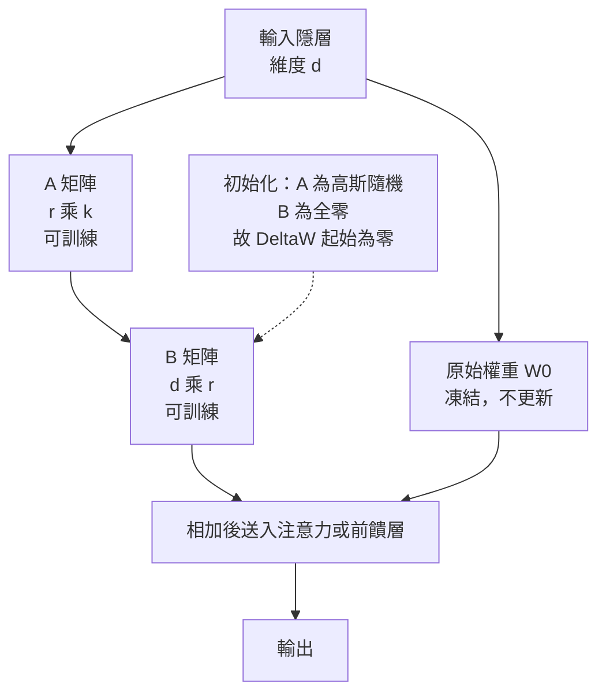

# 7.2 2020 年代：參數高效微調（PEFT）：LoRA、QLoRA 與適配器設計

## 一、全量微調的成本

第 7.1 節說明上下文學習能以零訓練成本完成客製化。那麼為什麼還需要微調？因為當適配器本身就要為每個使用者、每個版本、每個領域各存一份時，儲存的代價會從一個「檔案大小的問題」膨脹成「模型倉庫的治理問題」。

先看全量微調的帳單。假設有一個 70 億參數的模型，若以 16 位元浮點儲存，單份權重約需 $ 2 \times 7 \times 10^{9} = 14 $ GB 記憶體。而訓練時還必須同時保存梯度與優化器狀態。以 Adam 為例，每個參數需要一份梯度、一份一階動量估計與一份二階動量估計，在混合精度訓練下合計約為每參數 16 位元。因此整體訓練記憶體需求可以粗估為：

$$
M_{\text{train}} \approx N \bigl( s_{\text{weight}} + s_{\text{grad}} + s_{\text{mom1}} + s_{\text{mom2}} \bigr)
$$

代入 $ N = 7 \times 10^{9} $ 與各項位元數，得到約 112 GB 的記憶體需求，還不包含 activations 與暫存空間。這意味著單張 80 GB 的 A100 仍然不夠，一般消費級顯示卡（16 或 24 GB）則更是天方夜譚。

第二層成本是**每個任務一份完整權重**。若一家企業要服務客服、翻譯、法律摘要與內部程式碼助手四個場景，全量微調的結果是四份各 14 GB 的模型，共 56 GB，部署時還要為每份模型分別維護推理環境與版本控管流程。

第三層成本是**每一次資料更新都要重訓**。當法規條文更新或產品功能改版，模型就必須重新走一遍完整的訓練流程，數天到數週的算力與人力重新投入。
第四層成本是**災難性遺忘**。在全量微調中，新領域的資料會覆蓋舊領域所學到的表示，一個在醫療語料上微調的模型往往在通用問答上大幅退化。為了避免這個問題，實務上要混入大量通用資料，讓每一次微調都變得更貴。

還有一層常被忽略的**工程複雜度成本**。全量微調不只是記憶體吃緊，它還需要分散式資料平行、梯度同步、檢查點與故障恢復（第 6.3 節）。而 PEFT 只訓練極少參數，梯度幾乎不需同步，訓練可在單机上完成。

參數高效微調（Parameter-Efficient Fine-Tuning，PEFT）正是針對這四項成本而生的技術族：讓每個下游任務只訓練極少數的參數，並且讓這些任務特有參數可以被獨立儲存、獨立載入、即時互換。

## 二、第一批方法：適配器與提示微調

### 2.1 適配器（Adapter）

2019 年，Houlsby 等人提出適配器架構。他們的做法是在每個 Transformer 層的兩個子層之後各插入一個小型的前饋網路模組，而把原本的權重凍結：

$$
h' = h + \operatorname{Adapter}(h) = h + W_{\text{up}}\, \sigma(W_{\text{down}} h)
$$

其中 $ W_{\text{down}} $ 把隱層維度 $ d $ 降維到很小的瓶頸維度 $ b $ ， $ W_{\text{up}} $ 再把它升回 $ d $ ，通常取 $ b \ll d $ 。殘差連接保證了插入的模組在初始時可以被初始化為近似恆等映射，因此訓練初期模型行為幾乎不變，訓練過程平穩。

適配器的參數開銷是每層 $ 2 \times d \times b $ 。以 $ d = 4096 $ 、 $ b = 64 $ 計，每層約 52 萬參數，相對於該層原本數千萬參數的權重，比例不到百分之一。它的優點是直觀、容易插入既有框架，而且每個任務只需儲存幾 MB 的適配器檔案；缺點是推理時多出兩層矩陣乘法，會帶來可量測的延遲，而且必須修改模型前向流程才能載入適配器。

適配器的貢獻在於確立了 PEFT 的基本範式，事後回看它的幾項設計選擇都很有遠見：凍結主體保證了預訓練能力不被摧毀，瓶頸結構保證了參數效率，殘差連接保證了插入位置的安全。後來幾乎所有 PEFT 方法都沿用了這三個判準——**改動要有界、效應要集中、介入要無害**。LoRA 與適配器的差別正在於如何同時滿足這三條：LoRA 把「插入新模組」改成「沿用既有模組的結構」，於是既滿足了效應集中，又完全免除了推理時的額外延遲。

### 2.2 提示微調（Prompt Tuning）

2021 年，Lester 等人提出提示微調，方向與適配器相反：不插入任何新的模組，而是把原本離散的輸入嵌入，改成可訓練的連續向量。具體做法是引入一組軟提示（soft prompt）向量 $ P \in \mathbb{R}^{p \times d} $ ，把它與輸入嵌入拼接後送入模型，而原本的嵌入層與全部 Transformer 權重皆凍結：

$$
[ P \,; \, x_{\text{emb}} ] \rightarrow \text{Transformer} \rightarrow y
$$

訓練時只有 $ P $ 這 $ p \times d $ 個連續參數會被更新。它的極致形態是 Lester 等人的 *prefix tuning*：在每一層的注意力鍵與值之前都加上可訓練的前綴向量，讓每一層都能重新分配注意力模式。

提示微調的參數開銷極小，在模型規模較大時甚至優於適配器。但它有明顯限制：每個提示向量只作用於輸入端，而適配器作用於每一層的表示轉換，因此在需要大幅改變模型內部行為的任務上，提示微調通常不如適配器。此外，軟提示的數值優化需要比離散提示更多的資料與更仔細的學習率調校，在小資料情境下容易過擬合。

提示微調的真正貢獻是確立了一個極為重要的直覺：**提示不只是一段給人看的文字，它也可以是一組訓練出來、離散搜尋難以達到的連續向量**。這把「提示工程」從語言層面拉到了向量層面。更重要的是，提示微調說明了「指令」與「參數」是可以互換的——同樣的適配效果，一端是離散的、人類可讀的、隨時可改的文字，另一端是連續的、不可讀的、需訓練才能得到的向量。

## 三、LoRA：低秩適配

2021 年，Hu 等人提出的 LoRA（Low-Rank Adaptation）是影響力最大的 PEFT 方法，它的優雅之處在於一個簡單的觀察：**微調造成的權重變更，其方向空間的維度遠低於權重本身**。

LoRA 的核心是把凍結的權重 $ W_0 \in \mathbb{R}^{d \times k} $ 替換為：

$$
W_0 + \Delta W, \qquad \Delta W = BA, \quad B \in \mathbb{R}^{d \times r}, \quad A \in \mathbb{R}^{r \times k}, \quad r \ll \min(d, k)
$$

也就是說，可訓練的部分被限制在秩不超過 $ r $ 的子空間裡。若 $ r = 8 $ 而 $ d = k = 4096 $ ，可訓練參數只有 $ 2 \times 8 \times 4096 = 65536 $ 個，約為原權重矩陣的 0.4%。

**初始化是 LoRA 設計中最關鍵的一個決定。** 若兩層都隨機初始化，訓練起點的 $ \Delta W $ 就會是一個隨機的滿秩擾動，會立刻破壞預訓練模型的行為，正確做法是讓 $ A $ 為高斯隨機初始化、 $ B $ 初始化為零矩陣，此時 $ \Delta W = BA = 0 $ ，模型在第一步之前與預訓練模型完全等價，訓練是從零出發的「增量修正」，這也是 LoRA 對指令微調特別友好的原因。

**前向運算與合併。** 訓練時，前向運算寫成：

$$
h = W_0 x + \frac{\alpha}{r} BA x
$$

其中 $ \alpha $ 是縮放係數。訓練結束後，由於 $ BA $ 是常數矩陣，可以直接合併回原權重：

$$
W_{\text{merged}} = W_0 + \frac{\alpha}{r} BA
$$

合併後模型的計算圖與原模型完全相同，**推理延遲與記憶體都零額外成本**。這是 LoRA 相對於適配器最實用的優勢：適配器必須在推理時多跑兩層矩陣乘法，而 LoRA 可以徹底消失。

**秩與模組選擇。** 秩 $ r $ 是 LoRA 的主要超參數。經驗法則是：任務越接近基礎模型的既有能力分布，需要的秩越小；任務越新穎、需要注入新知識或新格式，所需的秩就越大。文獻中常見的範圍是 $ r = 4 $ 到 $ r = 64 $ ，且增大 $ r $ 的邊際效益會快速遞減。此外，LoRA 通常只套用在注意力的查詢與值投影矩陣上，而前饋層的矩陣更大卻常被略過，原因是注意力投影是資訊流動的瓶頸，修改它對模型行為的影響更直接。

LoRA 之所以流行，還有一個純粹的工程原因：**適配器的檔案可以直接合併進基礎模型**。對同一個基礎模型做十種不同任務的 LoRA，儲存成本是十個幾 MB 的檔案而不是十份完整權重；部署時依任務載入對應的適配器並合併，甚至可以在記憶體中即時切換。這種「一個基礎模型加一個可插拔模組」的形態，後來成為整個開源模型生態的標準做法。

還有一個低秩假設背後的直覺值得一提。既然 $ \Delta W $ 被限制在秩 $ r $ 的子空間裡，那麼可訓練參數的數量是 $ r (d + k) $ ，而全秩更新需要 $ d k $ ，兩者之比約為 $ r (d+k) / (dk) $ ，在 $ d $ 與 $ k $ 同階時就約等於 $ 2r/d $ 。這意味著在維度數千的矩陣上，只要取 $ r = 8 $ 就能把可訓練比例壓到千分之一以下。

## 四、QLoRA：讓單張消費級顯卡也能微調

2023 年，Dettmers 等人提出的 QLoRA 把三項技術結合起來，把 70 億參數模型的微調硬體需求壓到單張 24 GB 顯示卡之內。

**第一項：4-bit 分位數量化的 NF4。** 普通的均勻量化把連續的浮點值域切成等寬區間，但模型權重服從近似常態的分佈，絕大多數數值密集地聚集在零附近，因此等寬區間會讓資訊大量損失。QLoRA 使用 **NormalFloat4（NF4）** 這種資訊論上針對常態分佈最佳化的分位數型態：把分位點取自分佈的分位數而非等距網格，每個值只需 4 位元就能保有大部分資訊。原值再以每個分組的絕對值與最大值正規化因子做雙重縮放。

**第二項：雙重量化（Double Quantization）。** NF4 只壓縮了權重本身，但每個分組的正規化因子本身也是一組浮點數，仍需額外記憶體。雙重量化把這些因子本身也量化為 8 位元，由於因子數量遠少於權重數量，這一步能再省下相當可觀的空間。

**第三項：分頁優化器（Paged Optimizers）。** 分頁操作系統可以把記憶體不夠的頁面換到磁碟，QLoRA 把同樣的思路帶進 GPU 記憶體管理：當優化器狀態即將溢出時，把部分頁面暫時移到 CPU 記憶體，處理完再換回。這讓訓練在記憶體邊際時不會直接崩潰，也讓 24 GB 顯卡能穩定處理 33B 參數的模型。

### 4.1 記憶體的數量級分析

用一個具體算例感受三項技術的份量。取一個 70 億參數的模型，訓練時記憶體的主要成分如下：

| 項目 | 數量或位元數 | 估計記憶體 |
|------|--------------|------------|
| 基準權重（16 位元） | $ 7 \times 10^{9} $ 參數 | 約 14 GB |
| 基準權重（NF4 4 位元） | 同上，4 位元 | 約 3.5 GB |
| LoRA 適配器（ $ r=16 $ ，16 位元） | 約 0.4% 參數 | 約 60 MB |
| 適配器梯度（16 位元） | 同上 | 約 60 MB |
| 適配器 Adam 狀態（32 位元） | 兩份 | 約 240 MB |
| 激活值與暫存 | 視序列長度而定 | 數 GB |

全量微調時，基準權重 14 GB、梯度 14 GB、Adam 狀態約 56 GB，合計超過 84 GB，再加上激活值就會突破單張 80 GB A100 的極限，還需要梯度檢查點等額外手段。而 QLoRA 把基準權重壓到 3.5 GB，可訓練部分只占幾百 MB，剩下來的空間全部留給激活值，於是 24 GB 的消費級顯示卡就足以完成 70 億模型的微調。

關鍵在於：**量化把「凍結的部分」變便宜，LoRA 把「要更新的部分」變小**。兩者作用於記憶體的不同部分，因此效果可以疊加。若只有 LoRA 而沒有量化，基準權重仍然是 14 GB 的 16 位元浮點，光這一項就吃掉 24 GB 顯示卡的一大半；若只有量化而沒有 LoRA，訓練仍需要為整個模型計算梯度，記憶體的量級不會改變。

另一個容易被忽略的好處是量化後的合併幾乎沒有精度損失。由於 $ \Delta W $ 是低秩的，其自身的數值範圍小，加入 4 位元基準時誤差相對可控，實驗顯示合併後的模型與全精度 LoRA 幾乎無差別，但推論時的記憶體與原生 4 位元量化模型相同。

還有一個實務好處：**QLoRA 的訓練產出物可以發布給沒有高階顯卡的人**。因為適配器是以 16 位元儲存的完整張量，使用者下載適配器之後，合併進自己量化過的基準模型即可，完全不需要 24 GB 顯卡。訓練與推論的硬體需求被解耦了。

### 4.2 雙重量化與分頁的細節補充

雙重量化的必要性可以量化說明。若每個 NF4 量化分組涵蓋 64 個權重值，那麼每 64 個權重就伴隨一個 32 位元的縮放因子，這個因子的開銷相當於 0.5 位元每個權重，看似微小，但當基準權重本身已被壓到 4 位元時，0.5 位元就等於多出 12.5% 的總量。把因子進一步量化為 8 位元後，每個權重的額外開銷降到 0.125 位元，總量回到接近 4.1 位元每個權重。

分頁優化器的價值則在於**把記憶體邊界變成可跨越的邊界**。當序列較長或批次較大時，優化器狀態往往是最後被擠壓的對象；有了分頁機制，溢出的頁面可以搬到 CPU 記憶體，PCIe 傳輸延遲因只在特定時刻發生而被攤薄到可接受的範圍。

## 五、方法族譜與實務選擇

把上述方法排在一起，可以得到一張 PEFT 方法對照表。

| 方法 | 可訓練參數比例 | 訓練記憶體 | 推理成本 | 插入位置 | 主要限制 |
|------|----------------|------------|----------|----------|----------|
| 全量微調 | 100% | 極高，約 80 GB 以上 | 與原模型相同 | 無 | 每任務一份完整權重，易遺忘 |
| 適配器 | 0.1% 至 1% | 低 | 略增，需額外層 | 每層子層之後 | 推理有額外延遲 |
| 提示微調 | 0.01% 至 0.1% | 極低 | 與原模型相同 | 輸入嵌入端 | 影響力侷限於輸入端 |
| 前綴微調 | 0.1% | 低 | 略增 | 每層鍵值之前 | 序列長度受限 |
| LoRA | 0.01% 至 1% | 低 | 零額外延遲（可合併） | 線性層旁 | 需選定套用模組與秩 |
| QLoRA | 0.01% 至 1% | 極低，單卡可訓練 | 零額外延遲 | 同 LoRA | 4 位元帶來些微精度損失 |

實務上的選擇可以歸納成幾條判準。

**若任務是「換格式」而非「換知識」**，先試 LoRA 甚至提示微調。這類任務只需要模型學會一種輸出結構，資料量在數百到數千筆即可，參數高效方法綽綽有餘。

**若任務是「注入大量領域知識」**，LoRA 的容量可能不足。此時有兩條路：一是提高秩並把 LoRA 套用到所有線性層；二是走**領域持續預訓練**這條路——用領域語料繼續做下一詞元預訓練，再疊加 LoRA 做任務適應。前者是更新，第二者是把「知識寫進權重」，兩者的成本與風險完全不同，持續預訓練需要重新走過大部分的訓練流程，屬於較重的選項。

**若資料極少**，提示微調或低秩 LoRA 比全量微調更不容易過擬合，也不需要承擔災難性遺忘的風險。

**若要交付多個客製化版本**，LoRA 的可合併性使它是最自然的選擇：一份基準模型加多個數 MB 的適配器檔案，部署與版本控管都簡單。

**若要教模型「不要什麼」**，單靠 PEFT 恐怕不夠，因為拒絕與安全性屬於偏好層次的問題，需要第 8 章的人類回饋對齊來處理。

**若團隊缺乏訓練基礎設施**，最務實的起點往往不是 PEFT，而是第 7.1 節的上下文學習。PEFT 把成本從「零」提高到「需要一張顯卡與一份訓練腳本」，這在對響應延遲或資料合規有嚴格要求的場景仍然不划算，因此技術選型的第一步永遠是問「這個需求真的需要改變模型嗎」。

### 5.1 領域持續預訓練：第五種選擇

值得單獨一提的是**領域持續預訓練（Domain-Adaptive Pretraining，DAPT）**。它嚴格說不屬於 PEFT，因為它要更新整個模型的權重，但在實務上佔據著同等重要的位置，常被列為第五種選擇。

其做法是把模型放在目標領域的語料上繼續進行下一詞元預訓練，讓模型在專業化過程中把領域的統計規律、術語與文體吸收進權重，然後再疊加一層 LoRA 來適應具體任務。對於醫療、法律、程式碼這類術語密集且文體迥異的領域，DAPT 的效果常常明顯優於單靠 LoRA，因為 PEFT 適合「改變行為」而非「注入大量新分布」。

選項之間的取捨可以總結為一句話：**PEFT 改變模型怎麼做事，持續預訓練改變模型知道什麼**。若痛點是格式、風格、指令遵循與特定任務表現，PEFT 是對的工具；若痛點是模型根本不懂這個領域的詞彙與知識結構，則需要先做持續預訓練再疊加 PEFT。

### 延伸：把 PEFT 放回全書的脈絡

PEFT 的出現，恰好呼應了本書第 6.3 節所討論的規模定律現象：模型參數愈多，微調成本愈高，於是「用可訓練參數的稀疏性來換取成本」的做法愈來愈划算。當模型的通用能力已經足夠時，人們要的不是再教它更多，而是讓它以可控的成本，為特定用途做一次小幅但精準的修正。

LoRA 與 QLoRA 也把訓練與部署的界線重新劃定：一個基準模型加上一個可插拔的差分模組，構成了一種新的「發布單位」。這與第 9 章的檢索增強、與第 10 章的智慧體迴圈共同構成 2023 年之後的應用樣貌——**模型是共用的、可攜帶的、可以即時組裝的**。

至於如何讓這些被微調過的模型真正符合作者的意圖——不只是能回答，而是回答得合宜、誠實、並且知道什麼時候該停下——那是第 8 章的主題。指令微調解決了「聽得懂」，PEFT 解決了「改得動」，而偏好對齊與安全護欄解決的是「對得齊」。

---

### 交叉參照

- 第 5.2 節：自迴歸語言模型架構，是本章所有 PEFT 方法插入位置的基礎。
- 第 6.3 節：規模定律與分散式訓練，解釋了為何微調成本會成為瓶頸。
- 第 7.1 節：指令微調與上下文學習，是理解 PEFT 應用場景的前提。
- 第 8.1 節：RLHF 與第 8.2 節的 DPO，屬於偏好層面的對齊，與本章的權重層面微調互補。
