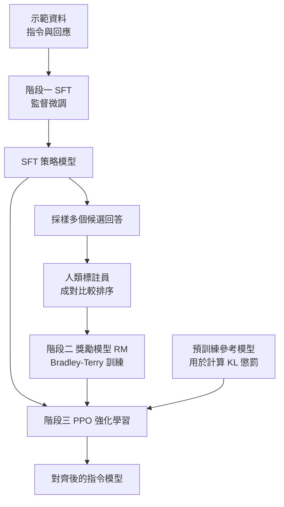

# 8.1 2022 年代：強化學習人類反饋（RLHF）：獎勵模型與 PPO 演算法

## 前言：預訓練模型背後的那道牆

到第 7 章為止，語言模型的訓練目標始終是同一件事：在語料上預測下一個詞。這是一個純粹的分布建模任務，模型學到的是「在人類寫過的文字裡，什麼樣的詞比較可能出現」。它並不知道「提問的人想要什麼」，也不在乎「答案是真是假」。2022 年之前的 GPT-3 正是這樣的產物：它能寫出極為流暢的段落，能模仿任何文體，卻在實測中頻繁「續寫」而非「回答」。它不會說「我不知道」，不會主動拒絕明顯不該協助的請求，也不會因為使用者換一種說法就改變立場。這些缺失並非能力不足，而是目標函數從未要求它具備這些行為。

## 為什麼需要 RLHF

在工程上，人類偏好早就被證明是比任何自動指標都有效的品質判準。困惑度衡量的是文本與語料的相似程度，BLEU 衡量的是與參考譯文的重疊，兩者都無法回答「這個回答是否有用、是否安全、是否切題」。相較之下，讓兩位標註員比較兩個回答並選出較好者，人類之間的一致性（agreement）往往高達七成以上；而要求同一位標註員對單一回答打 1 到 7 分，不同人之間的一致性則大幅衰退。這個差異不是心理學的偶然發現，而是序數效用理論的基本前提：人類的判斷是相對的，不是絕對的。RLHF 的整套設計，第一步就是把統計學的這個結論照搬進來。

純預訓練模型的失效可以分三類來看。第一類是**指令不遵循**：模型把使用者的問句當成文章的開頭，接著自問自答寫出十個可能的段落。第二類是**無害性缺席**：預訓練語料裡存在大量教人做壞事的文本，模型不僅不會迴避，還可能因為「這類文本在語料中比例高」而格外流暢。第三類是**無用輸出**：沒有任何機制告訴模型「過長的清單不如三句重點」。要修正這三類問題，就必須引入一個新的訊號——人類對回答品質的判斷。然而人類判斷有兩個致命障礙：其一，人類能輕易比較兩個回答孰優孰劣，卻難以對單一回答打出可信的絕對分數；其二，逐字打分在物理上不可能，因為語言模型生成的回應量是人類閱讀速度的數千倍。

RLHF（Reinforcement Learning from Human Feedback，強化學習人類反饋）的核心洞見就在於：**放棄絕對評分，改用成對比較，再把比較結果蒸餾成一個可微分、可快速查詢的獎勵模型。** 這個洞看似簡單，卻讓人類偏好第一次能以每秒數萬次的頻率進入訓練迴圈，進而讓「聽指令、說人話、懂拒絕」這些行為可以在幾千億 token 的規模上被系統性塑造。

## 三步驟：InstructGPT 的標準流程

OpenAI 於 2022 年發表的 InstructGPT 論文把這套流程固定為三個階段，本書後續章節也沿用這個骨架。

**第一步是 SFT（Supervised Fine-Tuning，監督微調）。** 收集人類撰寫的「指令—回應」示範資料，直接在預訓練模型上做標準的下一詞預測微調。這一步的作用是「轉身」：把續寫器變成回答器，並提供一個行為大致合理的初始策略。之所以仍要這一步，是因為策略梯度法需要一個起點，而且 SFT 模型給出的分布已經比原始預訓練模型更貼近指令語境。

**第二步是訓練獎勵模型 RM（Reward Model）。** 對每個 prompt，用 SFT 模型採樣多個候選回答，交由人類標註員排序或兩兩比較，再用這些偏好資料訓練一個把「提示 + 回答」映射到標量分數的神經網路。實務上 RM 常以語言模型為骨架再接一個線性輸出頭，其規模通常與策略模型相當或略小。

**第三步是以 RM 為獎勵來源，用 PPO 強化學習微調策略。** 此刻的「環境」是一台伺服器：狀態是對話前文與已生成的詞元，動作是下一個詞元，回合在生成結束或長度上限到臨時終止，獎勵則在回合末尾由 RM 打一次分。整個流程的資料流如下。

三個階段的分工可以用表格整理成下表，讀者會發現它與《強化學習》一書中的模式基礎、Actor-Critic 架構、以及 KL 正則化三個概念一一對應。

| 階段 | 輸入 | 學習目標 | 類比 | 主要風險 |
| --- | --- | --- | --- | --- |
| SFT | 示範資料 | 下一詞預測 | 行為克隆 | 天花板受限於示範品質 |
| RM | 成對偏好 | Bradley-Terry 交叉熵 | 從偏好學價值 | 過度最佳化、可被騙過 |
| PPO | 策略自身採樣 | 最大化獎勵減 KL | Actor-Critic | 訓練不穩定、成本高 |

## 獎勵模型：Bradley-Terry 形式與交叉熵損失

獎勵模型的數學核心是一個極簡的機率模型。假設回答 $`y`$ 的「效用」由一個未知的實數獎勵 $`r(x, y)`$ 決定，人類在看到兩個回答時，以機率 $`\sigma\left(r(x, y_w) - r(x, y_l)\right)`$ 偏好 $`y_w`$ 而非 $`y_l`$ ，其中 $`\sigma`$ 是邏輯斯 sigmoid 函數， $`y_w`$ 與 $`y_l`$ 分別是獲選與落選的回答。這就是 Bradley-Terry 選擇模型，也是序數效用理論在機器學習中的標準形態：

$$
P(y_w \succ y_l \mid x) = \sigma\left(r_\phi(x, y_w) - r_\phi(x, y_l)\right)
$$

由於真實的 $`r`$ 未知，我們以參數化的網路 $`r_\phi`$ 來替代它，並以負對數似然作為訓練損失：

$$
\mathcal{L}(\phi) = -\mathbb{E}_{(x, y_w, y_l)}\left[ \log \sigma\left( r_\phi(x, y_w) - r_\phi(x, y_l) \right) \right]
$$

這個式子的資訊量遠大於它的長度值得玩味。首先，RM 學到的不是「這個回答有多好」，而是「回答之間的相對差異」；把相減的結構放進去，等於自動消除了與提示無關的公共偏移量。其次，人類標註員只須做比較，不必解釋理由，這讓資料生產的吞吐量提高了數十倍。第三，損失函數是標準的二元交叉熵，因此不難看出 DPO 之類的後續方法為何能沿用同一套數學語彙——這條線索會在 8.2 節正式接上。

## 獎勵模型的隱憂：過度最佳化

一旦策略開始最大化 $`r_\phi`$ ，一個幾乎不可避免的問題就浮現：**RM 是一個學出來的近似，而不是價值的真實定義。** 策略優化器的本領是找出任何能讓分數上升的方向，而它在資料分布之外的分數毫無保證。結果是策略會逐漸摸索出「看起來像高分回答、其實並未真正回答問題」的模式：過度堆疊客套話、擅自加上摘要與標題、無中生有地補充細節。這一現象在強化學習文獻中稱為過度最佳化（over-optimization），在 RLHF 語境中則常被稱為獎勵駭入（reward hacking）。

更細緻的一層是，獎勵模型與策略共享同一批有限的人類偏好資料，人類標註員自身的偏好並非全知。因此 RM 的判斷邊界，實際上是被標註員群體的共識所劃定的。InstructGPT 論文同時報告了「訓練獎勵分數」與「人類真實評分」兩條曲線：前者隨強化學習持續上升，後者卻在某個點之後開始下滑。這是一個關鍵的經驗事實——**優化到獎勵的極致，往往意味著偏好的劣化**。此後所有關於對齊演算法改良的嘗試，本質上都在處理這個落差。

另一個容易被低估的問題是資料分布的窄化。偏好資料通常來自少數幾個任務類別，且多為簡短問答；當策略在這些類別上被反覆強化，它會把特定措辭與特定結構的答案學成「高分解」，而這些模式未必能遷移到未見過的領域。於是出現一個兩難： $`\beta`$ 調得夠大，模型不會過度擬合偏好資料，但也學不到多少新行為；調得夠小，模型在偏好資料上表現亮眼，卻在邊界情況中顯得荒謬。這個兩難沒有數學解，只能靠持續的線上評測與人工巡檢來管理。

## KL 懲罰項：把策略錨在原處

要抑制過度最佳化，標準做法是在目標函數中加上一個對策略偏移的懲罰。InstructGPT 使用的形式是：最大化 RM 分數的期望，同時最小化新策略與參考模型之間的 KL 散度。

$$
\max_\theta\ \mathbb{E}_{(x, y) \sim \pi_\theta}\left[ r_\phi(x, y) \right] - \beta\, \mathbb{E}_{x}\left[ \mathrm{KL}\left( \pi_\theta(\cdot \mid x) \,\|\, \pi_{\text{ref}}(\cdot \mid x) \right) \right]
$$

參考模型 $`\pi_{\text{ref}}`$ 通常直接取自 SFT 階段的模型，而 $`\beta`$ 是控制對齊強度的旋鈕。三個理由使這個項不可省：第一，KL 把策略限制在「RM 仍然大致可信」的區域內，等於給過度最佳化劃下邊界；第二，它防止災難性遺忘，因為純粹的獎勵最大化可能讓模型丟棄預訓練所學的語法與知識，只留下讓評分器滿意的退化行為；第三，它抑制模式坍縮，避免所有提示都得到千篇一律的「安全套話」。代價也很明顯： $`\beta`$ 太大，強化學習便失去意義； $`\beta`$ 太小，護欄形同虛設。這是一個只能靠經驗與監控微調的工程參數。

## PPO 的核心：clip 目標與 GAE

策略更新的具體形式採用 PPO 的剪切目標函數。令 $`r_t(\theta)`$ 為新舊策略在時刻 $`t`$ 的機率比， $`\hat{A}_t`$ 為估計的優勢函數， $`\epsilon`$ 為剪切範圍：

$$
\mathcal{L}^{\text{CLIP}}(\theta) = \mathbb{E}_t\left[ \min\left( r_t(\theta) \hat{A}_t, \ \text{clip}\left( r_t(\theta), 1-\epsilon, 1+\epsilon\right) \hat{A}_t \right) \right]
$$

這個目標的機制值得仔細拆解。當某個動作的優勢為正時， $`\min`$ 會取較悲觀的一支，也就是一旦機率比超過 $`1+\epsilon`$ 就停止獎勵進一步提升；當優勢為負時， $`\min`$ 同樣取悲觀支，使得機率比低於 $`1-\epsilon`$ 後不再被持續懲罰。結果是每次更新後策略的改變幅度受到硬性上限，舊資料的樣本仍能安全地重複使用數輪。這個「信任域的近似」正是 PPO 與 TRPO 的關鍵分野：PPO 用一個硬性剪切取代了複雜的共軛梯度求解，用犧牲理論保證換取實作簡潔。

在語言模型上，這個剪切還有額外的意義。 $`r_t`$ 對應的是「在已生成前文的條件下，這個詞元的機率被放大或縮小了多少倍」，因此 clip 實際上限制的是**每個位置上機率分布的移動幅度**，而不是整段文字的編輯距離。這意味著策略仍然可能把整段回答換成另一種風格，只要逐步移動即可；換言之，PPO 的約束是局部的、近期的，並不能保證全局行為的不變。這也是為什麼 KL 項必須在序列層面另行計算：局部 clip 擋不住整體漂移。

優勢的估計則由 GAE（廣義優勢估計）給出，它在偏差與變異之間取一個折衷，並以一個衰減係數在多步 TD 殘差間做指數加權：

$$
\hat{A}_t^{\text{GAE}(\gamma, \lambda)} = \sum_{l=0}^{T-t} (\gamma \lambda)^l \left( r_{t+l} + \gamma V_{t+l+1} - V_{t+l} \right)
$$

其中 $`V`$ 是 critic 估計的價值， $`\gamma`$ 與 $`\lambda`$ 分別控制折扣與偏差-變異折衷。當 $`\lambda = 0`$ 時退化成一步 TD 估計，偏差大但穩定；當 $`\lambda = 1`$ 時接近蒙地卡羅回傳，偏差小但方差高。在 RLHF 中，由於獎勵只在末尾出現一次而終止符號的到來又難以預測，中間詞元的價值判斷幾乎全靠 critic 的外推，這使得 GAE 的超參數選擇格外敏感。

## 為什麼選 PPO 而非 TRPO 或 REINFORCE

在 RLHF 這個場景裡，演算法選擇的判準不是理論最優，而是「在有限算力下能穩定跑完」。REINFORCE 屬於純策略梯度法，每步都必須用整條軌跡的回報估計基線，估計的方差極高，而語言模型的軌跡動輒數百上千個詞元，單次採樣的回報雜訊足以淹沒學習訊號。TRPO（信任域策略最佳化）用共軛梯度法解出一個保證單步改變不超過 KL 上界的更新，理論保證優於 PPO，但它需要二階資訊，反覆求解線性系統，且實作複雜度遠高於 PPO。PPO 則以 clip 近似了信任域的效果，只需要一階梯度與幾行程式碼，卻在實務上展現出罕見的穩健。**這是一個典型的工程取捨案例：理論保證較弱但能跑得動的演算法，贏過理論保證更強但跑不動的演算法。**

## 工程代價：四個模型與不穩定的訓練

RLHF 的實現代價極高，而且最直觀的困難來自記憶體。在同一時刻，系統中至少要同時容納四份模型：預訓練或 SFT 得到的參考模型（用來計算 KL 懲罰）、正在被更新的策略模型、估計價值的 critic 頭，以及獨立的獎勵模型。它們彼此串接在一次前向與反向傳播中，任何一個都無法省略，因為四者的梯度路徑並不相同。相較之下，SFT 只需要一份模型與一份資料，這就是為什麼整齊資料的訓練成本要低上數個數量級。

第二個麻煩是訓練本身的不穩定。獎勵只在回合末尾給出一次，屬於最極端的稀疏回報；KL 與 RM 分數在每一步更新中此消彼長；RLHF 實驗經常需要跑到某個 step 之後才會突然「想通」而躍升，中間可能長達數千步沒有進展。批次之間的差異也令人不安：同一個隨機種子改變後，最終模型的行為偏好可能完全不同，這使得「把效果歸因到某個超參數」變得格外困難。第三個麻煩是資料的地理分布不均：SFT 示範只在初期使用，之後的每一個詞元都需要即時採樣、即時評分，因此多數時間花在推論而非訓練上，GPU 算力的利用率遠低於常規的監督訓練。InstructGPT 論文也坦承 RLHF 的訓練計算量遠高於純監督微調，這也是日後 RLAIF 與 DPO 等替代路線出現的產業動因。

值得強調的是，這些工程代價並非只有負面意義。四模型共存的架構迫使工程團隊認真思考「模型」作為可獨立部署、可獨立評估的組件該如何切分，而今日許多開源對齊工具鏈正是沿著這條路徑演化出來。更重要的是，RLHF 把「人類意圖」正式納入了可優化的目標函數，這在《強化學習》書中並沒有先例：在傳統 RL 中，獎勵是環境的屬性；在 RLHF 中，獎勵是從人類意圖蒸餾而來的產物，而蒸餾本身成為一個值得研究的學習問題。

## 與《強化學習》一書的呼應

回頭看，本章的每一個組件都不是新發明，而是《強化學習》書中概念的重新組裝。狀態、動作、回報與折扣因子的形式化來自馬可夫決策過程；GAE 來自時序差分與 $`\lambda`$ 回傳 的融合；PPO 來自 A2C 的實作演進；KL 正則化在《強化學習》書中以「獎勵塑形」或「信任域」的面貌出現。新意不在於零件，而在於**換了環境**：狀態從像素變成詞元序列，動作從連續量變成離散詞表上的取樣，獎勵從可精確計算的遊戲分數變成一個會犯錯的神經網路輸出。環境的更換帶來兩個後果，一是所有經典方法都必須重新適應序列極長、回報極稀疏的新結構，二是原本可被忽略的模型偏差（model bias）在這裡被推到了舞台中央——因為在棋類中，壞的環境評估只是讓你贏得少一點；在語言中，壞的獎勵模型會直接決定模型最終說出什麼。

## 小結

2022 年的 InstructGPT 確立了一個至今仍主導主流的做法：先以示範讓模型學會「怎麼回答」，再以成對比較教會它「什麼叫好」，最後用 PPO 在獎勵模型與 KL 錨點的雙重約束下微調策略。它以算力換來可控的行為，卻也留下了三個懸而未決的問題：獎勵模型本身的可被利用性、四模型共存的工程負擔、以及「強化學習究竟是否必要」的根本疑問。8.2 節將回答最後這一個問題——證明在某些條件下，強化學習那一整段是可以被繞開的。

## 參考文獻

- Ouyang, L. et al. (2022). *Training language models to follow instructions with human feedback*. NeurIPS.
- Christiano, P. F. et al. (2017). *Deep reinforcement learning from human preferences*. NeurIPS.
- Ziegler, D. et al. (2020). *Fine-tuning language models from human preferences*. NeurIPS.
- Schulman, J. et al. (2017). *Proximal policy optimization algorithms*. arXiv:1707.06347.
- Rafailov, R. et al. (2023). *Direct preference optimization: your language model is secretly a reward model*. NeurIPS.
