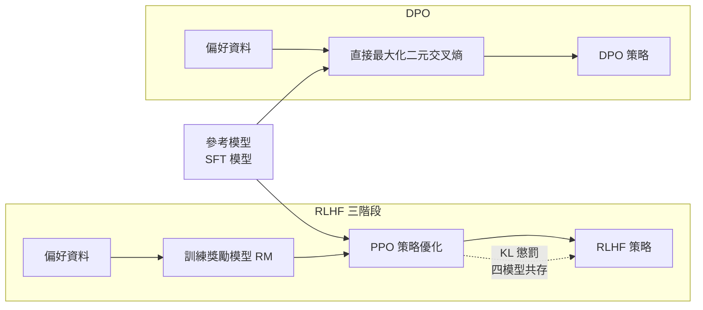

# 8.2 2023 年代：直接偏好優化（DPO）與無獎勵對齊數學推導

## 前言：把強化學習整段拿掉

2022 年底，RLHF 已經成為業界事實上的標準做法，而它的代價也開始累積。訓練一次要同時養活四個模型，流程難以重現，容易陷入獎勵駭入的惡性循環，而且整條鏈路都建立在一個不完美的獎勵模型之上。就在這樣的背景下，2023 年的《Direct Preference Optimization: Your Language Model is Secretly a Reward Model》提出了一個極為大膽的主張：**既然目標只是讓最終策略更受偏好，那麼中間的獎勵模型與 PPO 訓練都不是必要的。**

這個主張之所以聽起來離譜，是因為在直覺上，強化學習是一種「過程性」的學習方法：模型要自己去嘗試、去探索、去接收回報，行為的改善是沿途累積的結果。若能直接跳到終點、由最終結果反推參數，那豈不是把探索的價值也一併丟棄了？DPO 論文的回答是：不是丟棄，而是**把探索階段的結果解析地代換成一個封閉式的目標函數**。本章將從 RLHF 的最佳回應條件出發，逐步推導出 DPO 的損失函數，並說明這個「代換」在數學上為何成立。

還有一個背景必須交代清楚：DPO 出現的時間點，正好是 ChatGPT 釋出後兩年，整個產業都在尋找「不訓練也能對齊」的路徑。市場對 RLHF 的評價是分裂的——它的效果毋庸置疑，但它的可重現性、穩定性與硬體門檻都讓許多人懷疑這是不是唯一的答案。另一個驅動力則來自學術界：RLHF 的理論分析極為困難，因為目標函數中同時出現隨機策略、對偶變數、以及一個獨立的獎勵模型；要證明收斂性或給出泛化界限，幾乎無從下手。DPO 的貢獻之一，正是把這個混亂的問題化約成一個類似邏輯迴歸的封閉式最佳化問題，讓它第一次可以被寫在紙上做推導。

## RLHF 的目標與最佳回應條件

先把 8.1 節的目標函數寫清楚。RLHF 求解的是一個帶 KL 約束的獎勵最大化問題：

$$
\max_{\pi_\theta}\ \mathbb{E}_{x \sim \mathcal{D},\, y \sim \pi_\theta(\cdot \mid x)}\left[ r_\phi(x, y) \right] - \beta\, \mathbb{E}_{x}\left[ \mathrm{KL}\left( \pi_\theta(\cdot \mid x) \,\|\, \pi_{\text{ref}}(\cdot \mid x) \right) \right]
$$

其中 $ \pi_{\text{ref}} $ 是參考模型， $ \beta $ 是對齊強度。這個帶約束的問題有一個漂亮的解法：引入一個 Lagrange 乘子並對策略求最優值，得到的最佳回應策略具有一個指數加權的形式：

$$
\pi^*(y \mid x) = \frac{1}{Z(x)} \pi_{\text{ref}}(y \mid x) \exp\left( \frac{1}{\beta} r_\phi(x, y) \right)
$$

取對數可得關鍵的一行：

$$
\log \pi^*(y \mid x) = \log \pi_{\text{ref}}(y \mid x) + \frac{1}{\beta} r_\phi(x, y) - \log Z(x)
$$

這個式子說明了一件重要的事：**最佳策略、參考策略與獎勵之間存在一個可以直接反解的關係。** 也就是說，只要知道策略與參考策略的對數機率比，就能反推出隱含的獎勵。論文的標題「你的語言模型其實就是一個獎勵模型」正是指這件事。

## 從最佳回應到偏好機率

接著把 Bradley-Terry 偏好模型套進去。這個步驟是整篇論文的樞紐，因為它把「獎勵」這個連續量轉換成了「偏好勝率」這個可觀測量。在最佳回應策略下，偏好勝率可以寫成：

$$
P(y_w \succ y_l \mid x) = \sigma\left( \beta \log \frac{\pi^*(y_w \mid x)}{\pi_{\text{ref}}(y_w \mid x)} - \beta \log \frac{\pi^*(y_l \mid x)}{\pi_{\text{ref}}(y_l \mid x)} \right)
$$

注意右邊不再出現 $ r_\phi $ 與配分函數 $ Z(x) $ ：因為兩邊相減時 $ Z(x) $ 恰好抵消。而 $ \pi^* $ 又可以用待訓練的 $ \pi_\theta $ 取代——這一步是合法而關鍵的，因為最優化過程本來就是要把 $ \pi_\theta $ 推向 $ \pi^* $ 。於是 Bradley-Terry 的似然函數完全由策略本身寫成，獎勵模型從此不復存在。

## DPO 的目標函數

把上式取負對數，得到 DPO 的損失函數：

$$
\mathcal{L}_{\text{DPO}}(\theta) = -\mathbb{E}_{(x, y_w, y_l)}\left[ \log \sigma\left( \beta \log \frac{\pi_\theta(y_w \mid x)}{\pi_{\text{ref}}(y_w \mid x)} - \beta \log \frac{\pi_\theta(y_l \mid x)}{\pi_{\text{ref}}(y_l \mid x)} \right) \right]
$$

這個式子可以拆成三個部分來理解，每一部分都對應一個明確的設計意圖。

先看一個容易被忽略但極重要的技術細節：機率比是**整段序列的機率**，也就是把自回歸分解展開後所有詞元條件機率的乘積：

$$
\frac{\pi_\theta(y_w \mid x)}{\pi_{\text{ref}}(y_w \mid x)} = \prod_{t=1}^{T_w} \frac{\pi_\theta(y_w^t \mid x, y_w^{<t})}{\pi_{\text{ref}}(y_w^t \mid x, y_w^{<t})}
$$

這個展開式說明 DPO 的梯度會作用到序列中的每一個位置，而不是像一般 SFT 那樣把序列當成整塊處理。對偏好資料中那些「被選中的回答裡特別出色的片段」，模型會被直接鼓勵提高其機率；對被拒絕回答裡的問題片段，模型會被懲罰。這是 DPO 能夠做「片段級信用分配」的技術基礎。

**第一部分是隱式獎勵。** 括號內的差值正是隱式獎勵之差： $ r_\theta(x, y) = \beta \log \frac{\pi_\theta(y \mid x)}{\pi_{\text{ref}}(y \mid x)} $ 。這意味著我們並非「沒有獎勵」，而是不再另外訓練一個獎勵模型，而是讓策略的對數機率相對參考模型的偏移**扮演**獎勵的角色。參考模型因此被重新詮釋：它不是 KL 懲罰的計算對象，而是獎勵的原點與尺度。

**第二部分是參考模型作為 KL 錨點。** 8.1 節提到 KL 項是防止策略漂移的護欄；DPO 把這個護欄從「目標函數中的一個附加項」內建成「機率比的分母」。當 $ \pi_\theta $ 遠離 $ \pi_{\text{ref}} $ 時，機率比迅速變大，隱式獎勵被放大，優化就會把策略拉回來。這是一個更強的形式：它不只是懲罰偏移，而是讓偏移直接決定獎勵的大小。

**第三部分是 $ \beta $ 控制對齊強度。** $ \beta $ 越大，隱式獎勵的尺度越大，模型被允許偏離參考模型的程度越小，輸出因此更保守、更貼近參考策略； $ \beta $ 越小，則允許更劇烈的改變。在極限 $ \beta \to \infty $ 時策略幾乎不動，在極限 $ \beta \to 0 $ 時模型只求最大化勝率而完全脫離參考模型。這個旋鈕讓單一超參數就能控制「保守」與「進取」之間的取捨。

## 逐項比較：兩條路線的目標函數

把兩者並排放置，差異會顯得格外清楚。

| 比較項目 | RLHF (PPO) | DPO |
| --- | --- | --- |
| 需要的模型 | 策略、參考、critic、獎勵模型 | 策略、參考 |
| 偏好資料用法 | 訓練 RM，再以 RM 分數為獎勵 | 直接作為交叉熵標籤 |
| 目標形式 | 期望獎勵減 KL 散度 | 序列級二元交叉熵 |
| 是否需要 rollout | 需要，即時採樣並推論 | 不需要，離線資料即可 |
| 訓練過程 | 多階段、有隨機性 | 單一階段、接近確定性 |
| 主要失敗模式 | 獎勵駭入、訓練不穩 | 過擬合偏好、對負例敏感 |
| 記憶體需求 | 高 | 低 |

這張表也回答了 DPO 為何在工程上受到歡迎：它把一個三階段、含隨機性的分散式流程，壓縮成了一個類似一般監督微調的單一階段流程。實驗室報告顯示，在相同的偏好資料量下，DPO 的訓練時間可以比 PPO 少上一個數量級，而且最終模型在人工評測中往往更受偏好。

## DPO 的特別之處

DPO 的特別之處可以歸納為三句話。

**第一，它把序列級的分類問題重新表述。** 傳統的指令微調把每個示範當作獨立樣本，用下一詞交叉熵去擬合示範答案；這等於要求模型精確重現某一種寫法。DPO 則把整段回答當作一個分類單位，在「兩個完整的序列」之間做偏好判斷。於是模型不必學會某種特定措辭，只要學會在兩個序列之間拉開機率差距即可。這個重新表述讓「品質」這種模糊概念第一次被放進交叉熵的框架裡。

**第二，損失函數是標準的二元交叉熵。** 它與分類任務的形式完全相同，因此所有既有的優化器、正則化技巧、早停策略、學習率排程都可以直接沿用。這也是它能夠被工業社群迅速接納的技術原因。

**第三，它把探索的成本交給了別人。** PPO 必須自己 rollout、自己評分、自己承擔探索的風險；DPO 直接假設已經有人把「好答案」和「壞答案」配好了。因此資料的品質成為唯一的瓶頸。這個取捨聽起來划算，但把難題從演算法轉移到了資料。

值得留意的是「探索被外包」這件事的深遠影響。在 PPO 中，模型可以從完全不同的策略出發，沿著自己的路徑找到一個更好的解；在 DPO 中，模型只能在給定的對比之間調整偏好強度。這解釋了為什麼 DPO 在**風格與格式**這一類維度上表現極佳（格式偏好很容易配對），卻在**需要全新推理策略**的維度上難有突破（那需要探索）。同一個原理也說明了為什麼 10.1 節所談的推理時學習最終仍得回到帶 rollout 的強化學習。

## 實踐上的優勢與侷限

優勢前面已經列過：穩定、易實作、記憶體需求低、不需要 critic、不需要 rollout、同樣的偏好資料可以反覆用於多個實驗變體。這些優點讓小型團隊也能做前沿的對齊研究。

值得再強調的是訓練流程性質的改變。PPO 的每一個 batch 都要從當前策略採樣，因此**同一份偏好資料只能用一次**；重跑一次實驗會得到完全不同的模型行為。DPO 則是離線的、確定性的：給定相同的資料與初始化，訓練過程完全可重現，唯一的隨機性來自資料順序與 dropout。這種可重現性在科學研究上比聽起來更有價值——它意味著一個對齊方法的效果差異，可以被歸因到方法本身，而不是歸因到一次幸運的採樣。這是 DPO 在學術界迅速被接受的重要原因。

侷限同樣清晰。第一，**DPO 需要成對偏好資料**。若手上只有單一的「好答案」而沒有排序或比較，就必須先用獎勵模型或另一個模型來造出負例，等於把 RM 又請回來。第二，**DPO 無法利用環境反饋**。若某個任務的品質可以由客觀訊號判定（例如程式是否通過測試、數學答案是否正確），PPO 可以直接拿來當獎勵，而 DPO 的框架裡沒有容納這類即時訊號的位置。第三，**DPO 對負例的選擇極度敏感**。若負例來自同一個模型但明顯較差，模型學到的可能只是「不要學那樣寫」而非「要學得更好」；若負例來自完全不同的模型，差距過大又使分類過於簡單，梯度訊號微弱。第四，DPO 在理論上無法保證像 PPO 那樣探索到參考模型分布之外的更優策略。第五，DPO 在分佈外輸入上的表現可能退化，因為最佳回應公式只在偏好資料所覆蓋的區域內有理論保證。

## 後續變體

DPO 開啟了一條快速繁衍的支線。**IPO**（Identity Preference Optimization）針對 DPO 過度擬合的現象，觀察到偏好資料的機率在訓練中往往趨近於 1 而非停留在最優值，因而改以一個平方誤差式的目標把策略拉向一個平衡點。**KTO**（Kahneman-Tversky Optimization）針對偏好資料難以取得這個瓶頸，觀察到真實世界中大量存在的是「單一回答 + 好或壞標籤」而非成對比較，於是設計出只需單條反饋即可訓練的目標，並借用前景理論的價值函數形狀來分別處理正負樣本。**SimPO** 進一步簡化，直接移除參考模型，改用目標長度歸一化的獎勵與長度懲罰項來維持對齊。**ORPO** 走得更遠，把 SFT 與偏好最佳化合併成單一階段，用一個 odds-ratio 型的項來對比被選中與被拒絕序列的機率，連參考模型都不再需要。

另一條支線是**線上偏好優化**：把 DPO 的核心想法嵌回線上迴圈，用當前策略即時生成候選、由人類或更強的模型給出偏好、不斷以新偏好資料更新。這條路線也把「偏好」升級為多種訊號，例如 RLHF 的迭代版本、監督式微調與線上偏好混合的配方，以及讓模型自行產出反例再自我批評的循環。

線上化帶來一個關鍵的機制差異：偏好資料的分佈會隨著策略演化而移動。這意味著模型必須持續適應「自己目前的薄弱處」，而不是停留在某一批靜態資料上。這也讓「以模型自身產生的對比」成為一種自然的負例來源——因為策略在同一提示下的多次採樣，恰好提供了最貼近其當前分布的對照組。事實上，這正是 8.1 節所描述的 RLHF 迴圈所做的事，只不過獎勵的來源從「訓練好的獎勵模型」換成了「另一個更強的模型的判斷」，也就是所謂的 AI 反饋替代人類反饋（RLAIF）。這條支線最終匯入 10.1 節所討論的推理時學習。

## 從「對齊」到「可驗證獎勵」

在所有這些嘗試的深處，有一個更根本的轉向值得特別標出：**獎勵的來源正在從「人類偏好」移向「可客觀驗證的結果」。** 以程式碼為例，單元測試是否通過是一個二元且客觀的訊號；數學題的標準答案是否吻合、模擬的物理量是否守恆、資料庫查詢的結果集是否正確，也都是。這一方向常被稱為可驗證獎勵強化學習（RLVR），其推動力正是 RLHF 最大的弱點——**人類偏好是主觀的、有偏的，而且難以覆蓋到專業領域的細節。**

以程式生成為例，編譯成功與測試通過幾乎不依賴標註員的品味，一個完全沒有 RLHF 經驗的工程師只要寫好測試就能定義好壞。這種把獎勵定義從「人怎麼看」換成「世界怎麼運作」的轉移，意味著 8.1 節所描述的整個對齊流程，在某些領域裡可能會被完全繞開。

可驗證獎勵的價值不只在於客觀，更在於它能被自動產生於大規模。把「程式碼通過測試」當成獎勵，意味著每一次訓練迭代都能消耗掉數百萬個自動生成的任務，而這些任務不佔用任何標註員的人力。相較之下，人類偏好資料的生產速率有生理上限，而且每一條都需要付費。這個量級差距解釋了為什麼在數學推理與程式領域，RLVR 路線在短短兩年內就產出了超越人類水準的模型——**當獎勵的生成成本趨近於零時，強化學習的樣本效率就不再是瓶頸。**

但同一個趨勢也帶來新問題：可驗證的獎勵只覆蓋那些能被形式化的子任務，模型在那些任務上表現優秀，卻可能在無法驗證的邊界處失去約束。此外，可驗證獎勵容易引發另一種過度最佳化——模型學會讓測試通過而非真正解決問題。這條線索將在 8.3 節中以幻覺的形式重新出現。

## 小結

DPO 的歷史意義不在於它比 PPO 好，而在於它證明了一件更根本的事：**在對齊這個問題上，強化學習並非必要的。** 當目標是「讓模型更受偏好」而非「讓模型在環境中學習新技能」時，偏好資料本身就是足夠的訓練訊號，而最佳回應條件提供了從偏好到策略的直接橋樑。這條路徑把對齊從一門需要重型基礎設施的工程，變成了一門需要好資料的工程——資料的重要性因此再次被推高。

8.3 節將轉向一個更難纏的問題：**就算模型被完美地對齊了，它仍可能在說謊。** 偏好對齊讓模型學會「用什麼語氣說話」，卻沒有教它「說的內容是否為真」。幻覺、安全護欄與可解釋性的討論，正是要處理這個殘餘的缺口。

## 參考文獻

- Rafailov, R., Sharma, A., Mitchell, E., et al. (2023). *Direct preference optimization: your language model is secretly a reward model*. NeurIPS.
- Ethayarajh, K., Xu, W., Muennighoff, N., et al. (2024). *KTO: model alignment as prospect theoretic optimization*. ICML.
- Meng, Y. et al. (2024). *SimPO: simple preference optimization with a reference-free reward*. ACL.
- Hong, J. et al. (2024). *ORPO: monotone preference optimization*. ICML.
- Chen, T. et al. (2021). *Evaluating large language models trained on code*. arXiv:2107.03374.
